# Executive Foundation: The Enterprise AI Constitution & Invariant Canon

---

## 🎯 Executive Overview & Constitutional Bedrock

Autonomous AI systems operating in high-stakes enterprise environments cannot rely on unconstrained natural language instructions. Prompt phrasing is inherently ambiguous and vulnerable to sycophancy, drift, and deceptive alignment.

The **Enterprise AI Constitution** establishes the non-negotiable legal and architectural bedrock of the Context Factory. It codifies the **10 Inviolable Commandments** and the **22 Canonical Invariants ($I_{01}$–$I_{22}$)** that govern every autonomous agent across all functional modules.

```
┌──────────────────────────────────────────────────────────────────────────────────────────────────┐
│                      THE 5 INVARIANT CLASSES OF THE CONSTITUTION                                 │
├────────────────────┬───────────────────────────────────┬─────────────────────────────────────────┤
│ Invariant Class    │ Scope & Objective                 │ Enforcement Mechanism                   │
├────────────────────┼───────────────────────────────────┼─────────────────────────────────────────┤
│ 1. HARD-SAFETY     │ Biological & capital preservation │ Pre-Action Plausibility Bands ($I_{02}$) │
│ 2. MATH-BOUND      │ Statistical & domain bounds       │ Condition numbers, DSR, and decay ($I_{11}$)│
│ 3. SCHEMA-PARITY   │ Database & DTO integrity          │ Dual-Schema Parity & WAL Mode ($I_{13}$)│
│ 4. CONTEXT-ISOLATE │ Blast radius & attention defense  │ 400 LOC ceiling & 80-line views ($I_{16}$)│
│ 5. CODE-HYGIENE    │ Anti-deception & zero-drift       │ AST Zero-Mock Rules ZM001-ZM009 ($I_{22}$)│
└────────────────────┴───────────────────────────────────┴─────────────────────────────────────────┘
```

---

## 📜 The 10 Inviolable Commandments of Enterprise AI

1. **Thou Shalt Not Smuggle Synthetic Mocks**: Production pipelines must never return hardcoded stubs or mock telemetry (Invariant $I_{01}$).
2. **Thou Shalt Bound Every Physical Action**: Every mutation must be clamped by statistical plausibility bands before execution (Invariant $I_{02}$).
3. **Thou Shalt Isolate Fatal Contagion**: A single critical hazard must immediately halt execution regardless of other metrics (Invariant $I_{03}$).
4. **Thou Shalt Not Hard Delete**: Corrupted or disputed state must be soft-tagged and tombstoned to immutable quarantine (Invariant $I_{04}$).
5. **Thou Shalt Decouple Decision from Narrative**: Epistemic normalizers must strip promotional hype and apply an 80% commercial discount (Invariant $I_{05}$).
6. **Thou Shalt Attenuate Stale Evidence**: Observations decay continuously according to exponential half-life kinetics (Invariant $I_{17}$).
7. **Thou Shalt Reject Conjunctive Paralysis**: Decision gates must use Compensatory Confluence across orthogonal pillars (Invariant $I_{09}$).
8. **Thou Shalt Respect the Modularity Ceiling**: No code module may exceed 400 physical lines of code (Invariant $I_{16}$).
9. **Thou Shalt Anchor Invariants Cryptographically**: Core invariants must be bound by checksummed SHA1 comment anchors (Invariant $I_{22}$).
10. **Thou Shalt Cryptographically Attest Every Output**: Every agent output must carry an SPDX 3.0 AI-SBOM header with UUIDv4 lineage (Invariant $I_{15}$).

---

## 🏛️ The 22 Canonical Invariants ($I_{01}$–$I_{22}$)

| ID | Name | Class | Governing Invariant Predicate | Enforcing Module | Verification Test |
|:---|:---|:---|:---|:---|:---|
| **$I_{01}$** | **Zero-Simulated-Data** | `HARD-SAFETY` | $\forall d \in \text{Prod}: d \notin \text{Synthetic} \land \text{finite}(d)$ | `04_TEST`, `06_01` | `test_zero_mock_runtime_breaker` |
| **$I_{02}$** | **Plausibility Band** | `HARD-SAFETY` | $|P_{\text{exec}} - \text{Baseline}| \le \min(\Delta_{\text{dyn}}, \Delta_{\text{max}})$ | `03_06`, `06_02` | `test_dual_use_pre_action_band` |
| **$I_{03}$** | **Fatal Contagion Veto**| `HARD-SAFETY` | $\text{Hazard} = \text{True} \implies \text{Verdict} = \text{HALT}$ | `04_02`, `09_02` | `test_crisis_4_replay_paralysis` |
| **$I_{04}$** | **Immutable Quarantine**| `HARD-SAFETY` | $\forall r \in \text{Ledger}: \mathrm{DELETE}(r) = \emptyset$ | `06_01`, `08_LAB` | `test_cross_channel_audit_table` |
| **$I_{05}$** | **Epistemic Air-Gap** | `HARD-SAFETY` | $W_{\text{eff}} = W_{\text{raw}} \cdot 0.20 \land \text{airgapped}$ | `02_02`, `09_05` | `test_crisis_5_replay_priming` |
| **$I_{06}$** | **Logit Bound Clamp** | `MATH-BOUND` | $P \in [\epsilon, 1-\epsilon] \implies |\mathrm{logit}(P)| \le 13.815$ | `09_02` | `test_div_by_zero_logit_boundary`|
| **$I_{07}$** | **Div-by-Zero Safety** | `MATH-BOUND` | $\forall a/b: b = 0 \implies \text{fallback}(\epsilon)$ | `03_02`, `04_02` | `test_div_by_zero_entropy` |
| **$I_{08}$** | **Growth Hurdle** | `MATH-BOUND` | $\text{EGR} = \text{Yield} + \min(g, 0.25) \ge r_{\text{hurdle}}$ | `04_02` | `test_growth_adjusted_hurdle` |
| **$I_{09}$** | **Compensatory Flow** | `MATH-BOUND` | $\sum_{j=1}^4 \mathbb{I}(S_j \ge 0.35) \ge 2 \land \neg \text{Veto}$ | `02_03`, `09_02` | `test_confluence_formulation` |
| **$I_{10}$** | **Prior Integrity** | `MATH-BOUND` | $\alpha, \beta \ge 0.50$ across discrete action arms | `09_02` | `test_bandit_prior_integrity` |
| **$I_{11}$** | **Covariance Bound** | `MATH-BOUND` | $\mathrm{cond}(\mathbf{\Sigma}_{\text{LW}}) \le 10^{12}$ | `09_05` | `test_condition_number_scaling` |
| **$I_{12}$** | **Conformal Coverage** | `MATH-BOUND` | $\text{BandWidth}(V_{\text{High}}) \ge \text{BandWidth}(V_{\text{Low}})$ | `04_TEST`, `06_02` | `test_conformal_coverage` |
| **$I_{13}$** | **Dual-Schema Parity** | `SCHEMA-PARITY` | $\text{Schema}_{\text{SQL}} \equiv \text{Schema}_{\text{DTO}}$ | `03_04`, `05_04` | `test_schema_parity` |
| **$I_{14}$** | **SQLite WAL Mode** | `SCHEMA-PARITY` | $\text{journal-mode}=\text{WAL} \land \text{busy-timeout}=30\text{s}$ | `03_04` | `test_wal_mode_concurrency` |
| **$I_{15}$** | **AI-SBOM Lineage** | `SCHEMA-PARITY` | $\text{UUIDv4} \land \text{GitDigest} \land \text{SPDX-3.0}$ | `05_05`, `08_LAB` | `test_ai_sbom_traceability` |
| **$I_{16}$** | **Modularity Ceiling** | `CONTEXT-ISOL` | $\text{LOC}_{\text{file}} \le 400 \land \text{RefactorTrigger}=350$ | `03_03`, `05_03` | `test_adr016_loc_counter` |
| **$I_{17}$** | **Horizon Decay** | `CONTEXT-ISOL` | $w(\Delta t) = w_0 \cdot 2^{-\Delta t / t_{1/2}} \land (\Delta t > 2t_{1/2} \to \text{EXP})$| `02_02`, `03_02` | `test_half_life_decay` |
| **$I_{18}$** | **Surgical Context** | `CONTEXT-ISOL` | $\text{ViewWindow} \le 80 \text{ lines} \land \text{Tokens} < 2,500$ | `03_04`, `09_04` | `test_context_budget_bound` |
| **$I_{19}$** | **Hermetic Isolation** | `CODE-HYGIENE` | Sockets blocked during CI testing (`pytest-socket`) | `04_02`, `08_LAB` | `test_socket_isolation` |
| **$I_{20}$** | **Deterministic Seeds** | `CODE-HYGIENE` | $\text{Seed}=42 \land \text{Temperature}=0.0$ | `05_01`, `09_01` | `test_deterministic_repro` |
| **$I_{21}$** | **Micro-USD Quota** | `CODE-HYGIENE` | $\text{Spend}_{24\text{h}} \le 400,000\,\mu\text{USD}$ ($0.40/day) | `01_03`, `03_02` | `test_micro_usd_spend_limit` |
| **$I_{22}$** | **Registry Parity** | `CODE-HYGIENE` | $\Delta(\text{AST}, \text{Registries}) = \emptyset$ | `03_04`, `05_05` | `test_zero_drift_pre_commit` |

---

## 📋 Cross-Chapter Constitutional Integration Map

```mermaid
flowchart TD
    CONST["Enterprise AI Constitution (00_ENTERPRISE_CONSTITUTION.md)"]
    
    CONST --> M1["Phase 01: Strategy & Vision (Pillars 1 & 2, Invariant I21)"]
    CONST --> M2["Phase 02: Requirements & Design (Invariants I03, I05, I09, I17)"]
    CONST --> M3["Phase 03: Building & Coding (Invariants I02, I13, I14, I16, I18, I22)"]
    CONST --> M4["Phase 04: Testing & Validation (Invariants I01, I08, I10, I12, I19)"]
    CONST --> M5["Phase 05: Deployment & BuilderOps (Invariants I15, I16, I20, I22)"]
    CONST --> M6["Phase 06: Security & Compliance (Invariants I01, I02, I04, I05)"]
    CONST --> M7["Phase 07: Agile Team Process & Flow (DORA Telemetry & CDR Quotas)"]
    CONST --> M8["Phase 08: Final Capstone Assembly (Dual-Track Agent Certification)"]
    CONST --> M9["Phase 09: Agent Orchestration (Invariants I06, I07, I09, I11, I18)"]

    style CONST fill:#f8f9fa,stroke:#343a40,stroke-width:3px;
    style M1 fill:#e8f4f8,stroke:#17a2b8,stroke-width:1.5px;
    style M2 fill:#e8f4f8,stroke:#17a2b8,stroke-width:1.5px;
    style M3 fill:#e8f4f8,stroke:#17a2b8,stroke-width:1.5px;
    style M4 fill:#e8f4f8,stroke:#17a2b8,stroke-width:1.5px;
    style M5 fill:#e8f4f8,stroke:#17a2b8,stroke-width:1.5px;
    style M6 fill:#e8f4f8,stroke:#17a2b8,stroke-width:1.5px;
    style M7 fill:#e8f4f8,stroke:#17a2b8,stroke-width:1.5px;
    style M8 fill:#d4edda,stroke:#28a745,stroke-width:2px;
    style M9 fill:#fef9e7,stroke:#ffc107,stroke-width:1.5px;
```



---

[**Proceed to The 3-Tier Context Pipeline →**](./00_THE_CONTEXT_PIPELINE.md) | [**Return to Main Curriculum Hub →**](./README.md)
