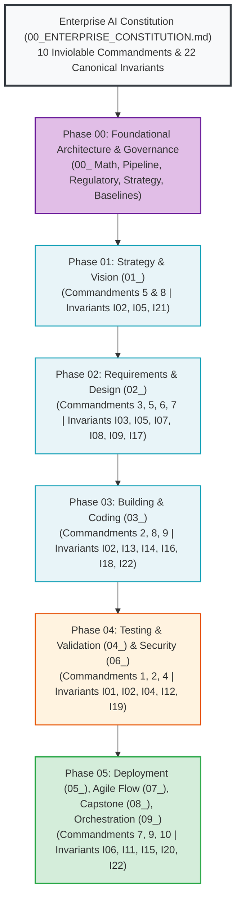

# Executive Foundation: The Enterprise AI Constitution & Invariant Canon

---

## 🎯 Executive Overview & Constitutional Bedrock

Autonomous AI systems operating in high-stakes enterprise environments cannot rely on unconstrained natural language instructions. Prompt phrasing is inherently ambiguous and vulnerable to sycophancy, drift, and deceptive alignment.

The **Enterprise AI Constitution** establishes the non-negotiable legal and architectural bedrock of the Context Factory. It codifies the **10 Inviolable Commandments** and the **22 Canonical Invariants ($I_{01}$–$I_{22}$)** that govern every autonomous agent across all functional modules.

```
┌──────────────────────────────────────────────────────────────────────────────────────────────────┐
│                      THE 5 INVARIANT CLASSES OF THE CONSTITUTION                                 │
├────────────────────┬───────────────────────────────────┬─────────────────────────────────────────┤
│ Invariant Class    │ Scope & Objective                 │ Enforcement Mechanism                   │
├────────────────────┼───────────────────────────────────┼─────────────────────────────────────────┤
│ 1. HARD-SAFETY     │ Biological & capital preservation │ Pre-Action Plausibility Bands ($I_{02}$) │
│ 2. MATH-BOUND      │ Statistical & domain bounds       │ Condition numbers, DSR, and decay ($I_{11}$)│
│ 3. SCHEMA-PARITY   │ Database & DTO integrity          │ Dual-Schema Parity & WAL Mode ($I_{13}$)│
│ 4. CONTEXT-ISOLATE │ Blast radius & attention defense  │ 400 LOC ceiling & AST scoped views ($I_{16}$)│
│ 5. CODE-HYGIENE    │ Anti-deception & zero-drift       │ AST Zero-Mock Rules ZM001-ZM009 ($I_{22}$)│
└────────────────────┴───────────────────────────────────┴─────────────────────────────────────────┘
```

---

## 📜 The 10 Inviolable Commandments of Enterprise AI

1. **Thou Shalt Not Smuggle Synthetic Mocks**: Production pipelines must never return hardcoded stubs or mock telemetry (Invariant $I_{01}$).
2. **Thou Shalt Bound Every Physical Action**: Every mutation must be clamped by statistical plausibility bands before execution (Invariant $I_{02}$).
3. **Thou Shalt Isolate Fatal Contagion**: A single critical hazard must immediately halt execution regardless of other metrics (Invariant $I_{03}$).
4. **Thou Shalt Not Hard Delete**: Corrupted or disputed state must be soft-tagged and tombstoned to immutable quarantine (Invariant $I_{04}$).
5. **Thou Shalt Decouple Decision from Narrative**: Epistemic normalizers must strip promotional hype and apply an 80% commercial discount (Invariant $I_{05}$).
6. **Thou Shalt Attenuate Stale Evidence**: Observations decay continuously according to exponential half-life kinetics (Invariant $I_{17}$).
7. **Thou Shalt Reject Conjunctive Paralysis**: Decision gates must use Compensatory Confluence across orthogonal pillars (Invariant $I_{09}$).
8. **Thou Shalt Respect the Modularity Heuristic**: Code modules should target $\le 400$ lines of code grounded in Single Responsibility Principle (SRP) and cognitive maintainability, allowing atomic bug fixes while discouraging feature sprawl (Invariant $I_{16}$).
9. **Thou Shalt Anchor Invariants Cryptographically**: Core invariants must be bound by checksummed SHA1 comment anchors (Invariant $I_{22}$).
10. **Thou Shalt Cryptographically Attest Every Output**: Every agent output must carry an SPDX 3.0 AI-SBOM header with UUIDv4 lineage (Invariant $I_{15}$).

---

## 🏛️ The 22 Canonical Invariants ($I_{01}$–$I_{22}$)

| ID | Name | Class | Governing Invariant Predicate | Enforcing Module | Verification Test |
|:---|:---|:---|:---|:---|:---|
| **$I_{01}$** | **Zero-Simulated-Data** | `HARD-SAFETY` | $\forall d \in \text{Prod}: d \notin \text{Synthetic} \land \text{finite}(d)$ | `04_TEST`, `06_01` | `test_zero_mock_runtime_breaker` |
| **$I_{02}$** | **Plausibility Band** | `HARD-SAFETY` | $\lvert P_{\text{exec}} - \text{Baseline} \rvert \le \min(\Delta_{\text{dyn}}, \Delta_{\text{max}})$ | `03_06`, `06_02` | `test_dual_use_pre_action_band` |
| **$I_{03}$** | **Fatal Contagion Veto**| `HARD-SAFETY` | $\text{Hazard} = \text{True} \implies \text{Verdict} = \text{HALT}$ | `04_02`, `09_02` | `test_crisis_4_replay_paralysis` |
| **$I_{04}$** | **Immutable Quarantine**| `HARD-SAFETY` | $\forall r \in \text{Ledger}: \mathrm{DELETE}(r) = \emptyset$ | `06_01`, `08_LAB` | `test_cross_channel_audit_table` |
| **$I_{05}$** | **Epistemic Air-Gap** | `HARD-SAFETY` | $W_{\text{eff}} = W_{\text{raw}} \cdot 0.20 \land \text{airgapped}$ | `02_02`, `09_05` | `test_crisis_5_replay_priming` |
| **$I_{06}$** | **Logit Bound Clamp** | `MATH-BOUND` | $P \in [\epsilon, 1-\epsilon] \implies \lvert \mathrm{logit}(P) \rvert \le 13.815$ | `09_02` | `test_div_by_zero_logit_boundary`|
| **$I_{07}$** | **Div-by-Zero Safety** | `MATH-BOUND` | $\forall a/b: b = 0 \implies \text{fallback}(\epsilon)$ | `03_02`, `04_02` | `test_div_by_zero_entropy` |
| **$I_{08}$** | **Growth Hurdle** | `MATH-BOUND` | $\text{EGR} = \text{Yield} + \min(g, 0.25) \ge r_{\text{hurdle}}$ | `04_02` | `test_growth_adjusted_hurdle` |
| **$I_{09}$** | **Compensatory Flow** | `MATH-BOUND` | $\sum_{j=1}^4 \mathbb{I}(S_j \ge 0.35) \ge 2 \land \neg \text{Veto}$ | `02_03`, `09_02` | `test_confluence_formulation` |
| **$I_{10}$** | **Prior Integrity** | `MATH-BOUND` | $\alpha, \beta \ge 0.50$ across discrete action arms | `09_02` | `test_bandit_prior_integrity` |
| **$I_{11}$** | **Covariance Bound** | `MATH-BOUND` | $\mathrm{cond}(\mathbf{\Sigma}_{\text{LW}}) \le 10^{12}$ | `09_05` | `test_condition_number_scaling` |
| **$I_{12}$** | **Conformal Coverage** | `MATH-BOUND` | $\text{BandWidth}(V_{\text{High}}) \ge \text{BandWidth}(V_{\text{Low}})$ | `04_TEST`, `06_02` | `test_conformal_coverage` |
| **$I_{13}$** | **Dual-Schema Parity** | `SCHEMA-PARITY` | $\text{Schema}_{\text{SQL}} \equiv \text{Schema}_{\text{DTO}}$ | `03_04`, `05_04` | `test_schema_parity` |
| **$I_{14}$** | **SQLite WAL Mode** | `SCHEMA-PARITY` | $\text{journal-mode}=\text{WAL} \land \text{busy-timeout}=30\text{s}$ | `03_04` | `test_wal_mode_concurrency` |
| **$I_{15}$** | **AI-SBOM Lineage** | `SCHEMA-PARITY` | $\text{UUIDv4} \land \text{GitDigest} \land \text{SPDX-3.0}$ | `05_05`, `08_LAB` | `test_ai_sbom_traceability` |
| **$I_{16}$** | **Modularity Ceiling** | `CONTEXT-ISOL` | $\text{LOC}_{\text{file}} \le 400 \land \text{RefactorTrigger}=350$ | `03_03`, `05_03` | `test_adr016_loc_counter` |
| **$I_{17}$** | **Horizon Decay** | `CONTEXT-ISOL` | $w(\Delta t) = w_0 \cdot 2^{-\Delta t / t_{1/2}} \land (\Delta t > 2t_{1/2} \to \text{EXP})$| `02_02`, `03_02` | `test_half_life_decay` |
| **$I_{18}$** | **Surgical Context** | `CONTEXT-ISOL` | $\text{ViewWindow} \le \text{AST Scope} \land \text{Tokens} < 2,500$ | `03_04`, `09_04` | `test_context_budget_bound` |
| **$I_{19}$** | **Hermetic Isolation** | `CODE-HYGIENE` | Sockets blocked during CI testing (`pytest-socket`) | `04_02`, `08_LAB` | `test_socket_isolation` |
| **$I_{20}$** | **Deterministic Seeds** | `CODE-HYGIENE` | $\text{Seed}=42 \land \text{Temperature}=0.0$ | `05_01`, `09_01` | `test_deterministic_repro` |
| **$I_{21}$** | **Micro-USD Quota** | `CODE-HYGIENE` | $\text{Spend}_{24\text{h}} \le 400,000\,\mu\text{USD}$ (\$0.40/day) | `01_03`, `03_02` | `test_micro_usd_spend_limit` |
| **$I_{22}$** | **Registry Parity** | `CODE-HYGIENE` | $\Delta(\text{AST}, \text{Registries}) = \emptyset$ | `03_04`, `05_05` | `test_zero_drift_pre_commit` |

---

## 📋 Cross-Chapter Constitutional Integration Map

The **10 Inviolable Commandments** and **22 Canonical Invariants** govern every stage of the autonomous engineering lifecycle. To ensure seamless traceability, the curriculum organizes implementation into **6 Milestones (Phases)** spanning Chapters `00_` through `09_`:

### 1. The 6 Enterprise Lifecycle Milestones & Chapter Mapping

| Milestone / Phase | Operational Focus & Lifecycle Stage | Curriculum Modules | Governing Commandments & Invariants | Key Foundational Deliverables |
|:---|:---|:---|:---|:---|
| **Phase 00: Foundations & Risk Architecture** | Mathematical risk foundations, regulatory governance, token economics, and Day Zero baseline metrics. | `00_THE_MATHEMATICS_OF_AI_RISK.md`<br>`00_ENTERPRISE_CONSTITUTION.md`<br>`00_THE_CONTEXT_PIPELINE.md`<br>`00_REGULATORY_MODEL_GOVERNANCE.md`<br>`00_EXECUTIVE_ALIGNMENT_STRATEGY.md`<br>`00_PREREQUISITES_AND_BASELINES.md` | Commandments 1–10<br>(Invariants $I_{01}$–$I_{22}$) | Bedrock Constitution, AI-SBOM spec, Regulatory Compliance Matrix, 80% Commercial Discount, Living Context Compiler. |
| **Phase 01: Strategy & Vision** | Strategic decomposition, business value modeling, and executive guardrails. | `01_strategy_and_vision/` | Commandment 5 (Epistemic air-gap)<br>Commandment 8 (Modularity)<br>(Invariants $I_{02}, I_{05}, I_{21}$) | Bounded Epics, Micro-USD token quotas ($400,000\,\mu\text{USD}$/day), value stream mapping. |
| **Phase 02: Requirements & Design** | 3-Part Directives (Role, Task, Format), Semantic Blueprints, and 20 pre-condition edge cases. | `02_requirements_and_design/` | Commandment 3 (Fatal veto)<br>Commandment 5 (Commercial discount)<br>Commandment 6 (Horizon decay)<br>Commandment 7 (Confluence)<br>(Invariants $I_{03}, I_{05}, I_{07}, I_{08}, I_{09}, I_{17}$) | Unidirectional Epistemic Air-Gap, 80% commercial discount filters, typed closed-world schemas. |
| **Phase 03: Building & Coding** | Living Context compilation, AST state/math registries, and modular software construction. | `03_building_and_coding/` | Commandment 2 (Plausibility bands)<br>Commandment 8 (400 LOC ceiling)<br>Commandment 9 (SHA1 anchors)<br>(Invariants $I_{02}, I_{07}, I_{13}, I_{14}, I_{16}, I_{18}, I_{22}$) | `STATE_REGISTRY.md`, `MATHEMATICAL_REGISTRY.md`, `living_context.json` (<1,500 tokens), zero-drift pre-commit chains. |
| **Phase 04: Testing & Security** | Zero-mock code scanning, socket isolation, regulatory red-teaming, and model risk audit. | `04_testing_and_validation/`<br>`06_security_and_compliance/` | Commandment 1 (Zero mocks)<br>Commandment 2 (Execution bounds)<br>Commandment 4 (Zero hard-deletes)<br>(Invariants $I_{01}, I_{02}, I_{03}, I_{04}, I_{10}, I_{12}, I_{19}$) | AST Zero-Mock Rules (ZM001–ZM009), hermetic `pytest-socket` sandbox, Deflated Sharpe Ratio ($\text{DSR} \ge 0.95$). |
| **Phase 05: Operations & Multi-Agent Orchestration** | CI drift monitoring, team velocity metrics, Dialectical Adversarial Triads, and capstone assembly. | `05_deployment_and_operations/`<br>`07_team_process_and_flow/`<br>`08_final_capstone_project/`<br>`09_ai_agent_orchestration/` | Commandment 7 (Dialectical confluence)<br>Commandment 9 (Cryptographic anchors)<br>Commandment 10 (AI-SBOM provenance)<br>(Invariants $I_{06}, I_{07}, I_{09}, I_{11}, I_{15}, I_{20}, I_{22}$) | CI zero-drift sentinels, AI-SBOM headers, DORA/SPACE telemetry, Convex debate solver, Level-2 \$0-compute JSD bypass. |

### 2. Constitutional Lifecycle Flow



---

## 🧭 Executive Reading Path: Navigating the 00_ Foundational Architecture

Before proceeding to tactical domain chapters (`01_` through `09_`), cross-functional teams must ground their domain practices in the complete **Phase 00 Foundational Suite**:

1. [**00_THE_MATHEMATICS_OF_AI_RISK.md**](./00_THE_MATHEMATICS_OF_AI_RISK.md)  
   *Mathematical Proofs:* Attention entropy $\mathcal{H}(A_i)$, U-shaped context loss $F(x)$, exponential half-life decay kinetics, conjunctive gate collapse (0.243%) vs. compensatory confluence, log-odds convex evidence fusion with JSD discounting, Ledoit-Wolf covariance shrinkage, and Deflated Sharpe Ratio.
2. [**00_ENTERPRISE_CONSTITUTION.md**](./00_ENTERPRISE_CONSTITUTION.md)  
   *Constitutional Bedrock:* The 10 Inviolable Commandments, 22 Canonical Invariants ($I_{01}$–$I_{22}$), Fail-Closed Telemetry Doctrine, and Immutable Quarantine Ledger. *(Current Document)*
3. [**00_THE_CONTEXT_PIPELINE.md**](./00_THE_CONTEXT_PIPELINE.md)  
   *Compilation Architecture:* 3-Tier Context Pipeline, AST State & Math Registries, living context compiler (`living_context.json` <1,500 tokens), and zero-drift pre-commit enforcement.
4. [**00_REGULATORY_MODEL_GOVERNANCE.md**](./00_REGULATORY_MODEL_GOVERNANCE.md)  
   *Statutory Compliance:* Mapping statutory mandates (FDA 21 CFR Part 820/11, Federal Reserve SR 11-7, FAA DO-178C Level A, and EU AI Act) to concrete engineering patterns and SPDX 3.0 AI-SBOM provenance.
5. [**00_EXECUTIVE_ALIGNMENT_STRATEGY.md**](./00_EXECUTIVE_ALIGNMENT_STRATEGY.md)  
   *C-Suite Strategy & Token Economics:* 85% to 95% token OpEx savings, Micro-USD quotas ($400,000\,\mu\text{USD}$/day), bounded task decomposition (<200 LOC blast radius), and the 120-day organizational transformation roadmap.
6. [**00_PREREQUISITES_AND_BASELINES.md**](./00_PREREQUISITES_AND_BASELINES.md)  
   *Day Zero Readiness Assessment:* Shadow AI elimination, 3 interaction maturity tiers, historical 90-day DORA and SPACE baseline telemetry extraction, and role-by-role readiness checklists.

---

[**Next in Phase 00: Proceed to The 3-Tier Context Pipeline Architecture →**](./00_THE_CONTEXT_PIPELINE.md) | [**Return to Main Curriculum Hub →**](./README.md)
