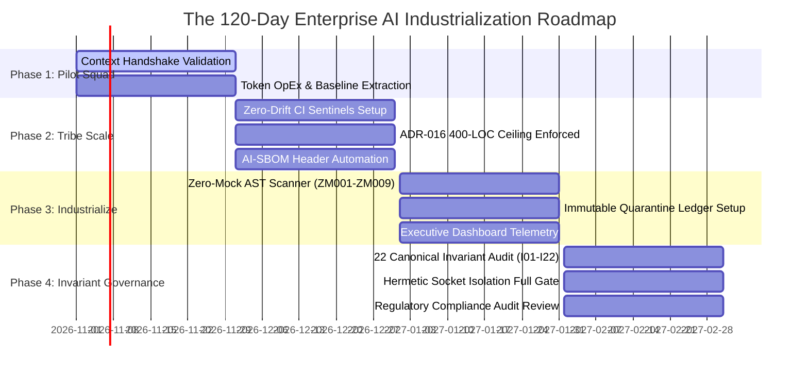

# Executive Alignment Strategy: Industrializing Enterprise Software with Autonomous AI

## Executive Summary: The Transition from Stochastic Chatbots to the Context Factory

For Chief Technology Officers (CTOs), Chief Information Officers (CIOs), and Engineering Vice Presidents, the initial wave of generative AI adoption has arrived at an inflection point. While individual engineers report subjective speedups when using AI chatbots for isolated scripts, enterprise engineering organizations frequently encounter an **"AI Productivity Cliff"** as repositories scale:

1. **The Context Cliff:** Large Language Models (LLMs) collapse in architectural precision when confronted with enterprise monoliths (>500,000 LOC), generating plausible-sounding code that hallucinates non-existent APIs, breaks database schemas, and erases critical error handling.
2. **Runaway Token OpEx:** Organizations bleed millions of dollars in inference costs by using "Monolithic Prompting"—dumping hundreds of thousands of raw repository tokens into massive context windows, only to suffer from information-theoretic attention dilution.
3. **Unmitigated Regulatory Exposure:** Un-audited generative AI pipelines fail to produce the objective verification, validation, and traceability evidence required by core regulatory and supervisory frameworks (FDA 21 CFR Part 820/11, Federal Reserve SR 11-7, FAA DO-178C Level A, and EU AI Act Regulation (EU) 2024/1689), exposing the enterprise to severe compliance and operational liabilities.

The **Context Factory** provides the executive blueprint to industrialize AI-assisted engineering. By replacing stochastic prompting with **AST-compiled living context**, **2-tier precision routing**, **cryptographic invariant anchors**, and **fail-closed circuit breakers**, the Context Factory converts AI from an uncontrollable operational liability into a deterministic, auditable software production engine.

---

## 1. The Financial Case: The Token Economy & ROI Analysis

In autonomous enterprise software engineering, **Context is Currency**. Inefficient context management directly inflates cloud infrastructure OpEx while degrading model reasoning.

```
Monolithic Prompting (Dump the Whole Repo):
   Tokens:  [ 500,000 Raw Context Tokens ] ──► Cost: $$$$ (High OpEx) ──► Accuracy: 35% (Diluted)

The Context Factory (2-Tier Precision Routing):
   Tokens:  [ 1,500 Minified AST Tokens ]  ──► Cost: $    (85% Savings) ──► Accuracy: 98% (Surgical)
```

### 1.1 Financial Comparison: Monolithic vs. Context Factory

| Operational Metric | Monolithic "Dump the Repo" Approach | The Context Factory Architecture | Executive ROI Impact |
|:---|:---|:---|:---|
| **Average Prompt Payload** | 250,000 to 500,000 tokens | 1,500 to 4,000 tokens (Surgical AST) | **85% to 95% reduction in token consumption** |
| **Inference Cost per Task** | \$2.50 to \$7.50 per agent turn | \$0.02 to \$0.10 per agent turn | **Multi-million-dollar annual OpEx reduction** |
| **Attention Fidelity** | High entropy ($\mathcal{H} \approx \ln N$); severe middle loss | Low entropy; zero "Lost in the Middle" rot | Drastic decline in defect remediation cycles |
| **API Rate-Limit Throttle** | Frequent HTTP 429 throttling; blocked queues | Zero throttling; bounded micro-USD spend | Predictable continuous CI/CD throughput |
| **Code Merge Success** | Low (<40% first-pass pass rate) | High (>90% first-pass pass rate) | Faster time-to-market with zero rework |

### 1.2 The Micro-USD Spend Ceiling & Daily Quota ($I_{21}$ / ADR-011)

To prevent runaway recursive agent loops from draining corporate budgets, the architecture enforces strict programmatic spend ceilings tracked in integer micro-USD ($\mu\text{USD}$):
- **Rolling 24-Hour Organization Quota:** Capped at $Q_{\text{limit}} = \$0.40/\text{day} = 400,000\,\mu\text{USD}$ per developer workspace.
- **Single-Feature Isolation Ceiling:** Capped at $Q_{\text{feature}} \le \$0.08/\text{day} = 80,000\,\mu\text{USD}$.
- When an agent's rolling expenditure approaches the quota, execution throttles automatically to zero-marginal-cost models (e.g., local small models or Gemini Flash), preventing unexpected billing spikes.

---

## 2. Managing the Cognitive Blast Radius: Bounded Task Decomposition

### 2.1 The Strategic Risk: Compounding Geometric Error ($p^n$)

As proven in [The Mathematics of AI Risk](./00_THE_MATHEMATICS_OF_AI_RISK.md), an autonomous agent operating at $95\%$ individual step accuracy across a 20-step monolithic epic has an aggregate success probability of only **$35.85\%$**:

$$\mathbb{P}_{\text{sequence}}(20) = (0.95)^{20} \approx 35.85\%$$

Allowing autonomous agents to execute large, unconstrained tasks ("Refactor the billing subsystem and update tests") guarantees cascading compound hallucinations.

### 2.2 Bounded Cognitive Units & Blast Radius Control

To eliminate cascading failure, leadership must mandate **Bounded Task Decomposition**:
1. **The 3-Module Scope Boundary:** An autonomous task must never touch more than 3 source modules in a single generation cycle.
2. **The 200-LOC Blast Radius:** No automated pull request may exceed 200 physical lines of code.
3. **The 4k-Token Working Memory Cap:** The agent's hydrated context window must not exceed 4,000 tokens, ensuring that all instructions reside within the high-fidelity Primacy Zone.
4. **Human Role-to-Role Circuit Breakers:** Every stage transition (Requirements $\to$ Implementation $\to$ Validation) acts as a mathematical circuit breaker, resetting the probability of compound hallucination back to $100\%$ before the next stage commences.

### 2.3 Context Debt vs. Technical Debt

Executive leadership is intimately familiar with *Technical Debt* (legacy code shortcuts, missing tests, un-patched vulnerabilities). In the AI era, engineering organizations face an even more insidious liability: **Context Debt**.

- **Definition of Context Debt:** The accumulation of stale Markdown documentation, obsolete ADRs, unindexed functions, monolithic files (>350 LOC), and conflicting prompt directives within a repository.
- **The Cost of Context Debt:** While human engineers can mentally filter out obsolete documentation, AI agents consume all provided context literally. Context debt deterministically induces model hallucinations, signature mismatches, and broken database queries.
- **Remediation:** The Context Factory treats context maintenance as an automated CI requirement. Pre-commit drift gates (`drift-monitor.yml`) ensure that documentation and AST registries reflect 100% byte-for-byte reality.

---

## 3. Cross-Functional Role Alignment Matrix

Industrializing software engineering with AI requires structured alignment across all five core disciplines. The table below defines the enterprise roles, their governing architectural invariants, primary operational artifacts, and core training curriculum:

| Enterprise Role | Operational Domain & Responsibilities | Governing Constitutional Invariants | Primary Operational Artifacts | Curriculum Path |
|:---|:---|:---|:---|:---|
| **Product Owners & Regulated Executives** | - Epistemic model risk governance<br>- Fail-closed business doctrine<br>- Regulatory compliance (FDA / SR 11-7 / EU AI Act)<br>- Zero hard-deletes & quarantine oversight | $I_{03}$ Fatal-Contagion Veto<br>$I_{04}$ Immutable Quarantine<br>$I_{15}$ UUID Traceability<br>$I_{21}$ Macro Gate | - Enterprise Constitution<br>- AI-SBOM Compliance Gate<br>- Immutable Quarantine Ledger<br>- Executive DORA Dashboards | `00_`<br>`01_strategy_and_vision` |
| **Business Analysts & Requirements Leads** | - 3-Part Directives (Role, Task, Format)<br>- Epistemic air-gapping of user feedback<br>- 80% commercial discount on vendor claims<br>- Semantic Blueprints with 20 edge cases | $I_{05}$ Closed-World Fallback<br>$I_{07}$ Div-by-Zero Domain<br>$I_{08}$ Growth Hurdle<br>$I_{20}$ Epistemic News Air-Gap | - Semantic Blueprints<br>- 20-Row Edge Case Matrix<br>- Machine-Readable Story Files (`/stories/`) | `02_requirements_and_design` |
| **System Architects & Software Engineers** | - ADR-016 400-LOC modular ceiling heuristic<br>- AST scoped surgical context windows<br>- AST State & Math Registry synchronization<br>- Living Context compilation (<1,500 tokens)<br>- SHA1 Invariant Anchor embedding | $I_{01}$ Zero-Simulated-Data<br>$I_{02}$ Execution Plausibility<br>$I_{06}$ MOS Bounds<br>$I_{11}$ Whitening Stability<br>$I_{22}$ 400-LOC Ceiling | - `STATE_REGISTRY.md`<br>- `MATHEMATICAL_REGISTRY.md`<br>- `data/openrouter_context.json`<br>- `# === INVARIANT-BLOCK` | `03_building_and_coding` |
| **Validation Leads & Quality Engineers** | - Programmatic AST Zero-Mock scanning<br>- Hermetic socket isolation enforcement<br>- Cryptographic SHA1 invariant verification<br>- Cartesian fault-injection fuzz testing<br>- 4-tier opaque-box verification suites | $I_{01}$ Zero-Simulated-Data<br>$I_{09}$ Compensatory Confluence<br>$I_{10}$ Bandit Priors<br>$I_{12}$ Conformal Coverage<br>$I_{22}$ Test Quality $\ge 90\%$ | - `scripts/scan_mock_data.py` (ZM001–ZM009)<br>- `tests/conftest.py` (`pytest-socket`)<br>- `verify_code_invariants.py`<br>- Conformal Fuzz Harnesses | `04_testing_and_validation`<br>`06_security_and_compliance` |
| **Scrum Masters & Agile Coaches** | - Bounded task decomposition (1-2 pts)<br>- Active Context Debt monitoring<br>- AI blast radius containment (<200 LOC)<br>- Tracking AI-assisted DORA & SPACE telemetry<br>- Guiding 120-day phased rollout roadmap | $I_{13}$ Remote-First Freshness<br>$I_{14}$ Cross-Channel Sync<br>$I_{16}$ Multi-Entity Isolation<br>$I_{17}$ Horizon-Matched Decay | - Context Debt Dashboard<br>- Sprint Refactoring Spikes (350 LOC trigger)<br>- Review Cognitive Load Logs<br>- DORA Incident Trackers | `07_team_process_and_flow` |

---

## 4. Executive Telemetry: DORA & SPACE Metrics in the AI Era

Measuring developer productivity in an AI-augmented organization requires updating standard DORA and SPACE metrics to account for code generation volume, review load, and epistemic drift.

```
┌──────────────────────────────────────────────────────────────────────────────────────────────────┐
│                             EXECUTIVE AI TELEMETRY DASHBOARD                                     │
├──────────────────────────────────────────────────────────────────────────────────────────────────┤
│  DORA Metrics:                                                                                   │
│  • Lead Time for Changes: Commit-to-merge velocity (<4 hrs target)                              │
│  • Change Failure Rate (CFR): Monitored post-AI code generation (assert CFR <= 5%)              │
│  • Mean Time to Recovery (MTTR): Automated rollback via git drift monitor (<15 min)              │
│                                                                                                  │
│  SPACE Metrics:                                                                                  │
│  • Review Cognitive Load: PR line size (<200 LOC) & review comments per PR (<3 comments)        │
│  • Test Code Ratio: Delta(Test LOC) / Delta(Prod LOC) >= 1.50                                    │
│  • Context Freshness Index: 100% byte parity between AST registries and code                     │
└──────────────────────────────────────────────────────────────────────────────────────────────────┘
```

### 4.1 Detailed Metric Formulations:

1. **Lead Time for Changes:** Measures the time delta between the first commit timestamp on a feature branch and the production deployment timestamp. The Context Factory targets a **60% reduction in lead time** by eliminating architectural ambiguity through Semantic Blueprints.
2. **Change Failure Rate (CFR):** Tracks the percentage of deployments requiring emergency hotfixes, rollbacks, or patches. While naive AI usage typically causes CFR to spike, the Context Factory asserts $\text{CFR} \le 5\%$ through programmatic AST zero-mock enforcement and adversarial red-teaming.
3. **Review Cognitive Load (PR Size Ratio):** In unconstrained teams, AI generates massive 1,500-LOC pull requests that overwhelm human reviewers, leading to rubber-stamping. The Context Factory enforces an architectural ceiling of $\le 200$ LOC per PR, ensuring high reviewer vigilance.
4. **Test-to-Production Code Ratio ($\Delta \text{Test} / \Delta \text{Prod}$):** AI accelerates code writing; therefore, automated verification must expand proportionally. The organization mandates that for every line of production code merged, at least **1.5 lines of hermetic, socket-isolated test code** must be added ($\text{Ratio} \ge 1.50$).

---

## 5. Organizational Roadmap: The 120-Day Phased Industrialization Plan

Transforming an enterprise engineering department into a Context Factory is executed across four disciplined 30-day phases:



### Phase Details:

- **Phase 1: Pilot Squad (Days 1–30):**  
  Deploy the Context Factory across a single pilot squad (1 BA, 3 Engineers, 1 QE). Validate the Context Handshake using Semantic Blueprints and 3-Part Directives. Establish the DORA/SPACE performance baseline and measure initial token OpEx reductions.
- **Phase 2: Tribe Scale (Days 31–60):**  
  Scale across an entire engineering tribe (5–8 squads). Enforce the ADR-016 400-LOC modular ceiling heuristic and 350-LOC refactor trigger. Deploy the automated pre-commit command chain and activate CI zero-drift sentinels (`drift-monitor.yml`). Mandate AI-SBOM headers on all pull requests.
- **Phase 3: Industrialize (Days 61–90):**  
  Expand enterprise-wide. Activate the static AST Zero-Mock Scanner (rules ZM001–ZM009) across all repositories. Implement ADR-027 immutable quarantine ledgers, banning raw `DELETE` SQL operations. Connect repository telemetry directly to executive C-suite dashboards.
- **Phase 4: Full Invariant Governance (Days 91–120):**  
  Achieve 100% formal governance. Embed verifiable SHA1 Invariant Anchor blocks across all 22 Canonical Invariants ($I_{01}-I_{22}$). Enforce hermetic socket isolation (`pytest-socket`) across all test suites. Satisfy the evidentiary requirements for formal regulatory and supervisory audits (FDA PMA/510(k) clearances, Federal Reserve SR 11-7 supervisory reviews, FAA DO-178C airworthiness approvals, and EU AI Act conformity assessments).

---

## 📚 References & Enterprise Benchmarks

1. **Rabanser, S., Kapoor, S., & Narayanan, A. (2026).** *"Towards a Science of AI Agent Reliability."* Princeton University. [arXiv:2601.06341](https://arxiv.org/abs/2601.06341).
2. **Xie, Y., et al. (2026).** *"From Spark to Fire: Modeling and Mitigating Error Cascades in LLM-Based Multi-Agent Collaboration."* [arXiv:2603.04474](https://arxiv.org/abs/2603.04474).
3. **Forsgren, N., Humble, J., & Kim, G. (2018).** *Accelerate: The Science of Lean Software and DevOps: Building and Scaling High Performing Technology Organizations.* IT Revolution Press.
4. **Forsgren, N., et al. (2021).** *"The SPACE of Developer Productivity: There's more to it than you think."* *ACM Queue*, 19(1), 20–48.
5. **National Telecommunications and Information Administration (NTIA) (2021).** *"The Minimum Elements For a Software Bill of Materials (SBOM)."* U.S. Department of Commerce.
6. **Federal Reserve Board / OCC (2011).** *"Supervisory Guidance on Model Risk Management."* Supervisory Letter SR 11-7.
7. **Bailey, D. H., & López de Prado, M. (2014).** *"The Deflated Sharpe Ratio: Correcting for Selection Bias, Backtest Overfitting, and Non-Normality."* *Journal of Portfolio Management*, 40(5), 94–107.
8. **Ledoit, O., & Wolf, M. (2004).** *"A Well-Conditioned Estimator for Large-Dimensional Covariance Matrices."* *Journal of Multivariate Analysis*, 88(2), 365–411.
9. **Lin, J. (1991).** *"Divergence measures based on the Shannon entropy."* *IEEE Transactions on Information Theory*, 37(1), 145–151.
10. **Kessy, A., Lewin, A., & Strimmer, K. (2018).** *"Optimal Whitening and Decorrelation."* *The American Statistician*, 72(4), 309–314.

---

[**Next: Prerequisites & Baselines →**](./00_PREREQUISITES_AND_BASELINES.md) | [**Return to Root README →**](./README.md)
