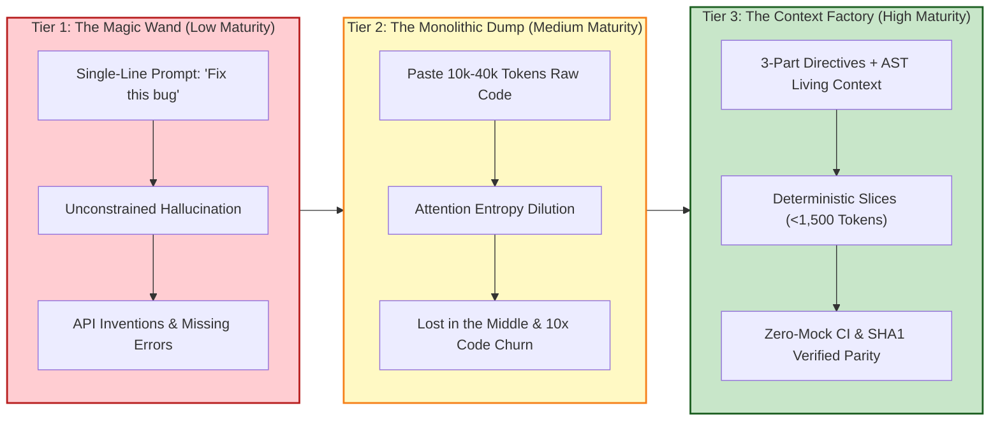
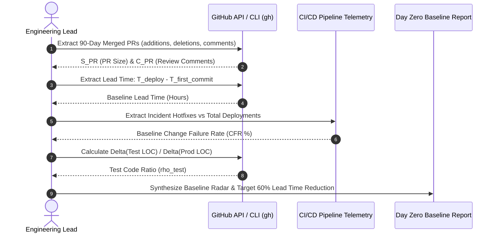

# Team Analysis & Baseline Metrics: The Day Zero Prerequisite

## Executive Overview: The Requirement for Empirical Baselines

Before an enterprise initiates role-based AI training or transitions squads to the Context Factory architecture, engineering leadership must execute a disciplined **Day Zero Assessment**. 

Adopting AI without baseline metrics creates an "Anecdotal Trap": engineering managers rely on developer sentiment ("AI feels faster"), while executive leadership observes rising cloud token bills, growing context debt, and an increasing Change Failure Rate (CFR).

The Day Zero Assessment executes across two parallel tracks:
1. **Behavioral Analysis (The Qualitative Audit):** Discovering how engineers, product owners, and analysts currently interact with AI models and auditing shadow AI usage.
2. **Quantitative Engineering Metrics (DORA & SPACE):** Capturing historical 90-day baseline metrics directly from source control and deployment APIs to prove statistical improvement.

---

## 1. Track I: Behavioral Analysis & The AI Tooling Audit

### 1.1 The Tooling Audit: Eliminating Shadow AI & Context Leakage

Before establishing standardized context pipelines, organizations must identify fragmentation across developer environments:
- **Approved vs. Shadow AI:** Survey all engineering squads to identify un-governed tool usage (e.g., personal ChatGPT/Claude subscriptions, untracked browser extensions, unvetted local LLMs). Shadow AI usage introduces massive intellectual property (IP) and PII leakage risks.
- **IDE & Extension Fragmentation:** Document the distribution of developer environments (VS Code, Cursor, JetBrains, Neovim). Context routing mechanisms must be tailored to the environment's capabilities (e.g., `.cursorrules` vs. `copilot-instructions.md` vs. MCP tool manifests).
- **API Key & Secret Governance:** Verify that no raw developer API keys are hardcoded in local configuration files or git histories. All agent inference must route through centralized, rate-limited enterprise proxies enforcing micro-USD spend caps (Invariant $I_{21}$).

### 1.2 The Three Interaction Maturity Tiers

Organizations must evaluate a representative sample of 50 recent AI interactions (from IDE telemetry, chat histories, or PR descriptions) and classify them into three distinct maturity tiers:



### The AI Interaction Maturity Tiers

| Interaction Tier | Core Operational Pattern | Typical Ingress Prompt | Failure Mode & Architectural Outcome |
| :--- | :--- | :--- | :--- |
| **Tier 1: The Magic Wand** | Low Maturity / Conversational | Single-line prompts: `"Fix this bug"` | Model invents non-existent APIs, drops error handling, violates architecture |
| **Tier 2: The Monolithic Dump** | Medium Maturity / Prompt Bloat | Pasting 10k–40k tokens of raw code | Attention entropy dispersion, "Lost in the Middle" loss, 10x code churn |
| **Tier 3: The Context Factory** | High Maturity / Deterministic | 3-Part Directives + AST Living Context | Surgical AST-scoped edits (<1,500 tokens), zero drift, SHA1 anchors, fail-closed |

### 1.3 Identifying the "AI Productivity Cliff"

Through structured interviews with principal architects and senior builders, leadership must map the exact threshold where developer productivity inverts:
- **The File Count / LOC Threshold:** Identify the specific codebase size (typically $> 400$ LOC per file or $> 15$ files per module) where developers stop using AI because the model "gets lost," hallucinates obsolete methods, or breaks existing tests.
- **Root Cause Isolation:** This threshold empirically validates the necessity of the **Architectural Modularity Ceiling (400 LOC)** and the **AST State Registry**, pinpointing the exact subsystems requiring immediate architectural refactoring.

---

## 2. Track II: DORA & SPACE Metrics Extraction (The Performance Baseline)

To mathematically prove the ROI of the Context Factory, BuilderOps teams must extract the previous 90 days of engineering performance data directly from the GitHub REST/GraphQL APIs and CI/CD logging systems.



### 2.1 DORA Metric 1: Lead Time for Changes ($T_{\text{lead}}$)

**Objective:** Measure the elapsed time from feature conception to production deployment.  
**Hypothesis:** Constraining AI agents with machine-readable Semantic Blueprints eliminates architectural rework, reducing lead time by $60\%$.

$$\text{Lead Time} = T_{\text{deploy}} - T_{\text{first-commit}}$$

**GitHub API Extraction Protocol:**
```bash
# Extract earliest commit timestamp and merge timestamp for merged PRs
gh pr list --state merged --limit 100 --json number,createdAt,mergedAt,commits \
  --jq '.[] | {pr: .number, created: .createdAt, merged: .mergedAt, first_commit: .commits[0].committedDate}'
```

### 2.2 DORA Metric 2: Change Failure Rate (CFR)

**Objective:** Track the percentage of production deployments requiring emergency rollbacks, hotfixes, or incident mitigation.  
**Hypothesis:** Programmatic AST Zero-Mock enforcement (rules ZM001–ZM009) and adversarial red-teaming maintain $\text{CFR} \le 5\%$, preventing AI-generated bugs from reaching production.

$$\text{CFR} = \frac{N_{\text{hotfix-deployments}} + N_{\text{rollback-events}}}{N_{\text{total-deployments}}} \times 100\%$$

**GitHub API Extraction Protocol:**
```bash
# Count total production deployments vs incident-tagged PRs
TOTAL_DEPLOYS=$(gh release list --limit 100 | wc -l)
INCIDENT_PRS=$(gh pr list --state merged --search "label:incident OR label:hotfix" --limit 100 | wc -l)
echo "Baseline CFR: $(echo "scale=2; ($INCIDENT_PRS / $TOTAL_DEPLOYS) * 100" | bc)%"
```

### 2.3 SPACE Metric 1: Review Cognitive Load (PR Size Ratio)

**Objective:** Measure the cognitive burden placed on human code reviewers.  
**Hypothesis:** Enforcing bounded task decomposition (<200 LOC per PR) eliminates reviewer exhaustion and stops the rubber-stamping of AI-generated code.

$$\bar{S}_{\text{PR}} = \frac{1}{M} \sum_{i=1}^M \left(\text{Additions}_i + \text{Deletions}_i\right)$$

$$\bar{C}_{\text{PR}} = \frac{1}{M} \sum_{i=1}^M \text{ReviewComments}_i$$

**GitHub API Extraction Protocol:**
```bash
# Calculate average lines changed and comments per PR
gh pr list --state merged --limit 100 --json additions,deletions,comments \
  --jq '[.[] | {loc: (.additions + .deletions), comments: (.comments | length)}] | 
        {avg_loc: (map(.loc) | add / length), avg_comments: (map(.comments) | add / length)}'
```

### 2.4 SPACE Metric 2: Test Code Ratio ($\rho_{\text{test}}$)

**Objective:** Measure whether test coverage expands proportionally with automated code generation.  
**Hypothesis:** In a mature Context Factory, Validation Leads use AI to expand test suites, driving the ratio of test additions to production additions to $\ge 1.50$.

$$\rho_{\text{test}} = \frac{\sum \Delta \text{LOC}_{\text{test}}}{\sum \Delta \text{LOC}_{\text{production}}}$$

**Evaluation Standard:**
- $\rho_{\text{test}} < 0.80$: 🔴 **Critical Risk** (Production code outstripping tests; technical debt accumulating).
- $0.80 \le \rho_{\text{test}} < 1.20$: 🟡 **Moderate Health** (Parity maintained).
- $\rho_{\text{test}} \ge 1.50$: 🟢 **High Health** (Contract-first validation active; extensive edge case coverage).

---

## 3. Technical Environment & Toolchain Prerequisites

Before executing the Context Factory workflows, the repository environment must be verified against these technical requirements:

### 3.1 Python Runtime & AST Toolchain
- **Python Version:** Python 3.11+ required (for native AST enhancements, `typing.Self`, and exception groups).
- **Core Standard Libraries:** `ast`, `hashlib`, `uuid`, `json`, `pathlib`, `typing`.
- **Pre-Commit Framework:** Native git hook support for executing `scripts/update_state_registry.py` and `scripts/verify_code_invariants.py`.

### 3.2 Hermetic Testing Infrastructure
- **Test Runner:** `pytest` (version 7.4+).
- **Hermetic Network Interception:** `pytest-socket` installed and configured in `tests/conftest.py`:
  ```python
  # Ensure socket blocking is active by default
  def pytest_configure(config):
      config.addinivalue_line("addopts", "--disable-socket")
  ```
- Any test attempting live network access must explicitly raise `SocketBlockedError`.

### 3.3 Database & Edge Storage Prerequisites
- **Production Engine:** Cloudflare D1 / Distributed SQL.
- **Local Edge Worker Cache:** SQLite3 configured with Write-Ahead Logging (WAL) and robust busy timeouts:
  ```sql
  PRAGMA journal_mode = WAL;
  PRAGMA busy_timeout = 30000; -- 30-second timeout to prevent locked database errors
  PRAGMA synchronous = NORMAL;
  ```

---

## 4. Role-by-Role Readiness Checklist

Prior to launching Phase 1 of the 120-Day Rollout Roadmap, every squad member must satisfy their role-specific checklist:

| Role | Day Zero Prerequisite Checklist | Verification Artifact |
|:---|:---|:---|
| **Product Owner / Executive** | [ ] 90-day DORA and SPACE baseline metrics captured.<br>[ ] Enterprise Constitution ratified.<br>[ ] Model risk governance and quarantine tables provisioned. | Executive Baseline Report & Approved Constitution |
| **Business Analyst (BA)** | [ ] Ingested external requirements air-gapped from internal state.<br>[ ] 80% commercial discount applied to vendor claims.<br>[ ] 20-edge-case Semantic Blueprint template loaded. | Completed Semantic Blueprint (`docs/stories/`) |
| **System Architect / Developer** | [ ] ADR-016 400-LOC ceiling verified across all existing files.<br>[ ] `STATE_REGISTRY.md` and `MATHEMATICAL_REGISTRY.md` compiled.<br>[ ] Atomic pre-commit command chain configured in `.git/hooks/`. | Passing `git diff --exit-code` on AST registries |
| **Validation Lead (QE)** | [ ] `scripts/scan_mock_data.py` (ZM001–ZM009) integrated into CI.<br>[ ] `pytest-socket` active in `tests/conftest.py`.<br>[ ] SHA1 invariant verification script operational. | Green hermetic test run with zero network egress |
| **Scrum Master / Agile Coach** | [ ] User stories sized to $\le 2$ points (<200 LOC blast radius).<br>[ ] Sprint dashboard tracking files near 350-LOC refactor trigger.<br>[ ] Developer feedback loop established. | Sprint Board with Context Debt Tracking |

---

## Production Reality & Operational Failure Modes in the AI Era

### The Mid-2026 Production Baseline (The Verification Trap & Context Debt)

> [!WARNING]
> **The 75% Enterprise Ad-Hoc Trap**: Between 75% and 84% of engineering pods dive headfirst into AI tools without establishing baseline telemetry or hermetic environments. Developers paste code snippets into personal accounts (shadow AI) because corporate tooling feels clunky.

#### Observed Empirical Failure Cycle:
1. **The Context Wall**: Teams lack historical 90-day baselines for DORA and SPACE metrics, leaving engineering managers unable to measure whether AI adoption accelerates delivery or merely inflates LOC churn.
2. **The Verification Tax**: Tests are riddled with live socket calls and flaky mocks that pass locally but fail in CI; PR review bloat climbs by +91% (Faros AI) and delivery stability degrades by 7.2% per 25% AI adoption (DORA).
3. **The Churn Inversion**: Without diagnostic baselines, pods cannot isolate unanchored AI code generation as the root cause of systemic delivery degradation.

### Ungoverned Production Failure Modes
When engineering teams ignore Day Zero prerequisites and generate code without baseline guardrails:
- **Flaky CI Pipelines & Socket Leaks**: Without `pytest-socket` active by default, unit tests silently make network calls to external APIs. When an upstream service experiences latency or outages, the entire build pipeline grinds to a halt.
- **Shadow AI Intellectual Property Leaks**: Developers using un-airgapped consumer LLMs accidentally leak proprietary algorithms, database credentials, and regulated PII into public training sets.
- **Blind Flying on Productivity**: Without a 90-day baseline, leadership misinterprets vanity commit spikes as success, masking the accumulation of catastrophic context debt and architectural drift until a major outage strikes.

### Deterministic Engineering Defenses & Operational Takeaways
1. **Activate Offline Socket Interception Immediately**: Add `pytest-socket` with `--disable-socket` to the base `pytest.ini` or `conftest.py`. Fail any test that attempts outbound network access during unit testing.
2. **Lock Down the 90-Day DORA/SPACE Baseline**: Capture historical lead time, change failure rate, and PR review turnaround times before enabling AI agent features in the repository.
3. **Configure SQLite Edge Storage with WAL & 30s Timeouts**: Standardize local databases with Write-Ahead Logging (`PRAGMA journal_mode = WAL;`) and busy timeouts (`PRAGMA busy_timeout = 30000;`) to prevent locked database exceptions during concurrent agent runs.
4. **Enforce Role-by-Role Day Zero Checklists**: Require that every role (BA, Architect, QE, Scrum Master) verifies their prerequisite items—especially semantic blueprint schemas and AST registries—before opening sprint work to AI assistance.

---

[**Next: Root Curriculum Overview →**](./README.md)
