# Regulatory Model Governance: High-Stakes Compliance, AI-SBOM Standards, and Immutable Quarantine

## Executive Overview: The Regulated Enterprise Mandate

In enterprise domains where algorithmic decisions carry life-safety, systemic financial, or national security consequences, autonomous AI agents cannot operate as opaque, un-audited "black boxes." Deploying generative models into production requires adherence to the world's most stringent regulatory frameworks:

- **Healthcare & Life Sciences:** FDA Class III Pre-Market Approval (PMA), 21 CFR Part 820 (Quality System Regulation), 21 CFR Part 11 (Electronic Records and Signatures), and ISO 13485:2016 (Medical Devices — Quality Management Systems).
- **Fintech & Banking:** Federal Reserve Board / OCC Supervisory Letter SR 11-7 (Guidance on Model Risk Management), SEC Rule 17a-4 (Books and Records Governance), and Basel Committee on Banking Supervision (BCBS) principles.
- **Aerospace & Defense:** FAA DO-178C Level A (Software Considerations in Airborne Systems and Equipment Certification) and DO-254 for design assurance.
- **Transnational AI Standards:** The European Union Artificial Intelligence Act (EU AI Act, Articles 9, 14, and 17), NIST AI Risk Management Framework (NIST AI RMF 1.0), and Executive Order 14028 (Improving the Nation's Cybersecurity).

This document establishes the formal compliance architecture, the **AI Software Bill of Materials (AI-SBOM)** specification, and the **Immutable Quarantine Governance** required to deploy autonomous agents in regulated environments.

---

## 1. High-Stakes Regulatory Framework Alignment

The table below maps the core architectural mechanisms of the Context Factory to specific regulatory clauses across global governance frameworks:

| Regulatory Standard | Governing Section / Clause | Regulatory Mandate | Context Factory Implementation |
|:---|:---|:---|:---|
| **FDA 21 CFR Part 820** | §820.30(f) Design Verification<br>§820.30(g) Design Validation | Verification that device software conforms to defined user needs and intentional specifications without unintended side effects. | Programmatic AST Zero-Mock Scanner (ZM001–ZM007) and Hermetic Socket Isolation (`pytest-socket`) asserting absolute offline determinism. |
| **FDA 21 CFR Part 11** | §11.10(e) Audit Trails | Secure, computer-generated, time-stamped audit trails to independently record the date and time of operator entries and actions. | Invariant $I_{15}$ UUID Traceability: Every LLM generation, consensus score, and state mutation is stamped with UUIDv4 and written to D1 SQL audit tables. |
| **ISO 13485:2016** | Clause 4.1.6 Software Validation | Documented procedures for the validation of software application used in the quality management system. | Code-Adjacent SHA1 Invariant Anchors ($I_{01}-I_{22}$) verifying byte-for-byte mathematical parity between specification, code, and test. |
| **Federal Reserve SR 11-7** | Model Validation & Conceptual Soundness | Rigorous assessment of model conceptual soundness, mathematical theory, tracking of limitations, and stress testing. | Deflated Sharpe Ratio (DSR $\ge 0.95$), Ledoit-Wolf Shrinkage ($\mathrm{cond}(\Sigma) \le 10^{12}$), and Cartesian Fault-Injection Fuzz Testing. |
| **FAA DO-178C Level A** | Section 6.3.4 Software Architecture Verification | Verification that software architecture satisfies all high-level requirements and that no unintended functions or dead code exist. | ADR-016 400-LOC modular ceiling, 80-line surgical slices, and Rule 14 Anti-Feature-Erasure Protocol preventing unintended code mutations. |
| **EU AI Act (2024/1689)** | Article 9 Risk Management<br>Article 14 Human Oversight | Continuous identification of foreseeable risks; high-risk AI must enable human operators to oversee operation and override decisions. | Dialectical Adversarial Triad (ADR-039) arbitrated by convex solver; Pre-Action Plausibility Bands ($I_{02}$); Fail-Closed Telemetry Doctrine. |
| **NIST AI RMF 1.0** | GOVERN 1.2 & MAP 2.3 | Inventorying AI dependencies; mapping system components, data sources, and operational bounds. | Machine-readable AI-SBOM headers on every commit; AST State Registry (`STATE_REGISTRY.md`) and Mathematical Registry. |

---

## 2. The AI Software Bill of Materials (AI-SBOM) Specification

Traditional Software Bills of Materials (SBOMs)—standardized via CycloneDX or SPDX 2.3—inventory third-party binary libraries and open-source dependencies (e.g., `npm`, `pypi`). However, in autonomous software engineering, the primary driver of non-deterministic behavior is the **Cognitive Dependency Chain**: the foundational model, inference parameters, prompt templates, and active context nodes.

Under SPDX 3.0 (AI Profile) and CISA guidelines, every pull request or automated commit generated with AI assistance must embed a machine-readable **AI-SBOM Metadata Header**.

### 2.1 The Standardized AI-SBOM Header Schema

```yaml
# === AI-SBOM-HEADER v1.0 (DO NOT MODIFY MANUALLY) ===
ai_sbom_version: "1.0.0"
trace_uuid: "e4b6d39a-7c21-4f18-8f12-9842a67301c2"
agent_identity:
  agent_id: "ForensicArchitect-Worker-03"
  agent_role: "implementer"
  archetype: "teamwork_preview_worker"
foundation_model:
  provider: "OpenRouter"
  model_slug: "anthropic/claude-3.5-sonnet:exact"
  model_digest: "sha256:8f2a1b9c7d4e3f2a1b9c7d4e3f2a1b9c7d4e3f2a1b9c7d4e3f2a1b9c7d4e3f2a"
  inference_parameters:
    temperature: 0.0
    top_p: 1.0
    seed: 42
    max_tokens: 4096
context_provenance:
  epic_id: "EPIC-REG-402"
  semantic_blueprint: "docs/stories/FEATURE-714.md"
  governing_adrs: ["ADR-016", "ADR-027", "ADR-029", "ADR-030"]
  active_invariants: ["I01", "I02", "I04", "I15", "I22"]
  ast_state_digest: "sha1:3a7d2b1f"
  math_registry_digest: "sha1:9e4c1a8d"
compliance_attestation:
  hermetic_socket_test: "PASSED (pytest-socket 0.7.0)"
  ast_zero_mock_scan: "PASSED (ZM001-ZM007 0 violations)"
  loc_ceiling_audit: "PASSED (312 non-anchor LOC <= 400)"
  generated_at_utc: "2026-10-17T22:20:00Z"
# === /AI-SBOM-HEADER ===
```

### 2.2 Automated CI Validation of AI-SBOM Headers

The deployment pipeline enforces AI-SBOM validity through a dedicated GitHub Actions workflow (`.github/workflows/verify_ai_sbom.yml`):
1. **Header Presence:** Asserts that every PR containing modified code files includes the `# === AI-SBOM-HEADER ===` block in the commit message or PR description.
2. **Deterministic Inference Assertion:** Verifies that `temperature == 0.0`. In regulated environments, non-zero temperatures introduce stochastic variation, invalidating reproducibility requirements under 21 CFR §11.10.
3. **AST Digest Parity:** Recomputes the SHA1 hash of `STATE_REGISTRY.md` and verifies parity with the header's `ast_state_digest`. Any uncommitted code modifications trigger an immediate rejection.

---

## 3. Model Versioning, Drift Analysis & Regional Sovereignty

### 3.1 The "Zero Unpinned Models" Mandate

A catastrophic failure mode in enterprise AI systems is the **Silent Model Update**. AI service providers continuously update frontier models behind public API endpoints (e.g., migrating `gpt-4o` or `claude-3-5-sonnet` to newer checkpoints). These updates frequently alter system prompt adherence, modify output formatting, or relax defensive guardrails.

**The Strict Versioning Policy Mandates:**
1. **Exact Checkpoint Pinning:** Agents must never utilize floating aliases (e.g., `latest`, `preview`, `v1`). System configurations must explicitly specify exact date-stamped or digest-pinned model slugs (e.g., `gemini-1.5-pro-002`, `claude-3-5-sonnet-20241022`).
2. **The Adversarial Promotion Gate:** Upgrading a production agent from Model A to Model B is legally classified as a **Major Engineering Change**. Before an upgrade is approved, the BuilderOps and QE teams must execute the entire Tier 1 through Tier 4 Adversarial Test Suite against the new model, mathematically proving:
   - Zero regression in AST Zero-Mock compliance (ZM001–ZM007).
   - Zero drift in the 22 Invariant Anchor verifications ($I_{01}-I_{22}$).
   - Equal or superior Deflated Sharpe Ratio ($\text{DSR} \ge 0.95$).

### 3.2 Data Sovereignty & Regional Inference Governance

Under the **EU AI Act (Article 10)**, **GDPR (Chapter V)**, and **HIPAA (45 CFR Part 164)**, inference data containing European citizen identifiers or protected clinical data must not exit approved legal jurisdictions:
- **Regional Inference Endpoints:** Production agents operating on EU or clinical telemetry must route inference exclusively through geographically isolated endpoints (e.g., `eu.anthropic.com` or local on-premise air-gapped LLM runtimes).
- **Zero Training Retention:** Enterprise service level agreements (SLAs) must contractually enforce zero data logging and zero model training on customer payloads.

---

## 4. Quarantine Governance & The Zero Hard-Deletes Mandate (ADR-027)

In regulated enterprise environments, **data destruction is a criminal and regulatory violation**. When an autonomous system discovers that a historical consensus record, trading execution, or clinical recommendation was generated based on corrupted data or a software defect, the instinct of conventional software engineers is to issue a raw database purge:

```sql
-- STRICTLY FORBIDDEN IN REGULATED ENTERPRISES (CRIME / COMPLIANCE VIOLATION)
DELETE FROM consensus WHERE id = 'rec-9042';
```

Purging historical records destroys the forensic audit trail required by regulatory inspectors (FDA, SEC, FAA), preventing investigators from understanding what information the autonomous agent possessed at the moment of decision.

### 4.1 The Immutable Quarantine Schema

Under Invariant $I_{04}$ (ADR-027), raw hard deletes are physically disabled via database triggers. Corrupted or invalidated records are atomically extracted and migrated into the `consensus_quarantine` table:

```sql
CREATE TABLE IF NOT EXISTS consensus_quarantine (
    quarantine_id TEXT PRIMARY KEY,
    original_table TEXT NOT NULL,
    original_id TEXT NOT NULL,
    original_payload JSON NOT NULL,
    invalidation_reason TEXT NOT NULL CHECK(length(invalidation_reason) >= 10),
    bug_reference TEXT NOT NULL, -- e.g. 'ISSUE-402'
    originating_agent_id TEXT NOT NULL,
    model_version TEXT NOT NULL,
    trace_uuid TEXT NOT NULL,
    quarantined_at TIMESTAMP DEFAULT CURRENT_TIMESTAMP,
    quarantined_by TEXT NOT NULL
);
```

### 4.2 The Atomic Migration Transaction

When an invalidation is confirmed, the system executes an atomic transaction that marks the live record as inactive while persisting the complete historical artifact into the quarantine ledger:

```python
def quarantine_invalid_record(db: DatabaseConnection, record_id: str, reason: str, bug_ref: str, auditor_id: str) -> None:
    """Canonical implementation of Invariant I04 Quarantine Protocol."""
    assert len(reason) >= 10, "Invalidation reason must provide detailed forensic rationale"
    with db.transaction():
        record = db.query_one("SELECT * FROM consensus WHERE id = ?", (record_id,))
        if not record:
            raise RecordNotFoundError(f"Record {record_id} does not exist.")
        
        # 1. Insert into immutable quarantine ledger
        db.execute("""
            INSERT INTO consensus_quarantine (
                quarantine_id, original_table, original_id, original_payload,
                invalidation_reason, bug_reference, originating_agent_id,
                model_version, trace_uuid, quarantined_by
            ) VALUES (?, 'consensus', ?, ?, ?, ?, ?, ?, ?, ?)
        """, (
            str(uuid.uuid4()), record['id'], json.dumps(record['payload']),
            reason, bug_ref, record['agent_id'], record['model'],
            record['trace_uuid'], auditor_id
        ))
        
        # 2. Demote live record without deleting historical trace
        db.execute("""
            UPDATE consensus 
            SET active_status = 'QUARANTINED', 
                confidence_score = 0,
                demoted_at = CURRENT_TIMESTAMP
            WHERE id = ?
        """, (record_id,))
```

---

## 5. Dual-Use Regulated Comparison Tables & Forensic Case Studies

To ensure universal applicability, the table below provides a systematic cross-domain crosswalk mapping high-stakes autonomous software patterns across critical industries:

| Architectural Subsystem | Quantitative Finance Safeguard (`StockAnalysis V3`) | FDA Class III Medical Device (Closed-Loop Pancreas / Infusion) | Aerospace Fly-by-Wire Avionics (FAA DO-178C Level A) | Mission-Critical Banking Mainframe (SWIFT / Fedwire Gateway) |
|:---|:---|:---|:---|:---|
| **Zero-Mock Telemetry ($I_{01}$)** | Rejects synthetic dark pool ratios (`0.50`) and interest rate stubs (`5.25%`). Fails closed. | Rejects synthetic glucose defaults (`100 mg/dL`) or pulse oximetry fallbacks (`98%`). Latches pump to basal rate. | Rejects synthetic pitot airspeed defaults (`250 kts`) during sensor icing. Reverts to Direct Law flight control. | Rejects synthetic account balance stubs (`$10,000`). Declines transaction on ledger timeout. |
| **Plausibility Bands ($I_{02}$)** | $\|P_{\text{exec}} - \text{EMA}_5\| \le \max(3\text{ATR}_{14}, 0.08\text{EMA}_5)$. Rejects execution spikes. | $\|V_{\text{dose}} - V_{\text{baseline}}\| \le \max(3\sigma, 0.10V_{\text{base}})$. Clamps drug titration rate. | $\|\theta_{\text{surface}} - \theta_{\text{trim}}\| \le \text{MaxDeflection}(V_{\text{airspeed}})$. Limits control surface slew rate. | $\|\text{Amount} - \mu_{\text{history}}\| \le 3\sigma_{\text{account}}$. Routes wire anomaly to cryptographic dual custody. |
| **Compensatory Confluence ($I_{09}$)** | Requires $\ge 2$ of 4 pillars $\ge 0.35$ for BUY; single metrics cannot unilaterally veto. | Requires $\ge 2$ orthogonal physiological signs (lactate, BP, HRV) for sepsis alert; fever absence cannot veto. | Triple Modular Redundancy (TMR) voting across 3 flight computers; single bit discrepancy does not disengage avionics. | Multi-factor fraud evaluation (biometrics, velocity, geo, device); single foreign IP does not block user. |
| **Immutable Quarantine ($I_{04}$)** | Atomic migration of corrupted records to `consensus_quarantine`; hard deletes banned. | Device error logs and failed infusion records preserved in tamper-proof EEPROM for FDA inspection. | Flight Data Recorder (FDR) and cockpit voice logs preserved in crash-survivable memory units. | Corrupted payment messages archived to immutable WORM (Write Once, Read Many) optical storage. |
| **Epistemic Air-Gap ($I_{20}$)** | Social media ingested without portfolio state; marketing funnels slashed by 80% ($W_{\text{comm}} = 0.20$). | Clinical drug studies ingested without hospital budget state; vendor claims discounted by 80%. | Air-gapping flight sensor telemetry from airline public relations and passenger Wi-Fi networks. | Air-gapping core settlement ledger from marketing CRM and credit scoring promotion funnels. |

---

## 6. Forensic Case Study Integration

### 6.1 Forensic Case Study 1: The Synthetic Poison Catastrophe (Crisis 3)

- **The Incident:** In an asynchronous distributed pipeline, an expired API key in an upstream data fetcher triggered standard web-development "fail-soft" try-except handlers:
  ```python
  # THE FATAL FAIL-SOFT ANTI-PATTERN (FLAGGED BY ZM001 / ZM002)
  try:
      fed_funds_rate = fetch_live_treasury_yield()
  except Exception:
      fed_funds_rate = 5.25  # Hardcoded optimistic stub
  ```
- **The Catastrophe:** While real interest rates declined to $3.75\%$, the stale $5.25\%$ stub persisted across 900,000 database rows over eight weeks. The inflated interest rate compressed equity risk premia calculations in fundamental valuation models. In October 2026, an autonomous multi-agent portfolio optimizer interpreted the compressed risk premium as an imminent market crash, triggering an emergency panic liquidation of over **$150,000 in high-conviction growth assets directly prior to a +35% earnings rally**.
- **Regulated Healthcare Equivalent:** In an intensive care unit (ICU) closed-loop vasopressor infusion pump, a transient Bluetooth sensor disconnect in an arterial line blood pressure cuff triggers a catch block returning `mean_arterial_pressure = 70.0 mmHg` (sensible human baseline). In reality, the patient's true arterial pressure had plummeted to $42.0 \text{ mmHg}$ due to septic hemorrhage. Relying on the synthetic $70.0 \text{ mmHg}$ default, the automated titration pump withholds life-saving norepinephrine, resulting in fatal cardiogenic shock.
- **Permanent Solution:** Absolute enforcement of Invariant $I_{01}$ (Zero-Simulated-Data), AST static scanner rules ZM001–ZM007, and the Fail-Closed Telemetry Doctrine. If sensor telemetry is unverified or missing, the system emits `None` and immediately latches actuators into a safe, mechanical hold state.

---

### 6.2 Forensic Case Study 2: Cross-Channel Verdict Desynchronization (Crisis 6)

- **The Incident:** Presentation endpoints (an executive email digest, an interactive Slack notification bot, and a local IDE command-line interface) operated as independent consumers executing separate SQL queries, local cache reads, and un-coordinated LLM prompts.
- **The Catastrophe:** On the same morning, the same candidate asset emitted three contradictory verdicts across presentation channels:
  - *Email Gateway:* `BUY (78% conviction)` (queried canonical remote Cloudflare D1 database).
  - *Slack Bot:* `PRICE SUPPRESSED ABORT` (hit rate-limit bundle timeout and fell back to empty dict).
  - *Local IDE CLI:* `NEUTRAL (EXPIRED, 42%)` (queried a local SQLite replica that was 80 hours out of date).
  Additionally, an inverted confidence formula calculated confidence as $100 - |P - 50| \times 2$. When the model was at maximum uncertainty ($50\%$ conviction), the confidence paradoxically evaluated to $\mathbf{100\%}$ (`HOLD 100% confidence`)!
- **Regulated Aerospace Equivalent:** In an airliner cockpit, the Electronic Flight Bag (EFB) on the captain's tablet displays an obsolete runway closure NOTAM due to a delayed Wi-Fi sync, while the Primary Flight Display (PFD) and flight management computer display an active runway approach. Simultaneously, the crew alerting system outputs an inverted caution tone. The conflicting indications induce pilot spatial disorientation during a zero-visibility instrument landing system (ILS) approach.
- **Permanent Solution:**
  1. **Single-Source Broker Lock (ADR-038):** All presentation channels must query the centralized `ConsensusService.get_active_verdict()`. Direct queries to local SQLite replicas are blocked.
  2. **Remote-First Freshness Gate (Invariant $I_{13}$):** Local caches older than 24 hours must pull from the canonical remote ledger. Caches older than 72 hours with remote access down trip `StaleDataCircuitBreaker` and fail closed.
  3. **Server-Composed Directional Header (Invariant $I_{14}$):** Directional headlines are formatted deterministically by backend code before rendering; LLMs are restricted to non-directional qualitative reasoning.

---

## 7. Nightly Reconciliation & Dual-Storage Parity Architecture

```mermaid
flowchart TD
    subgraph OperationalDay ["1. Intraday Operational Telemetry"]
        MUTATIONS["State Mutations & Executions"] --> REMOTE_D1["Cloudflare D1 Remote Database (Canonical Source of Truth)"]
        REMOTE_D1 --> EDGE_CACHE["Local SQLite Worker Replicas (Read-Only Edge Delivery)"]
    end

    subgraph NightlyAuditLoop ["2. Nightly Reconciliation & Compliance Loop"]
        CRON_TRIGGER["Scheduled 24-Hour Reconciliation Trigger"] --> PULL_PASS["Mandatory Remote Pull: sync_data.py --pull"]
        PULL_PASS --> FRESH_CHECK{"D1 Telemetry Freshness <= 24h? (I13)"}
        FRESH_CHECK -- "No (Stale)" --> PIPELINE_ALARM["ALARM: Data Stale (>3d Fail Closed: StaleDataCircuitBreaker)"]
        FRESH_CHECK -- "Yes" --> HASH_PARITY{"Remote D1 vs Local SQLite Parity Hash"}
        HASH_PARITY -- "Mismatch Detected" --> RESYNC["Rebuild Local SQLite Cache from Canonical Remote Truth"]
        HASH_PARITY -- "Byte Parity Verified" --> MTM_CALC["Recompute Mark-to-Market Ledger Valuation"]
        
        MTM_CALC --> RECON_TOL{"PnL Divergence <= $250.00 Tolerance?"}
        RECON_TOL -- "Divergence Exceeded" --> DISCREPANCY["Trigger PagerDuty Severity-1 Forensic Audit"]
        RECON_TOL -- "Within Tolerance" --> TRACE_AUDIT{"Verify UUID Traceability (I15) on All Records"}
        
        TRACE_AUDIT -- "Missing Trace ID" --> QUARANTINE_MIGRATE["Migrate Tainted Record to consensus_quarantine (I04)"]
        TRACE_AUDIT -- "100% Trace Parity" --> ATTESTATION["Generate Cryptographic Daily Compliance Attestation"]
    end

    style OperationalDay fill:#e0f2f1,stroke:#00695c,stroke-width:2px;
    style NightlyAuditLoop fill:#f3e5f5,stroke:#6a1b9a,stroke-width:2px;
    style ATTESTATION fill:#c8e6c9,stroke:#1b5e20,stroke-width:2px;
    style QUARANTINE_MIGRATE fill:#ffcdd2,stroke:#c62828,stroke-width:2px;
```



---

[**Next: Executive Alignment Strategy →**](./00_EXECUTIVE_ALIGNMENT_STRATEGY.md) | [**Return to Root README →**](./README.md)
