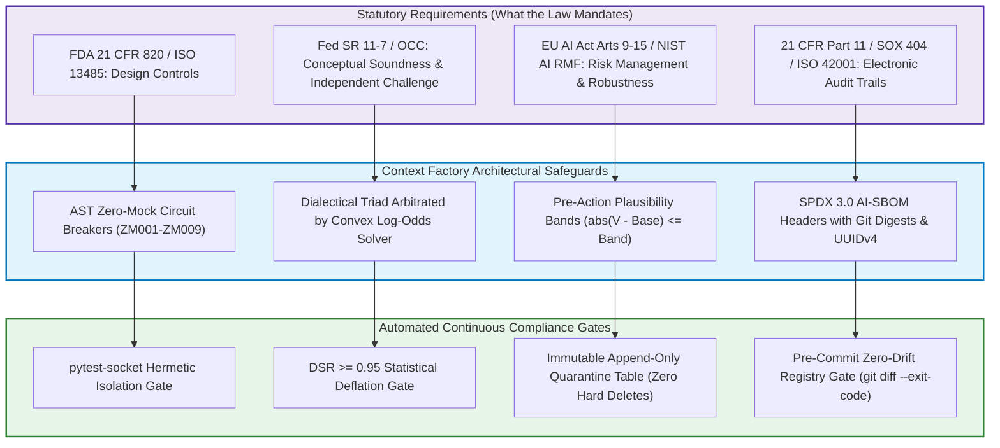

# Executive Reference: Regulatory AI Model Governance & Compliance

---

## 🎯 Executive Overview & Scope

In safety-critical and regulated enterprise environments, autonomous artificial intelligence agents cannot be deployed as black boxes. Software systems operating in these industries are subject to statutory oversight requiring complete traceability, mathematical verifiability, and fail-closed safety architectures.

This document establishes the **Executive Regulatory Compliance Matrix**. It maps formal legal mandates to the engineering patterns implemented throughout the Context Factory.

### Regulatory Framework to Engineering Mapping

| Statutory Standard | Regulatory Scope & Mandate | Context Factory Implementation Pattern | Automated CI Verification Gate |
| :--- | :--- | :--- | :--- |
| **FDA 21 CFR §820.30** | Design Controls, Verification & Validation | AST Zero-Mock Circuit Breaker ($I_{01}$) | `scripts/scan_mock_data.py` (ZM001–ZM009) |
| **FDA 21 CFR Part 11** | Electronic Records & Immutable Audit Trails | Machine-Readable SPDX 3.0 AI-SBOM & UUIDv4 | `verify_ai_sbom.py` ($I_{15}$) |
| **Federal Reserve SR 11-7** | Model Risk Management & Independent Challenge | Dialectical Triad & Deflated Sharpe Ratio ($\mathrm{DSR} \ge 0.95$) | `solve_convex_debate_verdict()` |
| **EU AI Act (High-Risk)** | Continuous Risk Governance & Robustness (Arts. 9–15) | Pre-Action Plausibility Bands ($I_{02}$) & WAL Mode ($I_{14}$) | `plausibility_band_clamp` ($I_{02}$) |
| **FAA DO-178C Level A** | Deterministic Execution & Structural Verification | Hermetic Socket Isolation & 400-LOC Ceilings ($I_{16}, I_{19}$) | `pytest --disable-socket` |

---

## 🏛️ Statutory Mandates vs. Engineering Implementation Patterns

Regulators mandate **outcomes, verification evidence, and auditability**; they do not dictate internal software architecture or proprietary algorithms. The Context Factory establishes concrete engineering implementation patterns designed to produce the objective evidence required by these legal frameworks:

### 1. Medical Device Software (FDA 21 CFR Part 820.30 & ISO 13485)
*   **Statutory / Regulatory Obligation**: 21 CFR §820.30(f)-(g) and ISO 13485 mandate that manufacturers establish procedures for design verification (confirming design outputs meet design inputs) and design validation (ensuring devices conform to defined user needs and intended uses under actual or simulated operating conditions, supported by risk analysis under ISO 14971). FDA regulations do *not* prescribe specific Python AST linters or bespoke unit test rules.
*   **Engineering Implementation Pattern**: The **AST Zero-Mock Circuit Breaker (Invariant $I_{01}$)** in production code. Synthetic stubs, fallback constants, and unanchored mocks are eliminated from production paths and verification test suites to generate the objective, uncorrupted verification evidence required by design controls.
*   **Deep Implementation**: [Testing Architecture (04_TEST)](./04_testing_and_validation/TEST_ARCHITECTURE.md) and [Regulatory Red-Teaming (06_02)](./06_security_and_compliance/03_regulatory_red_teaming.md).

---

### 2. Banking Model Risk Management (Federal Reserve SR 11-7 & OCC 2011-12)
*   **Statutory / Supervisory Obligation**: Financial institutions must establish a comprehensive Model Risk Management (MRM) framework across three core pillars: (1) robust model development, implementation, and use (demonstrating conceptual soundness); (2) comprehensive model validation independent of model development (including evaluation of conceptual soundness, ongoing monitoring, process verification, and outcomes analysis such as backtesting); and (3) governance, policies, and controls. SR 11-7 does *not* prescribe multi-agent LLM debate triads, prompt injection tests, or bespoke trading algorithms.
*   **Engineering Implementation Pattern**: The **Dialectical Adversarial Triad** (Proponent, Adversary, and Forensic Auditor) arbitrated by a **Deterministic Convex Evidence Solver**, backed by the **Deflated Sharpe Ratio ($\mathrm{DSR} \ge 0.95$)** to correct for multiple-testing selection bias. These patterns provide the structural independence, rigorous conceptual challenge, and empirical outcomes analysis required during model risk audits.
*   **Deep Implementation**: [The Assembly Mechanism (09_02)](./09_ai_agent_orchestration/02_the_assembly_mechanism.md) and [Testing the Agent Config (09_03)](./09_ai_agent_orchestration/03_testing_the_agent_config.md).

---

### 3. High-Risk AI Systems (European Union AI Act — Regulation (EU) 2024/1689)
*   **Statutory Obligation**: High-risk AI systems must establish continuous risk management throughout the lifecycle (Article 9), adhere to data governance criteria (Article 10), maintain technical documentation (Article 11), enable automatic event logging to ensure traceability (Article 12), guarantee transparency (Article 13), provide human oversight capabilities (Article 14), and achieve appropriate levels of accuracy, robustness, and cybersecurity resilience against errors, faults, and adversarial third-party exploitation (Article 15). The EU AI Act does *not* mandate specific commercial algorithms or proprietary execution clamps.
*   **Engineering Implementation Pattern**: **Pre-Action Execution Plausibility Bands (Invariant $I_{02}$)** as mechanical, runtime boundary limiters ($|V_{\text{exec}} - \text{Baseline}| \le \text{Band}$) and **Automated State Reconciliation Loops**. These engineering patterns enforce fail-closed runtime safety and produce immutable audit logs satisfying the human oversight and robustness obligations of Articles 14 and 15.
*   **Deep Implementation**: [Security & Directives (06_01)](./06_security_and_compliance/01_epistemic_governance_and_proxy_risk_auditing.md) and [Automated Traceability (05_05)](./05_deployment_and_operations/06_automated_traceability.md).

---

### 4. Electronic Records Integrity (FDA 21 CFR Part 11 & SOX Section 404)
*   **Statutory Obligation**: 21 CFR Part 11 (§11.10(e)) mandates secure, computer-generated, time-stamped audit trails to independently record the date and time of operator entries and actions that create, modify, or maintain electronic records, with system checks to enforce permitted sequencing (§11.10(f)); Sarbanes-Oxley (SOX) Section 404 mandates verifiable internal accounting controls over financial reporting records. These statutes do *not* specify JSON schema versions or database engine types.
*   **Engineering Implementation Pattern**: **Machine-Readable SPDX 3.0 AI-SBOM Headers** and **Immutable Quarantine Ledgers** (enforced by a permanent ban on raw SQL `DELETE` operations). System architects enforce append-only state mutation, embedding cryptographic commit digests, model weight hashes, and UUIDv4 audit traces directly into transaction headers.
*   **Deep Implementation**: [Automated Traceability (05_05)](./05_deployment_and_operations/06_automated_traceability.md) and [Security Directives (06_01)](./06_security_and_compliance/01_epistemic_governance_and_proxy_risk_auditing.md).

---

## 📋 Comprehensive Compliance Navigation Matrix

| Statutory Mandate | Responsible Role | Implementation Module | Automated CI Gate |
| :--- | :--- | :--- | :--- |
| **Design Controls (FDA Part 820)** | Validation Lead (QE) | `04_02`, `04_TEST` | `scan_mock_data.py` (ZM001–ZM009) |
| **Model Risk (Fed SR 11-7)** | Systems Architect | `09_02`, `09_03` | `dialectical_arbiter.py` (JSD <= 0.12) |
| **Risk Bounds (EU AI Act)** | Security Officer | `06_01`, `06_02` | `plausibility_band_clamp` ($I_{02}$) |
| **Audit Trails (Part 11 / SOX)** | BuilderOps Lead | `05_05`, `06_01` | `spdx_sbom_generator.py` ($I_{15}$) |
| **Airworthiness (DO-178C)** | Builder / Architect | `03_03`, `05_03` | `verify_loc_ceiling.py` (<= 400 LOC) |

---

## Production Reality & Operational Failure Modes in the AI Era

### The Mid-2026 Production Baseline (The Verification Trap & Context Debt)

> [!WARNING]
> **The 75% Enterprise Ad-Hoc Trap**: Between 75% and 84% of engineering teams in regulated industries treat AI governance as an afterthought. Developers use autocomplete and chat sidebars to generate safety-critical code without documenting provenance.

#### Observed Empirical Failure Cycle:
1. **The Context Wall**: When audit time arrives, teams either claim AI is a text editor or fabricate manual compliance paperwork retrospectively.
2. **The Verification Tax**: AI code contains subtle deceptive compliance, causing reviewers to spend 91% more time in PR review (Faros AI) without actually verifying statutory invariants.
3. **The Churn Inversion**: Without deterministic verification gates, teams remain exposed to severe regulatory fines and mandatory operational shutdowns.

### Ungoverned Production Failure Modes
When engineering teams ignore structured regulatory engineering patterns and ship ungoverned AI-generated code:
- **Regulatory Enforcement Actions**: Regulators under FDA 21 CFR 820.30, Federal Reserve SR 11-7, or EU AI Act Article 15 issue warning letters, halt device manufacturing, or impose heavy administrative fines when safety-critical algorithms lack objective design verification and audit traceability.
- **Undetected Algorithmic Drift**: Without deterministic plausibility bands ($I_{02}$) and dialectical arbitration, an AI-generated change introduces non-finite float vulnerabilities or boundary bypasses that cause financial misallocations or patient harm.
- **Retroactive Code Freeze**: When an un-audited failure occurs, regulatory authorities demand an immediate freeze on all automated deployments until every line of code is retrospectively inspected and attested by hand.

### Deterministic Engineering Defenses & Operational Takeaways
1. **Differentiate Statutory Mandates from Engineering Patterns**: In your compliance architecture, explicitly separate what the law requires (e.g., SR 11-7 independent model challenge) from the internal software pattern built to satisfy it (e.g., dialectical triad arbitrated by convex log-odds solvers).
2. **Embed SPDX 3.0 Lineage Headers ($I_{15}$)**: Ensure every critical transaction, state mutation, or clinical record includes the git commit digest, model SHA-256 hash, and UUIDv4 trace identifier to satisfy Part 11 and EU AI Act Article 12.
3. **Clamp Critical Execution Paths with Invariant $I_{02}$**: Implement mechanical boundary checks ($|V_{\text{exec}} - \text{Baseline}| \le \text{Band}$) in code to ensure high-risk actions fail closed if model outputs exceed physiological or financial tolerances.
4. **Automate Regulatory Proof Generation in CI**: Map test suites directly to the Regulatory Navigation Matrix, ensuring that every CI run produces an immutable, machine-readable audit report proving compliance.

---

[**Proceed to Enterprise Constitution →**](./00_ENTERPRISE_CONSTITUTION.md) | [**Return to Main Curriculum Hub →**](./README.md)
