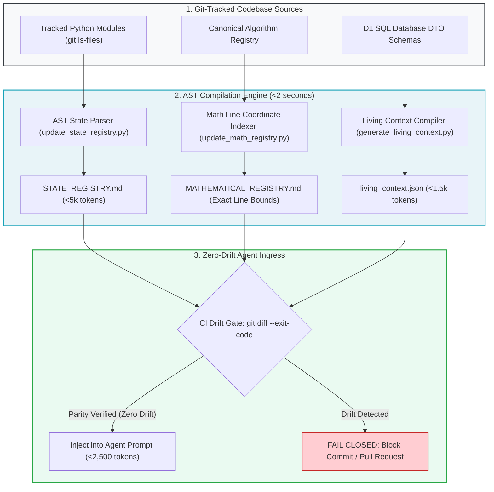

# Executive Reference: The 3-Tier Context Pipeline Architecture

---

## 🎯 Executive Overview & Scope

In autonomous enterprise software engineering, large language models must never be prompted with unconstrained raw repositories. Feeding an entire codebase into an LLM causes attention entropy dispersion, triggers "Lost in the Middle" amnesia, and leads to code bloat and hallucinations.

The Context Factory solves this by enforcing the **3-Tier Context Pipeline**: a deterministic compilation chain that extracts only verified AST signatures, schema contracts, and active invariants into an audited, token-dense payload (<1,500 tokens).

```
┌──────────────────────────────────────────────────────────────────────────────────────────────────┐
│                      THE 3-TIER CONTEXT COMPILATION HIERARCHY                                    │
├────────────────────┬───────────────────────────────────┬─────────────────────────────────────────┤
│ Context Tier       │ Scope & Content                   │ Token Budget Allocation                 │
├────────────────────┼───────────────────────────────────┼─────────────────────────────────────────┤
│ Tier 1: Global     │ Enterprise Constitution & Rules   │ 200 – 400 tokens (Immutable / Pinned)   │
│ Tier 2: Structural │ AST Living Context JSON           │ 800 – 1,200 tokens (Dynamic AST Cache)  │
│ Tier 3: Surgical   │ Domain Blueprint & AST Node Scope │ 400 – 600 tokens (Target Scope Focus)   │
├────────────────────┴───────────────────────────────────┴─────────────────────────────────────────┤
│ TOTAL COMBINED PROMPT PAYLOAD CEILING:                 │ <= 2,500 TOKENS (95%+ Attention Zone)   │
└──────────────────────────────────────────────────────────────────────────────────────────────────┘
```

---

## 🔄 End-to-End Context Pipeline & Zero-Drift Verification



---

## 🏛️ Context Pipeline Core Artifacts & Implementation Guide

### 1. The AST State Registry (`STATE_REGISTRY.md`)
*   **Purpose**: Lightweight topographic index (<5,000 tokens) compiled directly from Python native `ast.parse` over git-tracked files.
*   **Contents**: Module paths, physical line counts, classes, public function signatures, and modularity health status (`✅ Healthy (<350 LOC)` vs `⚠️ Near 400 LOC Cap`).
*   **Deep Implementation**: [Context Engineering (03_04)](./03_building_and_coding/04_ast_registries_and_living_context.md).

### 2. The Canonical Mathematical Registry (`MATHEMATICAL_REGISTRY.md`)
*   **Purpose**: Catalogs all safety and quantitative algorithms with exact AST start/end line coordinates (`L_start` to `L_end`), LaTeX formulas, and linked unit tests.
*   **Contents**: 100+ formal algorithms with zero line-drift.
*   **Deep Implementation**: [Context Engineering (03_04)](./03_building_and_coding/04_ast_registries_and_living_context.md).

### 3. The Living Context Compiler (`living_context.json`)
*   **Purpose**: Token-dense JSON context payload (<1,500 tokens) injected into model prompts before execution.
*   **Contents**: Active model routing matrix, database schema parity map (SQL DTOs to Pydantic models), and governing invariants.
*   **Deep Implementation**: [Context Engineering (03_04)](./03_building_and_coding/04_ast_registries_and_living_context.md) and [Context Mapping Matrix (09_04)](./09_ai_agent_orchestration/04_context_mapping_matrix.md).

### 4. Zero-Drift Pre-Commit Hook & Remote CI Monitor
*   **Purpose**: Guaranteed byte-parity between physical code and documentation.
*   **Execution Command**:
    ```bash
    python3 scripts/update_state_registry.py &&     python3 scripts/update_math_registry.py &&     python3 scripts/generate_living_context.py &&     git diff --exit-code
    ```
*   **Deep Implementation**: [Automated Traceability (05_05)](./05_deployment_and_operations/05_automated_traceability.md).

---

## Production Reality & Operational Failure Modes in the AI Era

### The Mid-2026 Production Baseline (The Verification Trap & Context Debt)
In mid-2026, 75\%-84\% of software engineering teams have no programmatic context pipeline. Developers manually copy-paste snippets into chat windows, or rely on naive vector RAG systems that slice repositories into arbitrary 500-token chunks. The results are disastrous: vector embeddings match superficial semantic keywords rather than physical AST dependency graphs, polluting the prompt with irrelevant utility code. According to the Stack Overflow Developer Survey, 63.3\% of engineers cite codebase context fragmentation as their primary bottleneck with AI tooling. Monolithic prompts balloon to 40,000 tokens, burning \$157.50 per 1,000 tasks while suffering from attention dilution and the U-shaped "Lost in the Middle" curve. The team is mired in the DORA Verification Trap, debugging plausible hallucinations born from noisy context.

### Ungoverned Production Failure Modes
When engineering teams bypass compiler-grade context engineering and dump uncurated files into prompts:
- **Architectural & Schema Drift (Crisis 2)**: Code and documentation drift apart within 48 hours. Agents write patches targeting deprecated function signatures or obsolete database DTOs, breaking the build upon commit.
- **Attention Collapse & Amnesia**: Ingesting un-indexed raw code dilutes attention entropy ($\mathcal{H} \approx 10.60\text{ nats}$), dropping retrieval accuracy in the middle of the prompt to 35\%. The model silently drops safety checks, security validations, and error handling.
- **5x OpEx Waste**: Engineering budgets pay premium frontier rates to process thousands of tokens of non-source noise (lockfiles, test fixtures, build artifacts) that provide zero architectural value to the model.

### Deterministic Engineering Defenses & Operational Takeaways
1. **Compile Living Context Under 1,500 Tokens**: Replace raw prompt dumps with an automated compiler (`scripts/generate_living_context.py`) that packages active model routing, database DTO mappings, and governing invariants into a concise JSON payload under 1,500 tokens.
2. **Automate AST State Registry Generation**: Run Python native `ast.parse` in a pre-commit hook to generate `STATE_REGISTRY.md`, providing a machine-readable topographic map of classes, methods, and line counts (<5,000 tokens).
3. **Enforce the Zero-Drift Pre-Commit Sentinel**: Add `python3 scripts/update_state_registry.py && git diff --exit-code` to the git pre-commit chain. If code changes without updating the AST registry, fail the commit immediately.
4. **Filter Out the 83% Non-Source Noise**: Configure context compilers to automatically ignore lockfiles, minified assets, and test logs, ensuring every token in the prompt carries high semantic signal.

---

[**Proceed to The Mathematics of AI Risk →**](./00_THE_MATHEMATICS_OF_AI_RISK.md) | [**Return to Main Curriculum Hub →**](./README.md)
