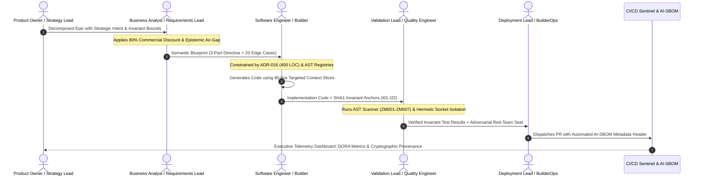

# The Enterprise Context Pipeline: AST-Compiled Living Context vs. Naive Vector RAG

## Executive Overview: The Paradigm Shift in Context Engineering

In early enterprise AI initiatives, organizations attempted to scale agentic software development by adopting **Naive Vector RAG (Retrieval-Augmented Generation)**. In this naive paradigm, entire codebases and architectural markdown documents are chunked arbitrarily, transformed into dense embedding vectors, and retrieved via cosine similarity into multi-thousand-token prompts.

In high-stakes, regulated engineering environments, **Naive Vector RAG fails deterministically**. Vector embeddings measure broad semantic proximity rather than precise programmatic contracts; they cannot distinguish between positive assertions and negative prohibitions, and they dilute the model's finite attention budget across thousands of irrelevant tokens.

The **Enterprise Context Pipeline** replaces naive semantic chunking with a **Deterministic AST-Compiled Living Context Lifecycle**. By extracting structural ground truth directly from the codebase's Abstract Syntax Tree (AST), enforcing a strict **400-LOC modular ceiling (ADR-016)**, slicing context into **surgical 80-line view windows**, and isolating external narratives behind an **Epistemic Air-Gap (ADR-030)**, the Context Pipeline guarantees zero-drift, audit-compliant code generation.

---

## 1. The Failure of Naive Vector RAG vs. The AST Living Context Factory

### 1.1 The Semantic Blindness of Cosine Similarity

Naive Vector RAG relies on calculating the cosine similarity between a query vector $\mathbf{q} \in \mathbb{R}^d$ and indexed chunk vectors $\mathbf{d}_i \in \mathbb{R}^d$:

$$\cos(\mathbf{q}, \mathbf{d}_i) = \frac{\mathbf{q} \cdot \mathbf{d}_i}{\|\mathbf{q}\| \|\mathbf{d}_i\|}$$

While high-dimensional embeddings excel at thematic clustering, they exhibit catastrophic **Sign Blindness** and **Relational Inversion** when applied to discrete software specifications, mathematical equations, and clinical parameters:

$$\cos\left(\mathbf{v}_{\text{bolus\_administration\_authorized}}, \; \mathbf{v}_{\text{bolus\_administration\_prohibited}}\right) \ge \mathbf{0.94}$$
$$\cos\left(\mathbf{v}_{\text{allow\_synthetic\_mock\_fallbacks}}, \; \mathbf{v}_{\text{prohibit\_synthetic\_mock\_fallbacks}}\right) \ge \mathbf{0.93}$$
$$\cos\left(\mathbf{v}_{\text{capital\_expansion\_mode}}, \; \mathbf{v}_{\text{capital\_liquidation\_mode}}\right) \ge \mathbf{0.95}$$

Because the cosine distance between diametrically opposed software rules is virtually zero, Naive Vector RAG routinely injects obsolete, contradictory, or negative guidance directly into the agent's working memory.

### 1.2 The Token Bloat & Context Rot Trap

When an agent attempts to resolve dependencies using Naive RAG, the retrieval engine retrieves dozens of 500-token chunks, bloating the prompt payload to 30,000–60,000+ tokens. 

As formalized in [The Mathematics of AI Risk](./00_THE_MATHEMATICS_OF_AI_RISK.md):
1. **Attention Entropy Dispersion:** As sequence length $N \to \infty$, attention entropy $\mathcal{H}(A_i) = -\sum A_{ij} \ln A_{ij}$ approaches its theoretical maximum $\ln N$. The agent spreads its attention budget thinly across background noise, losing focus on core invariants.
2. **The Lost-in-the-Middle Valley:** Chunks placed in the middle $(0.15, 0.85)$ of the context payload suffer a **40% to 75% retrieval degradation**. The agent hallucinates parameter types, omits critical error handling, and erases defensive code blocks.

### 1.3 Architectural Comparison: Naive RAG vs. AST Context Factory

| Architectural Dimension | Naive Vector RAG Approach | Deterministic AST Context Factory |
|:---|:---|:---|
| **Context Extraction** | Unstructured regex/text chunking into vector DB | Direct AST parsing (`ast.parse`) of git-tracked files |
| **Relational Fidelity** | Stochastic semantic proximity ($\cos \ge 0.94$ for opposites) | Exact AST parent-child coordinates, classes, and signatures |
| **Token Payload Size** | Unbounded bloat (30k–80k tokens of prose Markdown) | Minified, ultra-compact digest (<1,500 tokens JSON) |
| **Attention Focus** | High entropy $\mathcal{H}(A_i) \approx \ln N$; severe middle dilution | Low entropy; surgical 80-line windows in high-attention zones |
| **Drift Detection** | Manual; prose documentation diverges from code within days | Automated pre-commit CI gate (`git diff --exit-code`) |
| **Failure Mode** | Hallucinated imports, column names, and synthetic fallbacks | Fail-closed syntax verification; zero AST drift |

---

## 2. End-to-End AST Compilation & Living Context Lifecycle

```mermaid
flowchart TD
    subgraph NaiveRAG ["The Fragile Naive Vector RAG Approach (Prone to Drift)"]
        N1["Monolithic Codebase (500k LOC)"] -->|Unstructured Text Chunking| N2["Vector Database Embeddings"]
        N3["Natural Language Query"] -->|Cosine Distance Metric| N4["Top-K Semantic Text Chunks"]
        N4 -->|Token Bloat (>30k tokens)| N5["LLM Working Memory Prompt"]
        N5 -->|"Lost in the Middle" Degradation Valley| N6["Hallucinated Signatures, Broken DTOs, Diff Corruption"]
    end

    subgraph ASTContextFactory ["The Deterministic AST Context Factory Lifecycle"]
        A1["Source Code Modules (ADR-016 <= 400 LOC)"] -->|ast.parse| A2["AST Topography Scanner: update_state_registry.py"]
        A1 -->|ast.walk| A3["Math Algorithm Auditor: update_math_registry.py"]
        A2 --> R1["STATE_REGISTRY.md (File Topography, LOC, Functions)"]
        A3 --> R2["MATHEMATICAL_REGISTRY.md (100 Verified Algorithms)"]
        R1 & R2 --> A4["Living Context Compiler: generate_living_context.py"]
        A4 --> A5["Minified Living Context JSON (<1,500 tokens)"]
        A5 --> A6["Role-Based Context Slicer: ADR-044"]
        A6 -->|Surgical 80-Line Context Window| A7["Autonomous Agent Context Ingestion"]
        A7 --> A8["Deterministic, Zero-Drift Code Generation"]
        A8 --> A9["Atomic Pre-Commit CI Gate: drift-monitor.yml"]
        A9 -->|Pass| A10["Hermetic Git Commit & Deployment"]
        A9 -->|Drift Detected| A11["Automated Build Failure & Invariant Alert"]
    end

    style NaiveRAG fill:#ffebee,stroke:#c62828,stroke-width:2px;
    style ASTContextFactory fill:#e8f5e9,stroke:#2e7d32,stroke-width:2px;
    style N6 fill:#ffcdd2,stroke:#b71c1c,stroke-width:2px;
    style A10 fill:#c8e6c9,stroke:#1b5e20,stroke-width:2px;
```

### 2.1 The Three AST Artifacts

The Context Factory compiles and maintains three machine-readable registries:

1. **The State Registry (`STATE_REGISTRY.md` — <5,000 tokens):**  
   Compiled via `scripts/update_state_registry.py` over all git-tracked files (`git ls-files`). Parses every module's AST to record:
   - Physical non-anchor LOC.
   - Class declarations and inheritance hierarchies.
   - Public function signatures and return type annotations.
   - Health status badge: `✅ Healthy (<350 LOC)` vs `⚠️ Near 400 LOC Cap (Refactor Required)`.
2. **The Mathematical Registry (`docs/MATHEMATICAL_REGISTRY.md`):**  
   Compiled via `scripts/update_math_registry.py`. Catalogs the enterprise's verified canonical algorithms (e.g., Ledoit-Wolf shrinkage, GAC-ROIC-MOS, DSR, ZCA whitening), indexing:
   - Exact AST physical line coordinates: $L\{\text{start}\} - L\{\text{end}\}$.
   - Formal LaTeX mathematical equations.
   - Explicit file binding to passing unit test harnesses (`ASSERT`).
   - If an algorithm's symbol or test file is missing, the compiler **fails closed** with an assertion error.
3. **The Living Context Digest (`data/openrouter_context.json` — <1,500 tokens):**  
   Compiled via `scripts/generate_living_context.py`. Provides a dense, minified JSON representation of active database table-to-DTO mappings (`TABLE_DTO_MAP`), active model matrices, and the 22 System Invariant predicates. Prepend-ready for system prompts, saving $\sim 10,000$ prompt tokens per agent invocation.

---

## 3. ADR-016 Modular Engineering Standards: The 400-LOC Ceiling

The ADR-016 standard establishes physical file size ceilings and surgical context slicing to guarantee that codebases remain within the transformer's optimal attention zone.

### 3.1 The 400-LOC Hard Ceiling & 350-LOC Refactoring Trigger

- **The 400-LOC Hard Ceiling:** No production, test, or configuration file may exceed **400 physical lines of code**. Monolithic files (>500 LOC) induce attention degradation, leading refactoring agents to silently delete defensive code.
- **The 350-LOC Refactoring Trigger:** When a file reaches **350 LOC**, an automated pre-commit warning is issued. The file enters a refactoring freeze: no new features may be added until the file is decomposed into cohesive domain submodules.
- **Non-Anchor LOC Exemption:** SHA1 Invariant Anchor blocks (`# === INVARIANT-BLOCK v1 ... ===`) are excluded from the line count calculation:
  $$\text{non\_anchor\_loc} = \text{total\_file\_lines} - \text{anchor\_block\_lines} \le 400$$

### 3.2 The 80-Line Surgical View Window

When an AI agent modifies code, providing the entire file in context wastes token bandwidth and degrades precision. Builders and orchestrators must constrain the agent's view to an **80-line surgical window**:
- 20 lines of preceding structural context (class/function definition).
- 40 lines of the active modification target.
- 20 lines of trailing structural context (return assertions/closing scope).

By restricting edits to 80-line slices, the entire context payload resides within the model's high-fidelity **Primacy Zone** ($x \in [0.0, 0.15]$), eliminating diff corruption and syntax errors.

### 3.3 Rule 14: The Anti-Feature-Erasure Protocol

When human engineers or AI agents refactor a module to comply with the 400-LOC ceiling, they frequently succumb to **Compression Bias**—shortening files by deleting defensive assertions, removing error handling, or replacing complex fallback cascades with `# ... existing code ...`.

**Rule 14 Strictly Forbids Feature Erasure:**
1. Refactoring must split logic into submodules via clean domain decomposition (e.g., extracting `ExecutionValidator` out of `OrderRouter`).
2. Deleting any of the following to reduce line counts is a **Constitutional Violation (Exit Code 1)**:
   - Zero-mock defensive assertions.
   - Input validation gates and domain boundary checks ($I_{07}$).
   - Secondary and tertiary API fallback tiers.
   - Audit logging and UUID trace persistence statements ($I_{15}$).

### 3.4 The Atomic Pre-Commit Command Chain

To guarantee that source code and AST registries never drift, all local commits and CI pipelines must execute the atomic pre-commit command chain:

```bash
git add -A && \
python3 scripts/update_state_registry.py && \
python3 scripts/update_math_registry.py && \
python3 scripts/generate_living_context.py && \
git add STATE_REGISTRY.md docs/MATHEMATICAL_REGISTRY.md data/openrouter_context.json && \
git diff --exit-code STATE_REGISTRY.md docs/MATHEMATICAL_REGISTRY.md data/openrouter_context.json && \
PYTHONPATH=. MOCK_MODE=true pytest tests/unit/test_context_freshness.py
```

If any developer or agent modifies source code without updating the registries, `git diff --exit-code` halts the commit immediately.

---

## 4. Epistemic Air-Gap (ADR-030) & The 80% Commercial Funnel Discount

### 4.1 Cognitive Priming & Confirmation Bias Cascades

When an AI agent is tasked with evaluating external unstructured information (financial news, vendor whitepapers, clinical literature, customer reviews), a fatal architectural flaw is **Omniscient Context Leakage**.

If the agent's ingestion prompt is hydrated with internal state (e.g., current portfolio losses, hospital drug supply shortages, project deadline panic), the agent suffers from **Cognitive Priming**. It actively scans the external narrative for information that confirms its pre-existing internal bias, entering a self-fulfilling confirmation loop.

As documented in forensic investigations, an AI agent hydrated with internal macro risk warnings will interpret a sensationalist YouTube marketing video ("Imminent Market Crash!") as "independent external corroboration," triggering catastrophic, premature liquidations.

```mermaid
flowchart TD
    subgraph ExternalTelemetry ["External Unstructured Telemetry Stream"]
        RAW1["Social Media & Video Transcripts"]
        RAW2["Vendor Technical Whitepapers & Case Studies"]
        RAW3["Regulatory Filings (SEC 10-K / FDA Submissions)"]
    end

    subgraph EpistemicAirGap ["ADR-030: Epistemic Air-Gap Firewall"]
        EXTRACT["Zero-Context Courtroom Extraction Contract"]
        RAW1 & RAW2 & RAW3 --> EXTRACT
        EXTRACT --> CLASSIFY{"Epistemic Classification Engine"}
        CLASSIFY -->|"Sponsored / Affiliate Conflict"| COMM["COMMERCIAL_PROMOTION"]
        CLASSIFY -->|"Unverified Public Claim"| OBS["OBSERVED_CLAIM (Pillar 4 Psychology)"]
        CLASSIFY -->|"Verified Regulatory Document"| FACT["GROUND_TRUTH_FACT (Pillar 1 Integrity)"]
        
        COMM --> FUNNEL["Commercial Funnel De-Biasing: W_commercial = 0.20 (80% Polarity Slashing)"]
        OBS --> DECAY["Half-Life Signal Decay: w(t) = w0 * 2^(-t / t_half)"]
        FACT --> REG["Direct Telemetry Ingestion (Full Weight = 1.0)"]
    end

    subgraph InternalDecisionEngine ["Internal Multi-Agent Decision Engine"]
        STATE["Internal Portfolio State / Patient Physiological Records"]
        AIRGAP_BARRIER["UNIDIRECTIONAL AIR-GAP: Internal State NEVER Leaks Upstream"]
        STATE -.->|STRICTLY FORBIDDEN (Schema Violation)| EXTRACT
        
        FUNNEL & DECAY & REG --> FUSION["Convex Evidence Fusion Solver (ADR-039)"]
        STATE --> FUSION
        FUSION --> SAFE_ACTION["Safe, Un-Primed Operational Action"]
    end

    style EpistemicAirGap fill:#fff8e1,stroke:#f57f17,stroke-width:2px;
    style ExternalTelemetry fill:#f3e5f5,stroke:#7b1fa2,stroke-width:2px;
    style InternalDecisionEngine fill:#e1f5fe,stroke:#0277bd,stroke-width:2px;
    style AIRGAP_BARRIER fill:#ffcdd2,stroke:#c62828,stroke-width:2px;
```

### 4.2 The Unidirectional Air-Gap Specification

Under ADR-030, the extraction of external media is decoupled across a **Unidirectional Epistemic Air-Gap**:
1. **Zero Internal State:** The media extraction prompt receives *only* the raw transcript or document text. It is blind to internal portfolio allocations, balance sheet distress, or executive sentiment.
2. **The Courtroom Recorder Persona:** The extractor prompt is strictly commanded to act as an objective courtroom stenographer, recording claims without editorializing.
3. **Epistemic Classification:** All extracted entities are strictly categorized into machine-readable types:
   - `OBSERVED_CLAIM`: Unverified subjective sentiment or narrative opinion.
   - `GROUND_TRUTH_FACT`: Verifiable empirical event backed by immutable regulatory filings.
   - Any extracted narrative containing statements asserting that the author's view "aligns with our internal strategy" triggers an immediate schema validation error.

### 4.3 The 80% Commercial Funnel Discount Formulation

External content creators, vendors, and analysts frequently deploy sensationalist rhetoric to drive commercial monetization funnels (e.g., selling trading courses, paid subscription tiers, proprietary hardware).

When the ingestion engine detects affiliate links, sponsored disclaimers, or promotional monetization funnels (`commercial_conflict: true`), the stored sentiment polarity is discounted by **80% ($W_{\text{commercial}} = 0.20$)**:

$$\text{Polarity}_{\text{stored}} = \operatorname{round}\left(\text{Polarity}_{\text{raw}} \times 0.20, \; 2\right)$$

The effective Brier reliability weight $W_{\text{eff}}$ of the source is similarly penalized:

$$W_{\text{eff}} = W_{\text{Brier}} \times W_{\text{commercial}} = W_{\text{Brier}} \times 0.20$$

This mathematical discount prevents marketing hyperbole from distorting Bayesian priors or triggering false-positive alerts.

---

## 5. The Enterprise Context Handshake: Cross-Functional Handoff Protocol

The Context Factory replaces informal, ambiguous verbal or chat instructions with a **standardized role-to-role Context Handshake**. Each role in the enterprise context pipeline bounds, enriches, and validates the information before passing it to the downstream consumer.



### Detailed Stage Contracts:

1. **Stage 1: Strategy Lead → Requirements Lead (Decomposition Handshake)**
   - **Contract:** Break monolithic business visions into bounded, decoupled epics that touch $\le 3$ sub-domains.
   - **Deliverable:** Bounded Epic Specification defining business intent, regulatory boundaries, and economic constraints.
2. **Stage 2: Requirements Lead → Builder (Semantic Blueprint Handshake)**
   - **Contract:** Eliminate all natural language ambiguity by constructing a machine-executable **Semantic Blueprint**.
   - **Directives:** Specify the **3-Part Directive** (Role, Task, Format) and enumerate **20 mandatory pre-condition edge cases** (null handling, rate limiting, domain safety $I_{07}$, boundary conditions).
   - **Deliverable:** Markdown blueprint committed directly to the repository (e.g., `docs/stories/FEATURE-101.md`).
3. **Stage 3: Builder → Validation Lead (Implementation Handshake)**
   - **Contract:** Generate code strictly conforming to the Semantic Blueprint, bounded by ADR-016 (400 LOC ceiling) and 80-line surgical slices.
   - **Directives:** Bind code directly to verified primitives in the AST registries and embed verifiable `# === INVARIANT-BLOCK` anchors ($I_{01}-I_{22}$) adjacent to implementation functions.
   - **Deliverable:** Clean implementation code and unit tests with zero AST drift.
4. **Stage 4: Validation Lead → BuilderOps (Verification Handshake)**
   - **Contract:** Programmatically prove the implementation did not hallucinate interfaces or introduce pleasing-bias mocks.
   - **Directives:** Execute the static AST scanner (`scripts/scan_mock_data.py` for rules ZM001–ZM007), enforce hermetic socket isolation (`pytest-socket` raising `SocketBlockedError`), verify SHA1 invariant checksums, and execute Cartesian fault-injection fuzzing.
   - **Deliverable:** 100% passing hermetic test suite with cryptographic invariant attestation.
5. **Stage 5: BuilderOps → Executive Leadership (Traceability & Feedback Loop)**
   - **Contract:** Package commits with complete regulatory provenance and operational telemetry.
   - **Directives:** Append an **AI-SBOM metadata header** to the pull request, log execution traces with UUIDv4 identifiers, and stream DORA/SPACE metrics to executive dashboards.
   - **Deliverable:** Production deployment artifact with auditable 7-year regulatory compliance trail.

---

[**Next: Regulatory Model Governance →**](./00_REGULATORY_MODEL_GOVERNANCE.md) | [**Return to Root README →**](./README.md)
