# The Mathematics of AI Risk: Mathematical Formulations, Stochastic Decay, and Invariant Proofs

## Executive Overview: The Fallacy of Stochastic Autonomy

A dangerous premise persists in modern enterprise software engineering: the assumption that if a frontier Large Language Model (LLM) exhibits a high benchmark accuracy (e.g., 95% on isolated synthetic evaluations), it can be granted unsupervised autonomy to execute end-to-end software engineering epics, clinical decision sequences, or capital allocation workflows.

This assumption fundamentally misunderstands the mathematical behavior of probabilistic systems under sequential composition, high-dimensional attention dilution, and epistemic drift. In high-stakes environments—such as FDA Class III closed-loop medical devices, DO-178C Level A aerospace avionics, core banking mainframes, and autonomous quantitative asset allocation—probabilistic token prediction without deterministic structural constraints guarantees catastrophic failure.

This treatise formalizes the mathematical laws governing AI risk, derives the mechanisms of stochastic decay, and establishes the invariant proofs required to construct deterministic, fail-closed autonomous systems.

---

## 1. The Compounding Error Rate: The Geometric Decay Law

### 1.1 The Geometric Multiplication of Probabilities

Let an autonomous task sequence consist of $N$ discrete, causally dependent operational steps (e.g., requirement extraction, schema validation, AST parsing, code scaffolding, regression test generation, and transactional deployment). Let $p_k$ represent the probability that step $k$ executes with 100% semantic and syntactic correctness, conditioned on the absolute fidelity of all prior steps:

$$p_k = \mathbb{P}\left(S_k = \text{Success} \mid \bigcap_{j=1}^{k-1} S_j = \text{Success}\right)$$

Assuming independent conditional step fidelities bounded by an optimistic benchmark ceiling $p_k \le p = 0.95$, the end-to-end probability of aggregate sequence success $\mathbb{P}_{\text{sequence}}(N)$ decays exponentially as a geometric progression:

$$\mathbb{P}_{\text{sequence}}(N) = \prod_{k=1}^N p_k \le p^N = (0.95)^N$$

```
   100% ┼───┐
        │   └───┐
    80% ┼───────└───┐
        │           └───┐  p^N Exponential Decay
    60% ┼───────────────└───┐ (p = 0.95)
        │                   └───┐
    40% ┼───────────────────────└───┐
        │                           └───┐
    20% ┼───────────────────────────────└───┐
        │                                   └─────────
      0% ┴───┬───┬───┬───┬───┬───┬───┬───┬───┬───┬───┬───
         0   2   4   6   8  10  12  14  16  18  20  24
                            Steps (N)
```

Evaluating this formulation across standard software development workflows reveals the mathematical impossibility of unconstrained multi-step autonomy:
- For $N = 5$ steps: $\mathbb{P}_{\text{sequence}}(5) = (0.95)^5 \approx 77.38\%$
- For $N = 10$ steps: $\mathbb{P}_{\text{sequence}}(10) = (0.95)^{10} \approx 59.87\%$
- For $N = 20$ steps: $\mathbb{P}_{\text{sequence}}(20) = (0.95)^{20} \approx 35.85\%$
- For $N = 50$ steps: $\mathbb{P}_{\text{sequence}}(50) = (0.95)^{50} \approx 7.69\%$

### 1.2 Cascading Compound Hallucinations

In an unconstrained agentic architecture, step $k+1$ consumes the generative artifact of step $k$ as its unverified ground truth. Let $\epsilon_k = 1 - p_k$ represent the error residual at step $k$. If an error occurs at step $m$ ($S_m \neq \text{Success}$), the probability space of all subsequent steps is poisoned:

$$\mathbb{P}\left(S_{k} = \text{Success} \mid S_m = \text{Failure}\right) \approx 0 \quad \forall k > m$$

The error does not remain bounded; rather, it amplifies non-linearly across the causal graph. The agent treats its own hallucinated interfaces, incorrect mathematical assumptions, or corrupted database queries as verified facts, entering a self-reinforcing confirmation loop. In empirical literature, this phenomenon is formalized as the **Compound Hallucination Cascade** (Rabanser et al., Princeton University 2026; Xie et al., 2026).

---

## 2. Transformer Attention Mechanics & Information-Theoretic Attention Entropy

### 2.1 Quadratic Attention Complexity

The canonical Transformer architecture computes self-attention over a sequence of $N$ token representations mapped to Query ($Q$), Key ($K$), and Value ($V$) tensors in $\mathbb{R}^{N \times d_k}$ across $H$ attention heads and $L$ layers:

$$\text{Attention}(Q, K, V) = \text{softmax}\left(\frac{QK^T}{\sqrt{d_k}}\right)V$$

The inner product $QK^T$ evaluates all pairwise interactions between tokens, resulting in quadratic computational and memory scaling:

$$\mathcal{O}_{\text{FLOPs}} \sim 2 \cdot L \cdot H \cdot N^2 \cdot d_k$$

$$\mathcal{O}_{\text{Memory}} \sim L \cdot H \cdot N^2$$

### 2.2 Softmax Normalization and Attention Entropy

Let $A_{ij}$ denote the scalar attention weight assigned by token $i$ to token $j$ within a given head, following the row-wise softmax transformation:

$$A_{ij} = \frac{\exp\left(\frac{q_i k_j^T}{\sqrt{d_k}}\right)}{\sum_{m=1}^N \exp\left(\frac{q_i k_m^T}{\sqrt{d_k}}\right)}$$

By the axiomatic definition of the softmax operator, the attention weights form a valid probability distribution over the sequence length $N$:

$$\sum_{j=1}^N A_{ij} = 1.0 \quad \text{and} \quad A_{ij} \ge 0 \quad \forall j \in \{1, \dots, N\}$$

Consequently, the expected attention allocated to any arbitrary token $j$ under a uniform prior is strictly bounded by the reciprocal of the sequence length:

$$\mathbb{E}[A_{ij}] = \frac{1}{N}$$

We measure the dispersion of focus for token $i$ across the context window using the **Information-Theoretic Attention Entropy** $\mathcal{H}(A_i)$:

$$\mathcal{H}(A_i) = -\sum_{j=1}^N A_{ij} \ln A_{ij}$$

```
High Attention Entropy (Dispersed / Amnesiac):
   H(A_i) ≈ ln(N)
   Attention: [ 0.001 | 0.001 | 0.001 | 0.001 | 0.001 | ... | 0.001 ]  --> Token Amnesia

Low Attention Entropy (Surgical / Bounded Context):
   H(A_i) << ln(N)
   Attention: [ 0.850 | 0.050 | 0.000 | 0.080 | 0.020 | ... | 0.000 ]  --> High Precision
```

### 2.3 The Asymptotic Attention Dilution Theorem

**Theorem 1 (Attention Dilution & Noise Dominance):**  
As the prompt context length $N \to \infty$, the maximum achievable entropy scales logarithmically $\mathcal{H}_{\max}(N) = \ln N$. If the background context contains $N - K$ non-essential or noisy tokens (where $K$ is the fixed number of core architectural invariants), the mutual information $\mathcal{I}(T_{\text{target}}; \text{Output})$ between the critical invariants and the generated output satisfies:

$$\lim_{N \to \infty} \mathcal{I}(T_{\text{target}}; \text{Output}) = 0$$

*Proof Sketch:*  
Under uniform or bounded softmax dispersion, as $N \gg K$, the cumulative softmax denominator $\sum_{m=1}^N \exp(z_{im})$ is dominated by the sum over the $N-K$ distractors. Even with higher individual logit scores $z_{\text{target}} > z_{\text{noise}}$, the unbounded summation $\sum_{m \notin \text{Target}} \exp(z_{im}) \sim (N-K)\mathbb{E}[\exp(z_{\text{noise}})]$ forces $A_{i, \text{target}} \to 0$ as $N \to \infty$. The signal-to-noise ratio collapses, inducing silent invariant erasure and diff corruption.

---

## 3. The U-Shaped Positional Attention Curve ("Lost in the Middle")

### 3.1 Mathematical Formulation of Retrieval Fidelity $F(x)$

Empirical investigations into decoder-only autoregressive transformers (Liu et al., Stanford & Meta AI; Rabanser et al., 2026) establish that retrieval accuracy is not uniform across the prompt context. Rather, positional attention follows a severe U-shaped curve characterized by extreme **Primacy Bias** at the prompt inception and **Recency Bias** at the prompt termination.

Let $x \in [0.0, 1.0]$ represent the normalized token coordinate within a context payload of length $N$, where $x = 0.0$ is the initial system prompt token and $x = 1.0$ is the terminal instruction token. The empirical retrieval fidelity function $F(x)$ is formalized as:

$$F(x) = \begin{cases} 
1.0 - k_1 x & x \in [0.0, 0.15] \quad \text{(High-Fidelity Primacy Zone)} \\
F_{\text{valley}} + \epsilon(x) & x \in (0.15, 0.85) \quad \text{(Degradation Valley: 40%–75% Loss)} \\
1.0 - k_2 (1.0 - x) & x \in [0.85, 1.0] \quad \text{(High-Fidelity Recency Zone)}
\end{cases}$$

Where $k_1, k_2 > 0$ are decay constants, $F_{\text{valley}} \in [0.25, 0.45]$ represents the baseline retention floor, and $\epsilon(x)$ is a low-amplitude stochastic fluctuation.

```
F(x) Retrieval Fidelity
1.0 ┼───┐                                                       ┌───┤
0.8 ┼   └───┐                                               ┌───┘   │
0.6 ┼       └───┐                                       ┌───┘       │
0.4 ┼           └───────────────────────────────────────┘           │  Degradation Valley
0.2 ┼                     (40% to 75% Information Loss)             │  (15% to 85% Zone)
0.0 ┴───┬───────────────┬───────────────────────┬───────────────┬───┤
       0.0             0.15                    0.85            1.00
       [Primacy Zone]   <── Degradation Valley ──>    [Recency Zone]
```

### 3.2 The Semantic Blindness of Naive Vector RAG

To mitigate token bloat, naive enterprise architectures deploy Vector Retrieval-Augmented Generation (RAG) using dense embedding models. A query vector $\mathbf{q} \in \mathbb{R}^d$ is matched against document vectors $\mathbf{d}_i \in \mathbb{R}^d$ using cosine similarity:

$$\cos(\mathbf{q}, \mathbf{d}_i) = \frac{\mathbf{q} \cdot \mathbf{d}_i}{\|\mathbf{q}\| \|\mathbf{d}_i\|}$$

While effective for broad topic retrieval, dense embedding spaces exhibit fundamental **Sign Blindness** and **Relational Inversion**:
$$\cos\left(\mathbf{v}_{\text{bolus\_administration\_authorized}}, \; \mathbf{v}_{\text{bolus\_administration\_prohibited}}\right) \ge 0.94$$
$$\cos\left(\mathbf{v}_{\text{capital\_expansion\_regime}}, \; \mathbf{v}_{\text{capital\_contraction\_liquidation}}\right) \ge 0.95$$

Because vector embeddings map semantic proximity rather than discrete boolean predicates or inequality directions, naive vector RAG regularly retrieves documents with inverted polarity. When concatenated into the middle $(0.15, 0.85)$ of the prompt, these chunks fall directly into the retrieval degradation valley, producing confident hallucinations.

---

## 4. Exponential Continuous Half-Life Telemetry Decay

### 4.1 Temporal Confidence Attenuation

In dynamic environments, historical state observations decay in predictive utility. Let an observation or recommendation generated at time $t_0$ have an initial raw confidence score $w_0 \in [0, 100]$. At elapsed time $\Delta t = t - t_0$, the continuous decayed weight $w(\Delta t)$ is governed by the half-life decay formulation:

$$w(\Delta t) = w_0 \cdot \left(\frac{1}{2}\right)^{\frac{\Delta t}{t_{1/2}}} = w_0 \cdot \exp\left(-\frac{\ln 2}{t_{1/2}} \Delta t\right)$$

Where $t_{1/2}$ is the operational half-life parameter. The effective integer confidence score utilized in downstream gating is computed via deterministic rounding:

$$\text{effective\_confidence}(\Delta t) = \operatorname{int}\left(\operatorname{round}\left(w_0 \cdot 2^{-\frac{\Delta t}{t_{1/2}}}\right)\right)$$

### 4.2 Four-Horizon Operational Taxonomy

To prevent catastrophic decision-making on stale telemetry, system signals must be partitioned into four distinct operational horizons:

| Horizon Classification | Half-Life ($t_{1/2}$) | Hard Expiry ($2 \cdot t_{1/2}$) | Typical Domain Telemetry (Medical / Financial / Aerospace) |
|---|---|---|---|
| **1. Kinematic / Momentum Flow** | $5.0 \text{ days}$ ($120 \text{ hrs}$) | $10.0 \text{ days}$ | Acute hemodynamic pulse; intraday order-flow delta; aerodynamic flight surface trim. |
| **2. Tactical Operational** | $7.0 \text{ days}$ ($168 \text{ hrs}$) | $14.0 \text{ days}$ | 24-hour urine output balance; technical breakout momentum; engine fuel manifold pressure. |
| **3. Structural Solvency / Credit** | $21.0 \text{ days}$ ($504 \text{ hrs}$) | $42.0 \text{ days}$ | Serum creatinine clearance ($Kt/V$); corporate debt maturity schedule; turbine thermal cycle fatigue. |
| **4. Secular Quality Compounder** | $90.0 \text{ days}$ ($2,160 \text{ hrs}$) | $180.0 \text{ days}$ | Chronic HbA1c trajectory; return on invested capital (ROIC); airframe structural airworthiness. |

When $\Delta t > 2 \cdot t_{1/2}$, the signal undergoes mandatory state demotion to `EXPIRED`, zeroing its weight in subsequent decision fusion.

```
Signal Weight w(t)
1.0 ┼───┐
    │   └───┐
0.5 ┼───────┴───┐ (t = t_1/2: Weight = 0.50)
    │           └───┐
0.25┼───────────────┴───┐ (t = 2*t_1/2: Hard Expiry Barrier)
    │                   └───────────────────────►
0.0 ┴───┬───────────────┬───────────────────────┬───
        0             t_1/2                   2*t_1/2
                 Elapsed Time (Δt)
```

---

## 5. Conjunctive Boolean Gate Collapse vs. Compensatory Orthogonal Confluence

### 5.1 The Mathematical Proof of Conjunctive Boolean Collapse

A prevalent anti-pattern in high-assurance engineering is sequential conjunctive gating (stacking boolean `AND` requirements):

$$\text{Action Approved} \iff \bigwedge_{k=1}^K \left(M_k \ge \theta_k\right)$$

Let $p_k = \mathbb{P}(M_k \ge \theta_k)$ represent the marginal probability of metric $k$ satisfying threshold $\theta_k$. Assuming orthogonal or weakly correlated signals, the joint probability of passing all $K$ gates collapses geometrically:

$$\mathbb{P}(\text{Action Approved}) = \prod_{k=1}^K p_k$$

**Case Study: $K = 5$ Strict Filters:**  
Let five high-standard validation gates each possess a marginal pass rate of $p_k = 0.30$:

$$\mathbb{P}(\text{Action Approved}) = (0.30)^5 = 0.00243 = \mathbf{0.243\%}$$

**Case Study: $K = 8$ Lenient Filters:**  
Even with eight highly permissive gates where each individual pass rate is $p_k = 0.75$:

$$\mathbb{P}(\text{Action Approved}) = (0.75)^8 \approx \mathbf{10.01\%}$$

*Consequence:* Over **89.99%** of robust, viable candidate actions are rejected by false-negative paralysis. A single metric experiencing temporary measurement noise vetoes the entire system.

### 5.2 Compensatory $M$-of-$N$ Orthogonal Confluence (ADR-024)

To prevent gate paralysis while maintaining rigorous safety, the architecture replaces conjunctive boolean chains with **Compensatory Orthogonal Confluence** bounded by isolated **Fatal Contagion Vetoes**.

Let the feature space be projected onto $N = 4$ mutually decorrelated orthogonal pillars:
1. **Pillar 1 ($P_1$): Quality / Structural Integrity** (Metabolic stability / Balance sheet solvency)
2. **Pillar 2 ($P_2$): Kinematics / Momentum Dynamics** (Acute physiological response / Relative trend strength)
3. **Pillar 3 ($P_3$): Network Diffusion / Systemic Spillover** (Immune cascade / Value-chain supply propagation)
4. **Pillar 4 ($P_4$): Flow Dynamics & Telemetry Integrity** (Sensor SNR / Institutional liquidity absorption)

Each pillar outputs a normalized score $P_k \in [-1.0, +1.0]$. The system permits action consideration if and only if at least $M = 2$ of the $N = 4$ pillars exhibit high conviction ($\ge +0.35$), provided no catastrophic safety veto is active:

$$\text{Action Authorized} \iff \left( \sum_{k=1}^4 \mathbb{I}(P_k \ge +0.35) \ge 2 \right) \;\land\; \neg \text{FatalContagion}$$

Where the **Fatal Contagion Veto** is strictly restricted to existential failure states:

$$\text{FatalContagion} \iff (\text{SCSI} \le -0.35) \lor (\text{StructuralCollapse} = \text{True}) \lor (\text{Altman Z} < 1.10 \land \text{NetDebt} > 0)$$

### 5.3 Asymmetric Breakeven Win Rate Formulation

In asymmetric decision systems where reward-to-risk ratios are engineered via dynamic stop-losses and trailing ratchets, the required breakeven win rate $\rho^*$ is drastically reduced. Let $\bar{G}$ represent average gain upon success and $\bar{L}$ represent average loss upon failure:

$$\rho^* = \frac{\bar{L}}{\bar{G} + \bar{L}}$$

For an asymmetric payoff ratio of $3.5 : 1$ (where $\bar{G} = 3.5 \bar{L}$):

$$\rho^* = \frac{1.0}{3.5 + 1.0} = \frac{1.0}{4.5} \approx \mathbf{22.2\%}$$

Conjunctive boolean gating demands an unattainable win rate ($>90\%$) by punishing false positives while ignoring massive opportunity cost. Compensatory confluence operates profitably and safely at win rates between $25\%$ and $45\%$.

```mermaid
flowchart TD
    subgraph ConjunctiveGateCollapse ["The Fragile Anti-Pattern: Conjunctive Boolean AND-Gates"]
        C_IN["Candidate Telemetry"] --> G1{"Metric 1 >= Hurdle"}
        G1 -- Pass --> G2{"Metric 2 >= Hurdle"}
        G1 -- Fail --> V1["VETO"]
        G2 -- Pass --> G3{"Metric 3 >= Hurdle"}
        G2 -- Fail --> V2["VETO"]
        G3 -- Pass --> G4{"Metric 4 >= Hurdle"}
        G3 -- Fail --> V3["VETO"]
        G4 -- Pass --> G5{"Metric 5 >= Hurdle"}
        G4 -- Fail --> V4["VETO"]
        G5 -- Pass --> APPROVED_NAIVE["ACTION APPROVED (0.243% Pass Rate)"]
        G5 -- Fail --> V5["VETO"]
        V1 & V2 & V3 & V4 & V5 --> PARALYSIS["99% Gate Paralysis: Rejects >89.9% of Valid Setups"]
    end

    subgraph CompensatoryConfluence ["The Robust Solution: Compensatory 4-Pillar Confluence (ADR-024)"]
        O_IN["Candidate Telemetry"] --> P1["Pillar 1: Structural Quality"]
        O_IN --> P2["Pillar 2: Kinematic Momentum"]
        O_IN --> P3["Pillar 3: Network Spillover"]
        O_IN --> P4["Pillar 4: Flow Dynamics"]
        
        P1 & P2 & P3 & P4 --> VETO_CHECK{"Fatal Contagion Detected?<br>(SCSI <= -0.35 OR Altman Z < 1.10)"}
        VETO_CHECK -- "Yes (Existential Threat)" --> HARD_VETO["HARD VETO: Absolute Safety Latch"]
        VETO_CHECK -- "No Contagion" --> M_OF_N{"Compensatory Gate:<br>Count(P_k >= 0.35) >= 2 of 4?"}
        M_OF_N -- "Yes (Robust Confluence)" --> AUTHORIZE["ACTION AUTHORIZED: Breakeven Win Rate = 22.2%"]
        M_OF_N -- "No" --> SAFE_WATCH["WATCH: Insufficient Confluence (Dormant State)"]
    end

    style ConjunctiveGateCollapse fill:#ffebee,stroke:#c62828,stroke-width:2px;
    style CompensatoryConfluence fill:#e8f5e9,stroke:#2e7d32,stroke-width:2px;
    style PARALYSIS fill:#ffcdd2,stroke:#b71c1c,stroke-width:2px;
    style AUTHORIZE fill:#c8e6c9,stroke:#1b5e20,stroke-width:2px;
```



---

## 6. Closed-Form Log-Odds Convex Evidence Fusion with JSD Entropy Discounting

### 6.1 Log-Odds Mapping Space

Probabilities bounded in $[0, 1]$ suffer from compression artifacts at the boundaries ($P \to 0$ or $P \to 1$). To achieve mathematically sound multi-agent evidence combination, all probabilities are projected onto the unbounded real line $\mathbb{R}$ via the logit transformation:

$$\text{logit}(P) = \ln\left(\frac{P}{1 - P}\right)$$

The inverse transformation is the standard logistic sigmoid function $\sigma(l)$:

$$\sigma(l) = \frac{1}{1 + e^{-l}}$$

### 6.2 Deterministic Quantitative Evidence Vector

Let quantitative factor models evaluate structural fundamentals and dynamic valuation, outputting probabilities $P_{\text{pillar}}$ and $P_{\text{valuation}}$. The quantitative log-odds component $l_{\text{quant}}$ is formulated as:

$$l_{\text{quant}} = 0.55 \cdot \text{logit}(P_{\text{pillar}}) + 0.45 \cdot \text{logit}(P_{\text{valuation}}) - \max(0.0, \beta_{\text{macro\_penalty}})$$

Where $\beta_{\text{macro\_penalty}} \ge 0$ represents an external environmental drag coefficient.

### 6.3 Dialectical Epistemic Triad Log-Odds

Let three independent, role-specialized agents evaluate disjoint context slices:
- $P_{\text{forensic}}$: Probability of safety emitted by the Forensic Auditor (XBRL, debt tranches, regulatory compliance).
- $P_{\text{catalyst}}$: Probability of efficacy emitted by the Proponent/Catalyst Agent.
- $P_{\text{adversarial}}$: Probability of survival emitted by the Adversary/Red Team.

Their combined log-odds contribution $l_{\text{triad}}$ is a weighted linear combination:

$$l_{\text{triad}} = w_f \cdot \text{logit}(P_{\text{forensic}}) + w_c \cdot \text{logit}(P_{\text{catalyst}}) + w_a \cdot \text{logit}(P_{\text{adversarial}})$$

Where weights satisfy $\sum w_j = 1.0$, dynamically modulated by context alignment.

### 6.4 Jensen-Shannon Divergence and Entropy Discounting

When autonomous debate agents disagree violently, epistemic variance is maximized. Rather than averaging contradictory opinions, the system applies an **Entropy Discount Factor** driven by the **Jensen-Shannon Divergence (JSD)**.

Let $P$ and $Q$ be the binary probability distributions emitted by the Proponent and Adversary:

$$P = [P_{\text{bull}}, 1 - P_{\text{bull}}], \quad Q = [P_{\text{bear}}, 1 - P_{\text{bear}}]$$

The midpoint distribution is $M = \frac{1}{2}(P + Q)$. The JSD is computed as the symmetric Kullback-Leibler divergence:

$$\text{JSD}(P \parallel Q) = \frac{1}{2} D_{\text{KL}}(P \parallel M) + \frac{1}{2} D_{\text{KL}}(Q \parallel M)$$

Where $D_{\text{KL}}(P \parallel M) = \sum_x P(x) \ln \frac{P(x)}{M(x)}$. Because binary distributions are used with natural logarithms, $\text{JSD} \in [0.0, \ln 2]$. The Triad Entropy Discount Factor is defined as:

$$\text{entropy\_discount} = \max\left(0.15, \; 1.0 - \lambda_{\text{JSD}} \cdot \text{JSD}(P \parallel Q)\right)$$

Where $\lambda_{\text{JSD}} = 1.25$. If the agents reach perfect consensus ($\text{JSD} \to 0$), the triad receives 100% weighting. If the agents irreconcilably diverge ($\text{JSD} \to \ln 2 \approx 0.693$), the triad contribution is mathematically crushed to the baseline floor ($0.15$), preventing hallucinatory debates from hijacking the deterministic solver.

### 6.5 Level-2 $0-Compute JSD Bypass

To eliminate unnecessary LLM inference costs and latency, the system evaluates the divergence of the underlying quantitative pillars prior to invoking LLMs:

$$\text{should\_bypass\_debate} \iff \text{JSD}(P_1, P_2, P_3, P_4) \le 0.12 \;\land\; \left(\bar{P} \ge 0.70 \lor \bar{P} \le 0.30\right)$$

If all quantitative pillars agree with high conviction, the LLM debate is bypassed entirely at **$0 token cost**, directly emitting the deterministic verdict.

### 6.6 Non-Linear Bounded Social Telemetry Adjustment

External qualitative crowd sentiment or clinician unstructured telemetry is converted to a bounded log-odds nudge $\Delta l_{\text{social}}$ via a hyperbolic tangent operator:

$$\Delta l_{\text{social}} = 0.15 \cdot \text{trust}_{\text{clamped}} \cdot \tanh\left(\frac{\text{sentiment\_skew}}{5.0}\right)$$

Where $\text{trust}_{\text{clamped}} \in [0.0, 1.0]$ is the source historical Brier credibility score, and the $\tanh$ saturation strictly guarantees that external narrative noise can never overpower internal quantitative invariants:

$$\lim_{|\text{skew}| \to \infty} |\Delta l_{\text{social}}| \le 0.15$$

### 6.7 Complete Fused Posterior Probability & Bounded Sizing Multiplier

The complete fused log-odds posterior $l_{\text{posterior}}$ evaluates as:

$$l_{\text{posterior}} = l_{\text{quant}} + \left(\text{entropy\_discount} \cdot l_{\text{triad}}\right) + w_{\text{rag}} l_{\text{rag}} + \Delta l_{\text{social}}$$

$$P_{\text{posterior}} = \sigma(l_{\text{posterior}}) = \frac{1}{1 + e^{-l_{\text{posterior}}}}$$

The resulting posterior probability is mapped directly to a bounded execution multiplier $M$ (Rule 7 / Invariant $I_{06}$):

$$M = \operatorname{clamp}\left(0.20 + 1.05 \cdot P_{\text{posterior}}, \; 0.20, \; 1.25\right)$$

---

## 7. Solvency Analytics: Discrete Debt Normalization & Refinancing Stress

In evaluating long-term operational viability, treating corporate debt or system energy reserves as an aggregate lump-sum introduces fatal imputation errors. Under ADR-032, liabilities are decomposed into discrete tranches with exact maturity dates and coupon structures.

### 7.1 Weighted Average Floating Coupon Debt (WAFCD)

Let a system maintain $K$ discrete debt tranches, where tranche $i$ has principal balance $D_i$ and stated coupon rate $c_i$:

$$\text{WAFCD} = \frac{\sum_{i=1}^K D_i \cdot c_i \cdot \mathbf{1}_{\{\text{coupon\_type}_i = \text{FLOATING}\}}}{\sum_{i=1}^K D_i}$$

Where $\mathbf{1}_{\{\cdot\}}$ is the indicator function. If interest rate spreads are redacted or unavailable, the system **fails closed** (`stated_coupon = None`), strictly forbidding synthetic SOFR imputation ($I_{01}$).

### 7.2 Refinancing Stress Score (RSS)

The Refinancing Stress Score measures liquidity coverage over a rolling 24-month cliff horizon:

$$\text{RSS} = \frac{\sum_{t \le 24\text{ months}} D_t}{\text{Annual Operating Cash Flow} + \text{Liquid Reserves}}$$

$$\text{RSS} \ge 1.20 \implies \text{Solvency Distress Tripwire Active} \implies \text{Hard Veto (Invariant } I_{03}\text{)}$$

---

## 8. Ledoit-Wolf Analytical Covariance Shrinkage & Symmetrical ZCA Whitening

### 8.1 The Multicollinearity Catastrophe

When projecting candidate metrics onto multi-dimensional factor spaces, environmental correlations distort distance metrics. During crises, cross-correlations surge toward unity ($\rho \to 1.0$), rendering the sample covariance matrix $S$ ill-conditioned:

$$\operatorname{cond}(S) = \frac{\lambda_{\max}(S)}{\lambda_{\min}(S)} > 10^{15}$$

Inverting an ill-conditioned matrix causes numerical explosion, amplifying sensor noise and corrupting portfolio or actuation weights.

### 8.2 Stage 1: Gram-Schmidt Residualization

Prior to covariance estimation, collinear dependencies against the primary baseline anchor $\mathbf{x}_1$ are residualized via Gram-Schmidt projection:

$$\mathbf{x}_3^{\text{res}} = \mathbf{x}_3 - 0.65 \cdot \left(\frac{\mathbf{x}_3^T \mathbf{x}_1}{\mathbf{x}_1^T \mathbf{x}_1}\right)\mathbf{x}_1$$

### 8.3 Stage 2: Analytical Ledoit-Wolf Shrinkage

The sample covariance matrix $S \in \mathbb{R}^{p \times p}$ is shrunk toward a well-conditioned spherical target $F = \frac{\operatorname{Tr}(S)}{p} I_p$:

$$\Sigma_{\text{LW}} = (1 - \lambda^*) S + \lambda^* F$$

Where the optimal shrinkage intensity $\lambda^* \in [0, 1]$ is computed analytically (Ledoit & Wolf, 2004) without cross-validation overhead. The shrinkage guarantees an invertible, positive-definite matrix satisfying the stability assertion:

$$\operatorname{cond}(\Sigma_{\text{LW}}) \le 10^{12} \quad (\text{Invariant } I_{11})$$

### 8.4 Stage 3: Eigenvalue-Clamped Symmetrical ZCA Whitening

To decorrelate factors while preserving the original coordinate identity (preventing arbitrary rotational distortion), the system applies **Zero-Phase Component Analysis (ZCA) Whitening**.

Decompose $\Sigma_{\text{LW}}$ via spectral eigendecomposition:

$$\Sigma_{\text{LW}} = U \Lambda U^T$$

Where $\Lambda = \operatorname{diag}(\lambda_1, \dots, \lambda_p)$ and $U$ is the orthogonal eigenvector matrix. Let $\mu = \frac{\operatorname{Tr}(\Sigma_{\text{LW}})}{p}$. To prevent alpha penalization and suppress micro-eigenvalue noise, eigenvalues are clamped:

$$\lambda_{\text{safe}, i} = \min\left(\max\left(\lambda_i, \; \epsilon_{\text{floor}} \lambda_{\max}\right), \; \max(1.0, \mu)\right)$$

The symmetrical ZCA whitening transform matrix $W_{\text{ZCA}}$ is:

$$W_{\text{ZCA}} = U \;\operatorname{diag}\left(\frac{1}{\sqrt{\lambda_{\text{safe}, 1}}}, \dots, \frac{1}{\sqrt{\lambda_{\text{safe}, p}}}\right) U^T$$

The decorrelated, white telemetry matrix $X_{\text{decorrelated}}$ is obtained as:

$$X_{\text{decorrelated}} = (X - \bar{X}) W_{\text{ZCA}}^T + \bar{X}$$

```
Raw Correlated Telemetry Space:
   Pillar 2 (Kinematics)
      ▲         /  (Strong Collinearity: ρ = 0.88)
      │       /
      │     /   [Ill-Conditioned Covariance]
      │   /
      └───┴────────────────► Pillar 1 (Quality)

After Symmetrical ZCA Whitening:
   Pillar 2 (Kinematics)
      ▲      •   •   •
      │    •   •   •   •   [Spherical, Decorrelated Covariance]
      │      •   •   •     [Original Coordinate Basis Preserved]
      └───┴────────────────► Pillar 1 (Quality)
```

---

## 9. Deflated Sharpe Ratio (DSR) & Statistical Significance under Multiple Testing

### 9.1 The P-Hacking & Selection Bias Fallacy

When autonomous AI agents backtest strategy parameters or tune clinical intervention thresholds across $N$ iterative trials, selecting the configuration with the highest nominal Sharpe Ratio ($SR$) introduces severe **Selection Bias under Multiple Testing** (Bailey & López de Prado, 2014).

Under the null hypothesis $H_0$ that true strategy performance is zero, the expected maximum Sharpe ratio observed across $N$ independent trials is strictly greater than zero:

$$\mathbb{E}\left[\max_{1 \le n \le N} \{SR_n\}\right] \approx \sigma_{\text{trials}} \left( (1 - \gamma_{\text{EM}}) \Phi^{-1}\left(1 - \frac{1}{N}\right) + \gamma_{\text{EM}} \Phi^{-1}\left(1 - \frac{1}{N \cdot e}\right) \right)$$

Where:
- $\sigma_{\text{trials}}$ is the sample standard deviation of the Sharpe ratios across all $N$ trials.
- $\gamma_{\text{EM}} \approx 0.5772156649$ is the Euler-Mascheroni constant.
- $\Phi^{-1}(\cdot)$ is the inverse standard normal cumulative distribution function.
- $e \approx 2.7182818284$.

### 9.2 Non-Normality and Higher-Moment Variance Estimator

Standard financial and biomedical telemetry exhibits non-Gaussian skewness and leptokurtic fat tails. The variance of the estimated Sharpe ratio $\sigma_{SR}^2$ over sample size $T$ periods is:

$$\sigma_{SR}^2 = \frac{1 - \gamma_3 SR + \frac{\gamma_4 - 1}{4} SR^2}{T - 1}$$

Where $\gamma_3$ is the skewness coefficient and $\gamma_4$ is the kurtosis coefficient of the return distribution.

### 9.3 The Deflated Sharpe Ratio Metric

The **Deflated Sharpe Ratio (DSR)** computes the probability that the observed Sharpe ratio $SR$ exceeds the expected maximum under selection bias:

$$t_{\text{stat}} = \frac{SR - \mathbb{E}\left[\max_N \{SR\}\right]}{\sqrt{\sigma_{SR}^2}}$$

$$\text{DSR} = \Phi(t_{\text{stat}}) = \int_{-\infty}^{t_{\text{stat}}} \frac{1}{\sqrt{2\pi}} e^{-\frac{u^2}{2}} du \in [0.0, 1.0]$$

$$\text{Production Authorization Gate} \iff \text{DSR} \ge \mathbf{0.95}$$

Any algorithmic strategy or automated dosing model with $\text{DSR} < 0.95$ is rejected as a statistical artifact of multiple testing (P-hacking).

---

## 10. Pre-Action Execution Plausibility Bands & Nightly Reconciliation

### 10.1 Execution Price Dynamic Plausibility Band (Invariant $I_{02}$ / ADR-029)

To prevent execution during anomalous market disconnections or sensor flash crashes, every proposed execution parameter $P_{\text{exec}}$ must reside within a dynamic volatility envelope around the 5-period Exponential Moving Average ($\text{EMA}_5$):

$$\left|P_{\text{exec}} - \text{EMA}_5\right| \le \max\left(3.0 \cdot \text{ATR}_{14}, \; 0.08 \cdot \text{EMA}_5\right)$$

Where $\text{ATR}_{14}$ is the 14-period Average True Range calculated over verified live bars ($I_{01}$). Orders exceeding this envelope are rejected immediately with `REJECTED_EXECUTION_GUARDRAIL`.

### 10.2 Weekend & Out-of-Session Drift Barrier

Executions occurring outside primary exchange hours or during weekend test cycles must match the Friday canonical closing price within $\le 1.0\%$:

$$\frac{\left|P_{\text{exec}} - P_{\text{Friday}}\right|}{P_{\text{Friday}}} \le 0.01$$

### 10.3 Nightly Mark-to-Market Reconciliation Loop

Every 24 hours, the system recomputes the state of all open ledger balances against canonical closing records:

$$\text{Recomputed State}_i = \text{Units}_i \cdot \left(P_{\text{canonical}, i} - P_{\text{baseline}, i}\right)$$

$$\text{Divergence Tolerance} = \max\left(\$250.00, \; \text{Total NAV} \times \frac{25\text{ bps}}{10,000}\right) = \$250.00$$

Any discrepancy exceeding the tolerance triggers an immutable pager alert and halts downstream executions until forensic state parity is achieved.

---

## 11. Dual-Use Regulated Callout Boxes

To establish universal systems applicability, the mathematical formulations derived above are paired across regulated operational domains:

> ### 🛡️ Dual-Use Callout Box 1: Pre-Action Plausibility Bands
> 
> **Algorithmic Trading Safeguards (Fintech):**  
> An execution algorithm receives an order to purchase 5,000 shares at $P_{\text{exec}} = \$280.00$. The current $\text{EMA}_5 = \$218.00$ and $\text{ATR}_{14} = \$4.00$.  
> Threshold: $\max(3 \times 4.00, \; 0.08 \times 218.00) = \max(\$12.00, \$17.44) = \$17.44$.  
> Actual Divergence: $|280.00 - 218.00| = \$62.00 > \$17.44$.  
> **Verdict:** Execution blocked (`REJECTED_EXECUTION_GUARDRAIL`). Prevents fat-finger fills or flash-crash fills.
> 
> **FDA Class III Closed-Loop Medical Device (Automated Insulin Delivery):**  
> A continuous glucose monitor (CGM) experiences a transient compression low, reporting interstitial glucose dropping at $4.5 \text{ mg/dL/min}$. The algorithm proposes a bolus suspension rate $V_{\text{exec}} = 0.00 \text{ U/hr}$ against a patient baseline $\text{EMA}_5 = 1.25 \text{ U/hr}$ with historical variance $\sigma_{\text{patient}} = 0.15 \text{ U/hr}$.  
> Plausibility Envelope: $|V_{\text{exec}} - \text{Baseline}| \le \max(3 \sigma, 0.20 \text{ Baseline}) = \max(0.45, 0.25) = 0.45 \text{ U/hr}$.  
> Actual Divergence: $|0.00 - 1.25| = 1.25 > 0.45$.  
> **Verdict:** Actuator command clamped to physiological envelope ($0.80 \text{ U/hr}$). Prevents fatal hypoglycemic rebound caused by temporary sensor disconnection.

---

> ### 🛡️ Dual-Use Callout Box 2: Compensatory Confluence vs. Conjunctive Collapse
> 
> **Algorithmic Trading Safeguards (Fintech):**  
> A secular growth compounder exhibits elite quality (Pillar 1 = 0.85), surging institutional accumulation (Pillar 4 = 0.78), and strong relative momentum (Pillar 2 = 0.65). However, due to heavy R&D reinvestment, traditional DCF intrinsic value indicates a temporary margin of safety deficit (Pillar 3 = -0.15).  
> - *Conjunctive Gate:* Fails immediately on DCF deficit $\to$ Cash drag, misses multi-year rally.  
> - *Compensatory Confluence:* $3 \text{ of } 4 \text{ Pillars} \ge 0.35$, $\text{SCSI} > -0.35 \implies$ Action Authorized. Captures compounder growth while bounding risk.
> 
> **Critical Care Clinical Decision Support (ICU Sepsis Early Warning):**  
> An ICU patient exhibits worsening respiratory rate (Pillar 1 = 0.82), elevated heart rate variability entropy (Pillar 2 = 0.74), and progressive base deficit (Pillar 4 = 0.68). However, body temperature remains normal at $37.0^\circ\text{C}$ (Pillar 3 = 0.05, no fever).  
> - *Conjunctive Gate:* Requires fever + tachycardia + tachypnea + leukocytosis $\implies$ Fails to alert until septic shock is irreversible.  
> - *Compensatory Confluence:* $3 \text{ of } 4 \text{ Pillars} \ge 0.35 \implies$ Triggers immediate bedside lactate drawing and broad-spectrum antibiotic protocol, saving patient life.

---

## 📚 References & Mathematical Standards

1. **Rabanser, S., Kapoor, S., & Narayanan, A. (2026).** *"Towards a Science of AI Agent Reliability."* Princeton University. [arXiv:2601.06341](https://arxiv.org/abs/2601.06341).
2. **Xie, Y., et al. (2026).** *"From Spark to Fire: Modeling and Mitigating Error Cascades in LLM-Based Multi-Agent Collaboration."* [arXiv:2603.04474](https://arxiv.org/abs/2603.04474).
3. **Liu, N. F., et al. (2023).** *"Lost in the Middle: How Language Models Use Long Contexts."* Stanford University, UC Berkeley, Meta AI.
4. **Bailey, D. H., & López de Prado, M. (2014).** *"The Deflated Sharpe Ratio: Correcting for Selection Bias, Backtest Overfitting, and Non-Normality."* *Journal of Portfolio Management*, 40(5), 94–107.
5. **Ledoit, O., & Wolf, M. (2004).** *"A Well-Conditioned Estimator for Large-Dimensional Covariance Matrices."* *Journal of Multivariate Analysis*, 88(2), 365–411.
6. **Bell, A. J., & Sejnowski, T. J. (1997).** *"The Independent Components of Natural Scenes are Edge Filters."* *Vision Research*, 37(23), 3327–3338. (Symmetrical ZCA Whitening Foundations).
7. **FDA Center for Devices and Radiological Health (2024).** *"Good Machine Learning Practice for Medical Device Development: Guiding Principles."* 21 CFR Part 820 / ISO 13485.

---

[**Next: The Enterprise Constitution →**](./00_ENTERPRISE_CONSTITUTION.md) | [**Return to Root README →**](./README.md)
