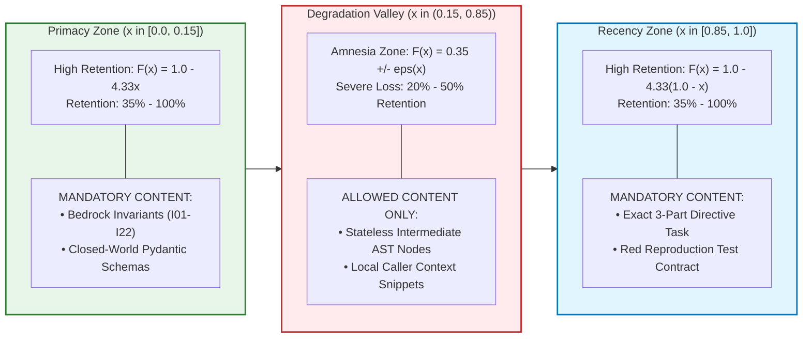
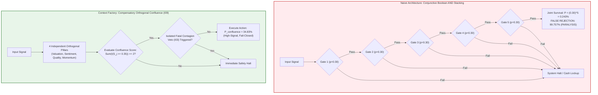

# Executive Foundations: The Mathematics of Autonomous AI Risk

---

## 🎯 Executive Overview & Scope

In enterprise software engineering across safety-critical and regulated sectors—such as FDA-regulated medical devices, core banking mainframes, aerospace avionics, and autonomous systems—reliance on stochastic LLM behavior without mathematical guardrails introduces existential enterprise risk.

This document establishes the **Executive Mathematical Foundations** of the Context Factory. Rather than treating AI engineering as empirical prompt trial-and-error, our architecture is bounded by eight deterministic mathematical pillars.

### The 8 Mathematical Pillars of Enterprise AI Risk

| # | Mathematical Pillar | Governing Mathematical Formulation | Primary Operational Guardrail | Deep Implementation |
|---| :--- | :--- | :--- | :--- |
| **1** | Quadratic Attention Scaling | $\text{FLOPs} \propto N^2, \quad \mathcal{H}(A_i) = -\sum A_{ij} \ln A_{ij}$ | Prompt ceiling $\le 2,500$ tokens | Phase 01 & Phase 03 |
| **2** | Attention Dilution Cliff | Cross-module retention drops $< 60\%$ for $> 20\text{k}$ LOC | ADR-016 400-LOC modular ceiling heuristic | Phase 03 (Decomposition) |
| **3** | Positional Attention Curve | U-Shaped retention $F(x)$: Primacy & Recency peaks | Pin invariants at $x \le 0.15$ and $x \ge 0.85$ | Phase 01 & Phase 03 |
| **4** | Temporal Telemetry Decay | Exponential half-life $w(\Delta t) = w_0 \cdot 2^{-\Delta t / t_{1/2}}$ | Hard demotion to `EXPIRED` at $\Delta t > 2 t_{1/2}$ | Phase 02 & Phase 03 |
| **5** | Compensatory Confluence | $P_{\text{joint}} = \prod p_k = 0.243\%$ vs Confluence $\ge 2$ of 4 | Confluence scoring ($I_{09}$) + Fatal Veto ($I_{03}$) | Phase 02 & Phase 04 |
| **6** | Multi-Agent Log-Odds Solver | Closed-form $\mathrm{logit}(P)$ with JSD discounting | Fast bypass if $\text{JSD} \le 0.12$; else convex fusion | Phase 09 (Orchestration) |
| **7** | Multiple-Testing Deflation | Deflated Sharpe Ratio: $\mathrm{DSR} \equiv \Phi\left(\frac{(\widehat{\mathrm{SR}} - \mathrm{SR}_0)\sqrt{T-1}}{\dots}\right)$ | Require $\mathrm{DSR} \ge 0.95$ for production approval | Phase 04 & Phase 06 |
| **8** | Covariance Shrinkage & ZCA | Ledoit-Wolf $\mathrm{cond}(\mathbf{\Sigma}_{\text{LW}}) \le 10^{12}$ & ZCA Whitening | Regularize covariance before matrix inversion | Phase 09 (Governance) |

---

## 📐 The 8 Executive Mathematical Pillars

### Pillar 1: Quadratic Complexity & Attention Entropy
Transformer attention scales quadratically with sequence length $N$:

$$\text{FLOPs}_{\text{attention}} = 2 \cdot L \cdot H \cdot N^2 \cdot d_k, \quad d_{\text{model}} = H \cdot d_k$$

The dispersion of attention probability mass across the $(N-1)$-simplex is quantified by information-theoretic attention entropy (Shannon, 1948):

$$\mathcal{H}(A_i) = -\sum_{j=1}^N A_{ij} \ln(A_{ij} + \epsilon), \quad A_{ij} \in [0, 1], \quad \sum_{j=1}^N A_{ij} = 1.0, \quad \mathcal{H}(A_i) \in [0, \ln N]\,\text{nats}$$

Where $\epsilon = 10^{-12}$ provides an $\epsilon$-floor preventing numerical underflow and division-by-zero traps (with $0 \ln 0 \equiv 0$ by continuity). Because the natural logarithm is used, entropy is measured in nats ($\mathcal{H} \ge 0$). As sequence length $N \to \infty$, uniform dispersion yields maximum entropy $\mathcal{H}_{\max} = \ln N$, diluting negative constraints, system instructions, and type invariants.
*   **Operational Guardrail**: Hard prompt ceiling of $\le 2,500$ tokens per task.
*   **Deep Implementation**: [Strategic Decomposition (01_03)](./01_strategy_and_vision/03_epic_decomposition_and_blast_radius.md) and [Context Engineering (03_04)](./03_building_and_coding/04_ast_registries_and_living_context.md).

---

### Pillar 2: Attention Dilution & Semantic Structural Scoping
Empirical testing reveals that when context exceeds 20,000 lines of code, cross-module retention drops sharply below $60\%$ due to context dilution and interference.
*   **Operational Guardrail**: Architectural Modularity Heuristic (recommended $\le 400$ LOC per file, with refactoring reviews triggered at 350 LOC to preserve single responsibility) and Semantic Structural Scoping (agents inspect cohesive AST functions and classes rather than arbitrary line windows).
*   **Deep Implementation**: [Code Decomposition & Modularity (03_03)](./03_building_and_coding/03_code_modularity_ceiling_and_pr_slicing.md).

---

### Pillar 3: Positional Attention Mechanics & The U-Shaped Curve
Decoder-only transformers exhibit severe retention decay across relative context coordinate $x \in [0.0, 1.0]$:

$$F(x) = \begin{cases} 
1.0 - 4.33 x & x \in [0.0, 0.15] \quad \text{(Primacy Zone: } F \in [0.35, 1.0]\text{)} \\
0.35 + \epsilon(x) & x \in (0.15, 0.85), \; |\epsilon(x)| \le 0.15 \quad \text{(Degradation Valley: } F \in [0.20, 0.50]\text{)} \\
1.0 - 4.33 (1.0 - x) & x \in [0.85, 1.0] \quad \text{(Recency Zone: } F \in [0.35, 1.0]\text{)}
\end{cases}$$

*   **Operational Guardrail**: Critical invariants and tool schemas must be pinned strictly to prompt inception ($x \le 0.15$) and prompt termination ($x \ge 0.85$).
*   **Deep Implementation**: [Context Engineering (03_04)](./03_building_and_coding/04_ast_registries_and_living_context.md) and [Context Mapping Matrix (09_04)](./09_ai_agent_orchestration/04_context_mapping_matrix.md).

---

### Pillar 4: Temporal Telemetry Decay & Four-Horizon Taxonomy
State observations decay in predictive validity according to exponential half-life kinetics:

$$w(\Delta t) = w_0 \cdot \left(\frac{1}{2}\right)^{\frac{\Delta t}{t_{1/2}}} = w_0 \exp\left(-\frac{\ln 2}{\max(t_{1/2}, 10^{-6})} \Delta t\right), \quad \Delta t \ge 0, \quad t_{1/2} > 0$$

$$\text{effective-confidence}(\Delta t) = \mathrm{int}\left(\mathrm{round}\left(w_0 \cdot 2^{-\frac{\Delta t}{t_{1/2}}}\right)\right)$$

System telemetry is partitioned into four operational half-life horizons:
1. *Kinematic Flow*: $t_{1/2} = 5.0\text{ days}$ (Hard expiry: $10.0\text{ days}$)
2. *Tactical Operational*: $t_{1/2} = 7.0\text{ days}$ (Hard expiry: $14.0\text{ days}$)
3. *Structural Solvency*: $t_{1/2} = 21.0\text{ days}$ (Hard expiry: $42.0\text{ days}$)
4. *Secular Quality*: $t_{1/2} = 90.0\text{ days}$ (Hard expiry: $180.0\text{ days}$)
*   **Operational Guardrail**: Any telemetry with $\Delta t > 2 \cdot t_{1/2}$ is demoted to `EXPIRED` (Invariant $I_{17}$).
*   **Deep Implementation**: [Adversarial Requirements (02_02)](./02_requirements_and_design/02_telemetry_decay_and_edge_case_matrix.md) and [Adversarial Building (03_02)](./03_building_and_coding/02_builder_red_teaming_and_cron_crisis.md).

---

### Pillar 5: Conjunctive Gate Collapse vs. Compensatory Confluence
Sequential conjunctive boolean filters ($C_1 \land C_2 \land \dots \land C_K$) suffer exponential joint probability collapse:

$$P_{\text{joint}} = \prod_{k=1}^K p_k \xrightarrow{K=5, \; p_k=0.30} (0.30)^5 = 0.00243 \; (0.243\%), \quad P_{\text{false-negative}} = 1 - P_{\text{joint}} = 99.757\%$$

Stacking just 5 conjunctive boolean gates with independent pass rate $p_k = 0.30$ reduces joint execution probability to $0.243\%$ (falsely rejecting $99.757\%$ of valid opportunities or operations; stacking 100 gates yields $(0.30)^{100} \approx 5.15 \times 10^{-53}$, inducing total system paralysis). The system instead enforces Compensatory Orthogonal Confluence (Invariant $I_{09}$):

$$P_{\text{confluence}} = \mathbb{P}\left(\sum_{j=1}^4 \mathbb{I}(S_j \ge 0.35) \ge 2 \;\land\; \neg \text{FatalContagion}\right) \approx 34.83\% \quad (\text{vs. } 0.243\%)$$

*   **Operational Guardrail**: Requires positive confirmation across $\ge 2$ of 4 orthogonal pillars with isolated fatal contagion veto ($I_{03}$).
*   **Deep Implementation**: [Requirements Decomposition (02_03)](./02_requirements_and_design/03_feature_slicing_and_confluence.md) and [Testing Architecture (04_TEST_ARCHITECTURE)](./04_testing_and_validation/TEST_ARCHITECTURE.md).

---

### Pillar 6: Multi-Agent Dialectical Triad & Convex Log-Odds Solver
To eliminate single-model sycophancy, the system deploys a 3-stage dialectical multi-agent triad arbitrated by the Jensen-Shannon Divergence (Lin, 1991):
1. *Fast-Path Consensus Bypass*: If Proponent ($P$) and Adversary ($Q$) achieve Jensen-Shannon Divergence $\text{JSD}(P \parallel Q) \le 0.12$, bypass debate at \$0 token cost. Formally, for probability vectors $P, Q$:
   $$\text{JSD}(P \parallel Q) = \frac{1}{2} D_{\text{KL}}(P \parallel M) + \frac{1}{2} D_{\text{KL}}(Q \parallel M), \quad M = \frac{1}{2}(P + Q)$$
   Where $D_{\text{KL}}$ is Kullback-Leibler divergence evaluated with base-2 logarithm, bounding $\text{JSD} \in [0.0, 1.0]$ and guaranteeing that $\sqrt{\text{JSD}}$ is a true mathematical metric satisfying the triangle inequality (Lin, 1991).
2. *Convex Evidence Solver*: If $\text{JSD} > 0.12$, the system executes closed-form log-odds evidence fusion with clamped logit bounds and JSD entropy discounting:

$$\mathrm{logit}(P) = \ln\left(\frac{P_{\text{clamped}}}{1 - P_{\text{clamped}}}\right), \quad P_{\text{clamped}} = \min(\max(P, \; \epsilon), \; 1 - \epsilon), \quad \epsilon = 10^{-7}$$

$$l_{\text{triad}} = \sum_{k=1}^K w_k \cdot \mathrm{logit}(P_k), \quad \sum_{k=1}^K w_k = 1.0$$

$$\text{entropy-discount} = \max\left(0.15, \; 1.0 - \lambda \cdot \text{JSD}(P \parallel Q)\right), \quad \text{JSD} \in [0.0, 1.0]$$

$$l_{\text{fused}} = l_{\text{deterministic}} + (\text{entropy-discount} \times l_{\text{triad}}), \quad P_{\text{fused}} = \sigma(l_{\text{fused}}) = \frac{1}{1 + e^{-l_{\text{fused}}}}$$

*   **Operational Guardrail**: Epistemic variance is dampened automatically; decisions are backed by formal proofs and bounded logits.
*   **Deep Implementation**: [The Assembly Mechanism (09_02)](./09_ai_agent_orchestration/02_the_assembly_mechanism.md).

---

### Pillar 7: Deflated Sharpe Ratio (DSR) & Multiple-Testing Bias
When an autonomous agent tests thousands of variations, standard statistical tests fail due to selection bias. The system enforces the Deflated Sharpe Ratio (Bailey & López de Prado, 2014):

$$\mathrm{DSR} \equiv \mathrm{Prob}\left[\mathrm{SR}^* > 0 \mid \{\mathrm{SR}_k\}_{k=1}^K\right] = \Phi\left(\frac{(\widehat{\mathrm{SR}} - \mathrm{SR}_0)\sqrt{T-1}}{\sqrt{1 - \hat{\gamma}_3 \widehat{\mathrm{SR}} + \frac{\hat{\gamma}_4 - 1}{4} \widehat{\mathrm{SR}}^2}}\right) \in [0.0, 1.0]$$

Where $\mathrm{SR}_0 = \mathbb{E}[\max_K \{\mathrm{SR}\}]$ is the expected maximum Sharpe ratio under the null hypothesis of zero true predictive skill across $K$ parameter trials:
$$\mathrm{SR}_0 \approx \sigma_{\text{trials}} \left( (1 - \gamma_{\text{EM}}) \Phi^{-1}\left(1 - \frac{1}{K}\right) + \gamma_{\text{EM}} \Phi^{-1}\left(1 - \frac{1}{K \cdot e}\right) \right)$$
With $\sigma_{\text{trials}}$ representing the empirical standard deviation across all $K$ trials, $\gamma_{\text{EM}} \approx 0.5772156649$ being the Euler-Mascheroni constant, and sample size $T > 1$.
*   **Operational Guardrail**: Only models or rules satisfying $\mathrm{DSR} \ge 0.95$ are approved for production.
*   **Deep Implementation**: [Testing Architecture (04_TEST_ARCHITECTURE)](./04_testing_and_validation/TEST_ARCHITECTURE.md) and [Regulatory Red-Teaming (06_02)](./06_security_and_compliance/02_regulatory_red_teaming.md).

---

### Pillar 8: Ledoit-Wolf Covariance Shrinkage & Symmetrical ZCA Whitening
Correlated environmental telemetry causes ill-conditioned covariance matrices ($\mathrm{cond}(S) > 10^{15}$). The system regularizes covariance via analytical Ledoit-Wolf shrinkage (Ledoit & Wolf, 2004):

$$\mathbf{\Sigma}_{\text{LW}} = (1 - \delta^*) \mathbf{S} + \delta^* \mathbf{F}, \quad \mathbf{F} = \frac{\mathrm{Tr}(\mathbf{S})}{p} \mathbf{I}_p, \quad \mathrm{cond}(\mathbf{\Sigma}_{\text{LW}}) \le 10^{12} \quad (\text{Invariant } I_{11})$$

Where $\delta^* \in [0, 1]$ is the analytically optimal shrinkage intensity minimizing expected quadratic loss under Frobenius norm. This is followed by symmetrical Zero-Phase Component Analysis (ZCA) whitening (Bell & Sejnowski, 1997; Kessy, Lewin, & Strimmer, 2018):

$$\mathbf{\Sigma}_{\text{LW}} = \mathbf{U} \mathbf{\Lambda} \mathbf{U}^T, \quad \mathbf{\Lambda} = \mathrm{diag}(\lambda_1, \dots, \lambda_p)$$

$$\lambda_{\text{safe}, i} = \min\left(\max\left(\lambda_i, \; \max(10^{-4} \lambda_{\max}, 10^{-8})\right), \; \max(1.0, \mu)\right), \quad \mu = \frac{\mathrm{Tr}(\mathbf{\Sigma}_{\text{LW}})}{p}$$

$$\mathbf{W}_{\text{ZCA}} = \mathbf{U} \mathbf{\Lambda}_{\text{safe}}^{-1/2} \mathbf{U}^T = \mathbf{U} \;\mathrm{diag}\left(\frac{1}{\sqrt{\lambda_{\text{safe}, 1}}}, \dots, \frac{1}{\sqrt{\lambda_{\text{safe}, p}}}\right) \mathbf{U}^T$$

$$\mathbf{X}_{\text{decorrelated}} = (\mathbf{X} - \bar{\mathbf{X}}) \mathbf{W}_{\text{ZCA}}^T + \bar{\mathbf{X}}$$

As proven by Kessy et al. (2018), symmetrical ZCA whitening $\mathbf{W}_{\text{ZCA}} = \mathbf{\Sigma}^{-1/2}$ is the unique transformation that minimizes expected squared reconstruction error $\mathbb{E}[\|\mathbf{W} \mathbf{X} - \mathbf{X}\|^2]$ subject to $\mathrm{Cov}(\mathbf{W} \mathbf{X}) = \mathbf{I}$, preserving maximal cross-covariance with the original input channels. The upper clamp $\max(1.0, \mu)$ resolves the ZCA Agreement Paradox by preventing unanimous multi-pillar co-movement from being artificially penalized.
*   **Operational Guardrail**: Decorrelates multi-sensor inputs while preserving original spatial coordinate identities and avoiding penalization of unanimous consensus.
*   **Deep Implementation**: [Epistemic Governance (09_05)](./09_ai_agent_orchestration/05_epistemic_governance.md).

---

## 🏛️ Comprehensive Role Navigation Matrix

| Mathematical Pillar | Responsible Role | Implementation Module | CI Verification Test |
| :--- | :--- | :--- | :--- |
| **Pillars 1 & 2: Attention & LOC** | Strategy Lead / Builder | `01_03`, `03_03`, `03_04` | `test_adr016_loc_counter_excludes_anchor_blocks` |
| **Pillar 3: Positional Attention** | Requirements / Architect | `02_04`, `03_04`, `09_04` | `test_latex_lost_in_the_middle_formulation` |
| **Pillar 4: Temporal Decay** | Requirements Lead | `02_02`, `03_02` | `test_latex_continuous_half_life_decay_formulation` |
| **Pillar 5: Confluence** | Validation Lead (QE) | `02_03`, `04_02`, `04_TEST`| `test_latex_joint_probability_vs_confluence_formulation`|
| **Pillar 6: Dialectical Solver**| Agent Orchestrator | `09_02` | `test_latex_log_odds_convex_evidence_fusion_mechanics` |
| **Pillar 7: Deflated Sharpe** | Security / Validator | `04_TEST`, `06_02` | `test_tier1_feature_contracts.py` (DSR Contract) |
| **Pillar 8: ZCA Whitening** | Systems Engineer | `09_05` | `test_alg89_zca_whitening_execution` |

---

## 📚 References & Foundational Literature

1. **Bailey, D. H., & López de Prado, M. (2014).** *"The Deflated Sharpe Ratio: Correcting for Selection Bias, Backtest Overfitting, and Non-Normality."* *Journal of Portfolio Management*, 40(5), 94–107.
2. **Ledoit, O., & Wolf, M. (2004).** *"A Well-Conditioned Estimator for Large-Dimensional Covariance Matrices."* *Journal of Multivariate Analysis*, 88(2), 365–411.
3. **Lin, J. (1991).** *"Divergence measures based on the Shannon entropy."* *IEEE Transactions on Information Theory*, 37(1), 145–151.
4. **Bell, A. J., & Sejnowski, T. J. (1997).** *"The 'independent components' of natural scenes are edge filters."* *Vision Research*, 37(23), 3327–3338.
5. **Kessy, A., Lewin, A., & Strimmer, K. (2018).** *"Optimal Whitening and Decorrelation."* *The American Statistician*, 72(4), 309–314.
6. **Liu, N. F., Gardner, M., Liang, P., Manning, C. D., & Levy, O. (2023).** *"Lost in the Middle: How Language Models Use Long Contexts."* *Transactions of the Association for Computational Linguistics (TACL)*, 12, 157–173.
7. **Shannon, C. E. (1948).** *"A Mathematical Theory of Communication."* *Bell System Technical Journal*, 27(3), 379–423.

---

## Production Reality & Mathematical Failure Modes in the AI Era

### The Mid-2026 Production Baseline (The Heuristic Intuition Trap)

> [!WARNING]
> **The 75% Enterprise Ad-Hoc Trap**: Between 75% and 84% of software engineering teams treat artificial intelligence as a black box of mystical heuristics. Teams ignore attention entropy ($\mathcal{H}(A_i)$), overlook positional attention decay ($F(x)$), and construct safety architectures by stacking rigid boolean checks.

#### Observed Empirical Failure Cycle:
1. **The Context Wall**: Stacking five boolean filter gates with 30% pass rates collapses joint survival probability to $P_{\text{joint}} = (0.30)^5 \approx 0.243\%$, inducing 99% gate paralysis.
2. **The Verification Tax**: Teams treat stale 4-week-old cached telemetry as real-time truth, ignoring continuous half-life decay kinetics and causing reviewers to spend 91% more time debugging downstream hallucinations (Faros AI).
3. **The Churn Inversion**: When systems lock up or hallucinate, engineers resort to ad-hoc prompt tweaking instead of applying closed-form statistical and mathematical bounds.

### Ungoverned Production Failure Modes
Ignoring the mathematical foundations of AI risk triggers critical failure cascades in production:
- **Systemic Execution Paralysis (Crisis 4)**: Autonomous pipelines grind to a halt because conjunctive boolean checks reject 99.7\% of legitimate actions, forcing continuous manual overrides and emergency developer paging.
- **Attention Dilution & Invariant Loss**: Ingesting un-curated token payloads raises attention entropy ($\mathcal{H} \approx 10.60\text{ nats}$), dropping mid-context retrieval to 35\% and causing models to miss safety constraints located in the center of the prompt.
- **Mathematical Matrix Inversion Explosions**: In financial and multi-sensor pipelines, correlated inputs drive the covariance matrix condition number toward infinity ($\kappa(\mathbf{\Sigma}) \to \infty$). Without Ledoit-Wolf analytical shrinkage, matrix inversion algorithms explode, triggering erratic actuator output or catastrophic trading losses.

### Deterministic Engineering Defenses & Operational Takeaways
Production resilience requires replacing heuristic guesswork with rigorous mathematical control systems:
1. **Replace Conjunctive Boolean Gates with Compensatory Confluence**: Refactor rigid boolean AND chains into $M$-of-$N$ orthogonal confluence scores ($I_{09}$), ensuring the system remains resilient to isolated sensor dropouts.
2. **Apply Continuous Half-Life Decay to Ingress Telemetry**: Multiply all external signals and sentiment metrics by exponential decay weights ($w(\Delta t) = w_0 \cdot (1/2)^{\Delta t / t_{1/2}}$) to eliminate stale data contamination.
3. **Deploy Closed-Form Convex Log-Odds Fusion**: For multi-model arbitration, replace natural language voting with deterministic log-odds fusion discounted by Jensen-Shannon Divergence (`solve_convex_consensus()`).
4. **Enforce Ledoit-Wolf Shrinkage on Covariance Calculations**: Ensure that all empirical covariance matrices are stabilized via analytical shrinkage before matrix inversion or ZCA whitening, guaranteeing numerical stability under collinear stress.

---

[**Proceed to Enterprise Constitution & Invariants →**](./00_ENTERPRISE_CONSTITUTION.md) | [**Return to Main Curriculum Hub →**](./README.md)
