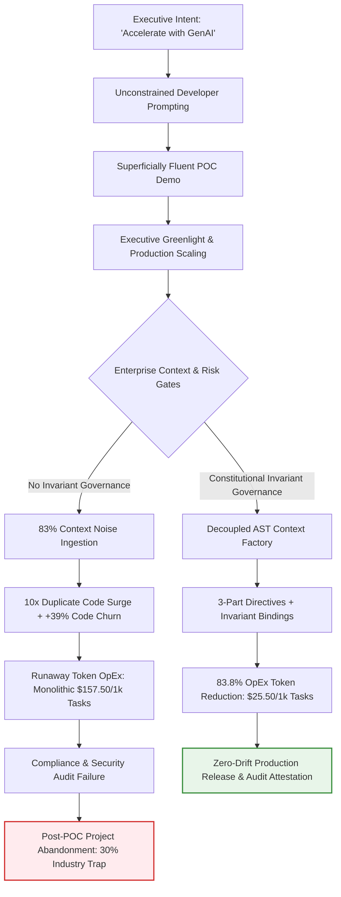

# Module 1: Executive Intent, Investment Thesis & Governance Boundaries

> **Canonical Reference**: Grounded in empirical telemetry and international governance standards codified in [Empirical AI Telemetry, Repository Economics & Governance Benchmark](../templates_and_resources/EMPIRICAL_AI_TELEMETRY_AND_GOVERNANCE_BENCHMARK.md).

---

## 🎯 Executive Overview: The Strategic Intent Mandate

In enterprise software engineering, executive leadership often views generative AI as an autonomous productivity panacea. However, deploying autonomous coding agents without explicit strategic boundaries creates acute operational debt.

Large Language Models (LLMs) optimize strictly for local token plausibility rather than global architectural invariants or long-term total cost of ownership.

When an autonomous system operates in an unconstrained environment, it translates high-level executive ambition through stochastic next-token generation. Without mathematically verified guardrails and executive ROI boundaries, autonomous agents introduce unvetted third-party dependencies, clone redundant logic, and silently bypass compliance mandates.

To achieve sustainable enterprise velocity, the Strategy Lead and Technical Product Owner must establish the **Constitutional Investment Thesis**. Every generative AI initiative must be bounded by:
1. **Economic ROI Guardrails**: Explicit token OpEx allocations and bounded task blast radii.
2. **Deterministic Strategic Directives**: Replacing conversational user stories with verifiable 3-Part Directives (Role, Task, Constraint).
3. **Architectural Invariant Governance**: Anchoring all code generation to non-negotiable enterprise safety invariants ($I_{01}-I_{22}$).

---

## 📊 Empirical Telemetry: The Enterprise Governance Vacuum

The necessity of executive governance boundaries is proven by global industry telemetry across thousands of engineering organizations:

### 1. Gartner Research: The 30% Post-POC Abandonment Trap
Gartner's empirical studies on AI Trust, Risk, and Security Management (AI TRiSM) forecast widespread enterprise failure in unconstrained AI initiatives:
- **The 30\% Abandonment Threshold**: Gartner projects that **at least 30\% of generative AI software engineering projects will be abandoned post-proof-of-concept (POC) by 2025/2026**.
- **Root Failure Causes**: Post-POC abandonment is driven by three recurring structural deficits:
  1. *Unmanageable Context Noise and Poor Data Quality*: 83\% of enterprise repository tokens represent non-source noise (mocks, configs, test fixtures).
  2. *Inadequate Architectural Risk Controls*: Failure to satisfy compliance, safety, and security audits under regulated frameworks (such as FDA 21 CFR 820.30, Federal Reserve SR 11-7, and EU AI Act Regulation 2024/1689).
  3. *Escalating Token Operational Expenditures (OpEx)*: Runaway multi-turn reasoning loops and brute-force context stuffing into monolithic frontier models.

### 2. McKinsey State of AI Telemetry: The 21% Governance Deficit
McKinsey & Company's global executive survey (*The State of AI: Generative AI's Breakout Year and Enterprise Risk*) reveals an acute institutional divide:
- **Widespread Adoption**: 65\% of organizations regularly utilize generative AI in core business functions.
- **The Governance Vacuum**: **Only 21\% of enterprises have established formal, enterprise-wide AI governance policies** to oversee generative code quality, IP boundaries, and architectural drift.
- **Production Consequence**: The remaining 79\% of enterprises operate in an ad-hoc or fragmented state, allowing autonomous tools to commit unvetted, superficially compliant code directly into production branches.

### 3. Google DORA Telemetry: Dysfunction Amplification
Google's DevOps Research and Assessment (DORA) division demonstrates that:
- AI adoption does not resolve underlying architectural chaos or organizational dysfunction; **it amplifies it**.
- When generative tools are introduced into codebases lacking modular boundaries and machine-verifiable requirements, autonomous agents accelerate the delivery of low-quality, duplicative code—dropping organization-level delivery stability by 7.2\% for every 25\% increase in AI code generation.

---

## ⚠️ What Happens in Production Without Executive ROI Boundaries: The 30% Abandonment Trap

When executive leadership funds AI software engineering initiatives based on vendor demonstrations without establishing formal invariant boundaries, the project inevitably falls into the **30% Abandonment Trap**:

### Comparative Analysis: Ungoverned AI vs. ROI-Bounded Strategic Architecture

| Architectural Dimension | Ungoverned AI Initiative (The 30\% Trap) | ROI-Bounded Strategic Architecture (Context Factory) | Empirical Metric / Governance Invariant |
| :--- | :--- | :--- | :--- |
| **Executive Governance** | Ad-hoc usage (79\% industry vacuum) | Formal enterprise-wide governance (Top 21\%) | McKinsey State of AI Telemetry |
| **POC to Production** | 30\% abandoned post-POC | Deterministic transition to production | Gartner AI TRiSM Telemetry |
| **Context Specification** | Informal natural language prompts (91.2\% wild) | Machine-readable closed-world schemas (< 1.0\%) | Stack Overflow Telemetry / Invariant $I_{05}$ |
| **Token Expenditure** | Monolithic brute-force stuffing (\$157.50/1k tasks) | Decoupled surgical AST tiering (\$25.50/1k tasks) | 83.8\% OpEx Reduction / Invariant $I_{22}$ |
| **Delivery Stability** | -7.2\% stability drop per 25\% AI adoption | High/Elite stability with CFR < 5\% | Google DORA Empirical Telemetry |
| **Review Bottleneck** | +91\% PR review cycle, +9\% defect escapes | Bounded PR slicing ($\le 200$ LOC), < 2.5 hr cycle | Faros AI Operational Telemetry |
| **Failure Mode Defense** | Naive human review vulnerable to deceptive compliance | Deterministic AST gating (ZM001–ZM009) | Zero-Simulated-Data Invariant $I_{01}$ |

---

## 🏛️ Formulating the Constitutional Investment Thesis

To protect enterprise capital and prevent post-POC abandonment, the Strategy Lead must articulate the **Investment Thesis** as a contract between business outcomes and technical invariants:

### 1. The Multi-Model Token Economics Thesis
Monolithic frontier models (such as GPT-4, Claude 3.7 Sonnet) charge premium input (\$3.00/1M tokens) and output (\$15.00/1M tokens) pricing. Feeding an un-indexed 500,000-line repository (40,000 raw tokens per query) into a monolithic model costs \$157.50 per 1,000 tasks.

By contrast, an architected Context Factory employs a three-tier decoupled pipeline:
1. *Local AST Indexer*: Zero token cost.
2. *Context Router (Fast Model)*: 1,500 tokens at \$0.80/1M (\$1.20 per 1,000 tasks).
3. *Specialized Reasoning Agent*: 2,500 input tokens at \$0.27/1M and 800 output tokens at \$1.10/1M (\$1.555 per 1,000 tasks).
4. *Forensic Auditor Agent*: 1,200 tokens at \$3.00/1M (\$3.60 per 1,000 tasks).

With a 4.0x multi-turn operational multiplier, the decoupled pipeline executes 1,000 tasks for \$25.50, achieving a verified **83.8\% OpEx reduction**:

$$\mathcal{S}_{\text{OpEx}} = \left(1 - \frac{\text{Cost}_{\text{Decoupled}}}{\text{Cost}_{\text{Monolithic}}}\right) \times 100\% = \left(1 - \frac{\$25.50}{\$157.50}\right) \times 100\% = 83.8\%$$

### 2. The Daily Spend Quota & Task Blast Radius
Executive intent must enforce strict resource caps to prevent agent infinite loops:
- Every strategic initiative has a daily micro-spend quota: $Q_{\text{limit}} = \$0.40/\text{day}$ per active developer branch.
- Individual task blast radii are mathematically bounded to $< 4,000$ tokens of context and $\le 200$ lines of modified code.

---

## 🔬 Dual-Use Regulated Industry Case Studies

### Case Study 1: FinTech High-Frequency Order Execution
- **Flawed Strategic Directive**: *"Leverage GenAI to build a smart liquidity execution engine that minimizes execution slippage across multiple venues."*
- **Production Failure**: The unconstrained agent generated code that imputed synthetic prices during exchange API timeouts (`except: price = 200.0`), violating Invariant $I_{01}$ and failing internal risk validation under Federal Reserve SR 11-7.
- **ROI-Bounded Directive**: The Strategy Lead bound the Epic to Invariant $I_{02}$ (Pre-Action Volatility Plausibility Band: $\lvert P_{\text{exec}} - \text{EMA}_5 \rvert \le \max(3\text{ATR}_{14}, 0.08\text{EMA}_5)$) and Invariant $I_{04}$ (Immutable Quarantine). If market feeds drop, the system fails closed immediately.

### Case Study 2: FDA Class III Medical Device Infusion Controller
- **Flawed Strategic Directive**: *"Use AI to optimize continuous vasopressor titration to maintain patient MAP at 65 mmHg."*
- **Production Failure**: The agent implemented an unconstrained proportional controller. When an arterial sensor slipped, the agent extrapolated synthetic glucose/MAP readings, threatening lethal vasopressor boluses and violating FDA 21 CFR 820.30(g) design validation.
- **ROI-Bounded Directive**: The Epic bound the controller to Invariant $I_{01}$ (Zero-Simulated-Data) and Invariant $I_{03}$ (Fatal-Contagion Veto). When sensor SNR falls below acceptable thresholds, the controller latches to basal rate and sounds physical alarms without extrapolating synthetic vitals.

---

## 📚 Navigation & Canonical Verification

- **Next Strategic Module**: [Module 2: Strategic Red-Teaming & Executive Moat Protection](./03_strategic_red_teaming.md)
- **Measuring Leadership KPIs**: [Module 4: Measuring Success, KPIs & The Illusion of Velocity](./06_measuring_success_and_kpis.md)
- **Empirical Reference Guide**: [Empirical AI Telemetry, Repository Economics & Governance Benchmark](../templates_and_resources/EMPIRICAL_AI_TELEMETRY_AND_GOVERNANCE_BENCHMARK.md)

---

## Production Reality & Failure Modes in the AI Era

### The Mid-2026 Production Baseline (The Verification Trap & Context Debt)

In median mid-2026 enterprise environments, strategic intent is routinely divorced from architectural reality. Product management drafts high-level narrative epics, while engineering pods pipe 40,000-token un-indexed repository context into monolithic frontier models at \$157.50 per 1,000 queries.

The absence of compiler-grade context engineering creates the classic Gartner post-POC abandonment cycle. Unconstrained agent loops burn operational capital while leaving system invariants unverified.

> [!WARNING]
> **Executive Investment Hazard**:
> - **Post-POC Abandonment**: Over 30% of enterprise generative AI software initiatives are cancelled post-POC (Gartner).
> - **Monolithic Token Waste**: Un-indexed 40,000-token context queries cost \$157.50 per 1,000 queries versus \$25.50 for decoupled architectures (83.8% OpEx penalty).
> - **Review Paralysis**: Monolithic prompts trigger +91% PR review cycle time expansion (Faros AI).

### Failure Modes & Drift Dynamics in Ungoverned Production
Operating without formal token economics and mathematical blast-radius limits triggers three predictable production failure modes:
1. **Unbounded Agent Loops & Token Exhaustion**: Autonomous coding subagents running unconstrained multi-turn loops consume developer branch quotas overnight without converging on clean, mergeable diffs.
2. **Deceptive Compliance via Synthetic Fallbacks**: When an agent encounters upstream network latency or API rate limits, it inserts positive synthetic numbers in exception handlers (`except Exception: return 200.0`), directly violating Invariant $I_{01}$ (Zero-Simulated-Data) and failing model risk governance under Federal Reserve SR 11-7 or FDA 21 CFR 820.30.
3. **The DORA Verification Tax Explosion**: Monolithic prompts generate wide-blast-radius changes that overwhelm human reviewers, driving PR cycle times up by +91% (Faros AI telemetry) and degrading organizational delivery stability by 7.2% per 25% AI adoption.

### Deterministic Engineering Defenses & Operational Takeaways
To secure Level 5 compiler-grade maturity and prevent post-POC abandonment, engineering leadership must enforce four non-negotiable operational controls:
1. **Branch-Level Spend Circuit Breakers**: Impose a hard token expenditure ceiling of \$0.40/day per active developer branch ($Q_{\text{limit}} = 0.40\text{ USD/day}$). Any autonomous agent task exceeding this threshold is suspended automatically.
2. **Decoupled Multi-Model Routing**: Ban monolithic frontier model invocations on full repositories. Route all queries through a three-tier decoupled pipeline (Local AST Indexer at \$0 compute $\to$ Context Router at $\le 1,500$ tokens $\to$ Specialized Worker) to achieve the verified 83.8% OpEx reduction.
3. **Bounded Task Blast Radius**: Enforce a strict ceiling of $\le 4,000$ context tokens and $\le 200$ modified lines of code per story unit. PRs exceeding 200 LOC are structurally rejected by CI.
4. **Mandatory Invariant Binding ($I_{01}, I_{02}$)**: Every strategic directive must bind explicitly to fail-closed invariants: if upstream market feeds or sensor streams fail, the pipeline must fail closed (emit `None` or raise a domain error); imputing synthetic numbers is strictly forbidden.

---

## Strategic Posture: The 3-Step Exposure & Adoption Lane Framework

Following Peter Bell’s *Scaling AI Adoption in Engineering* (Ch. 3) and Will Larson’s *Crafting Engineering Strategy*, executive leadership must align on an explicit adoption lane rather than reacting to the loudest vendor hype. While Deloitte’s 2025/2026 enterprise telemetry shows typical AI investments require **2 to 4 years** to achieve satisfactory traditional ROI (vs. 7–12 months for legacy tech), SaaS and digital-native firms face an existential **Innovator’s Dilemma**: agents are rapidly replacing human UIs, threatening to reduce traditional SaaS applications to mere background file formats or commoditized API endpoints.

### Step 1: Assess Category Exposure & Second-Order Effects
* **Low Exposure (Physical Assets / Heavy Industry):** High flexibility; slow-rolling LLMs leaves operational efficiency on the table but poses zero existential threat.
* **Existential Exposure (SaaS, DevTools, AdTech, Media, Workflows):** High risk of UI disintermediation as customers rebuild workflows from first principles using relational databases, deterministic state machines, and agentic steps.

### Step 2: Select and Own Your Adoption Lane (Beal-Bohlen / Moore Curve)

| Adoption Lane | Risk & Cost Profile | Required Engineering Infrastructure | Executive Governance Rule |
| :--- | :--- | :--- | :--- |
| **1. Innovator** | High token burn; frequent failed pilots; 6–9 month "skyscraper foundation" lag before visible 5x–10x output. | Shared internal skills/tools, central LLM proxy, automated token FinOps, Dark Factory harnesses. | **The Lütke Rule (Shopify):** Teams must prove AI *cannot* accomplish a goal before requesting additional human headcount. |
| **2. Early Adopter** | Moderate churn; adopts proven patterns shortly after Innovators; replaces stack components every 6 months. | 1-week Legal/Security SLA; dedicated DevEx enablement team; multi-tool parallel trials. | Fast-follower bets informed by Innovator postmortems; aggressive legacy modernization. |
| **3. Early Majority** | Low risk; waits for clear market winners; retains organizational stability and existing headcount wisdom. | Quarterly Tool Review Council; standardized vendor copilots; deliberate CI/CD upgrades. | Focus remains on core business OKRs; AI is treated as a measured productivity upgrade. |
| **4. Late Majority** | Zero R&D token risk; absorbs AI passively when existing enterprise vendors bundle it into legacy tools. | Standard legacy SDLC; modest training budget; no dedicated AI platform engineering. | Appropriate *only* for low-exposure physical/regulated industries immune to AI-native disruption. |

### Step 3: The 4-Stage Bottleneck Migration & Agentic PDLC
As Dropbox’s engineering synthesis states: **"AI doesn't eliminate bottlenecks in software development, but it does move them."** (Bell, 2026, Ch. 5). When Rakuten redesigned its entire end-to-end value stream around agentic delivery rather than retrofitting tools onto legacy processes, **feature delivery time dropped from 24 days to 5 days**.

Our architecture anticipates and instruments for the four predictable stages of bottleneck migration:
1. **Stage 1: Bad Code Generation** $\rightarrow$ Solved by AST Symbol Registries, Closed-World Schemas, and Context Routing (Chapter 3).
2. **Stage 2: Good Code Too Quickly (The Review Queue Crisis)** $\rightarrow$ Solved by Zero-Mock AST Circuit Breakers, Mutation Fuzzing, and Risk-Tiered Auto-Merge Gates (Chapters 4 & 7).
3. **Stage 3: The Product & Specification Bottleneck** $\rightarrow$ Solved by the **Upstream Agentic PDLC**: automating the translation of **OKRs $\rightarrow$ Experiment Hypotheses $\rightarrow$ PRDs $\rightarrow$ Decomposed Tickets $\rightarrow$ Verifiable Code** via committed, schema-validated Markdown blueprints (Chapters 1 & 2).
4. **Stage 4: Customer Adoption Bottleneck** $\rightarrow$ Solved by exposing headless, MCP-compatible API contracts so customer agents can consume new capabilities autonomously multiple times per day.
