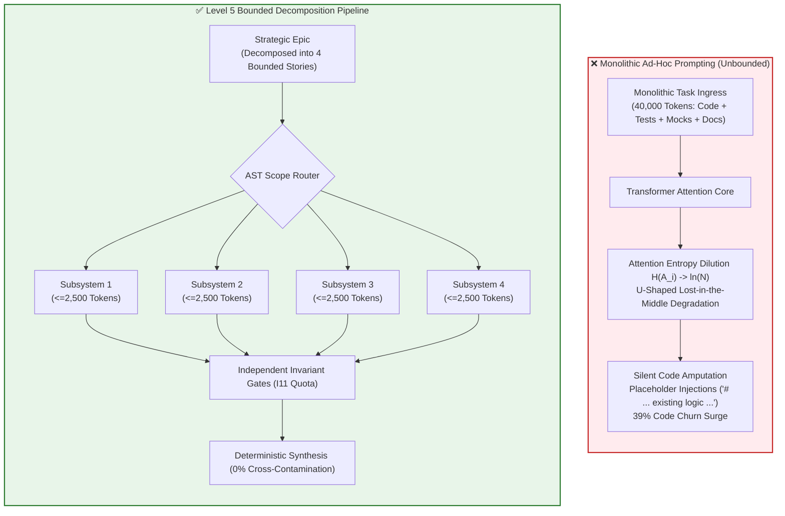
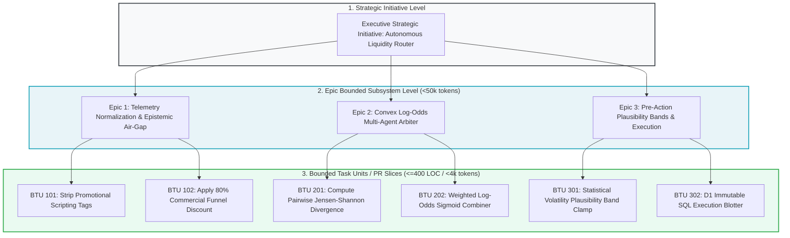

# Module 3: Epic Decomposition Mathematics & Organizational Blast Radius

---

## 🎯 Executive Overview & The Fallacy of Monolithic Prompts

A prevalent misconception among executive leadership and non-technical stakeholders is that expanding Large Language Model context windows (e.g., 1 Million to 2 Million tokens) eliminates the necessity of software modularity and task decomposition. Strategy Leads often ask:
> *"If modern frontier models can ingest 2 Million tokens, why can we not simply feed our entire 500,000 LOC enterprise codebase into a single prompt and ask the AI to refactor our system?"*

The answer is dictated by the fundamental mathematical laws of Transformer attention mechanics, information-theoretic attention entropy, and non-linear degradation curves. Unconstrained context ingestion does not increase model intelligence; it accelerates model hallucination, causes critical constraint amnesia, and incinerates token budgets.

```
┌──────────────────────────────────────────────────────────────────────────────────────────────────┐
│                   THE STRATEGIC CONTEXT SPECTRUM (MONOLITHIC VS. BOUNDED)                        │
├────────────────────────────────┬─────────────────────────────────────────────────────────────────┤
│ Monolithic Context (High Risk) │ Bounded Cognitive Units (Deterministic)                         │
├────────────────────────────────┼─────────────────────────────────────────────────────────────────┤
│ Ingests 50,000+ unbounded LOC  │ Semantic AST structural scoping (cohesive units <= 400 LOC)     │
│ Quadratic FLOPs explosion      │ Strictly bounded token burn (BTU <= 25,000 tokens)              │
│ Attention entropy dispersion   │ High attention concentration on critical invariants             │
│ Middle-zone information loss   │ Invariants pinned to high-attention Primacy & Recency zones     │
│ Silent feature truncation      │ Protected by Anti-Feature-Erasure (Rule 14)                     │
└────────────────────────────────┴─────────────────────────────────────────────────────────────────┘
```

---

## 🔢 The Mathematical Proof for Bounded Context

### 1. Quadratic Computational Scaling and Attention FLOPs
In the standard Transformer architecture, computing self-attention across a sequence of $N$ tokens requires calculating pairwise dot products between Query ($Q$) and Key ($K$) representations in $\mathbb{R}^{N 	imes d_k}$:

$$\text{Attention}(Q, K, V) = \text{softmax}\left(\frac{QK^T}{\sqrt{d_k}}\right)V$$

The raw computational complexity for self-attention across sequence length $N$ scales quadratically:

$$\text{FLOPs}_{\text{attention}} \sim 2 \cdot L \cdot H \cdot N^2 \cdot d_k$$

Where:
*   $L$ is the number of transformer layers.
*   $H$ is the number of attention heads.
*   $d_k$ is the dimensionality of each head ($d_{\text{model}} = H \cdot d_k$).

When $N$ scales from 4,000 tokens to 128,000 tokens ($32\times$ expansion), attention FLOPs expand by $32^2 = 1,024\times$, leading to massive latency spikes and quadratic inference costs.

### 2. Information-Theoretic Attention Entropy $\mathcal{H}(A_i)$
As sequence length $N$ grows, the softmax probability distribution across keys disperses across thousands of irrelevant tokens. The attention entropy for token $i$ across sequence $N$ is defined as:

$$\mathcal{H}(A_i) = -\sum_{j=1}^N A_{ij} \ln A_{ij}$$

*   **Minimum Entropy ($\\mathcal{H} = 0$)**: All attention mass is sharply focused on a single relevant token ($A_{i, \text{target}} = 1.0$).
*   **Maximum Entropy ($\\mathcal{H} = \ln N$)**: Attention mass is uniformly smeared across all $N$ tokens ($A_{ij} = \frac{1}{N}$), rendering the model incapable of distinguishing architectural constraints from background noise.

When attention entropy is elevated, the model suffers from **Constraint Smearing**: negative constraints (e.g., *"Never use floating-point math"* or *"Never allow unverified telemetry"*) lose salience, leading to silent security breaches.

### 3. The U-Shaped Attention Curve ("Lost in the Middle")
Empirical evaluations of decoder-only autoregressive transformers establish that retrieval accuracy is not uniform across a prompt. Positional attention follows a U-shaped retention fidelity curve $F(x)$ across relative token coordinate $x \in [0.0, 1.0]$:

$$F(x) = \begin{cases} 
1.0 - k_1 x & x \in [0.0, 0.15] \quad \text{(Primacy Bias: High Recall)} \\
0.35 + \epsilon(x) & x \in (0.15, 0.85) \quad \text{(Degradation Valley: 40 to 75 percent loss)} \\
1.0 - k_2 (1.0 - x) & x \in [0.85, 1.0] \quad \text{(Recency Bias: High Recall)}
\end{cases}$$

```
F(x) Retrieval Fidelity
1.0 ┼───┐                                                       ┌───┤
0.8 ┼   └───┐                                               ┌───┘   │
0.6 ┼       └───┐                                       ┌───┘       │
0.4 ┼           └───────────────────────────────────────┘           │  Degradation Valley
0.2 ┼                     (40% to 75% Information Loss)             │  (15% to 85% Zone)
0.0 ┴───┬───────────────┬───────────────────────┬───────────────┬───┤
       0.0             0.15                    0.85            1.00
       [Primacy Zone]   <── Degradation Valley ──>    [Recency Zone]
```

When an unpartitioned 500,000 LOC codebase is dumped into a prompt:
1. **Middle Zone Collapse**: Rules, schemas, and invariants placed in the middle 70% of the prompt suffer a $40\%$ to $75\%$ probability of omission.
2. **Feature Erasure & Truncation**: Under context fatigue, models hallucinate missing functions or replace complex error handlers with placeholders like `# ... existing logic remains ...`.



### 4. Token Spend Ceilings & Micro-USD Quotas ($I_{11}$)
Unconstrained prompting is economically unsustainable. Executing an unpartitioned 200,000-token prompt across 30 iterative agent cycles costs hundreds of dollars per minor bug fix.

Under the **Micro-USD Daily Spend Quota Guardrail (Invariant $I_{11}$)**, systems enforce a rolling 24-hour spend ceiling:

$$Q_{\text{rem}} = Q_{\text{limit}} - \sum_{t \in 24\text{h}} \text{Spend}_t, \quad Q_{\text{limit}} = 0.40\,\text{USD/day} = 400,000\,\mu\text{USD}$$

With an individual subsystem ceiling:

$$Q_{\text{subsystem}} \le 0.08\,\text{USD/day} = 80,000\,\mu\text{USD}$$

---

## ✂️ The Strategic Decomposition Hierarchy

To keep engineering within high-fidelity attention zones, the Strategy Lead establishes a strict 3-tier decomposition hierarchy:



---

## 🏥 Regulated Industry Dual-Use Case Studies

```
┌──────────────────────────────────────────────────────────────────────────────────────────────────┐
│                   DECOMPOSITION IN REGULATED ENTERPRISES                                         │
├──────────────────────────────────────────────────────────────────────────────────────────────────┤
│                                                                                                  │
│   HEALTHCARE: FDA Class III Closed-Loop Insulin Infusion Pump                                    │
│   • Threat: Developer submitted entire 60,000 LOC firmware to an LLM to add basal rate limits.   │
│   • Breakdown: Model experienced middle-zone attention collapse; stripped out the safety check   │
│     that halts insulin delivery when battery voltage drops below 3.2V.                           │
│   • Strategic Fix: Sliced into single-purpose BTU (<300 LOC) containing only the titration loop  │
│     and battery monitor schema. Verified via hermetic test suite with zero regressions.          │
│                                                                                                  │
│   FINANCE: Core Banking High-Frequency Settlement Gateway                                        │
│   • Threat: Engineering dumped 120,000 LOC ledger codebase into prompt to add ISO 20022 parsing. │
│   • Breakdown: Model hallucinated a synthetic currency conversion fallback when rates timed out. │
│   • Strategic Fix: Enforced Architectural Modularity Heuristics (<= 400 LOC) and Bounded Task Units.│
│     Isolated ISO 20022 message deserialization from core debit/credit ledger commit.             │
│                                                                                                  │
└──────────────────────────────────────────────────────────────────────────────────────────────────┘
```

---

## 📋 Module Summary & Practical Next Step

Strategic decomposition is an inviolable mathematical requirement. By enforcing Bounded Task Units (BTUs), Strategy Leads maintain model attention in the $>95\%$ precision zone, eliminate code bloat, and protect organizational capital.

[**Proceed to Module 4: Context Engineering & Registry Maps →**](./04_epistemic_firewalls_and_market_airgaps.md)

---

## Production Reality & Failure Modes in the AI Era

### The Mid-2026 Production Baseline (The Verification Trap & Context Debt)

In median mid-2026 engineering pods, developers and technical leads treat LLMs as full-stack architects with unbounded context retention. Teams feed massive monolithic epics in 35,000-token prompts.

Due to $O(N^2)$ transformer attention dilution, the model forgets middle constraints and hallucinates deprecated APIs. It outputs a 900-line monolithic diff that breaks cross-module invariants.

> [!WARNING]
> **Monolithic Context Failure Metrics**:
> - **Lost-in-the-Middle Degradation**: Mid-prompt retrieval fidelity drops to $F(x) \approx 0.35$ (40% to 75% retrieval loss).
> - **GitClear Churn Spiral**: Unbounded scoping induces a +39% surge in code churn and 10x cloned code duplication.
> - **Review Bottleneck**: Reviewers encounter +91% PR cycle time bloat attempting to verify monolithic diffs.

### Failure Modes & Drift Dynamics in Ungoverned Production
Failing to enforce mathematical Bounded Task Units (BTUs) and attention budgeting leads to three severe failure patterns:
1. **The GitClear Churn Spiral (+39% Churn, 10x Cloned Code)**: When given unbounded scope, models duplicate existing utility classes rather than refactor shared abstractions. When tests fail, developers repeatedly prompt-patch on top of earlier patches, creating extreme code churn.
2. **Attention Entropy & Invariant Dropping**: Critical business logic, input sanitization rules, and safety invariants placed in the middle of a 20,000-token prompt suffer from attention entropy $\mathcal{H}(A_i) \to \ln N$, resulting in silent omissions of security gates.
3. **Delivery Stability Drop (DORA Empirical Paradox)**: Enterprise delivery stability degrades by 7.2% per 25% increase in AI adoption because large-blast-radius PRs conceal subtle semantic regressions that evade standard unit tests.

### Deterministic Engineering Defenses & Operational Takeaways
To restore engineering velocity and maintain high-fidelity model execution, teams must enforce four mathematical decomposition rules:
1. **The 4,000-Token BTU Ceiling**: Decompose all epics into discrete Bounded Task Units. No individual agent task may ingest > 4,000 tokens of input context or generate > 400 lines of modified code.
2. **Exploit U-Curve Primacy & Recency Slots**: Structure prompts so that typed input/output schemas sit strictly in the top 10% (primacy zone) and negative boundary assertions ($I_{01}, I_{02}, I_{04}$) sit in the bottom 10% (recency zone). Never place critical safety invariants in the 15% to 85% attention trough.
3. **Automated PR Size Gate ($\le 200$ LOC)**: Configure CI pipelines to reject any AI-assisted PR modifying > 200 lines of code across > 2 files, requiring the change to be sliced into atomic, independently testable units.
4. **Single Architectural Boundary per Task**: A BTU must touch data ingestion OR mathematical calculation OR persistence—never all three in a single execution step.


