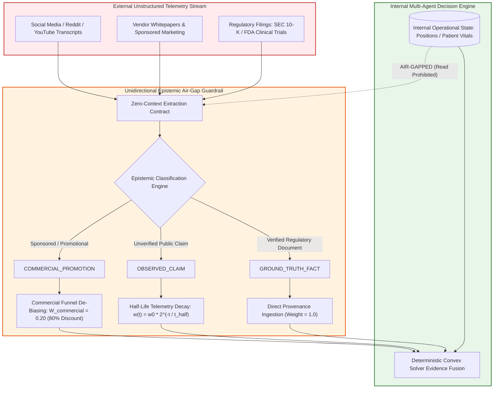

# Module 4: Strategic Context Engineering & Epistemic Firewalls

## 🧠 The Strategy Lead as Governor of Context Attention

In autonomous agentic engineering, **Context Engineering** is not prompt writing—it is the systematic construction of deterministic epistemic firewalls and data routing protocols. If an autonomous system is provided with unstructured, uncurated enterprise data, its reasoning collapses under attention dispersion, cognitive priming, and confirmation bias.

The Strategy Lead and Product Owner are responsible for establishing the **Strategic Context Envelope**. This envelope dictates:
1. What information the agent is permitted to know (**Epistemic Allowlisting**).
2. What external sources must be discounted or firewalled (**The Unidirectional Epistemic Air-Gap Guardrail**).
3. How unstructured narrative claims are mapped to machine-verifiable data structures (**The Epic Semantic Blueprint**).

---

## 🛡️ The Unidirectional Epistemic Air-Gap Guardrail

The most dangerous vulnerability in multi-agent intelligence extraction is **Cognitive Priming**. When an agent reading external unstructured sources (e.g., industry news, analyst podcasts, vendor marketing, medical preprints) is aware of internal vulnerabilities, portfolio weights, or clinical deficits, it inevitably reads those sources through its primed confirmation bias.

Under **Unidirectional Epistemic Air-Gap Guardrail**, the system enforces a strict, unidirectional epistemic air-gap:

```
┌────────────────────────────────────────────────────────────────────────────────────────┐
│                        Unidirectional Epistemic Air-Gap Guardrail: THE EPISTEMIC AIR-GAP FIREWALL                          │
├────────────────────────────────────────────────────────────────────────────────────────┤
│  External Unstructured Streams (Podcasts, Social Media, Sponsored Whitepapers)        │
│                                           │                                            │
│                                           ▼                                            │
│  [Zero-Context Extraction Contract: Courtroom Recorder Persona]                        │
│  • ZERO visibility into internal portfolio weights, cash balances, or patient vitals.  │
│  • Phrasing asserting alignment with internal strategy triggers hard schema error.     │
│                                           │                                            │
│                                           ▼                                            │
│  [Epistemic Classification Engine]                                                     │
│  • GROUND_TRUTH_FACT    ──► Verified SEC / FDA Filings          ──► Weight = 1.00     │
│  • OBSERVED_CLAIM       ──► Public Crowd Psychology             ──► Half-Life Decay   │
│  • COMMERCIAL_PROMOTION ──► Affiliate / Monetized Sales Funnels ──► 80% Discount      │
└────────────────────────────────────────────────────────────────────────────────────────┘
```

### The Three Epistemic Classifications

1. **`GROUND_TRUTH_FACT`**: Verified, audit-trailed regulatory documents (e.g., SEC Form 10-K, FDA Phase III clinical trial reports, FAA airworthiness directives). Ingested at full credibility weight ($W = 1.0$).
2. **`OBSERVED_CLAIM`**: Unverified third-party commentary, social media sentiment, or retail analyst opinion. Classified strictly as external crowd telemetry. Subject to continuous half-life decay ($w(\Delta t) = w_0 \cdot 2^{-\Delta t / t_{1/2}}$) and forbidden from directly updating execution state.
3. **`COMMERCIAL_PROMOTION`**: Sources containing monetized sales funnels, paid subscriptions, affiliate links, or promotional sponsorships. Slashed by the 80% Commercial Funnel Discount.

---

## 📉 The 80% Commercial Funnel Discount

Promotional media and sponsored vendor literature systematically exaggerate risks and rewards to drive retail sales funnels. In Case Study 5, an alarmist YouTube video exaggerated a routine Federal Reserve rate cut to market a $2,000 day-trading mentorship course, triggering a $150k panic liquidation.

To insulate autonomous decision pipelines from commercial hype, the Strategy Lead mandates the **80% Commercial Funnel Discount**:

When an unstructured source exhibits commercial conflict (`commercial_conflict: true`):
$$\text{Polarity}_{\text{stored}} = \text{round}(\text{Polarity}_{\text{raw}} \times 0.20, \; 2)$$

Furthermore, the creator or vendor credibility weight $W_{\text{Brier}}$ is mathematically discounted:
$$W_{\text{eff}} = W_{\text{Brier}} \times W_{\text{commercial}} = W_{\text{Brier}} \times 0.20$$

This mathematical discount prevents commercial marketing funnels from overwhelming objective quantitative metrics or clinical laboratory baselines.

---

## 🔄 Visual Architecture Diagram: Epistemic Air-Gap Information Flow



---

## 📜 The Epic Semantic Blueprint Specification

The primary strategic artifact emitted by the Strategy Lead / Product Owner is the **Epic Semantic Blueprint**. This machine-ingestible document anchors business strategy to code topography and canonical invariants:

```markdown
# Epic Semantic Blueprint: Continuous Telemetry Ingestion (EPIC-ING-04)

## 1. Strategic Metadata
- **Epic ID**: `EPIC-ING-04`
- **Bounded Subsystem**: `01_strategy_and_vision`, `02_requirements_and_specifications`
- **Max Token Budget**: `3,500 tokens`
- **Governing Invariants**: `I01, I04, I17, I20`

## 2. Epistemic Allowlist (Role-Based Epistemic Slicing Guardrail)
- **Included Context**: `schemas/telemetry_event.py`, `config/verified_provenance_allowlist.json`
- **Excluded Context (Air-Gapped)**: `portfolio/live_positions.db`, `clinical/patient_records.db`

## 3. Mathematical Constraints
- All external narrative telemetry must apply the 80% Commercial Funnel Discount:
  $$W_{\text{eff}} = W_{\text{Brier}} \times 0.20$$
  $$\text{Polarity}_{\text{stored}} = \text{round}(\text{Polarity}_{\text{raw}} \times 0.20, \; 2)$$
- External signals decay continuously via horizon-matched half-life ($I_{17}$):
  $$w(\Delta t) = w_0 \cdot 2^{-\Delta t / t_{1/2}}$$

## 4. Negative Boundary Assertions (Constitutional Locks)
- The ingestion worker is PROHIBITED from querying internal operational state.
- Ingestion worker MUST FAIL CLOSED (emit `None`) if source provenance is not in `VERIFIED_PROVENANCE_ALLOWLIST` ($I_{01}$).
- Hard deletes (`DELETE FROM telemetry`) are strictly banned; invalidated entries route to `quarantine_ledger` ($I_{04}$).
```

---

## 🔬 Dual-Use Regulated Callout Boxes

### Callout 1: Algorithmic Asset Management (Market Sentiment De-Biasing)
- **Application**: Ingesting financial news and executive commentary.
- **Enforcement**: If a market commentator publishes a piece titled *"Buy This Stock Before It Doubles Tomorrow"* containing affiliate brokerage links, the extractor flags `commercial_conflict: true`. The raw bullish sentiment (+8.5) is discounted:
  $$\text{Polarity}_{\text{stored}} = \text{round}(8.5 \times 0.20, \; 2) = +1.70$$
  The discounted signal is routed to the quantitative solver without priming internal risk limits.

### Callout 2: FDA Class III Medical Device Decision Pipeline (Clinical Literature Triage)
- **Application**: Triaging emerging clinical trial literature for oncology drug interaction warnings.
- **Enforcement**: An academic preprint reporting high efficacy for a novel drug combination is sponsored by the pharmaceutical manufacturer. The medical research agent flags `commercial_conflict: true`. The efficacy claim is discounted by 80%:
  $$W_{\text{eff}} = W_{\text{trial}} \times 0.20$$
  The system classifies the finding as `SPONSORED_CLAIM`, requiring independent FDA or peer-reviewed validation before modifying clinical treatment pathways.
