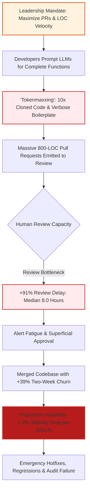

# Module 4: Measuring Success, KPIs & The Illusion of Velocity

> **Canonical Reference**: Grounded in empirical telemetry and international governance standards codified in [Empirical AI Telemetry, Repository Economics & Governance Benchmark](../templates_and_resources/EMPIRICAL_AI_TELEMETRY_AND_GOVERNANCE_BENCHMARK.md).

---

## 🎯 Executive Overview: The Measurement Paradox

When enterprises introduce autonomous coding assistants, executive leadership naturally seeks to measure return on investment. In traditional agile management, leaders monitor throughput metrics: lines of code (LOC) committed, story points completed, pull requests (PRs) merged, and sprint burndown velocity.

In the generative AI era, these traditional throughput metrics become actively misleading. An autonomous agent can generate 1,500 lines of syntactically immaculate boilerplate in under 10 seconds. However, if those 1,500 lines clone existing repository logic, introduce subtle type bypasses, and require 3 hours of exhausting human code review, organizational velocity has not increased—it has degraded.

This phenomenon is the **AI Software Engineering Productivity Paradox**:
- Individual software developers report perceived velocity gains of 20\% to 55\%.
- Organization-level delivery stability degrades, code churn increases by 39\%, and pull request review cycle durations expand by 91\%.

To prevent leadership self-deception, Strategy Leads and Technical Product Owners must replace raw volume metrics with **Stability, Hygiene, and Invariant Verification KPIs**.

---

## 📊 Empirical Grounding: The Telemetry of Codebase Instability

Authoritative empirical studies from global research bodies quantify the operational fallout of ungoverned AI code generation:

### 1. Google DORA Telemetry: The 7.2% Delivery Stability Drop
Google's DevOps Research and Assessment (DORA) division surveyed over 39,000 global engineering professionals in its State of DevOps and AI research:
- **The Stability Penalty**: For every **25\% increase in unconstrained AI code generation adoption**, organization-level delivery stability drops by **7.2\%**.
- **Change Failure Rate (CFR)**: The percentage of deployments requiring emergency hotfixes, patches, or rollbacks increases measurably because AI code passes local tests while violating cross-service invariants.
- **Mean Time to Recovery (MTTR)**: Incident remediation times lengthen significantly because on-call engineers must triage unfamiliar, AI-authored diffs during outages.

### 2. Faros AI Operational Telemetry: The Review Exhaustion Bottleneck
Faros AI evaluated engineering telemetry across enterprise software engineering teams, analyzing the lifecycle of AI-assisted pull requests:
- **+91% Surge in PR Review Duration**: The median cycle time required for human engineers to review, approve, and merge PRs containing substantial AI-generated code nearly doubled from 4.2 hours to 8.0 hours (+91\%).
- **+9% Increase in Merged Defect Escapes**: Despite lengthened review durations, defect escapes into staging and production branches increased by 9\%.
- **Mechanism of Failure (Cognitive Review Exhaustion)**: When presented with an AI-generated diff of 800 to 1,200 lines, human reviewers suffer from *pleasing bias* and *alert fatigue*. Because the code looks superficially clean, reviewers skim the diff without identifying missing negative boundary conditions or boolean smuggling.

### 3. The Distortion of Traditional Throughput Metrics: "Tokenmaxxing"
Measuring developer output by raw LOC committed or commit frequency incentivizes **"Tokenmaxxing"**:
- Generative models systematically optimize for token generation density rather than architectural reuse.
- Research by GitClear across 211 million lines of code reveals a **tenfold (10.0x) surge in duplicate code blocks** and a severe decline in refactoring activity (plummeting from 48\% of code edits down to 24\%).
- Leaders tracking raw lines of code or commit volume observe an illusion of hyper-productivity, while masked technical debt and duplicate helper functions compound across the repository.

---

## ⚠️ What Happens in Production Without Stability KPIs: The Illusion of Velocity

When executive compensation and team scorecards reward throughput without enforcing delivery stability, engineering organizations fall victim to **The Illusion of Velocity**:

### Telemetry Comparison Matrix: Throughput vs. Governed Stability KPIs

| Measurement Dimension | Naive Throughput Metric (The Illusion of Velocity) | Governed Stability KPI (Context Factory Standard) | Empirical Telemetry Source |
| :--- | :--- | :--- | :--- |
| **Primary Metric** | Raw Lines of Code (LOC) committed | Net Architectural Delta ($\Delta \text{LOC}_{\text{effective}}$) | GitClear 211M LOC Analysis |
| **Delivery Stability** | Ignored until deployment | DORA Change Failure Rate ($\text{CFR} \le 5\%$) | Google DORA Research (2024–2026) |
| **Review Efficiency** | Total PR count merged | PR Review Cycle Duration ($< 2.5\text{ hours}$) | Faros AI Operational Telemetry |
| **Code Churn** | Untracked two-week revisions | Two-Week Churn Rate ($< 1.5\%$ vs $4.3\%$ ungoverned) | GitClear Churn Telemetry |
| **Defect Escapes** | Post-release customer bug reports | Merged Defect Rate ($0\%$ escape via Zero-Mock CI) | Faros AI Defect Telemetry |
| **Batch Sizing** | Monolithic PRs ($600\text{--}1,200\text{ LOC}$) | Bounded PR Slices ($\le 200\text{ LOC}$ per ADR-016) | ADR-016 Modularity Ceiling |
| **Verification Gate** | Subjective peer code review | Zero-Trust Reproduction Gate ($100\%$ red-test verified) | Commandment IV / Invariant $I_{01}$ |

---

## 📐 The Strategy Lead's Governed KPI Framework

Strategy Leads and Product Owners must establish four empirical telemetry pillars to govern autonomous engineering pipelines:

### Pillar 1: DORA Stability & Resilience Index
Rather than measuring how fast code is deployed, leaders must measure deployment outcomes:
- **Change Failure Rate ($\text{CFR}$)**: Must remain $\le 5\%$ across all AI-assisted releases.
- **Mean Time to Recovery ($\text{MTTR}$)**: Emergency hotfix cycle must execute in $< 60\text{ minutes}$ using deterministic rollback mechanisms.

### Pillar 2: The Code Churn & Refactoring Ratio
Tracking the ratio of refactored code to newly added code prevents duplicate code explosion:
- **Two-Week Churn Rate**: Percentage of lines modified or deleted within 14 days must not exceed $1.5\%$ (reversing the $4.3\%$ ungoverned baseline).
- **Refactoring Ratio**: At least $40\%$ of modified lines in any feature epic must represent refactoring or reuse of existing AST registry functions, rather than standalone clones.

### Pillar 3: Small-Batch PR Slicing (ADR-016)
To eliminate Faros AI's +91\% review bottleneck:
- **Hard PR Slicing Ceiling**: No AI-assisted pull request may exceed $200$ physical lines of code diff.
- **Review Cycle SLA**: PR reviews must complete in $< 2.5\text{ hours}$ because reviewers inspect bounded, single-responsibility slices.

### Pillar 4: Zero-Trust Reproduction Verification
To eliminate the +9\% defect escape rate:
- **Mandatory Red Test**: Every bug fix or feature patch submitted by an autonomous agent must include a standalone reproduction test that fails on the unpatched codebase and passes on the patched codebase.
- PRs lacking an automated reproduction test are structurally blocked by CI.

---

## 🔬 Dual-Use Regulated Industry Case Studies

### FinTech: Core Transaction Settlement Pipeline
- **Flawed Metric**: Engineering leadership rewarded teams based on weekly PR throughput. Autonomous agents submitted 45 PRs per week containing duplicated fee-calculation logic across 12 microservices.
- **Production Consequence**: Fee calculation desynchronization between custody and ledger services caused a \$420,000 regulatory reconciliation shortfall.
- **Governed KPI**: The PO implemented the ADR-016 $200$-LOC slice ceiling and tracked AST module reuse. Churn dropped from $5.8\%$ to $1.1\%$, and reconciliation errors were eradicated.

### MedTech: Infusion Pump Firmware Telemetry (FDA 21 CFR 820.30)
- **Flawed Metric**: The vendor measured "features completed per sprint." AI generated unconstrained PID loop adjustments without automated negative boundary tests.
- **Production Consequence**: Firmware update passed nominal test suites but exhibited unstable titration oscillations under low-battery telemetry decay.
- **Governed KPI**: The Medical Product Owner mandated DORA CFR $< 1\%$ and $100\%$ Zero-Trust Reproduction Test coverage, satisfying FDA design validation mandates and eliminating unverified firmware releases.

---

## 📚 Navigation & Canonical Verification

- **Executive Directives**: [Module 1: Executive Intent, Investment Thesis & Governance Boundaries](./01_executive_intent_and_investment_thesis.md)
- **Strategic Red-Teaming**: [Module 2: Strategic Red-Teaming & Executive Moat Protection](./02_strategic_red_teaming.md)
- **Empirical Reference Guide**: [Empirical AI Telemetry, Repository Economics & Governance Benchmark](../templates_and_resources/EMPIRICAL_AI_TELEMETRY_AND_GOVERNANCE_BENCHMARK.md)

---

## Production Reality & Failure Modes in the AI Era

### The Mid-2026 Production Baseline (The Verification Trap & Context Debt)
In median mid-2026 engineering organizations, leadership has fallen victim to the "Illusion of Velocity." Engineering dashboards report that "developer velocity is up 40%" because developers use AI autocomplete to emit 3x more raw lines of code and open 2x more pull requests. In reality, the organization is paralyzed by the 2026 DORA Verification Trap: throughput metrics are inflated by low-complexity boilerplate, while senior engineers spend their days acting as exhausted manual verifiers. Faros AI empirical telemetry reveals the true operational cost: PR review durations have exploded by +91%, defect escape rates have climbed +9%, and overall organizational delivery stability has dropped by 7.2% per 25% AI adoption.

### Failure Modes & Drift Dynamics in Ungoverned Production
Rewarding raw line counts and PR throughput instead of governed economic and stability metrics induces severe organizational failure modes:
1. **The Senior Reviewer Burnout Spiral**: Senior engineers spend up to 60% of their working hours parsing AI-generated PR bloat that appears deceptively correct on the surface but silently breaks cross-service contracts or error boundaries.
2. **GitClear Code Churn Inversion ($R_{\text{churn}} > 5\%$)**: Churn metrics spike as developers repeatedly rewrite, revert, or patch code committed during prior sprints, creating an illusion of forward progress while accumulating immense architectural debt.
3. **Catastrophic Regressions in Regulated Domains**: As illustrated in the FinTech reconciliation loss (\$420k shortfall) and MedTech infusion oscillation incidents, un-governed velocity metrics encourage agents to bypass negative boundary checks and duplicate logic across microservices.

### Deterministic Engineering Defenses & Operational Takeaways
To replace vanity velocity metrics with compiler-grade engineering governance, organizations must enforce four operational KPIs:
1. **Track AI Code Churn Ratio ($R_{\text{churn}}$)**: Compute $R_{\text{churn}} = \frac{\text{LOC}_{\text{reverted\_30d}}}{\text{LOC}_{\text{committed\_30d}}} \times 100\%$. Establish a mandatory engineering threshold at 2.0%; any pod exceeding 2.0% must halt new feature authoring to refactor cloned logic.
2. **Cap PR Slices at $\le 200$ LOC**: Enforce an automated CI gate rejecting PRs that exceed 200 lines of modified code. Bounding PR size compresses review cycle times from > 6 hours back to under 2.5 hours, dismantling the Faros AI review bottleneck.
3. **Mandatory Zero-Trust Reproduction Test Gates**: Every bug-fix or feature PR generated with AI assistance must include an automated reproduction test that fails on the unpatched codebase and passes on the patched codebase. PRs lacking reproduction tests are structurally blocked from merge.
4. **Monitor the DORA Verification Tax**: Continuously measure the ratio of PR review time to authoring time. If review duration exceeds authoring time by $> 2.0\times$, declare an engineering quality halt and mandate compiler-grade AST context routing.

