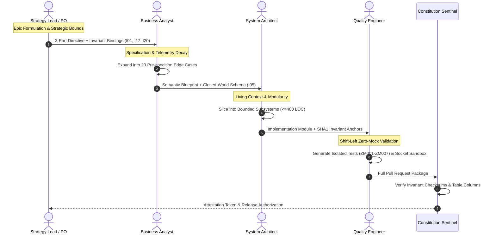

# Strategy Lead & Product Owner Hub: The Source of Strategic Intent & Epistemic Bounding

In the enterprise Context Pipeline, the **Strategy Lead / Product Owner (PO)** operates as the constitutional source of truth. Autonomous software engineering systems powered by Large Language Models (LLMs) cannot infer unstated business priorities, legal constraints, or clinical thresholds.

Without explicit boundary conditions, stochastic agents default to unbounded exploratory traversals. This behavior generates architectural drift, hallucinated data models, and unmitigated risk exposure.

> [!NOTE]
> As a Strategy Lead or Product Owner, your primary responsibility is **Epistemic Bounding and Invariant Governance**. You translate ambiguous executive mandates, statutory compliance obligations, and customer requirements into machine-ingestible **Epic Semantic Blueprints**.

### Strategic Paradigm Shift: Ad-Hoc Epics vs Level 5 Governance

| Architectural Dimension | Mid-2026 Median (Ad-Hoc Agile) | Enterprise Level 5 (Deterministic Pipeline) |
| :--- | :--- | :--- |
| **Epic Scope Definition** | One-line Jira tickets copied directly into LLM chats | Formally bounded 3-Part Directives with token quotas |
| **Context Blast Radius** | Unbounded context windows ($>40\text{k}$ tokens) | Bounded subsystems strictly capped at $\le 3\text{,}500$ tokens |
| **Safety Invariant Anchoring** | Vague natural language warnings ignored by models | Cryptographically anchored Canonical Invariants ($I_{01}$--$I_{22}$) |
| **Market Intelligence Ingress** | Unfiltered commercial hype ingested into prompts | 80% commercial discount filter via Epistemic Air-Gaps |
| **Development Velocity Metric** | Raw token throughput ("tokenmaxxing") | PR review cycle time and zero-churn invariant attestation |

---

## 🤝 The Strategic Context Handshake

The Strategy Lead sits between enterprise stakeholders and downstream requirements engineers, establishing an immutable contractual handshake:

| Stage | Inbound Artifact | Role Operational Action | Outbound Artifact | Target Recipient |
| :--- | :--- | :--- | :--- | :--- |
| **Strategic Intake** | Executive Vision, Market Research, Regulatory Directives | Decompose intent into bounded problem spaces; eliminate omniscient prompt leaks | **Epic 3-Part Directive** | Business Analysts / Requirements Leads |
| **Epistemic Air-Gap** | Voice-of-Customer, Vendor Marketing, Industry Media | Classify narrative claims as subjective telemetry; apply 80% commercial discount | **Sanitized Telemetry Contract (Unidirectional Epistemic Air-Gap Guardrail)** | Requirements Leads / Quant Engineers |
| **Invariant Binding** | Enterprise Constitution (Articles I–VII) | Anchor business logic to canonical system invariants ($I_{01}-I_{22}$) | **Epic Semantic Blueprint** | System Architects / Lead Engineers |

---

## 🏛️ Core Principles of Autonomous Strategic Bounding

### 1. 3-Part Directives with Invariant Bindings
Traditional user stories (*"As a user, I want..."*) lack the formal precision required by autonomous agents. Autonomous agents interpret vague natural language through probabilistic training distributions, frequently hallucinating dangerous default behaviors. Strategy Leads author **3-Part Directives** consisting of **Role**, **Task**, and **Constraint**, binding every initiative directly to the 22 Canonical Invariants (e.g., $I_{01}$ Zero-Simulated-Data, $I_{02}$ Execution-Price Guardrail, $I_{04}$ Immutable Quarantine, $I_{20}$ Epistemic News Isolation).

### 2. Epistemic Air-Gapping of Unstructured Intelligence (Unidirectional Epistemic Air-Gap Guardrail)
When strategic initiatives ingest external market reports, customer feedback, or clinical trial literature, agents must not be primed with internal operational state or existing portfolio holdings. Exposing an AI extractor to internal vulnerabilities causes confirmation bias and circular corroboration loops. The Strategy Lead mandates a unidirectional epistemic firewall separating external narrative sentiment from internal execution state.

### 3. Mathematical Blast Radius & Token Economics
A 500,000-line enterprise repository comprises approximately 4,000,000 tokens. Feeding massive codebase dumps into an agent induces attention entropy degradation:
$$\mathcal{H}(A_i) = -\sum_{j=1}^N A_{ij} \ln A_{ij}$$
This triggers the "Lost in the Middle" degradation valley where token retention drops by 40%–75%. The Strategy Lead mathematically bounds each Epic into isolated cognitive sub-domains requiring $< 50,000$ tokens of context, budgeting individual task blast radii to $< 4,000$ tokens and enforcing daily micro-spend quotas ($Q_{\text{limit}} = \$0.40/\text{day}$).

---

## 🔬 Dual-Use Regulated Callout Boxes

### Callout 1: Real-Time Algorithmic Trading Safeguards
In algorithmic trading, an ambiguous Epic directive such as *"Optimize liquidity execution across exchange routes"* can lead an autonomous coding agent to bypass pre-trade plausibility checks in pursuit of lower simulated slippage. Under Strategy Lead governance, the Epic must strictly bind to Invariant $I_{02}$ (Execution-Price Guardrail):
$$|P_{\text{exec}} - \text{EMA}_5| \le \max(3.0 \times \text{ATR}_{14}, \; 0.08 \times \text{EMA}_5)$$
Any execution outside this volatility band is structurally rejected, preventing flash-crash cascading orders during liquidity vacuums.

### Callout 2: FDA Class III Medical Device Decision Pipeline (Closed-Loop Infusion)
In an automated intravenous insulin or vasopressor infusion pump (governed by FDA 21 CFR Part 820 and ISO 13485), an Epic specifying *"Adjust titration rate based on real-time continuous sensor readings"* poses fatal risks if sensor noise induces erratic boluses. The Strategy Lead binds the medical Epic to Invariant $I_{02}$'s physiological counterpart:
$$|\text{Rate}_{\text{exec}} - \text{Rate}_{\text{baseline}}| \le \max(3\sigma_{\text{patient}}, \; 0.10 \times \text{Rate}_{\text{baseline}})$$
Furthermore, Invariant $I_{01}$ (Zero-Simulated-Data) mandates that if telemetry signal-to-noise ratio degrades below verified thresholds, the system must fail closed: latching the infusion rate to the safe basal floor, alerting clinical staff, and forbidding synthetic metric interpolation.

### Callout 3: Aerospace Fly-by-Wire Avionics (DO-178C Level A)
In flight envelope protection systems, aerodynamic control surfaces (elevators, ailerons, rudders) are commanded by digital flight control computers. An Epic commanding *"Damp aerodynamic turbulence oscillations"* must be bounded by physical flight envelope limiters:
$$\|\theta_{\text{surface}} - \theta_{\text{trim}}\| \le \text{MaxDeflection}(V_{\text{airspeed}})$$
The directive explicitly binds to Invariant $I_{03}$ (Fatal-Contagion Veto), guaranteeing that asymmetric sensor disagreement across pitot tubes immediately disengages automated flight directors and drops the aircraft into Direct Law control rather than allowing autonomous trimming into a stall.

---

## 📚 Curriculum Navigation & Learning Path

Product Owners and Strategy Leads should complete these foundational modules in sequence:

1. [**Module 1: Strategic Intent Directives & Invariant Governance**](./01_strategic_intent_and_invariants.md)  
   *Authoring deterministic directives (Role, Task, Constraint) with mathematical invariant links.*
2. [**Module 2: Strategic Red-Teaming & Executive Moat Protection**](./02_strategic_red_teaming.md)  
   *Identifying implicit assumptions, closing agentic loopholes, and mitigating cognitive priming.*
3. [**Module 3: Epic Decomposition Mathematics & Organizational Blast Radius**](./03_epic_decomposition_and_blast_radius.md)  
   *Decomposing complex enterprise initiatives into token-bounded sandbox domains ($< 50\text{k}$ tokens).*
4. [**Module 4: Strategic Epistemic Firewalls & Market Air-Gaps**](./04_epistemic_firewalls_and_market_airgaps.md)  
   *Building the Epic Semantic Blueprint and enforcing the Unidirectional Epistemic Air-Gap Guardrail.*
5. [**Lab Workbook: Practical Strategy Exercises**](./LAB_WORKBOOK.md)  
   *Hands-on labs: Decomposing high-stakes Epics, applying the 80% commercial discount, and authoring blueprint contracts.*

---

## 📊 Empirical Telemetry & Governance Standards

All strategic models, bounded token budgets, and epistemic guardrails in this chapter are directly calibrated against empirical developer telemetry and international governance standards. For the complete research foundation, longitudinal data, and economic models, consult the canonical reference benchmark:

- [**Empirical AI Telemetry, Repository Economics & Governance Benchmark**](../templates_and_resources/EMPIRICAL_AI_TELEMETRY_AND_GOVERNANCE_BENCHMARK.md):
  - **The Enterprise Governance Deficit (McKinsey & Gartner)**: Details why 79% of enterprise deployments lack formal risk policies and why Gartner forecasts that at least 30% of generative AI software initiatives will be abandoned post-POC by 2025/2026 due to poor context hygiene and cost blowouts (Benchmark §2.3, §2.4).
  - **The Delivery Stability Paradox (Google Cloud DORA)**: Analyzes empirical telemetry demonstrating a 7.2% drop in organizational delivery stability per 25% AI adoption when teams lack compiler-grade context controls (Benchmark §3.2).
  - **International Regulatory Alignment**: Maps strategic directives to voluntary and statutory risk standards, including NIST AI RMF 1.0 (GOVERN/MAP functions), ISO/IEC 42001:2023 (Clause 5 & 6 AI management policies), and EU AI Act (Regulation (EU) 2024/1689 Article 9 risk systems) (Benchmark §7.1–§7.3, §9).

---

## Production Reality & Failure Modes in the AI Era

### The Mid-2026 Production Baseline (The Verification Trap & Context Debt)

In median mid-2026 engineering organizations, AI strategy is commonly reduced to purchasing Copilot or Cursor seat licenses and hoping sprint velocity increases. Leaders operate without formal AI architectures, generating severe delivery friction.

> [!WARNING]
> **Empirical Production Baseline Telemetry**:
> - **Enterprise Governance Deficit**: 79% of enterprise deployments lack formal AI risk policies (McKinsey).
> - **Post-POC Abandonment**: Gartner forecasts that over 30% of generative AI software initiatives will be abandoned post-POC by 2025/2026 due to poor context hygiene and cost blowouts.
> - **Review Gridlock**: Engineering pods suffer from +91% PR review bloat (Faros AI).
> - **Delivery Stability Collapse**: Teams experience a 7.2% drop in organizational delivery stability for every 25% increase in AI adoption without context controls (Google Cloud DORA).

### Failure Modes & Drift Dynamics in Ungoverned Production
Treating strategic vision as abstract management theory rather than architectural invariant constraints induces three critical organizational failures:
1. **The Post-POC Budget Freeze**: Uncontrolled multi-turn agent sessions querying monolithic frontier models run up monthly API bills in the thousands of dollars without measurable ROI, triggering executive cancellation of AI platform investments.
2. **The Verification Trap Gridlock**: Senior engineers drown in the DORA Verification Trap, spending days reviewing hundreds of lines of AI-generated boilerplate that passes nominal tests but harbors subtle cross-service contract violations.
3. **Severe Regulatory Non-Compliance**: Regulated organizations in FinTech, Healthcare, or Aerospace fail audits under NIST AI RMF, ISO/IEC 42001, or EU AI Act Article 9 because they cannot demonstrate objective mathematical boundaries governing autonomous actions.

### Deterministic Engineering Defenses & Operational Takeaways
To break free from the median ad-hoc trap and achieve compiler-grade delivery maturity, engineering organizations must implement four foundational controls:
1. **Transition to Compiler-Grade Context Engineering**: Replace Level 1 ad-hoc conversational prompts with Level 5 machine-readable semantic blueprints. Every AI-assisted initiative must operate within bounded context paths and strict token budgets.
2. **Cap Daily Branch Spend at \$0.40**: Implement automated spend monitoring across developer API keys, automatically suspending agent sessions that exceed \$0.40/day per active developer branch.
3. **Institute the 200-LOC PR Modularity Ceiling**: Reject any PR generated with AI assistance that exceeds 200 lines of modified code, forcing decomposition into atomic, single-boundary PR slices.
4. **Anchor Invariants in CI Pipelines**: Embed canonical system invariants ($I_{01}-I_{22}$) into automated CI gates, failing builds whenever synthetic numbers, unverified data feeds, or raw SQL `DELETE` calls are detected.

