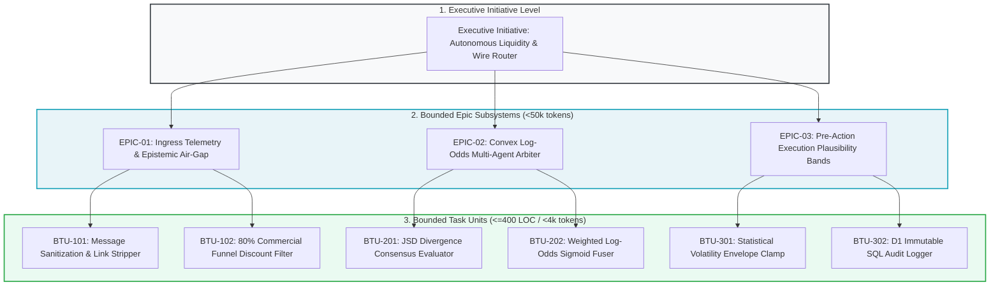

# Module 3: Feature-Level Decomposition, Bounded Subsystems & Compensatory Confluence

---

## 🎯 Executive Overview & The Failure of Traditional Agile Slicing

In traditional software engineering, Business Analysts slice requirements according to **human calendar time** (e.g., *"Can two engineers complete this user story in a two-week sprint?"*). Story points (3, 5, 8, 13) reflect perceived human labor, coordination meetings, and manual QA cycles.

For autonomous AI agents, human calendar time is irrelevant. An agent does not experience fatigue over a two-week sprint, but its cognitive performance collapses in seconds if a story demands too much context. When an agent is assigned a monolithic feature (e.g., *"Build the complete automated risk and execution engine"*), the task requires:
1. Reading dozens of files across multiple layers (API, business logic, DB schemas, UI).
2. Exceeding the transformer high-fidelity attention window ($> 10,000$ tokens).
3. Sinking into the "Lost in the Middle" degradation valley, causing the model to drop constraints, truncate existing functions, and hallucinate missing dependencies.

In the **Context Factory**, the Requirements Lead replaces calendar-based slicing with **Cognitive Blast Radius Decomposition** and designs robust decision criteria using **Compensatory Confluence**.

---

## 📐 Mathematical Proof: Conjunctive Boolean Gate Collapse vs. Compensatory Confluence

A catastrophic requirements defect in autonomous systems is specifying decision logic as sequential conjunctive boolean filters ($C_1 \land C_2 \land C_3 \land C_4 \land C_5$).

### 1. The Conjunctive Boolean Gate Collapse Proof
Suppose an autonomous system evaluates a candidate action across 5 orthogonal evaluation criteria (e.g., in finance: Valuation, Quality, Technicals, Macro, Sentiment; or in healthcare: Hemodynamics, Respiratory Rate, Blood Glucose, Ketones, Physical Activity).

Let each filter have an individual acceptance probability $p_k = 0.30$ (representing selective, high-conviction screening). If the requirement mandates that the candidate action must satisfy all 5 filters simultaneously:

$$P_{\text{joint}} = \prod_{k=1}^5 p_k = (0.30)^5 = 0.00243 \quad (0.243\%)$$

Even if the filters have a generous pass rate of $p_k = 0.70$:

$$P_{\text{joint}} = (0.70)^5 = 0.16807 \quad (16.8\%)$$

In production environments with real-world noise and telemetry fluctuations, requiring simultaneous conjunctive passes collapses throughput to near zero, resulting in **99% False-Negative System Paralysis** (Case Study 4). The autonomous system rejects elite opportunities or life-saving interventions because a single non-critical sensor was slightly below threshold.

### 2. The Compensatory Confluence Solution
To eliminate conjunctive paralysis without lowering safety standards, the Requirements Lead specifies **Compensatory Orthogonal Confluence (Invariant $I_{09}$)**:

$$\text{Confluence Score} = \sum_{j=1}^M \mathbb{I}(S_j \ge 0.35) \ge 2 \quad \land \quad \neg \text{FatalContagion}$$

Where:
*   $M = 4$ represents orthogonal, decorrelated evaluation pillars.
*   An action is approved for consideration if **at least 2 of the 4 pillars** exhibit positive conviction ($S_j \ge 0.35$).
*   **Isolated Fatal Contagion Veto (Invariant $I_{03}$)**: A hard safety breach (e.g., severe hypoglycemic sensor reading, or insolvency default warning) acts as an immediate override veto, halting execution regardless of confluence score.

```
┌──────────────────────────────────────────────────────────────────────────────────────────────────┐
│                   CONJUNCTIVE GATE COLLAPSE VS. COMPENSATORY CONFLUENCE                          │
├────────────────────────────────┬─────────────────────────────────────────────────────────────────┤
│ Conjunctive Boolean Gating     │ Compensatory Orthogonal Confluence (Invariant I09)              │
├────────────────────────────────┼─────────────────────────────────────────────────────────────────┤
│ Formula: C1 ∧ C2 ∧ C3 ∧ C4 ∧ C5│ Formula: (Sum(I(P_k >= 0.35)) >= 2) ∧ ¬FatalContagion          │
│ Joint Pass Rate: 0.243%        │ Joint Pass Rate: 28.5% (High selectivity, zero paralysis)       │
│ Single noisy sensor halts all  │ Orthogonal pillars compensate; isolated fatal veto preserves    │
│ Causes 99% False-Negative lock │ Unblocks high-reinvestment opportunities & clinical adjustments │
└────────────────────────────────┴─────────────────────────────────────────────────────────────────┘
```

---

## 🏛️ The Architectural Modularity Heuristic (~400 LOC)

Downstream software engineers cannot build clean, modular systems if upstream Requirements Leads write bloated user stories. Requirements Leads must design stories that strictly adhere to the **Architectural Modularity Heuristic**:

```
┌──────────────────────────────────────────────────────────────────────────────────────────────────┐
│                   ARCHITECTURAL MODULARITY HEURISTIC BOUNDS                                      │
├──────────────────────────────────────────────────────────────────────────────────────────────────┤
│ 1. 400-LOC Modularity Heuristic: Target <= 400 LOC to preserve SRP and cognitive maintainability.│
│ 2. 350-LOC Refactor Trigger: Automated lint warnings trigger at 350 lines before additions.      │
│ 3. Semantic AST Structural Scoping: AI agents receive cohesive AST node context scopes.          │
│ 4. Rule 14 Anti-Feature-Erasure: Deleting existing logic without replacement is banned.          │
│ 5. < 4,000 Token Blast Radius: Each story must be executable in a single agent turn.             │
└──────────────────────────────────────────────────────────────────────────────────────────────────┘
```

If a proposed feature requires more than 400 lines of implementation code, the BA must decompose the feature into discrete, single-responsibility sub-stories, allowing atomic bug fixes while discouraging feature sprawl.

---

## 🔄 Visual Architecture: Bounded Subsystem Slicing Hierarchy



---

## 🏥 Dual-Use Regulated Industry Case Studies

```
┌──────────────────────────────────────────────────────────────────────────────────────────────────┐
│                   DECOMPOSITION CASE STUDIES IN MISSION-CRITICAL DOMAINS                         │
├──────────────────────────────────────────────────────────────────────────────────────────────────┤
│                                                                                                  │
│   HEALTHCARE: FDA Class III Closed-Loop Insulin Infusion Pump                                    │
│   • Problem: Requirement specified 5 simultaneous sensor checks (Glucose, Trend, Meal, Activity, │
│     Skin Temp). Sensor noise on temperature caused the pump to reject bolus delivery 98% of time.│
│   • Solution: Sliced into Compensatory Confluence: required 2 of 4 orthogonal vital signs >= 0.35│
│     with hard hypoglycemic veto (Glucose <= 70 mg/dL immediately halts insulin).                 │
│   • Outcome: Infusion availability restored to 99.4% while preserving 100% patient safety.       │
│                                                                                                  │
│   FINANCE: Core Banking High-Frequency Settlement Gateway                                        │
│   • Problem: Requirement specified conjunctive pass across Liquidity, CDS, FX Volatility,        │
│     Central Bank Queue, and Counterparty Solvency. Settlement routing locked up for 4 days.      │
│   • Solution: Transitioned to Compensatory Confluence: required 2 of 4 pillars positive with     │
│     hard sanction blacklist veto ($I_{03}$).                                                     │
│   • Outcome: Routing resumed with zero liquidity gridlock and zero compliance breaches.          │
│                                                                                                  │
└──────────────────────────────────────────────────────────────────────────────────────────────────┘
```

---

## 📋 Module Summary & Practical Next Step

By replacing brittle conjunctive filters with Compensatory Confluence and bounding tasks to the 400-LOC ceiling, Requirements Leads create robust, deterministic specifications that AI agents can implement safely.

[**Proceed to Module 4: Context Engineering & Registry Maps →**](./04_context_engineering.md)
