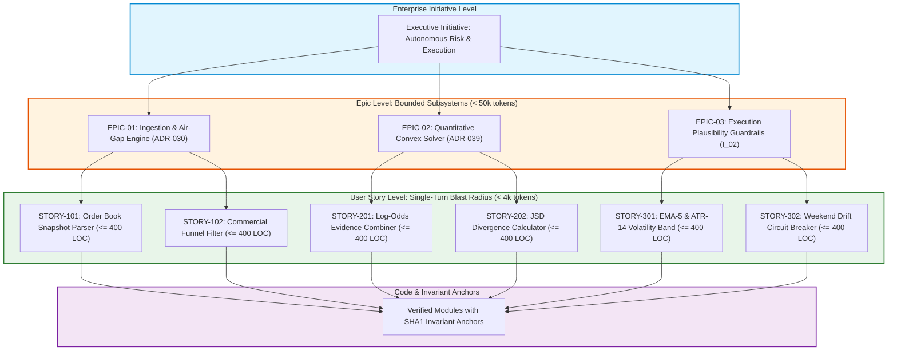

# Module 3: Feature-Level Decomposition & Bounded Subsystems

## ✂️ The Failure of Traditional Agile Story Slicing

In traditional software engineering, Business Analysts slice requirements according to **human calendar time** (e.g., *"Can two engineers complete this user story in a two-week sprint?"*). Story points (3, 5, 8, 13) reflect perceived human effort, coordination meetings, and manual QA testing cycles.

For autonomous AI agents, calendar time and human story points are meaningless metrics. An AI agent does not get fatigued over a two-week sprint, but its cognitive performance collapses in seconds if a story demands too much context. When an agent is assigned a monolithic 13-point story (e.g., *"Build the complete automated risk and execution engine"*), the task requires:
1. Reading dozens of files across multiple layers (API, business logic, DB schemas, UI).
2. Exceeding the transformer's high-fidelity attention window ($> 10,000$ tokens).
3. Entering the "Lost in the Middle" degradation valley, causing the AI to forget constraints, truncate existing functions, and hallucinate missing dependencies.

In autonomous systems, the Business Analyst must replace calendar-based slicing with **Cognitive Blast Radius Decomposition**.

---

## 📏 The ADR-016 Modularity Standard

Downstream software engineers cannot adhere to clean architecture if upstream Business Analysts write bloated, multi-responsibility user stories. Under **ADR-016**, the enterprise enforces strict code and context constraints:

```
┌────────────────────────────────────────────────────────────────────────────────────────┐
│                        ADR-016 MODULAR ARCHITECTURE BOUNDS                             │
├────────────────────────────────────────────────────────────────────────────────────────┤
│ 1. 400-LOC Hard Ceiling: No production or test module may exceed 400 physical lines.   │
│ 2. 350-LOC Refactor Trigger: Automated lint warnings trigger at 350 lines.             │
│ 3. 80-Line Surgical View Slices: AI agents receive targeted 80-line context windows.   │
│ 4. Rule 14 Anti-Feature-Erasure: Deleting existing logic without replacement is banned.│
│ 5. < 4,000 Token Blast Radius: Each story must be executable in a single agent turn.   │
└────────────────────────────────────────────────────────────────────────────────────────┘
```

When a Business Analyst specifies a user story, the expected implementation must be mathematically capable of fitting within a single 400-LOC file. If a proposed feature requires more than 400 lines of code, the BA has failed the decomposition and must partition the feature into discrete sub-stories.

---

## 🔄 Visual Architecture: Bounded Subsystem Slicing Hierarchy

The diagram below illustrates how an enterprise initiative is decomposed into token-bounded cognitive units:



---

## ⚖️ Slicing Comparison: Monolithic Story vs. Bounded Slices

### The Flawed Monolithic Story:
> **STORY-FAIL-01**: *"Implement the full pre-trade risk management engine. The system must ingest live market quotes, calculate 5-day EMA and 14-day ATR, check weekend session drift, reject invalid prices, and write failed orders to SQLite."*
>
> **Why It Fails**: This story touches market data ingestion, statistical volatility math, session calendar logic, execution gating, and database persistence. An AI agent writing this will generate a 900-line monolithic script, drop exception handlers, and fail to test edge cases.

---

### The Decomposed Bounded Slices:

| Story ID | Story Title | Bounded Context Scope | Target Files | Max LOC | Governing Invariant |
| :--- | :--- | :--- | :--- | :--- | :--- |
| **STORY-RISK-01** | **Volatility Envelope Calculator** | Pure mathematical computation of $\text{EMA}_5$ and $\text{ATR}_{14}$. | `src/math/volatility_envelope.py` | $< 250$ LOC | $I_{02}, I_{07}$ |
| **STORY-RISK-02** | **Session Calendar Validator** | Validates weekend execution drift ($\le 1.0\%$ vs Friday close). | `src/gates/session_calendar.py` | $< 200$ LOC | $I_{02}, I_{19}$ |
| **STORY-RISK-03** | **Execution Plausibility Gate** | Evaluates order against envelope; emits authorization verdict. | `src/gates/execution_guardrail.py` | $< 300$ LOC | $I_{01}, I_{02}$ |
| **STORY-RISK-04** | **Quarantine Ledger Persistence**| Archives rejected order payloads to immutable SQLite/D1 table. | `src/storage/quarantine_writer.py`| $< 250$ LOC | $I_{04}, I_{15}$ |

---

## 🔬 Dual-Use Regulated Callout Boxes

### Callout 1: Real-Time Algorithmic Asset Management
In high-frequency quantitative execution, decomposing the order pipeline into discrete bounded modules prevents race conditions and memory leaks. By isolating the mathematical volatility calculation (`STORY-RISK-01`) from database I/O (`STORY-RISK-04`), the quantitative calculation executes in $< 100\,\mu\text{s}$ without being blocked by SQLite disk write locks or WAL checkpoints.

### Callout 2: FDA Class III Medical Device Decision Pipeline
In an automated infusion pump, a monolithic story combining sensor signal processing, PID dosage calculation, and motor hardware control violates medical software isolation principles (IEC 62304 Class C). The BA must decompose the pipeline into:
1. `STORY-MED-01`: Sensor Waveform Filtering & SQI Validation (adheres to $I_{01}$).
2. `STORY-MED-02`: Pharmacokinetic Titration Engine (adheres to $I_{02}, I_{07}$).
3. `STORY-MED-03`: Hardware Stepper Actuation & Latch Circuit Breaker (adheres to $I_{03}, I_{05}$).
4. `STORY-MED-04`: Black-Box Event Audit Recorder (adheres to $I_{04}, I_{15}$).

### Callout 3: Aerospace Fly-by-Wire Avionics (DO-178C Level A)
Under DO-178C software guidelines, flight-critical code must demonstrate strict **Partitioning and Non-Interference**. Decomposing fly-by-wire requirements into independent sub-stories ensures that sensor failure isolation cannot interfere with flight control surface actuation, guaranteeing deterministic execution budgets.
