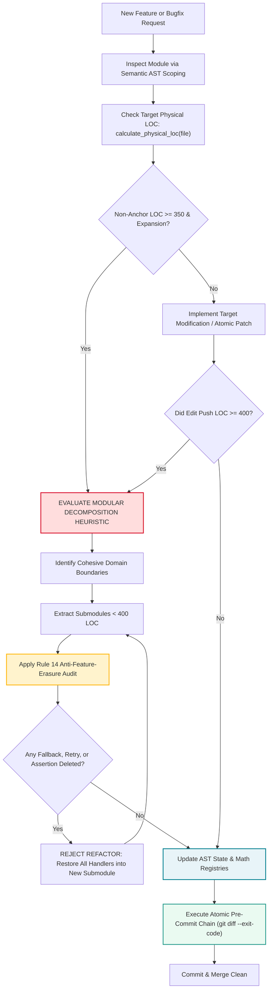

# Module 3: Code Modularity Ceilings (400 LOC) & Anti-Feature-Erasure PR Slicing

## 🧠 Theory: Token Economics, Working Memory & The U-Curve Collapse

In a large enterprise repository (500,000+ lines of code), autonomous AI agents face physical working memory limits imposed by transformer attention architecture. Even with expanded nominal context windows (128k to 1M tokens), model attention is neither uniform nor infinite.

### The Physics of Attention Collapse in Monolithic Code
As detailed in [The Mathematics of AI Risk](../00_THE_MATHEMATICS_OF_AI_RISK.md), the information-theoretic attention entropy across sequence length $N$ scales logarithmically:
$$\mathcal{H}(A_i) = -\sum_{j=1}^N A_{ij} \ln A_{ij}$$

When a 1,200-line monolithic file (~9,000 tokens) is loaded into an agent's context alongside project documentation, system instructions, and tool schemas, attention entropy disperses across thousands of non-relevant lines. The model's positional retrieval fidelity follows the empirical **U-shaped attention curve ("Lost in the Middle")**:

$$F(x) = \begin{cases} 
1.0 - k_1 x & x \in [0.0, 0.15] \quad \text{(Primacy Bias)} \\
0.35 + \epsilon(x) & x \in (0.15, 0.85) \quad \text{(Degradation Valley: 40 to 75 percent information loss)} \\
1.0 - k_2 (1.0 - x) & x \in [0.85, 1.0] \quad \text{(Recency Bias)}
\end{cases}$$

In a 1,200-line monolith, functions positioned between lines 200 and 1,000 reside directly in the **Degradation Valley**, where retrieval fidelity drops to approximately 35%. When instructed to make modifications to a method inside this valley, the autonomous agent exhibits three pathological failure modes:
1. **Context Amputation**: The agent loses track of variables instantiated at the top of the file, redeclaring them locally and shadowing state.
2. **Diff Corruption**: The agent produces hallucinated line numbers in its diff hunks, failing patch application.
3. **The Compression Cheating Trap (Silent Feature Erasure)**: Constrained by output token budgets, the model truncates peripheral code, replacing 200 lines of error handlers, retry logic, and invariant checks with comments like `# ... existing logic remains unchanged ...`.

---

## 💥 What Happens in Production Without Modularity Ceilings: The Verification Trap & Churn Explosion

When enterprise software organizations deploy generative AI assistants into codebases without enforcing strict modularity boundaries and small-batch pull request slicing, software development undergoes severe structural degradation. Empirical repository telemetry from global engineering studies reveals that unconstrained generation triggers an operational breakdown known as the **Verification Trap**.

### 1. The GitClear 211M LOC Longitudinal Findings: Churn & Duplication Explosion
In a landmark longitudinal study analyzing **211 million lines of code** committed between 2020 and 2024 (with ongoing 2025–2026 telemetry tracking), research platform GitClear identified severe code quality degradation directly tied to AI coding assistant adoption:

1. **+39% Surge in Two-Week Code Churn**:
   - Code churn—the percentage of committed code that is modified, reverted, or deleted within 14 days of creation—surged by **39\%** relative to pre-AI baselines (rising from 3.1\% to 4.3\%).
   - Rather than producing durable engineering assets, unconstrained AI generation operates via speculative trial-and-error: agents generate code that breaks under subtle integration pressures and is quickly thrown away.

2. **10x Surge in Duplicate and Cloned Code Blocks**:
   - Rather than identifying existing shared utility modules or refactoring existing call graphs, autonomous models systematically duplicate logic locally.
   - Duplicate code instances surged **tenfold** across repositories where AI assistance was actively used without strict AST indexing.

3. **The Cloning-over-Refactoring Inversion**:
   - In pre-AI software engineering, healthy codebases maintain an active refactoring culture: approximately 48\% of code changes represented refactoring, updating existing functions, moving code, or deleting dead paths.
   - In AI-augmented codebases, the refactoring ratio plummeted to **24\%**. Autonomous LLMs systematically choose the path of lowest token perplexity: generating new, isolated helper functions (e.g., `calculate_metrics_v2()`) rather than resolving cross-module dependencies across multi-file architectures.

### 2. The 2026 Google DORA Verification Trap & The Verification Tax
Google Cloud DORA's 2025–2026 research series (*State of AI-Assisted Software Development: Escaping the Verification Trap*) uncovers a severe economic and operational inversion:

1. **The Economic Inversion**:
   - The marginal cost of generating routine code has fallen toward zero ($<\$0.001$ per function). However, the cognitive and operational expenditure required to *verify*, debug, security-scan, and test that code has escalated exponentially.
   - Software engineers structurally invert from **creative creators into exhausted, alert-fatigued code reviewers**.

2. **The Verification Tax**:
   - Reviewing, debugging, and testing "almost right", plausible-looking code demands significantly more cognitive bandwidth than writing clean modular code from scratch.
   - Because modern reasoning models produce syntactically immaculate code with persuasive docstrings, subtle logical errors and missing edge cases easily escape human inspection during review, imposing a heavy downstream "tax" during deployment and production incidents.

3. **DORA Throughput Distortion ("Tokenmaxxing")**:
   - Traditional DevOps throughput metrics (deployment frequency, raw committed LOC, PR volume) become artificially inflated by low-complexity boilerplate and verbose scaffolding ("tokenmaxxing").
   - This creates an optical illusion of velocity, while enterprise delivery stability drops by **7.2\% for every 25\% increase in unconstrained AI adoption**, and downstream Change Failure Rates (CFR) spike.

### 3. Faros AI Telemetry: The Review Exhaustion Bottleneck
Telemetry across enterprise engineering teams evaluated by Faros AI quantifies the human toll of un-sliced, monolithic pull requests:
- **+91% Increase in PR Review Cycle Duration**: The median cycle time required for human engineers to review and approve pull requests containing large AI-generated diffs nearly doubled (+91\%, expanding from 4.2 hours to 8.0 hours).
- **+9% Increase in Merged Defect Escapes**: Despite longer review durations, production defect escapes rose by 9\%, directly driven by reviewer cognitive exhaustion and pleasing bias.

### 4. The Structural Antidote: 400-LOC Ceilings and Atomic PR Slicing ($\le 200$ LOC)
The mathematical and operational countermeasure to the Verification Trap is twofold:
1. **The ADR-016 400-LOC Modularity Ceiling**: Constraining every source module to $\le 400$ physical lines guarantees that the entire file resides within the high-fidelity zone of the attention curve ($<2\%$ of context capacity), preventing the $F(x) \approx 0.35$ Degradation Valley and eliminating context amputation.
2. **Atomic PR Slicing ($\le 200$ LOC per Slice)**: Restricting autonomous pull requests to bounded, single-responsibility units ($\le 200$ LOC) breaks the cognitive review bottleneck, restores human comprehension, reduces review duration to $<2.5$ hours, and slashes two-week code churn from $4.3\%$ to $<1.5\%$.

| Engineering Metric | Pre-AI Baseline | Ungoverned AI Generation | Context Factory Countermeasure | Operational Invariant Linkage |
| :--- | :--- | :--- | :--- | :--- |
| **Two-Week Code Churn** | 3.1\% | 4.3\% (+39\% relative) | < 1.5\% | Zero-Trust Reproduction Gate ($I_{01}$) |
| **Duplicate Code Blocks** | Baseline (1.0x) | 10.0x surge | Single-source truth (< 1.1x) | AST Math & State Registries ($I_{04}, I_{18}$) |
| **Refactored Code Ratio** | 48\% of edits | 24\% (Severe drop) | >= 50\% enforced | ADR-016 400-LOC Ceilings ($I_{20}$) |
| **DORA Delivery Stability** | High / Elite Tier | -7.2\% per 25\% AI adoption | Elite Stability (CFR < 5\%) | Hermetic Socket Isolation ($I_{03}, I_{15}$) |
| **PR Review Cycle Duration** | 4.2 hours | 8.0 hours (+91\%) | < 2.5 hours | PR Slicing ($\le 200$ LOC per slice) |
| **Production Defect Escapes** | Baseline | +9\% increase | 0 escapes (Zero-Mock CI) | AST ZM001–ZM009 Gating ($I_{16}, I_{22}$) |

> For comprehensive empirical telemetry data, methodology notes, and full academic citations, see the canonical reference: [Empirical AI Telemetry & Governance Benchmark](../templates_and_resources/EMPIRICAL_AI_TELEMETRY_AND_GOVERNANCE_BENCHMARK.md).

---

## 🏛️ The Architectural Modularity Heuristic Standard (400 LOC)

To eliminate monolithic degradation, prevent cognitive drift, and guarantee deterministic code modifications, enterprise software architecture codifies **Architectural Modularity Heuristics (The 400-LOC Guideline)**:

```
┌──────────────────────────────────────────────────────────────────────────────────────────────────┐
│                           THE ARCHITECTURAL MODULARITY HEURISTIC (400 LOC)                       │
├──────────────────────────────────────────────────────────────────────────────────────────────────┤
│                                                                                                  │
│   1. THE 400-LOC ARCHITECTURAL MODULARITY HEURISTIC                                              │
│      • Source modules in `src/`, `workers/`, and `tests/` maintain a target heuristic ceiling    │
│        of <= 400 physical lines to safeguard the Single Responsibility Principle (SRP).         │
│      • Excludes code-adjacent `# === INVARIANT-BLOCK` lines (safety annotations are free).      │
│      • Orchestration runners and complex coordinators have an explicit ceiling of 600 LOC.        │
│                                                                                                  │
│   2. THE 350-LOC REFACTORING HEURISTIC TRIGGER                                                   │
│      • Any module reaching 350 physical lines enters the "Refactor Warning Zone".               │
│      • Serves as an architectural modularity heuristic: before adding extensive feature sets,    │
│        engineers evaluate decomposition. Localized bug fixes and atomic patches remain          │
│        permitted without forcing premature, brittle micro-module fragmentation.                  │
│                                                                                                  │
│   3. SEMANTIC AST STRUCTURAL SCOPING                                                             │
│      • Autonomous agents inspect code via cohesive AST node units (functions, classes, and      │
│        interface declarations) rather than arbitrary physical line-slicing windows.             │
│      • In modern frontier models with context windows >= 128k tokens, inspecting an entire       │
│        cohesive module (<= 400 LOC, ≈ 2,500 tokens) operates well within high-fidelity          │
│        attention (<2% context capacity), preventing truncation of parameter lists or try-blocks.│
│                                                                                                  │
│   4. RULE 14: THE ANTI-FEATURE-ERASURE PROTOCOL                                                 │
│      • Refactoring to meet modularity targets MUST decompose logic into domain submodules.       │
│      • Agents are strictly forbidden from deleting fallback cascades, retry loops, or telemetry. │
│      • Banned: replacing existing methods with `# ... existing code ...` or pass-through stubs.   │
│                                                                                                  │
└──────────────────────────────────────────────────────────────────────────────────────────────────┘
```

---

## 🔬 Canonical Decomposition Patterns: Real-World Case Studies

### Case Study A: Decomposing a Monolithic Portfolio Tracker
When `paper_portfolio_tracker.py` grew to **480 lines of code**, adding tax-lot accounting threatened to push the file past 600 LOC, inducing attention dilution.

#### The Anti-Pattern (Compression Cheating):
An unconstrained AI agent was asked to "reduce `paper_portfolio_tracker.py` under 400 lines." The model deleted the 3-tier trailing stop ratchet and stripped drawdown calculation assertions, returning a 380-line file that silently broke portfolio risk stops in production.

#### The Architectural Modularity & Rule 14 Compliant Decomposition:
The system architect decomposed the module into three cohesive, single-responsibility units:
1. `portfolio_risk_stops.py` (192 LOC): Extracted trailing stop ratchets, volatility bands, and high-water mark tracking.
2. `paper_portfolio_metrics.py` (166 LOC): Extracted Sharpe ratio, Sortino ratio, max drawdown, and beta calculations.
3. `paper_portfolio_tracker.py` (332 LOC): Retained core state machine, order execution hooks, and position persistence.

*Result*: 100% of safety handlers and mathematical algorithms were preserved. All files satisfied the Architectural Modularity Ceiling ($< 350$ LOC).

---

### Case Study B: Decomposing the Multi-Agent Debate Matrix
The dialectical debate engine originally combined macro beta estimation, covariance whitening, and agent orchestration in a single 520-line file.

#### The Modular Decomposition (400-LOC Ceiling):
1. `macro_beta.py` (87 LOC): Mathematical estimation of market beta and idiosyncratic residual variance.
2. `zca_whitening.py` (118 LOC): Alg #89 Anchor-Preserving Symmetrical ZCA Whitening and Ledoit-Wolf shrinkage.
3. `epistemic_triad_orchestrator.py` (111 LOC): 3-stage Path C multi-agent debate coordination.
4. `debate_matrix.py` (284 LOC): Core consensus aggregation and convex log-odds solver bindings.

---

## 🔄 Visual Workflow: The Architectural Modularity Refactoring Lifecycle (400-LOC Ceiling)

The following Mermaid diagram details the deterministic decision tree executed before any code modification is merged:



---

## ⚖️ Dual-Use Regulated Callout Box: Modular Deconstruction in Safety-Critical Domains

::: tip DUAL-USE ANALYSIS: MODULARITY HEURISTICS & ANTI-FEATURE-ERASURE ACROSS REGULATED INDUSTRIES
| Engineering Requirement | Quantitative Asset Management Pipeline | FDA Class III Medical Device Firmware (21 CFR Part 820.30) | Aerospace Fly-by-Wire Avionics (RTCA DO-178C Level A) |
| :--- | :--- | :--- | :--- |
| **Physical Modularity Heuristics** | 400 LOC target per file. Preserves single responsibility and maintains active code well within high-fidelity attention ($<2\%$ context capacity). | MISRA C:2012 Design Guidelines: Recommends small, cohesive functions to prevent path explosion (Rule 8.4 mandates compatible external linkage declarations to prevent type mismatches). | DO-178C Unit Testing: Units strictly scoped to single-condition decision paths to guarantee 100% MC/DC testability. |
| **Rule 14 Anti-Feature-Erasure** | Forbids AI from removing 4-tier live price discovery waterfall (FMP $\to$ Yahoo $\to$ Finnhub $\to$ D1) to meet file limits. | Forbids AI from deleting redundant hardware watchdog pet routines (`WDT_PET()`) or sensor out-of-range clamps. | Forbids AI from stripping triple-modular redundancy (TMR) sensor voting or dual-channel bus synchronization logic. |
| **Semantic AST Structural Scoping** | Inspects cohesive AST units (functions, classes, schemas); operates in peak fidelity attention zone without severing syntax scopes. | Auditing and modifying single state-machine transitions without loading unrelated driver interrupt tables. | Verifying single aerodynamic table lookup functions without exposing actuator servo PID control loops. |
:::

---

## 🛠️ Practical Decomposition Protocol: The 4-Step Slicing Pipeline

When an architectural epic requires substantial new functionality, do not attempt to prompt an AI to implement the entire feature in a single pass. Decompose the implementation into **Sequential, Context-Bounded Pull Requests**:

```
┌──────────────────────────────────────────────────────────────────────────────────────────────────┐
│                              THE 4-STEP CONTEXT-BOUNDED PR PIPELINE                              │
├──────────────────────────────────────────────────────────────────────────────────────────────────┤
│                                                                                                  │
│   PR 1: SCHEMAS & INTERFACE CONTRACTS                                                            │
│   • Context: Database migration files, Pydantic DTO models, TypeScript interfaces.               │
│   • Target LOC: <= 120 lines.                                                                    │
│   • Output: Staged schema migrations and verified table-to-DTO mappings.                         │
│                                                                                                  │
│   PR 2: CORE MATHEMATICAL & DOMAIN ALGORITHMS                                                    │
│   • Context: PR 1 schemas + specific algorithmic formulation from `MATHEMATICAL_REGISTRY.md`.    │
│   • Target LOC: <= 250 lines.                                                                    │
│   • Output: Pure domain functions with zero external I/O and co-located unit test suite.        │
│                                                                                                  │
│   PR 3: APPLICATION SERVICES & ORCHESTRATION                                                     │
│   • Context: PR 2 domain models + function registry tools + domain ADRs.                         │
│   • Target LOC: <= 300 lines.                                                                    │
│   • Output: Service orchestrator managing state transitions and fail-closed error handling.      │
│                                                                                                  │
│   PR 4: PRESENTATION, APIS & INVARIANT ANCHORS                                                   │
│   • Context: Service interface + router definitions + `# === INVARIANT-BLOCK` checksum anchors.  │
│   • Target LOC: <= 180 lines.                                                                    │
│   • Output: REST/GraphQL endpoints and verified SHA1 invariant anchors.                          │
│                                                                                                  │
└──────────────────────────────────────────────────────────────────────────────────────────────────┘
```

---

## ✍️ Hands-On Exercises: Slicing a Complex Enterprise Epic

### Exercise 3.1: Decomposing a Closed-Loop Infusion Controller
**Scenario**: You are tasked with adding a "Pediatric Auto-Titration Mode" to an FDA Class III infusion pump. The existing `infusion_controller.c` file is at **365 physical lines** (in the 350-400 LOC Refactor Zone). The new feature requires:
1. A pediatric patient profile schema (weight, age, metabolic clearance rate).
2. A pharmacokinetic drug concentration decay model: $C(t) = C_0 \cdot e^{-k_e \cdot t}$.
3. Dynamic rate clamping based on measured blood pressure.

#### Your Action:
1. Write the architectural modularity refactoring plan to bring `infusion_controller.c` under 300 lines before adding the feature.
2. Define the submodules to extract and verify that Rule 14 Anti-Feature-Erasure is enforced.

#### Model Solution:
```markdown
### 1. REFACTORING PLAN (PRE-FEATURE DECOMPOSITION)
- TARGET: `firmware/infusion/infusion_controller.c` (currently 365 LOC).
- EXTRACTIONS:
  1. `firmware/infusion/pressure_occlusion_guard.c` (110 LOC): Extract hardware pressure transducer sampling, occlusion detection, and emergency line-clamp actuation.
  2. `firmware/infusion/infusion_telemetry.c` (85 LOC): Extract audit logging, delivery rate serialization, and UI annunciator events.
- POST-REFACTOR BASELINE: `infusion_controller.c` reduced to 170 LOC (< 350 LOC, Healthy).

### 2. RULE 14 ANTI-FEATURE-ERASURE VERIFICATION
- AUDIT: All pressure threshold assertions (`ASSERT_OCCLUSION_LIMIT`), watchdog kicks (`WDT_FEED()`), and fail-safe latching routines must be preserved verbatim in `pressure_occlusion_guard.c`.
- ZERO-MOCK COMPLIANCE: If pediatric sensor telemetry is disconnected, controller fails closed to basal hold (0.5 mcg/hr) and triggers nurse-call alarm. Zero default weight or synthetic rate imputation permitted.

### 3. PEDIATRIC FEATURE PR SLICING
- PR 1: `firmware/schemas/pediatric_profile.h` (45 LOC): Define typed struct with metabolic constants.
- PR 2: `firmware/math/pk_clearance_model.c` (90 LOC): Implement discrete exponential clearance calculation with fixed-point arithmetic.
- PR 3: `firmware/infusion/infusion_controller.c` (+75 LOC -> 245 LOC total): Bind pediatric profile to titration state machine.
```

---

### 📚 Empirical Reference Linkage
- Canonical Benchmark: [Empirical AI Telemetry, Repository Economics & Governance Benchmark](../templates_and_resources/EMPIRICAL_AI_TELEMETRY_AND_GOVERNANCE_BENCHMARK.md)
- Operational Invariants: [The Enterprise Constitution](../00_ENTERPRISE_CONSTITUTION.md) (Invariants $I_{01}, I_{04}, I_{18}, I_{20}$)

---
[**Proceed to Module 4: Context Engineering (The Builder's Guardrails) →**](./04_ast_registries_and_living_context.md)

---

## Production Reality & Failure Modes in the AI Era

### The Mid-2026 Production Baseline (The Verification Trap & Context Debt)
In the mid-2026 median engineering baseline (the 75\%--84\% ad-hoc adoption mean), developers routinely pass 1,200-line monolithic files into chat windows or accept cascading inline autocomplete ghost-text across large classes. The resulting pull requests are 800 to 1,500 LOC dumps. Because resolving shared dependencies across multi-file architectures requires deep AST traversal, frontier models systematically take the path of lowest token perplexity: they clone existing logic locally rather than importing and refactoring shared utilities. This dynamic is the primary driver of GitClear's empirical telemetry: a **10x explosion in duplicate code blocks** and the **collapse of active refactoring from 48\% down to 24\%**.

Engineering organizations enter the **2026 Google DORA Verification Trap**. Generating code has become virtually free, but the cognitive and operational cost of verifying that code escalates exponentially. Tech leads spend hours wading through sprawling diffs filled with low-complexity boilerplate ("tokenmaxxing"), experiencing severe review fatigue. Under this burden (evidenced by Faros AI's +91\% review cycle telemetry), reviewers skim middle lines, missing shadowed state and amputated safety handlers.

### Failure Modes & Drift Dynamics in Ungoverned Production
Failing to enforce modularity ceilings and small-batch PR slicing precipitates three severe operational crises:
1. **The Review Gridlock Collapse**: Pull request queues stall under multi-day delays. Under review exhaustion, reviewers inevitably approve PRs where autonomous agents replaced dozens of lines of error recovery with `# ... existing logic remains unchanged ...`. The first transient infrastructure hiccup causes an immediate cascade failure.
2. **The +39\% Two-Week Churn Tax**: Codebases suffer GitClear's documented churn surge: code merged in one sprint breaks under integration pressures in the next, requiring emergency reverts and rewrites, neutralizing productivity gains.
3. **Degradation Valley Amputation**: When source files exceed 800 lines, they reside directly in the transformer's Degradation Valley ($F(x) \approx 0.35$). Models experience cross-boundary amnesia, re-declaring global variables and generating hallucinated diff coordinates that corrupt patches.

### Deterministic Engineering Defenses & Operational Takeaways
To escape the DORA Verification Trap and restore engineering stability, systems teams implement these structural guardrails:
- **Enforce the ADR-016 400-LOC Hard Ceiling in CI**: Configure automated pre-commit and CI linters to fail any pull request adding code to a non-anchor source file exceeding 400 physical LOC. At 350 lines, trigger a mandatory refactoring warning requiring decomposition prior to feature expansion.
- **Mandate Small-Batch PR Slicing ($\le 200$ LOC)**: Restrict AI-assisted pull requests to $\le 200$ LOC across a maximum of 3 files. Enforce sequential atomic slicing: PR 1 (Data Schemas & DTOs), PR 2 (Pure Domain Logic & Invariants), PR 3 (Orchestration & Integration).
- **AST Anti-Duplication Linting**: Reject any pull request that introduces duplicate helper functions when canonical implementations already exist in the codebase. Require models to import verified utilities.
- **Cognitive Review Time Boxing (The 45-Minute Limit)**: If an AI-assisted pull request requires more than 45 minutes of thorough manual review, reject it back to the author for decomposition into smaller atomic units.


