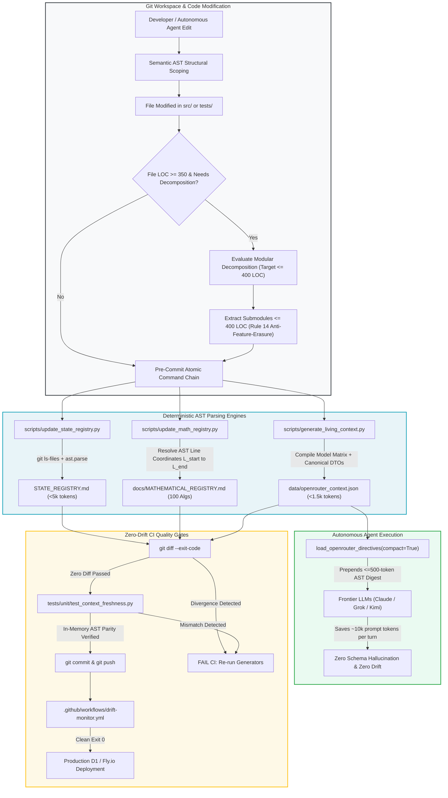

# Module 4: AST Code Registries & Living Context Compilation

## 🧠 Theory: Ground Truth in Large Repositories — Why Naive Vector RAG Fails

In enterprise software engineering, autonomous AI agents cannot rely on high-dimensional semantic vector retrieval (Naive Vector RAG) to locate ground truth across a 500k-LOC repository. 

### The Mathematical Vulnerability of Naive Vector Embeddings
Semantic search encodes source code chunks into dense continuous embedding vectors $\mathbf{u}, \mathbf{v} \in \mathbb{R}^d$ (typically $d \in [768, 1536]$), ranking relevance via cosine similarity:
$$\cos(\mathbf{u}, \mathbf{v}) = \frac{\mathbf{u} \cdot \mathbf{v}}{\|\mathbf{u}\| \|\mathbf{v}\|}$$

Cosine similarity measures thematic and conceptual proximity, not mathematical or structural correctness. In high-stakes engineering, vector embeddings suffer from catastrophic **Sign Blindness and Inversion Inability**:

$$\cos(\mathbf{u}_{\text{cash-expansion}}, \mathbf{v}_{\text{cash-contraction}}) \ge 0.94$$
$$\cos(\mathbf{u}_{\text{rate-clamp-positive}}, \mathbf{v}_{\text{rate-clamp-negative}}) \ge 0.92$$

Two blocks of code representing polar opposite actions—such as expanding vs contracting an order book, or infusing vs withdrawing a vasopressor—share identical technical vocabulary (currencies, rates, variables, timestamps). In embedding space, their vector representations are nearly collinear ($\cos \ge 0.94$). 

When an autonomous agent queries a vector database for *"how to calculate the margin of safety"*, naive RAG frequently retrieves deprecated prototype drafts or conflicting implementations, feeding stale assumptions into the prompt. Furthermore, vector chunking shatters abstract syntax trees, severing function headers from their underlying implementations and inducing diff corruption.

To establish infallible ground truth, builders construct **Deterministic Abstract Syntax Tree (AST) Registries** and **Living Context Compilers**.

---

## 🔬 Forensic Case Study 2: The Asynchronous Edge Prototype ("V2") Architectural & Context Drift Crisis (July 2026)

The necessity of AST-indexed living context was proven by the catastrophic breakdown of the reference platform's second-generation asynchronous edge architecture (historically referred to as **"V2"**).

### 1. The Naive Initial Architecture (V2)
In July 2026, the autonomous market analysis platform migrated from the initial V1 batch cron scripts to an event-driven edge topology (V2):
* **Cloudflare Workers & Queues**: Serverless edge handlers ingesting SEC filings and financial price webhooks.
* **Cloudflare D1 SQL**: A distributed serverless SQLite database acting as canonical remote ground truth.
* **40+ Markdown Architectural Blueprints**: An exhaustive suite of documentation specifications (`docs/specs/01_Foundation.md` through `07_Debate_Logic_Matrix.md`) detailing schemas, JSON payloads, and mathematical formulas.
* **The Operating Assumption**: Autonomous AI coding agents were instructed to *"read the documentation in `docs/specs/` before writing any code."*

```
┌────────────────────────────────────────────────────────────────────────┐
│                        V2 NAIVE HYBRID TOPOLOGY                        │
├────────────────────────────────────────────────────────────────────────┤
│                                                                        │
│   [ External Webhooks ]                                                │
│          │                                                             │
│          ▼                                                             │
│   ┌──────────────────────────────────────────────────────────────┐     │
│   │ Cloudflare Workers Gateway (TypeScript Edge)                 │     │
│   │ • Ingests FMP / SEC / FINRA payloads                         │     │
│   │ • Enqueues messages to Cloudflare Queues                     │     │
│   └──────────────────────────────────────────────────────────────┘     │
│          │                                                             │
│          ▼                                                             │
│   ┌──────────────────────────────────────────────────────────────┐     │
│   │ Asynchronous Queue Consumer                                  │     │
│   │ • Triggers GitHub Actions `workflow_dispatch`                │     │
│   └──────────────────────────────────────────────────────────────┘     │
│          │                                                             │
│          ▼                                                             │
│   ┌──────────────────────────────────────────────────────────────┐     │
│   │ Python Backend Executors (Autonomous AI Agents)              │     │
│   │ • Reads 40+ Markdown spec files for instructions             │     │
│   │ • Executes quantitative models & persists to D1 SQL          │     │
│   └──────────────────────────────────────────────────────────────┘     │
│                                                                        │
└────────────────────────────────────────────────────────────────────────┘
```

### 2. The Silent Catastrophe
Within three weeks, the platform suffered total architectural breakdown:
1. **Code-Documentation Divergence**: When an engineer modified a Python function signature (e.g., changing `get_historical_prices` to `get_daily_candles` and adding an `adjust_splits: bool` flag), the markdown specs in `docs/specs/` were left untouched. Subsequent autonomous agents read the outdated specification, generated code calling the deprecated signature, and committed code that failed immediately in production. By late July, **over 60% of the specifications contradicted the live codebase**.
2. **Database Schema Hallucination & SQL Contradictions**: Lacking machine-readable schema contracts in active working memory, LLMs hallucinated database tables and columns. Models issued queries like `SELECT * FROM historical_sentiment WHERE ticker = 'NVDA'` when the actual table was `event_logs`, or invented columns like `market_sentiment_score` on `consensus`, crashing queries with `sqlite3.OperationalError: no such column`. These errors failed silently when caught by fallback `try/except` blocks, returning empty dicts and leading models to assume the database held zero historical data.
3. **SQLite Concurrency Lock Collisions**: When 50 companies reported quarterly earnings simultaneously at 4:00 PM ET, 50 webhooks flooded Cloudflare Queues within seconds, triggering simultaneous GitHub Actions runs that crashed local SQLite replicas with `sqlite3.OperationalError: database is locked` due to the lack of Write-Ahead Logging (WAL) mode, busy retry timeouts, and atomic transaction scoping.
4. **AST Coordinate Amnesia**: When an autonomous agent edited a Python file, it lacked visibility into the AST coordinates of the rest of the application. An edit shifting line positions or return signatures broke dependent callers across multiple modules, hiding regressions until live execution.

### 3. The False Solutions Attempted
* **False Solution 1: Proliferating More Markdown Specs**: Authoring more documentation compounded the drift. More text fell out of sync faster, and loading 40+ markdown files bloated agent context windows past 25,000 tokens, accelerating attention degradation.
* **False Solution 2: Prompt Directives to "Read Docs First"**: Directing agents to read specs first doubled prompt token consumption, loaded stale instructions, and failed to prevent hallucinations.
* **False Solution 3: Naive Vector Embedding RAG**: Indexing code into vector databases returned deprecated draft implementations rather than canonical production code due to sign-blind cosine similarity.
* **False Solution 4: Manual Human Code Review**: Human reviewers were too slow for 24/7 autonomous swarms and missed subtle shifts in physical line numbers and return types.

### 4. The Permanent Invariants & Mechanisms
The crisis was permanently eliminated by establishing **AST-Synchronized Living Context Compilation** backed by **Zero-Drift CI Quality Gates**:
1. **The AST State Registry (`STATE_REGISTRY.md`)**: A lightweight index (<5,000 tokens) compiled directly via Python's native `ast.parse` over git-tracked files (`git ls-files`). It records physical line counts, classes, public function signatures, and modularity ceiling health status (`✅ Healthy (<350 LOC)` vs `⚠️ Near 400 LOC Cap`), allowing agents to understand repository topography in <2 seconds.
2. **The Canonical Mathematical Registry (`docs/MATHEMATICAL_REGISTRY.md`)**: Catalogs all canonical quantitative algorithms with exact source paths, AST start/end line coordinates (`L{start}–L{end}`), LaTeX equations, and linked unit test suites.
3. **The Living Context Compiler (`data/openrouter_context.json`)**: Compiles a token-dense (<1,500 tokens) JSON context payload containing the active model matrix, dual-schema parity map (mapping all 29 D1 SQL tables to Pydantic/dataclass models), and the 20 core architectural invariants. Injected into model prompts before execution, eliminating schema hallucinations.
4. **Mandatory Atomic Pre-Commit Command Chain & `drift-monitor.yml`**: Codifies the single atomic command chain required before every commit (`update_state_registry.py && update_math_registry.py && generate_living_context.py && git diff --exit-code`), backed by remote CI gates that block merges on drift.
5. **Database Concurrency Hardening**: Enforces SQLite WAL mode (`PRAGMA journal_mode=WAL;`), 30-second busy timeout (`PRAGMA busy_timeout=30000;`), and a 5-minute Cloudflare KV settle buffer (`macro_settle_*`).

---

## 🛠️ The AST Topography Mechanics: Building the Registries

### 1. Repository Topography Indexer: `update_state_registry.py`
The repository topography indexer parses all tracked source files across `src/`, `workers/`, `tests/`, `config/`, and `scripts/`, compiling a complete structural index into `STATE_REGISTRY.md` (<5,000 tokens).

#### A. Tracked Git Filter
To ensure that local development artifacts, scratch files, or virtual environments never leak into documentation, `update_state_registry.py` filters exclusively for git-tracked files:
```python
def get_tracked_files(root_dir: Path) -> Optional[Set[str]]:
    """Return set of tracked git file paths relative to ROOT_DIR."""
    try:
        res = subprocess.run(
            ["git", "ls-files"], capture_output=True, text=True, cwd=root_dir, timeout=10
        )
        if res.returncode == 0:
            return {line.strip() for line in res.stdout.splitlines() if line.strip()}
    except Exception:
        pass
    return None
```

#### B. AST Visitor & Topography Parsing
For every tracked Python module, the script parses source code using Python's native `ast.parse`. It walks the tree to extract class definitions, base classes, non-private function signatures, parameter names, and exact physical line counts:
```python
def parse_python_module(file_path: Path, root_dir: Path) -> dict:
    """Parses AST of a Python source file to extract line counts, classes, and functions."""
    rel_path = file_path.relative_to(root_dir)
    source = file_path.read_text(encoding="utf-8")
    line_count = len(source.splitlines())
    tree = ast.parse(source, filename=str(file_path))

    classes = []
    functions = []
    for node in ast.walk(tree):
        if isinstance(node, ast.ClassDef):
            bases = [b.id for b in node.bases if isinstance(b, ast.Name)]
            classes.append({"name": node.name, "bases": bases, "line": node.lineno})
        elif isinstance(node, ast.FunctionDef) and not node.name.startswith("_"):
            args = [a.arg for a in node.args.args]
            functions.append({"name": node.name, "args": args, "line": node.lineno})

    return {
        "path": str(rel_path),
        "lines": line_count,
        "classes": sorted(classes, key=lambda c: c["name"]),
        "functions": sorted(functions, key=lambda f: f["name"]),
        "status_flag": "⚠️ Near 400 LOC Cap" if line_count >= 350 else "✅ Healthy (<350 LOC)"
    }
```

Every module is deterministically sorted by its relative path, guaranteeing that identical repository commits generate byte-identical markdown across all developer machines and CI runners.

---

### 2. Algorithm Conflict Auditor: `update_math_registry.py`
In complex engineering systems, mathematical collisions occur when different subagents implement incompatible formulations of the same concept (e.g., one agent computing simple variance while another computes exponential variance, corrupting risk weights).

`scripts/update_math_registry.py` acts as the **Single Source of Truth for all 100 Canonical Algorithms**, cataloging their mathematical formulation, target file, function symbol, line range, and linked unit test:

```python
MATH_FUNCTIONS = [
    {
        "domain": "Bi-Directional Exponential Decay",
        "equation": r"w(t) = e^{-\frac{\ln 2}{t_{1/2}} \cdot t}",
        "file": "src/horizon/scope.py",
        "symbol": "calculate_decayed_polarity",
        "test": "tests/unit/test_multi_horizon_modules.py",
        "description": "Calculates exponential half-life signal decay over time."
    },
    {
        "domain": "CUSUM Stealth Accumulation",
        "equation": r"S_t = \max\left(0, S_{t-1} + \frac{X_t - \mu}{\sigma} - k\right)",
        "file": "src/scout/cusum_stealth.py",
        "symbol": "CUSUMStealthDetector.detect",
        "test": "tests/unit/test_cusum_stealth.py",
        "description": "Detects institutional dark pool accumulation via cumulative sum drift."
    },
    # ... additional canonical algorithms ...
]
```

#### AST Symbol Line Resolution & Fail-Closed Contract
`find_symbol_line_numbers()` parses the target file's AST, resolving whether the symbol is a standalone function or an inner class method. Crucially, `update_math_registry.py` enforces a **Fail-Closed Verification Contract**:
```python
start_l, end_l = find_symbol_line_numbers(file_path, item["symbol"])
assert start_l > 0, f"FATAL MATH REGISTRY ERROR: Symbol {item['symbol']} not found in {item['file']}!"
assert test_path.exists(), f"FATAL MATH REGISTRY ERROR: Test file {item['test']} missing!"
```
If a refactoring agent deletes a mathematical algorithm or removes a test file, the generator halts immediately. No algorithmic change can be committed without an AST-verified symbol and an existing test suite.

---

## 📦 The Living Context Compiler (`openrouter_context.json`)

While markdown registries provide human readability, injecting thousands of lines of markdown into LLM prompt context is token-inefficient. 

The **Living Context Compiler** (`scripts/generate_living_context.py`) compiles repository topography, database schemas, active model mappings, and systemic invariants into a compact JSON payload: `data/openrouter_context.json` (<1,500 tokens).

### Dual-Schema Parity Mapping
To permanently eliminate database schema hallucinations, the compiler maintains an explicit mapping of all **29 Cloudflare D1 SQL tables** to their backing Python Pydantic or dataclass models:

```python
TABLE_DTO_MAP = {
    "cost_logs": {"model": "CostEntry", "file": "src/pipeline/cost_ledger.py"},
    "event_logs": {"model": "EventPayload", "file": "src/schemas/events.py"},
    "consensus": {"model": "ConsensusVerdict", "file": "src/schemas/debate.py"},
    "consensus_quarantine": {"model": "QuarantineRecord", "file": "src/utils/quarantine_manager.py"},
    "daily_prices": {"model": "FinnhubClient / DualStorageEngine", "file": "src/utils/finnhub_client.py"},
    "paper_portfolio_ledger": {"model": "PaperPortfolioTracker", "file": "src/analytics/paper_portfolio_tracker.py"},
    "bandit_policy_state": {"model": "BanditPolicyStateRecord", "file": "src/schemas/bandit_policy.py"},
    # ... all 29 production SQL tables ...
}
```

### Compact AST Digest Ingestion in Execution Prompts
In production orchestration, every call to an LLM prepends a dense, under-500-token AST digest:

```python
def load_openrouter_directives(compact: bool = True) -> str:
    """Loads system directives. If compact=True, loads a <=500-token AST digest."""
    context_json = ROOT_DIR / "data" / "openrouter_context.json"
    c_data = json.loads(context_json.read_text(encoding="utf-8")) if context_json.exists() else {}

    digest = [
        "### CANONICAL AGENT DIRECTIVES (COMPACT AST DIGEST)",
        "1. Modularity Heuristics: Target <=400 LOC, proactively evaluate files >=350 LOC.",
        "2. Zero Simulated Data Mandate: NEVER emit mock/synthetic data. Fail closed (return None/raise).",
        "3. Compensatory Confluence (Invariant I09): >=2 of 4 pillars unblock BUY.",
        "4. Mandatory Pre-Commit Zero-Drift: State, Math, and Living Context registries must stay synchronized.",
        f"- Active Model Slugs: {json.dumps(c_data.get('active_models', {}))}",
        f"- Canonical Math Symbols: {', '.join(list(c_data.get('canonical_math_algorithms', {}).keys())[:15])}",
        f"- Inviolable Rules: {'; '.join(c_data.get('inviolable_rules', []))}"
    ]
    return "\n".join(digest)
```
By substituting a 500-token compact AST digest for 4,000-token raw markdown specifications, the system saves **~10,000 prompt tokens per multi-agent session**, directly preventing context collapse while enforcing adherence to the daily spend quota.

---

## ⚖️ Dual-Use Callout Box: AST Registries Across Regulated Industries

::: tip DUAL-USE ANALYSIS: AST REGISTRIES & GROUND TRUTH MAPPING
| Regulated Domain | Quantitative Asset Management | FDA Class III Medical Device Firmware | Aerospace Flight Guidance Systems |
| :--- | :--- | :--- | :--- |
| **AST State Registry** | Indexes 300+ Python modules with class definitions, public methods, and modularity ceiling health flags. | Indexes MISRA-C/C++ firmware modules, hardware register maps, and interrupt service routines (ISRs). | Indexes Ada/C avionics modules, flight control laws, and actuator bus interfaces under DO-178C. |
| **Mathematical Registry** | 100 quantitative algorithms (CUSUM, Ledoit-Wolf, ZCA Whitening, GAC-ROIC-MOS) with line coordinates. | Pharmacokinetic/pharmacodynamic drug decay equations, insulin sensitivity factor algorithms, and sensor Kalman filters. | Aerodynamic lift/drag polars, barometric altitude correction, and inertial navigation integration algorithms. |
| **Dual-Schema Parity** | 29 Cloudflare D1 SQL tables mapped to Pydantic/dataclass models (`openrouter_context.json`). | Medical Device Data Architecture: EEPROM parameter blocks mapped to firmware telemetry struct definitions. | ARINC 424 Navigation Database: Binary record structures mapped to flight computer navigation waypoint structs. |
:::

---

## 🗺️ Visual Architecture: End-to-End AST Compilation vs. Naive Vector RAG



---
[**Proceed to Module 5: Context Chaining & Precision Routing (The Orchestrator) →**](./05_context_chaining_and_routing.md)
