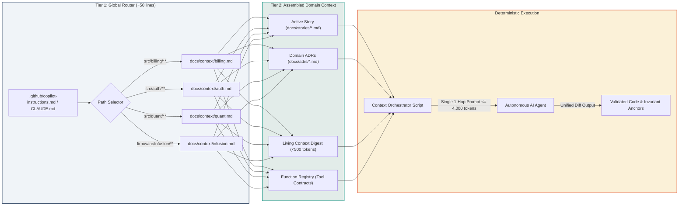

# Module 5: Context Chaining & Precision Routing (The Orchestrator)

## 🧠 Theory: The Physics of Token Compression & 1-Hop Execution

In an enterprise codebase spanning hundreds of thousands of lines of code, an autonomous AI agent cannot "browse" or "hunt" through the repository. When agents are prompted to search directories or iteratively crawl files, they encounter three mathematical and economic failure modes:

1. **Token Exhaustion & Latency Explosion**: An iterative file search burns between 15,000 and 40,000 tokens per hop, inducing minutes of latency and violating operational spend caps ($Q_{\text{limit}} = \$0.40$/day under the Micro-USD Daily Spend Quota Guardrail).
2. **Exponential Hallucination Cascades**: As shown in [The Mathematics of AI Risk](../00_THE_MATHEMATICS_OF_AI_RISK.md), if single-step accuracy is $p \approx 0.95$, an unconstrained multi-hop search across 10 steps compounds error geometrically:
   $$P_{\text{success}} = p^{10} = (0.95)^{10} \approx 59.8\%$$
   The agent has a 40.2% probability of picking an irrelevant file or following a deprecated code pattern.
3. **Working Memory Dilution**: Iteratively accumulated context displaces architectural constraints and boundary negative conditions into the "Lost in the Middle" attention degradation valley ($F(x) \approx 0.35$).

**Context Chaining** is the programmatic process of assembling a single, deterministic **Surgical Payload** containing the exact 1% of code, schemas, and architectural constraints necessary for the task. The modern enterprise standard for context assembly is the **2-Tier Precision Routing Model**.

---

## 🏛️ The 2-Tier Precision Routing Model

```
┌──────────────────────────────────────────────────────────────────────────────────────────────────┐
│                             THE 2-TIER PRECISION ROUTING ARCHITECTURE                            │
├──────────────────────────────────────────────────────────────────────────────────────────────────┤
│                                                                                                  │
│   TIER 1: THE GLOBAL TRAFFIC CONTROLLER (~50 lines)                                              │
│   • Entry Points: `.github/copilot-instructions.md`, `.cursorrules`, `CLAUDE.md`, or             │
│     `.antigravity/instructions.md`.                                                             │
│   • Purpose: Contains ONLY high-level domain dispatch pointers and the Global Persona.           │
│   • Mechanism: Evaluates active file path -> loads single authoritative Tier 2 domain context.   │
│                                                                                                  │
│   TIER 2: THE SURGICAL PAYLOAD (Direct 1-Hop Ingestion)                                          │
│   • Domain Knowledge: `docs/context/{domain}.md` (Boundary definitions and domain ADRs).        │
│   • Living Context Digest: `openrouter_context.json` (<500 tokens of active schemas and models). │
│   • Active Task: `docs/stories/{story_id}.md` (Semantic Blueprint with 20 pre-condition edges). │
│   • The "Hands" (Tool Definitions): `function_registry.json` (MCP tool contracts).               │
│                                                                                                  │
└──────────────────────────────────────────────────────────────────────────────────────────────────┘
```

---

## 🗺️ Visual Architecture: 2-Tier Context Routing Flow

The following Mermaid diagram illustrates how the Orchestrator executes a **1-Hop Ingestion Event**, eliminating multi-turn repository hunting:



---

## 💻 Production Implementation: The Context Assembler Script

In the Enterprise Context Factory, human engineers and automated CI runners do not manually copy-paste prompt contexts. They utilize an **Orchestration Script** to compile the prompt deterministically:

```python
"""
orchestrator_context_assembler.py
Deterministic 1-Hop Context Assembly Engine for Autonomous Builders.
Architectural Modularity compliant (<400 LOC).
"""
import json
from pathlib import Path
from typing import Dict, Any, List

REPO_ROOT = Path(__file__).resolve().parent.parent


class ContextAssembler:
    """Assembles a bounded, token-minimized 1-hop prompt payload."""

    def __init__(self, repo_root: Path = REPO_ROOT):
        self.root = repo_root

    def load_constitution(self) -> str:
        """Loads enterprise constitution articles and inviolable commandments."""
        const_path = self.root / "00_ENTERPRISE_CONSTITUTION.md"
        return const_path.read_text(encoding="utf-8") if const_path.exists() else ""

    def load_living_context_digest(self) -> str:
        """Loads minified living context JSON digest (<500 tokens)."""
        ctx_file = self.root / "data" / "openrouter_context.json"
        if not ctx_file.exists():
            return "### LIVING CONTEXT: State registry not initialized."
        data = json.loads(ctx_file.read_text(encoding="utf-8"))
        
        digest_lines = [
            "### LIVING CONTEXT DIGEST (<500 tokens)",
            f"- Modularity Heuristics: Target <=400 LOC, proactively evaluate files >=350 LOC.",
            f"- Active D1 SQL Tables: {', '.join(list(data.get('table_dto_map', {}).keys())[:12])}",
            f"- Canonical Algorithms: {', '.join(list(data.get('canonical_math_algorithms', {}).keys())[:10])}",
            f"- Active Invariants: {'; '.join(data.get('inviolable_rules', [])[:4])}"
        ]
        return "\n".join(digest_lines)

    def load_domain_context(self, domain: str) -> str:
        """Loads Tier 2 domain boundaries, ADRs, and schemas."""
        domain_file = self.root / "docs" / "context" / f"{domain}.md"
        if not domain_file.exists():
            raise FileNotFoundError(f"Authoritative domain context not found: {domain_file}")
        return domain_file.read_text(encoding="utf-8")

    def load_story_blueprint(self, story_id: str) -> str:
        """Loads the active context-enriched Semantic Blueprint."""
        story_file = self.root / "docs" / "stories" / f"{story_id}.md"
        if not story_file.exists():
            raise FileNotFoundError(f"Active story blueprint not found: {story_file}")
        return story_file.read_text(encoding="utf-8")

    def assemble_payload(self, story_id: str, domain: str, role_persona: str) -> Dict[str, Any]:
        """Chains components into a single bounded 1-hop system payload."""
        constitution = self.load_constitution()
        living_context = self.load_living_context_digest()
        domain_context = self.load_domain_context(domain)
        story = self.load_story_blueprint(story_id)

        system_instruction = (
            f"{role_persona}\n\n"
            f"=== 1. GLOBAL CONSTITUTION & INVARIANTS ===\n{constitution}\n\n"
            f"=== 2. LIVING CONTEXT DIGEST ===\n{living_context}\n\n"
            f"=== 3. TIER 2 DOMAIN CONTEXT & ADRS ===\n{domain_context}\n"
        )

        user_prompt = (
            f"=== 4. ACTIVE TASK REQUIREMENTS (SEMANTIC BLUEPRINT) ===\n{story}\n\n"
            f"INSTRUCTION: Implement the task specified above. Adhere strictly to Architectural Modularity Heuristics (<=400 LOC), "
            f"Rule 14 Anti-Feature-Erasure, and Zero-Mock compliance. Emit output as a unified git diff."
        )

        return {
            "system_instruction": system_instruction,
            "user_prompt": user_prompt,
            "estimated_tokens": (len(system_instruction) + len(user_prompt)) // 4
        }
```

---

## ⚖️ Dual-Use Callout Box: Context Assembly Across Regulated Domains

::: tip DUAL-USE ANALYSIS: CONTEXT ROUTING IN HIGH-STAKES ARCHITECTURES
| Operational Requirement | High-Frequency Quantitative Trading | FDA Class III Closed-Loop Medical Devices | Aerospace Flight Management Systems |
| :--- | :--- | :--- | :--- |
| **Tier 1 Traffic Router** | Directs AI to market microstructure domain context (`docs/context/microstructure.md`). | Directs AI to pump actuation and sensor debounce context (`docs/context/actuator.md`). | Directs AI to flight surface actuation context (`docs/context/flight_controls.md`). |
| **Living Context Injection** | Injects D1 SQL order book tables, tick size schemas, and active model matrix. | Injects EEPROM calibration tables, sensor analog-to-digital converter (ADC) scales. | Injects ARINC 424 waypoint binary schemas and avionics bus message identifiers. |
| **Domain Guardrail Enforcement** | Enforces Pre-Trade Plausibility Bands ($\lvert P_{\text{exec}} - \text{EMA}_5 \rvert \le \text{Band}$). | Enforces Medical Basal Clamping ($\lvert \text{Rate}_{\text{new}} - \text{Rate}_{\text{cur}} \rvert \le 10\%$). | Enforces Aerodynamic Envelope Limiting ($\delta_{\text{rudder}} \le 5^{\circ}$). |
| **Token ROI** | Eliminates 30,000-token directory searches, executing in <4,000 tokens in under 4 seconds. | Prevents model from inspecting patient PHI or unrelated telemetry logs during firmware fixes. | Prevents model from reviewing passenger entertainment systems when patching flight guidance. |
:::

---

## ✍️ Hands-On Exercises: Structuring a Context Assembly Chain

### Exercise 5.1: Assembling Context for a Database Migration
**Scenario**: You are tasked with adding a new `liquidity_tier` column to the `daily_prices` table.
1. Specify the exact files that must be chained into the Tier 2 payload.
2. What living context information must be provided to prevent the AI from breaking downstream DTO models?
3. What is the maximum acceptable token overhead for the assembled payload?

#### Model Solution:
```markdown
### 1. ASSEMBLED CONTEXT FILES
- Global Router (Tier 1): `.github/copilot-instructions.md` (Traffic router and modularity rules).
- Domain Context (Tier 2): `docs/context/market_data.md` (Contains Database Schema Parity Guardrails).
- Active Task: `docs/stories/MIGRATION-042-liquidity-tier.md` (Semantic Blueprint specifying integer enum values: 1=High, 2=Mid, 3=Illiquid).
- Schema Contract: `src/schemas/daily_prices.py` (Current Pydantic DTO model).

### 2. LIVING CONTEXT INGESTION
- Provide `table_dto_map["daily_prices"]` from `openrouter_context.json`, demonstrating that `daily_prices` maps directly to `FinnhubClient / DualStorageEngine`.
- The AI is explicitly informed that modifying the SQL table requires updating both the D1 schema and the `DailyPriceDTO` class simultaneously to preserve dual-schema parity.

### 3. TOKEN CEILING
- Target prompt size: <= 3,500 tokens (System: 2,500 tokens, User Story: 1,000 tokens). Total execution time: < 4 seconds.
```

---
[**Proceed to Module 6: Information Routing Structure & Pre-Commit Sentinels →**](./06_information_routing_structure.md)

---

## Production Reality & Failure Modes in the AI Era

### The Mid-2026 Production Baseline (The Verification Trap & Context Debt)
In the mid-2026 median engineering baseline (the 75\%--84\% ad-hoc adoption mean), developers permit autonomous coding agents to traverse repositories without deterministic routing constraints. Developers provide broad search tooling or terminal execution privileges with open-ended prompts: *"Find where we handle invoice discounts, see how discounts are applied, and add a 15\% promotional coupon logic."*

What follows is an operational and economic failure mode. The agent spends 30,000 to 50,000 tokens recursively traversing directory trees, inspecting test fixtures, and parsing obsolete migration scripts. Under the mathematics of compounded step error ($P_{\text{success}} = p^{10} = (0.95)^{10} \approx 59.8\%$), an unconstrained 10-hop exploration exhibits a 40.2\% probability of anchoring on a deprecated pattern. The agent frequently discovers an obsolete `discounts_v1_deprecated.py` file, modifies it, and emits a syntactically valid pull request while the active production service in `src/billing/` remains untouched.

### Failure Modes & Drift Dynamics in Ungoverned Production
Operating without 1-hop precision context chaining precipitates three severe production failure modes:
1. **API Spend Burnout**: Ungoverned multi-hop exploratory agents consume tens of thousands of tokens per run, depleting organizational LLM allocations rapidly without producing verified production logic.
2. **The Multi-Hop Hallucination Cascade**: Autonomous agents traversing un-indexed codebases inevitably anchor onto mock fixtures or prototype code in `tests/`, implementing production features that depend on synthetic data and failing immediately upon merge.
3. **Working Memory Exhaustion & Degradation**: Accumulating 40,000 tokens of file directory listings, tool outputs, and conversational filler in an agent's context window pushes critical architectural invariants and negative constraints directly into the attention degradation valley ($F(x) \approx 0.35$). The agent hallucinates function signatures and strips safety checks because its working memory is saturated with repository debris.

### Deterministic Engineering Defenses & Operational Takeaways
To eliminate exploratory token waste and establish deterministic 1-hop execution, engineering teams enforce these operational invariants:
- **Prohibit Exploratory Multi-Hop Repository Traversal**: Ban autonomous coding agents from running raw exploratory directory walks or broad recursive greps. Context assembly must be deterministic, programmatic, and 1-hop.
- **Implement the 2-Tier Routing Model**: Deploy a thin ($<50$ lines) Tier 1 router in `.github/copilot-instructions.md`, `CLAUDE.md`, or `.cursorrules` that deterministically routes active file paths to authoritative Tier 2 domain files in `docs/context/`.
- **Enforce a 4,000-Token Surgical Payload Budget**: Cap the total prompt payload (system persona, living context digest, domain ADR, active story, and 80-line target code slice) at $\le 4,000$ tokens, guaranteeing $<4$-second execution latency.
- **Inject Living Context Programmatically**: Require orchestrator harnesses to inject the minified table-to-DTO map (`openrouter_context.json`) directly into the prompt payload, eliminating the need for models to infer database schemas or DTO relationships.

