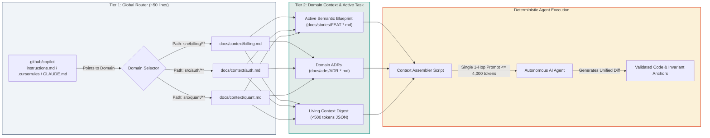

# Builder & Architect Hub: Deterministic Software Engineering & Living Context Architecture

## 🎯 The Builder & System Architect Mission

The primary mandate of the Software Engineer and System Architect in the **Enterprise Context Factory** is to construct **Deterministic Software Systems using Stochastic AI Tools**.

In an era where frontier Large Language Models (LLMs) operate via probabilistic next-token prediction, deploying unconstrained agents across enterprise codebases guarantees silent software degradation, context collapse, and cascading regressions. Unbounded files (>400 lines of code) induce attention dilution and catastrophic feature erasure. Stale markdown documentation causes agents to hallucinate non-existent database columns and deprecated APIs. Silenced error blocks returning synthetic constants poison mission-critical datastores.

To achieve production reliability in high-stakes regulated enterprises—such as **FDA Class III closed-loop medical devices**, **aerospace fly-by-wire avionics (DO-178C Level A)**, and **mission-critical quantitative finance engines**—Builders and System Architects construct the physical deterministic scaffolding:
1. **The Navigational Map**: 2-Tier Precision Routing that eliminates multi-hop repository scans.
2. **The Living Memory**: AST-indexed State and Mathematical Registries compiled directly from source code.
3. **The Surgical Payload**: Compressed Living Context (<1,500 tokens) with strict dual-schema database-to-DTO mappings.
4. **The Bounded Sandbox**: The **ADR-016 400-LOC modular ceiling**, 350-LOC refactoring trigger, 80-line targeted context windows, and **Rule 14 Anti-Feature-Erasure**.
5. **The Cryptographic Guardrails**: Code-adjacent SHA1 Invariant Anchors ($I_{01}$–$I_{22}$) and zero-drift atomic pre-commit gates.

---

## 🤝 The Cross-Functional Context Handshake

Architecture and implementation do not occur in isolation. Within the cross-functional pipeline, the Builder and System Architect operate at the critical boundary between requirements specification and quality engineering verification:

```
┌──────────────────────────────────────────────────────────────────────────────────────────────────┐
│                      THE ENTERPRISE CROSS-FUNCTIONAL CONTEXT PIPELINE                            │
├──────────────────────────────────────────────────────────────────────────────────────────────────┤
│                                                                                                  │
│   [Product Owners & Regulated Executives]  ──► 00_ Foundations & 08_ Governance                  │
│     • Enterprise Constitution (Articles I–VII) & 22 System Invariants (I01–I22)                 │
│     • Regulatory Compliance (FDA 21 CFR Part 820/11, DO-178C Level A, Federal Reserve SR 11-7)  │
│                                           │                                                      │
│                                           ▼                                                      │
│   [Business Analysts / Requirements Leads] ──► 01_ Strategy & 02_ Requirements                  │
│     • 3-Part Directives (Role, Task, Format) with Invariant Bindings                             │
│     • Epistemic Air-Gap (ADR-030) & 80% Commercial Funnel Discount ($W_{\text{commercial}} = 0.20$)│
│     • Semantic Blueprints with 20 Mandatory Pre-Condition Edge Cases                             │
│                                           │                                                      │
│                                           ▼                                                      │
│   [Software Engineers & System Architects] ──► 03_ Building & Coding [CURRENT MODULE]            │
│     • ADR-016 400-LOC Modular Ceiling, 350-LOC Refactor Trigger & 80-Line Surgical Slices        │
│     • AST-Indexed State Registries (`STATE_REGISTRY.md`) & Math Registries (100 Verified Algs)   │
│     • Living Context Compiler (<1,500 Tokens) vs Naive Vector RAG                                │
│     • Zero-Drift Atomic Pre-Commit Command Chains (`git diff --exit-code`)                       │
│     • Code-Adjacent SHA1-Checksummed Invariant Anchors ($I_{01}-I_{22}$)                         │
│                                           │                                                      │
│                                           ▼                                                      │
│   [Validation Leads / Quality Engineers]  ──► 04_ Testing & 06_ Security                         │
│     • Programmatic AST Zero-Mock Enforcement (Rules ZM001–ZM007)                                 │
│     • Hermetic Socket Isolation (`pytest-socket`, `SocketBlockedError`)                          │
│     • Compensatory 4-Pillar Confluence vs Conjunctive Gate Collapse                              │
│                                                                                                  │
└──────────────────────────────────────────────────────────────────────────────────────────────────┘
```

### The Architectural Handshake Contract

| Pipeline Phase | Inbound Artifacts | Architectural Transformation | Outbound Contract | Downstream Consumer |
| :--- | :--- | :--- | :--- | :--- |
| **Requirements $\to$ Architecture** | Semantic Blueprint (`docs/specs/*.md`), 3-Part Directive, 20 Edge Cases, Invariant Bindings ($I_k$). | Parse boundary constraints, evaluate Big-O implications, verify database table parity, decompose into $\le 80$-line surgical slices. | Architectural Decision Record (ADR), Module Decomposition Plan, 2-Tier Route Pointers. | Autonomous AI Builder / Implementation Engineer |
| **Architecture $\to$ Code** | ADR, 2-Tier Domain Context (`docs/context/*.md`), Living Context (`openrouter_context.json`). | Implement logic adhering to ADR-016 ($\le 400$ LOC), embed code-adjacent SHA1 Invariant Anchors, update registries. | Compiled Source Modules, Checksummed Anchor Blocks, Updated AST Registries. | Pre-Commit Verification Gate / Quality Engineer |
| **Code $\to$ Quality Engineering** | Staged Source Code, Generated AST Registries, SHA1 Checksums. | Execute atomic pre-commit chain (`git diff --exit-code`), verify zero AST drift in memory. | Clean Git Commit, Zero-Drift Attestation, Verifiable Execution Proof. | CI/CD Runner (`drift-monitor.yml`) & QE Test Harness |

---

## 🏛️ The Five Bedrock Pillars of Builder Architecture

```
┌──────────────────────────────────────────────────────────────────────────────────────────────────┐
│                   THE FIVE BEDROCK PILLARS OF BUILDER & ARCHITECT ARCHITECTURE                   │
├──────────────────────────────────────────────────────────────────────────────────────────────────┤
│                                                                                                  │
│   1. ADR-016 Modular Hard Ceiling                                                                │
│      • 400 Physical LOC Ceiling per module                                                       │
│      • 350 LOC Mandatory Refactoring Trigger                                                     │
│      • 80-Line Surgical Context View Windows                                                     │
│      • Rule 14 Anti-Feature-Erasure (Bans deleting fallbacks/retries to fit limits)               │
│                                                                                                  │
│   2. Deterministic AST Registries                                                                │
│      • `update_state_registry.py`: Native `ast.parse` over `git ls-files`                         │
│      • Extracts LOC, classes, public function signatures, and ADR-016 health flags               │
│      • `update_math_registry.py`: Catalogs 100 canonical algorithms with exact AST coordinates   │
│      • Fail-Closed verification: halts if symbol missing or linked test suite deleted             │
│                                                                                                  │
│   3. Living Context Minification (<1,500 Tokens)                                                 │
│      • `generate_living_context.py`: Compiles codebase state into `openrouter_context.json`      │
│      • Dual-Schema Parity: Maps all database tables to Pydantic/dataclass DTOs                   │
│      • Saves ~10,000 prompt tokens per session; completely eliminates schema hallucinations     │
│                                                                                                  │
│   4. Code-Adjacent SHA1 Invariant Anchors                                                        │
│      • Machine-parseable `# === INVARIANT-BLOCK v1` comments embedded directly in code           │
│      • Deterministic checksum verification: $\text{sha1}(\text{inv\_id}\|\text{adr}\|\text{pred})[:8]$   │
│      • LOC counter excludes anchor blocks to prevent penalizing safety documentation             │
│                                                                                                  │
│   5. Zero-Drift Pre-Commit & CI Gates                                                            │
│      • Atomic pre-commit command chain enforces local AST synchronization                        │
│      • `git diff --exit-code` halts commit if registries drift from source code                  │
│      • GitHub Actions `drift-monitor.yml` enforces zero-drift quality gate remotely              │
│                                                                                                  │
└──────────────────────────────────────────────────────────────────────────────────────────────────┘
```

---

## 🔬 Forensic Failure Modes: The Two Builder Crises

To understand why these five pillars are non-negotiable, software engineers and architects must examine the forensic failure modes that emerge when autonomous AI agents operate without structural guardrails.

### Forensic Case Study 1: The V1 Monolithic Cron Poller Crisis (May 2026)
* **The Naive Initial Architecture**: A daily batch cron job running at 8:00 PM ET executing monolithic procedural Python scripts (`daily_runner.py` / `fundamentals_fetcher.py`, 600–1,200+ LOC). The script iterated through a static watchlist of 35 equities in a synchronous for-loop, scraping external web endpoints (Yahoo Finance, Finnhub, SEC EDGAR) and invoking frontier LLMs with unconstrained 8,000-token prompts.
* **The Silent Catastrophe**:
  1. *Runaway Token Burn ($500+/Month Debating Flat Stocks)*: The poller unconditionally deliberated on low-beta, flat assets with zero material news, burning 92% of tokens on redundant, identical analyses.
  2. *16-Hour Reaction Lag*: A morning guidance cut (-18% plunge at 9:30 AM ET) went completely undetected until the 8:00 PM cron, with recommendations delivered at 7:00 AM the next day—16 hours after capital was destroyed.
  3. *SEC EDGAR 429 Blacklisting*: Rapid sequential scraping breached the SEC EDGAR 10 req/s rate limit, triggering HTTP `429 Too Many Requests` and IP bans that aborted runs mid-execution.
  4. *Context Collapse & Silent Feature Erasure*: In 1,200-line monoliths, transformer attention entropy ($\mathcal{H}(A_i)$) diluted focus. Autonomous refactoring agents suffered the "Lost in the Middle" degradation valley ($F(x) \approx 0.35$ for $x \in [0.15, 0.85]$) and silently truncated 200 lines of error handlers into comments like `# ... existing logic remains unchanged ...`.
* **Permanent Architectural Mechanisms**:
  - **ADR-001**: Event-driven asynchronous ingress via edge webhooks ($0 compute standby).
  - **ADR-002**: 3-Tier Severity Triage Funnel (Tier 1 Breadcrumb $0, Tier 2 Accumulation $0 in-plan, Tier 3 Cognitive Escalation).
  - **ADR-003**: Continuous polarity accumulation with exponential half-life decay ($w(\Delta t) = w_0 (1/2)^{\Delta t / t_{1/2}}$) and post-eruption reset.
  - **ADR-011**: Integer micro-USD daily spend quota ($Q_{\text{limit}} = \$0.40$/day, $Q_{\text{ticker}} \le \$0.08$/day).
  - **ADR-016**: 400-LOC modular hard ceiling and Rule 14 Anti-Feature-Erasure.

### Forensic Case Study 2: The V2 Architectural & Context Drift Crisis (July 2026)
* **The Naive Initial Architecture**: Migration to asynchronous edge workers (Cloudflare Workers, Queues, and D1 SQLite) documented across 40+ prose Markdown blueprints (`docs/specs/01_Foundation.md` through `07_Debate_Logic_Matrix.md`). Autonomous AI agents were instructed to "read the documentation before implementing code."
* **The Silent Catastrophe**:
  1. *Code-Doc Divergence*: Modifying Python function signatures left markdown specs stale. Subsequent AI agents read outdated specs, generated calls to deprecated signatures, and committed broken code. Over 60% of specs contradicted live code within 3 weeks.
  2. *Database Schema Hallucination*: Lacking machine-readable schema contracts, LLMs hallucinated non-existent tables (`SELECT * FROM historical_sentiment`) and columns (`market_sentiment_score`), crashing queries with `sqlite3.OperationalError: no such column`. Silenced `try/except` blocks returned empty dictionaries, leading agents to assume the system had zero historical state.
  3. *SQLite Concurrency Lock Collisions*: Burst earnings webhooks triggered concurrent worker execution, crashing local SQLite replicas with `sqlite3.OperationalError: database is locked` due to missing WAL mode and retry logic.
  4. *AST Coordinate Amnesia*: Edits made by autonomous agents shifted line numbers and signatures across modules, breaking dependent callers silently.
* **Permanent Architectural Mechanisms**:
  - **AST State Registry (`STATE_REGISTRY.md`)**: Automatically parsed via native `ast.parse` over `git ls-files`, providing instant, byte-accurate repo topography in <5,000 tokens.
  - **Canonical Mathematical Registry (`docs/MATHEMATICAL_REGISTRY.md`)**: Catalogs 100 algorithms with exact AST coordinates (`L{start}–L{end}`) and fail-closed test bindings (`assert start_l > 0`).
  - **Living Context Compiler (`openrouter_context.json`)**: Minified JSON (<1,500 tokens) encoding dual-schema table-to-DTO mappings for all 29 D1 SQL tables. Injected into system prompts, saving ~10,000 tokens per session.
  - **Mandatory Atomic Pre-Commit Command Chain**: `update_state_registry.py && update_math_registry.py && generate_living_context.py && git diff --exit-code`.
  - **Database Concurrency Hardening**: SQLite Write-Ahead Logging (`PRAGMA journal_mode=WAL;`) and 30-second busy timeout (`PRAGMA busy_timeout=30000;`).

---

## ⚖️ Dual-Use Regulated Callout Boxes

To ensure enterprise generalizability, the architectural mechanisms in this module apply equally across high-stakes industries:

::: tip DUAL-USE DOMAIN COMPARISON: ARCHITECTURAL DRIFT & REGISTRY GOVERNANCE
| System Component | Quantitative Asset Management (`StockAnalysis V3`) | FDA Class III Medical Device Firmware (21 CFR Part 820/11) | Aerospace Navigation & Flight Guidance (DO-178C / ARINC 424) | Mission-Critical Banking Mainframe Gateway (ISO 20022 / Fedwire) |
| :--- | :--- | :--- | :--- | :--- |
| **Living Schema / Register Parity** | Dual-schema mapping: 29 Cloudflare D1 SQL tables mapped to Pydantic/dataclass DTOs (`openrouter_context.json`). Prevents SQL column hallucination (`historical_sentiment`). | **MISRA-C Hardware Register Map**: Memory-mapped I/O registers for peristaltic pump actuators and pressure transducers indexed in AST registry. Prevents AI from hallucinating register offsets. | **ARINC 424 Navigation Database Registry**: Waypoints, airway segments, and terminal procedures indexed by AST with bit-accurate line coordinates. Prevents flight plan hallucination. | **COBOL Copybook Parity Registry**: Packed-decimal field layouts and record lengths mapped to Java DTOs. Prevents silent byte alignment truncation in payment gateways. |
| **Modular Line Ceiling (ADR-016)** | Strict 400 LOC ceiling, 350 LOC trigger, 80-line view slices. Eliminates token attention dilution and prevents truncation of multi-tier price waterfalls. | **MISRA-C Function Complexity Bounds**: Functions strictly bounded to $\le 100$ LOC and cyclomatic complexity $\le 10$. Eliminates stack overflow risk in safety-critical firmware loops. | **DO-178C Structural Coverage Slicing**: Units bounded to single-responsibility modules to ensure 100% Modified Condition/Decision Coverage (MC/DC) traceability. | **Single-Transaction Translation Unit**: Message parsing isolated from debit/credit ledger commit. Units bounded $\le 300$ LOC to ensure verifiable concurrency. |
| **Anti-Feature-Erasure (Rule 14)** | Bans replacing 200 lines of API retry cascades and fallback pricing with `# ... existing logic remains unchanged ...`. | **Watchdog Interrupt Preservation**: Bans AI refactoring agents from commenting out hardware watchdog kick routines (`WDT_FEED()`) or sensor debounce filters. | **Fail-Safe Envelope Limiter Preservation**: Forbids AI coding tools from truncating aerodynamic boundary clamping loops during autopilot code refactoring. | **Audit Trail Logging Preservation**: Forbids AI tools from deleting cryptographic ledger hashing or dual-custody approval verifications. |
| **Zero-Drift Pre-Commit Gate** | `git diff --exit-code` asserts generated state and math registries match source code before commit. | **Device Master Record (DMR) CI Sentinel**: Asserts firmware binaries, register maps, and hazard traceability matrices match git commit hash. | **DO-178C Software Lifecycle Environment Gate**: Asserts object code, source code, and low-level requirements maintain 1:1 bidirectional traceability. | **Mainframe Ledger Verification Gate**: Asserts database schema migrations maintain zero-divergence with dual-entry accounting contracts. |
:::

---

## 🗺️ Visual Architecture Diagrams

### 1. End-to-End AST Compilation and Living Context Lifecycle vs. Naive Vector RAG

The following diagram illustrates how deterministic AST compilation replaces unreliable semantic vector embeddings, creating an unbroken feedback loop from code changes to autonomous agent prompts and CI gates:

```mermaid
flowchart TD
    subgraph Git_Workspace ["Git Workspace & Code Modification"]
        A[Developer / Autonomous Agent Edit] --> B["Surgical View Windows <= 80 LOC"]
        B --> C[File Modified in src/ or tests/]
        C --> D{"File LOC >= 350?"}
        D -- Yes --> E[Trigger ADR-016 Modular Decomposition]
        E --> F["Extract Submodules < 400 LOC (Rule 14 Anti-Feature-Erasure)"]
        D -- No --> G[Pre-Commit Atomic Command Chain]
        F --> G
    end

    subgraph AST_Generators ["Deterministic AST Parsing Engines"]
        G --> H["scripts/update_state_registry.py"]
        G --> I["scripts/update_math_registry.py"]
        G --> J["scripts/generate_living_context.py"]
        
        H -->|git ls-files + ast.parse| K["STATE_REGISTRY.md (<5,000 tokens)"]
        I -->|AST Line Resolution L{start}-L{end}| L["docs/MATHEMATICAL_REGISTRY.md (100 Algs)"]
        J -->|Compile Model Matrix + D1 DTOs| M["data/openrouter_context.json (<1,500 tokens)"]
    end

    subgraph Prompt_Injection ["Autonomous Agent Execution"]
        M --> N["load_openrouter_directives(compact=True)"]
        N -->|Prepends <= 500-token AST Digest| O["Frontier LLM (Claude 4.7 / Grok 4.6 / Kimi K3)"]
        O -->|Saves ~10k prompt tokens per turn| P[Zero Schema Hallucination & Zero Drift]
    end

    subgraph Verification_Gates ["Zero-Drift CI Quality Gates"]
        K & L & M --> Q["git diff --exit-code"]
        Q -->|Zero Diff Passed| R["tests/unit/test_context_freshness.py"]
        R -->|In-Memory AST Parity Verified| S["git commit & git push"]
        S --> T[".github/workflows/drift-monitor.yml"]
        T -->|Clean Exit 0| U[Production Release / Deployment]
        
        Q -- Divergence Detected --> V[FAIL CI: Re-run Generators]
        R -- Mismatch Detected --> V
    end

    style Git_Workspace fill:#f8f9fa,stroke:#343a40,stroke-width:2px;
    style AST_Generators fill:#e8f4f8,stroke:#17a2b8,stroke-width:2px;
    style Prompt_Injection fill:#eafaf1,stroke:#28a745,stroke-width:2px;
    style Verification_Gates fill:#fef9e7,stroke:#ffc107,stroke-width:2px;
```

### 2. The 2-Tier Precision Routing Architecture

Instead of forcing AI agents to search an entire 500k LOC codebase, 2-Tier Precision Routing achieves **1-Hop Ingestion**, assembling context deterministically:



---

## 🗂️ Module Directory Navigation

Explore the technical modules of Milestone 3:

1. [**Module 1: The 3-Part Directive for Architecture**](./01_3_part_directives.md)
   * The physics of prompt boundaries: Context Boundary, Task Instruction, and Architectural Constraint.
2. [**Module 2: Adversarial Thinking & Red-Teaming for Builders**](./02_adversarial_thinking.md)
   * Root causes of Crisis 1 (Cron Poller); closing the Fail-Soft trap and intercepting silent failures.
3. [**Module 3: Code Decomposition (PR Slicing) & ADR-016 Modularity**](./03_decomposition.md)
   * Enforcing the 400-LOC ceiling, 350-LOC refactor trigger, 80-line targeted slices, and Rule 14 Anti-Feature-Erasure.
4. [**Module 4: Context Engineering (The Builder's Guardrails)**](./04_context_engineering.md)
   * Root causes of Crisis 2 (Context Drift); building AST State and Mathematical Registries and the Living Context Compiler.
5. [**Module 5: Context Chaining & Precision Routing (The Orchestrator)**](./05_context_chaining_and_routing.md)
   * Literal Python/TypeScript context assembler scripts; token budgeting and 1-hop execution.
6. [**Module 6: Information Routing Structure & Pre-Commit Sentinels**](./06_information_routing_structure.md)
   * Implementing SHA1 Invariant Anchors ($I_{01}$–$I_{22}$), `git diff --exit-code`, and CI sentinels.
7. [**Architecture Decision Record (ADR) Template**](./adr_template.md)
   * Standardized template linking architectural choices directly to machine constraints.
8. [**Function & Tool Registry Schemas**](./function_registry.md)
   * Mapping 500k LOC codebases into Model Context Protocol (MCP) and OpenAI tool schemas.
9. [**Builder Reference Architecture: The Context-First Repository**](./REFERENCE_ARCHITECTURE.md)
   * Structural organization for enterprise repositories optimized for AI machine readability.
10. [**System Prompt Skills Catalog**](./skills.md)
    * Injectable capability overrides: `STRICT_COMPONENT_SCAFFOLDING`, `LEGACY_REFACTOR_WITH_ASSERTIONS`, and `INVARIANT_ANCHOR_EMBEDDER`.
11. [**Hands-On Lab Workbook**](./LAB_WORKBOOK.md)
    * Practical exercises in invariant anchor hashing, AST parsing, and zero-drift verification.
12. [**Context Chaining Examples**](./examples/context_chaining_example.md)
    * Concrete prompt assembly examples comparing naive chatbot queries with chained payloads.

---
[**Proceed to Module 1: The 3-Part Directive for Architecture →**](./01_3_part_directives.md)
