# Module 3: Test Suite Decomposition & Hermetic Socket Sandboxing

## 🧠 Theory: Bounded Context Slicing & The Danger of Monolithic Test Suites

In large-scale enterprise systems, automated test suites frequently suffer from the same architectural degradation as production code. When quality engineers allow test files to grow into 1,000+ line monoliths containing hundreds of assertions, page objects, and fixtures, autonomous AI refactoring agents suffer severe attention degradation.

Under the transformer's $O(N^2)$ attention mechanism and the U-shaped positional attention curve, an AI modifying a monolithic test file loses track of earlier mock setups, accidentally deletes shared fixtures, and introduces unasserted side effects.

### The Architectural Modularity Test Heuristic (~400 LOC)
To maintain deterministic test quality, the **Architectural Modularity Heuristic (~400 LOC)** guides test code sizing:
1. **Target ~400-LOC Heuristic**: Test suites should target ~400 LOC for test clarity, cognitive focus, and Single Responsibility Principle (SRP). Comprehensive integration test suites, meta-harnesses, or AST validators (such as `e2e_curriculum_validator.py`) that evaluate cross-system properties may span multiple cohesive functional visitors without violating modularity invariants.
2. **350-LOC Refactoring Trigger**: When a unit test file reaches 350 lines, teams should proactively consider decomposing it into cohesive, isolated sub-suites before adding large new test matrices.
3. **Semantic AST Test Scoping**: Test authoring directives must operate within cohesive AST node scopes (<1,000 tokens) rather than arbitrary physical line windows.

```
┌──────────────────────────────────────────────────────────────────────────────────────────────────┐
│                     DECOMPOSITION OF TEST SUITES BY BOUNDED CONTEXT                              │
├──────────────────────────────────────────────────────────────────────────────────────────────────┤
│                                                                                                  │
│   ❌ MONOLITHIC TEST SUITE (COLLAPSE RISK)                                                       │
│   ┌──────────────────────────────────────────────────────────────────────────────────────────┐   │
│   │ test_orders_all.py (1,250 LOC)                                                           │   │
│   │ • Unit logic + DB queries + Network HTTP + UI E2E + Auth fixtures                         │   │
│   │ • Attention decay leads to silent fixture deletion & test flakiness                      │   │
│   └──────────────────────────────────────────────────────────────────────────────────────────┘   │
│                                                                                                  │
│   ✅ DECOMPOSED HERMETIC TEST PYRAMID (400-LOC MODULAR HEURISTIC COMPLIANT)                      │
│   ┌────────────────────────┐  ┌────────────────────────┐  ┌────────────────────────┐             │
│   │ test_order_math.py     │  │ test_guardrails.py     │  │ test_conformal_fuzz.py │             │
│   │ (Pure math, <250 LOC)  │  │ (Fail-closed, <300 LOC)│  │ (Fault inject, <350 LOC)│            │
│   └────────────────────────┘  └────────────────────────┘  └────────────────────────┘             │
│                                                                                                  │
└──────────────────────────────────────────────────────────────────────────────────────────────────┘
```

---

## 🔒 Hermetic Socket Isolation: OS-Level Network Interception

One of the most insidious testing failure modes in autonomous engineering is **Network Egress Leakage**. If a unit test suite makes outbound HTTP requests to live production or staging APIs:
1. Tests become non-deterministic and flaky due to transient network latency or rate limits (HTTP 429).
2. Live API keys risk credential leakage into logs.
3. AI coding agents can silently bypass zero-mock rules by calling external endpoints during test execution.

To guarantee 100% hermetic isolation, network egress is blocked at the operating system system call boundary using `pytest-socket`.

```mermaid
sequenceDiagram
    autonumber
    participant TestRunner as Pytest Test Execution
    participant AppCode as Application Code Under Test
    participant SocketHook as Hermetic Socket Hook (conftest.py)
    participant TelemetryStore as Golden Recorded Telemetry Cache
    participant ExtNet as External Real World (DNS / Financial APIs)

    TestRunner->>AppCode: Execute Test Case (Order Pricing Calculation)
    AppCode->>SocketHook: Calls socket.socket.connect(('api.nasdaq.com', 443))
    Note over SocketHook: OS-Level Network Interception
    SocketHook->>SocketHook: Inspect Active Test Context
    alt Golden Telemetry Cache Exists
        SocketHook->>TelemetryStore: Retrieve Verified Deterministic Recorded Frames
        TelemetryStore-->>AppCode: Replay Golden Frame (Zero Flakiness)
        AppCode-->>TestRunner: Deterministic Assertion Verified Clean
    else Un-sandboxed Socket Attempted
        SocketHook-->>ExtNet: BLOCKED (Zero Outbound Packets Emitted)
        SocketHook-->>AppCode: Raise SocketBlockedError("Outbound network disabled")
        AppCode-->>TestRunner: Test Fails Instantly with Diagnostic Trace
    end
```



### The Hermetic Socket Architecture
In `tests/conftest.py`, the Python `socket.socket.connect` system call is intercepted at fixture initialization:

```python
# tests/conftest.py: Hermetic OS-Level Socket Interception
import os
import socket
import pytest

class SocketBlockedError(RuntimeError):
    """Raised when an unauthorized outbound network socket connection is attempted."""
    pass

def guard_socket_connect(*args, **kwargs):
    raise SocketBlockedError(
        "NETWORK EGRESS BLOCKED: Unit tests must execute under 100% hermetic isolation. "
        "Outbound network socket calls are strictly forbidden."
    )

@pytest.fixture(autouse=True)
def block_outbound_sockets(monkeypatch):
    """Intercept socket system calls unless explicitly overridden by ALLOW_NET=true."""
    if os.getenv("ALLOW_NET", "").lower() != "true":
        monkeypatch.setattr(socket.socket, "connect", guard_socket_connect)
```

### Why SocketBlockedError Is Superior to Synthetic Mocks
Traditional unit testing advises developers to use `unittest.mock.patch` to mock HTTP clients. However, when an AI agent generates code, it often mocks the wrong interface or invents synthetic responses that do not reflect live API schemas.

Under Hermetic Socket Isolation:
* Code under test cannot reach the external network.
* If the code attempts an unauthorized outbound socket call, the test framework halts instantly in $<2\text{ms}$ with `SocketBlockedError`.
* Developers are forced to design decoupled architectures where functions accept pure data inputs rather than instantiating external network clients within business logic.

---

## 📦 Golden Recorded Telemetry vs. Synthetic Mocks

The Zero-Mock Mandate ($I_{01}$) does not mean systems cannot be tested against offline data. Instead, it creates a vital distinction between **Synthetic Mocks** and **Golden Recorded Telemetry**:

```
┌──────────────────────────────────────────────────────────────────────────────────────────────────┐
│                 SYNTHETIC MOCKS vs. GOLDEN RECORDED TELEMETRY                                    │
├──────────────────────────────────────────────────────────────────────────────────────────────────┤
│                                                                                                  │
│   SYNTHETIC MOCK (BANNED UNDER ZM001–ZM007)                                                      │
│   • Authored by an LLM or developer using arbitrary constants.                                   │
│   • Example: `{"dark_pool_ratio": 0.50, "spot_price": 200.0, "fed_funds": 5.25}`                 │
│   • Disconnected from physical market distributions, cross-table integrity, and schema timestamps.│
│                                                                                                  │
│   GOLDEN RECORDED TELEMETRY (PERMITTED UNDER INVARIANT I01)                                      │
│   • Exact, byte-for-byte capture of live market/sensor telemetry recorded from verified source. │
│   • Immutably signed with SHA256 checksum and provenance metadata.                               │
│   • Example: `SEC_EDGAR_RAW` Form 10-K Item 8 JSON payload captured on 2026-09-15.               │
│   • Preserves all real-world quirks: irregular timestamps, decimal fractions, and missing fields.│
│                                                                                                  │
└──────────────────────────────────────────────────────────────────────────────────────────────────┘
```

---

## 🔬 Dual-Use Regulated Callout Box

### 🛡️ Dual-Use Callout Box: Hermetic Test Isolation
> **Algorithmic Asset Management**: Outbound network interception via `pytest-socket` guarantees that backtests and unit test suites do not query live exchanges, preventing lookahead data leakage, rate-limiting IP bans, and unrepeatable execution results.  
> **Aerospace Hardware-in-the-Loop (HIL) Avionics (DO-178C Level A)**: In avionics flight control software verification, RTCA DO-178C Section 6.4 mandates software testing in target or closed-loop simulation environments without unverified external network dependencies. RTCA DO-178C software verification does NOT require "Air-Gapped Faraday Chambers" (Faraday cages and anechoic chambers are used for DO-160 radio frequency/electromagnetic interference environmental testing). Instead, DO-178C Level A requires deterministic closed-loop simulation environments with certified recorded sensor streams (e.g., ARINC 424 navigation telemetry) and hermetic execution without ambient network dependencies, ensuring 100% Modified Condition/Decision Coverage (MC/DC) repeatability free from external network jitter or packet interference.

---

## Production Reality & Failure Modes in the AI Era

### The Mid-2026 Production Baseline (The Verification Trap & Context Debt)

In the mid-2026 median engineering baseline (75%–84% ad-hoc adoption), test suites are non-hermetic, sprawling, and chronically flaky. A typical test suite blends pure invariant unit logic with live HTTP requests to third-party endpoints.

When CI pipelines execute, test runners initiate unconstrained outbound socket connections:

> [!WARNING]
> **Flaky Test Blindness & Outbound Sockets**
> - **Flaky Test Blindness**: Transient DNS timeouts and rate-limiting (HTTP 429) trigger non-deterministic failures, leading developers to blindly re-run pipelines until green.
> - **Idealized Synthetic Mocks**: AI tools synthesize idealized round figures (`{"price": 200.0}`) that conceal non-standard decimal fractions and NaN values.
> - **Monolithic Test Amputation**: When modifying oversized test files (>1,200 LOC), models silently truncate earlier assertions to fit token limits.

Teams succumb to **Flaky Test Blindness**, re-running failing pipeline jobs repeatedly until non-deterministic passes occur.

When AI tools synthesize mock payloads, models generate idealized round figures that conceal production pathologies such as non-standard fractions and NaN values.

### Failure Modes & Drift Dynamics in Ungoverned Production
Operating without hermetic socket sandboxing and test modularity induces three severe failure modes:
1. **The Flaky CI Pipeline Freeze**: Network-dependent test suites fail intermittently during deployment windows. Engineering teams routinely bypass pipeline blocks to expedite urgent patches, allowing critical regressions into production unverified.
2. **Credential and Telemetry Egress**: Non-hermetic test suites invoking outbound network sockets inadvertently leak staging credentials, API tokens, or proprietary internal data to external logging sinks, causing data compliance violations.
3. **Monolithic Test Amputation**: When autonomous coding assistants modify oversized test files exceeding 1,200 LOC, output token limits compel models to silently truncate earlier assertions and setup fixtures, degrading test coverage under the guise of refactoring.

### Deterministic Engineering Defenses & Operational Takeaways
To achieve hermetic, deterministic test execution and eliminate pipeline flakiness, engineering teams enforce these operational invariants:
- **Block Outbound Network Sockets at the OS/Kernel Boundary**: Integrate `pytest-socket` into root test fixtures, intercepting outbound TCP/UDP traffic and raising immediate `SocketBlockedError` if any unit test attempts socket communication.
- **Decompose Test Monoliths at the 350-LOC Boundary**: Enforce the 400-LOC modularity ceiling on test directories, splitting test monoliths into surgical suites: pure mathematical invariants (<250 LOC), negative boundary guardrails (<300 LOC), and fuzzing harnesses (<350 LOC).
- **Mandate Golden Recorded Telemetry Over Synthetic Mocks**: Prohibit developer-invented synthetic mock values. Require integration fixtures to consume byte-for-byte captures of verified production telemetry verified by SHA256 checksums.
- **Enforce Hermetic In-Memory Execution Targets**: Structure unit and contract test suites to run entirely in local memory without external daemons, executing hundreds of invariant assertions in $<2$ seconds.

