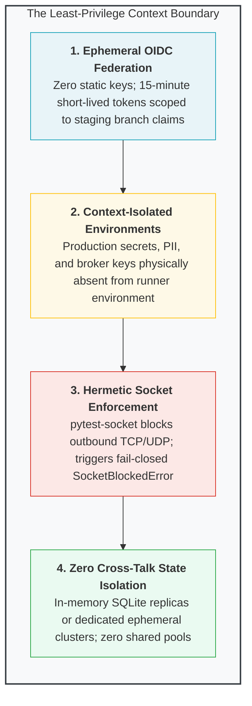
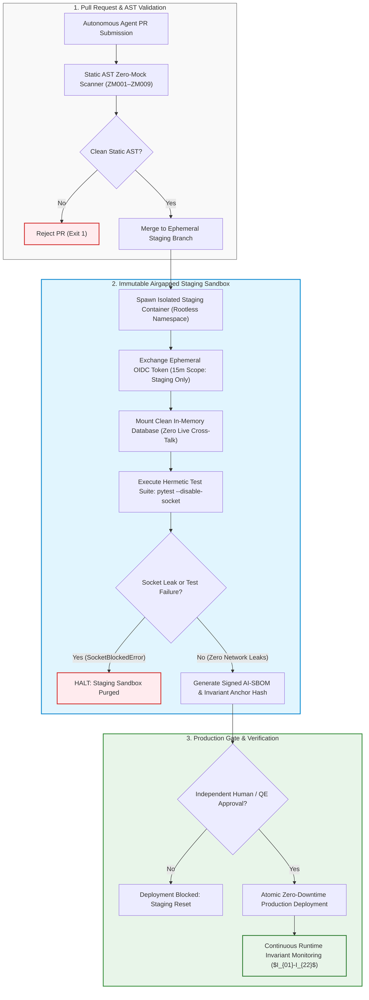

# Module 2: Immutable Staging Airgaps, Reproducibility & Context Least-Privilege

## 🧠 Theory: Structural Airgaps vs. Shared Infrastructure

In autonomous software delivery pipelines, granting AI agents access to shared, mutable staging environments is an architectural anti-pattern that precipitates catastrophic production drift. When an autonomous system attempts to deploy, test, and verify code within an environment that shares network bridges, database replicas, or environment variables with live systems, the boundary between test execution and production state inevitably collapses.

To guarantee zero-drift reproducibility and eliminate blast radiuses, enterprise engineering platforms enforce **Immutable Staging Airgaps** and the **Least-Privilege Context Boundary**.

---

## 🏛️ Regulatory & Standards Grounding: NIST AI RMF 1.0

The mandate for verifiable isolation and least-privilege boundaries is grounded in national and international risk governance frameworks, notably the **National Institute of Standards and Technology (NIST) Artificial Intelligence Risk Management Framework (AI RMF 1.0, NIST SP 1270)**:

### 1. Statutory / Framework Scope vs. Engineering Implementation
It is critical to distinguish framework governance guidance from internal engineering mechanisms:
- **NIST AI RMF 1.0 Scope**: The NIST AI RMF is a voluntary federal guidance framework organized around four core functions: **GOVERN, MAP, MEASURE, and MANAGE**. It establishes risk management principles but does not mandate specific software libraries or container configurations.
- **Engineering Implementation Pattern**: The platform implements ephemeral OpenID Connect (OIDC) identity federation, hermetic socket interception (`pytest-socket`), and immutable air-gapped staging environments as concrete engineering mechanisms to fulfill the risk controls specified under the NIST AI RMF **MANAGE** function.

### 2. NIST AI RMF MANAGE Core Controls
Specifically, the staging architecture satisfies two critical NIST AI RMF MANAGE categories:
- **MANAGE 2.4 (Third-Party & Component Risk)**: Requires organizational mechanisms to continuously monitor, track, and mitigate risks originating from third-party software dependencies, unverified API endpoints, and autonomous model outputs.
  - *Engineering Pattern*: Automated generation of cryptographically signed AI Software Bills of Materials (AI-SBOM) adhering to CycloneDX specifications, capturing exact model hashes, token provenance coordinates, and git commit SHAs before deployment.
- **MANAGE 4.1 (Incident Response, Recovery & Isolation)**: Requires measurable, documented fallback and isolation procedures to safely quarantine and remediate compromised AI system components without risking systemic contagion.
  - *Engineering Pattern*: Ephemeral staging environments that spin up in hermetically isolated network namespaces with zero persistent disk or network bridges to live production clusters.

---

## 🔒 The Least-Privilege Context Boundary

Autonomous deployment agents operate under an **Inviolable Least-Privilege Context Doctrine**:

---

## 🔄 Visual Architecture: The Immutable Staging Airgap Lifecycle

The following Mermaid diagram details the deterministic lifecycle executed for every code contribution prior to production promotion:

---

## 💥 What Happens in Production Without Air-Gapped Staging: The Post-Deployment Drift Vulnerability

When enterprise organizations deploy autonomous AI engineering swarms into un-airgapped or shared staging environments, they suffer from the **Post-Deployment Drift Vulnerability**.

### 1. The Cross-Contamination Catastrophe
In unconstrained environments, AI coding assistants frequently solve staging test failures by connecting directly to external live APIs or reading from shared development databases:
- **State Contamination**: An AI deployment agent running an automated integration test executes simulated order flows or automated batch updates. Because staging and development share a database server or cache cluster, test writes overwrite production records, contaminating audit ledgers and corrupting customer account balances.
- **Credential & Token Leakage**: When agents encounter ambiguous environment failures, LLMs attempt to debug by printing environment variables into build output logs (`env`, `print(os.environ)`). In un-airgapped environments holding production API secrets, credentials leak permanently into CI/CD job logs, exposing infrastructure to immediate adversary exploitation.

### 2. Google DORA Telemetry: The Delivery Stability Drop & MTTR Explosion
Google Cloud DORA's longitudinal research across 39,000+ professionals confirms the operational reality of un-isolated staging environments:
- **The 7.2% Stability Penalty**: For every **25\% increase in unconstrained AI adoption**, delivery stability drops by **7.2\%**.
- **The Configuration Drift Trap**: When staging environments are mutable and shared, software passes staging tests not because the code is correct, but because the staging environment has drifted to accommodate the code's latent bugs (e.g., lingering environment variables, uncommitted database tables, or permissive local security groups).
- **Post-Deployment Incident Escalation**: Once merged into production, the code encounters true cold-start conditions and crashes immediately. Mean Time to Recovery (MTTR) surges because human engineers must untangle both the flawed code diff and the environmental drift that allowed it to pass staging.

### 3. Gartner Telemetry: The 30% Post-POC Abandonment Reality
According to Gartner's research on AI Trust, Risk, and Security Management (AI TRiSM):
- **30% Post-POC Abandonment**: At least **30\% of enterprise generative AI software initiatives will be abandoned post-proof-of-concept by 2025/2026**.
- **Primary Abandonment Driver**: The inability to prove regulatory compliance, data isolation, and operational safety to enterprise risk committees. Organizations that fail to implement immutable, air-gapped staging environments cannot provide the verifiable audit trails required by NIST AI RMF and ISO/IEC 42001 audits.

---

## ⚖️ Comparative Architectural Teardown: Mutable Shared vs. Immutable Air-Gapped Staging

| Dimension | Mutable Shared Staging (Ungoverned) | Immutable Air-Gapped Staging (Standard) | Operational Impact |
| :--- | :--- | :--- | :--- |
| **Network Isolation** | Permissive outbound access | Hermetic socket isolation (`pytest-socket`) | Zero external data exfiltration |
| **Credential Lifetime** | Long-lived static secrets (AWS Keys) | Ephemeral 15-minute OIDC tokens | Leaked tokens expire immediately |
| **Database State** | Shared dev/staging database cluster | Ephemeral in-memory SQLite replicas | Zero test write contamination |
| **NIST AI RMF Alignment** | Non-compliant (Uncontrolled third-party calls) | Compliant with MANAGE 2.4 & 4.1 controls | Complete risk isolation |
| **DORA Delivery Stability** | -7.2\% stability drop per 25\% adoption | Elite Tier stability (CFR < 5\%) | Predictable, zero-drift releases |
| **Reproducibility** | Flaky (Depends on shared cache state) | 100\% deterministic byte-for-byte builds | Verifiable build artifacts |
| **AI-SBOM Attestation** | None (Ad-hoc build logs) | Cryptographically signed CycloneDX SBOM | Complete regulatory audit lineage |

---

## 🔬 Dual-Use Regulated Callout Boxes

### 🛡️ Dual-Use Callout Box 1: High-Frequency Trading & Algorithmic Asset Management
> **Scenario**: An autonomous agent deploys a volatility arbitrage strategy patch to staging.  
> **Without Air-Gapped Staging**: The staging container shares a FIX gateway configuration with production. The test suite transmits simulated market orders that bleed into live exchange order books, executing unwanted transactions and incurring substantial financial slippage.  
> **With Immutable Airgaps**: The staging container executes under hermetic socket isolation. All broker endpoints resolve strictly to an in-memory simulated order matching engine. Live socket requests trigger `SocketBlockedError`, and staging credentials lack market trading authorization under OIDC permission boundaries.

### 🛡️ Dual-Use Callout Box 2: FDA Class III Medical Device Firmware (21 CFR Part 820.30)
> **Scenario**: Deploying an updated closed-loop blood glucose titration algorithm.  
> **Without Air-Gapped Staging**: The verification runner connects to a live hospital test network where staging telemetry shares a broadcast domain with active patient monitors. Erroneous UDP multicast packets from the test runner trigger false alarms on clinical ICU telemetry consoles.  
> **With Immutable Airgaps**: Under ISO 13485 and 21 CFR 820.30(f) Design Verification, the firmware compiles and executes within an isolated hardware-in-the-loop (HIL) sandbox. Telemetry is verified against recorded physiological golden traces without external network access, providing verifiable mathematical proof of dosage safety before clinical deployment.

---

### 📚 Empirical Reference Linkage
- Canonical Benchmark: [Empirical AI Telemetry, Repository Economics & Governance Benchmark](../templates_and_resources/EMPIRICAL_AI_TELEMETRY_AND_GOVERNANCE_BENCHMARK.md)
- Operational Invariants: [The Enterprise Constitution](../00_ENTERPRISE_CONSTITUTION.md) (Invariants $I_{01}, I_{03}, I_{04}, I_{14}, I_{15}$)

---

## Production Reality & Operational Failure Modes in the AI Era

### The Mid-2026 Production Baseline (The Verification Trap & Context Debt)

> [!WARNING]
> **Shared Staging Contamination**: Long-lived shared staging environments bleed test traffic into live systems and destroy build reproducibility.

In the median mid-2026 engineering team, "staging" is a persistent, shared cluster. Half the services point to mock endpoints, while the other half share databases with production.

This architecture causes rapid context degradation:
* **Unbounded Outbound Network Calls**: AI-generated tests make live HTTP requests to external APIs and LLM gateways.
* **Loose Mock Fallbacks**: When tests fail on network latency, AI assistants suggest retry loops or empty fallbacks (`try: ... except: return {"status": "ok"}`).
* **State Contamination**: Over 80% of teams treat socket errors as test flakiness. Staging databases fill with synthetic hallucinations, eliminating test reproducibility.

### Ungoverned Production Failure Modes
Operating staging environments without hermetic airgaps and cryptographic immutability produces severe production hazards:
- **Production Data Bleed**: An autonomous agent or integration test running in staging reads a leaked production credential or connects across an unsegmented VPC route, executing writes against live production databases.
- **Runaway Token & API Ingestion Bills**: An uncontained agent in staging enters an infinite inference or polling loop against an external paid API gateway, burning thousands of dollars before anyone notices the egress spike.
- **Invalidated Regulatory Verifications**: Under FDA 21 CFR 820.30(f) or EU AI Act Article 15, software validation performed in a non-hermetic, non-reproducible environment is legally null and void. If you cannot reproduce the exact bit-for-bit build and execution environment in a cleanroom sandbox, your audit records will be rejected.

### Deterministic Engineering Defenses & Operational Takeaways
To ensure true staging reproducibility and prevent environmental contamination, teams must enforce four deterministic controls:
1. **Enforce Hermetic Socket Isolation in CI**: Add `pytest-socket --disable-socket` to all test commands. Strictly restrict allowed network calls to local loopback (`127.0.0.1`), ensuring zero outbound calls escape the runner container.
2. **Ephemeral Staging Containers Only**: Destroy and recreate staging instances on every PR run using Docker Compose or Kubernetes ephemeral namespaces. Never permit a long-lived, mutable staging cluster to persist across builds.
3. **Assert Invariant $I_{01}$ (Zero-Simulated-Data)**: Enforce a fail-closed policy where staging pipelines reject any payload containing unverified synthetic data or simulated records before committing state.
4. **Isolate OIDC Permission Boundaries**: Ensure CI runner tokens in staging have mathematically scoped IAM boundaries that deny any write access to production S3 buckets, databases, or VPC routing tables.

---
[**Proceed to Module 3: Pipeline Modularity & Canary Rollouts →**](./03_pipeline_modularity_and_canary_rollouts.md)

