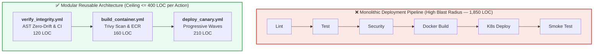
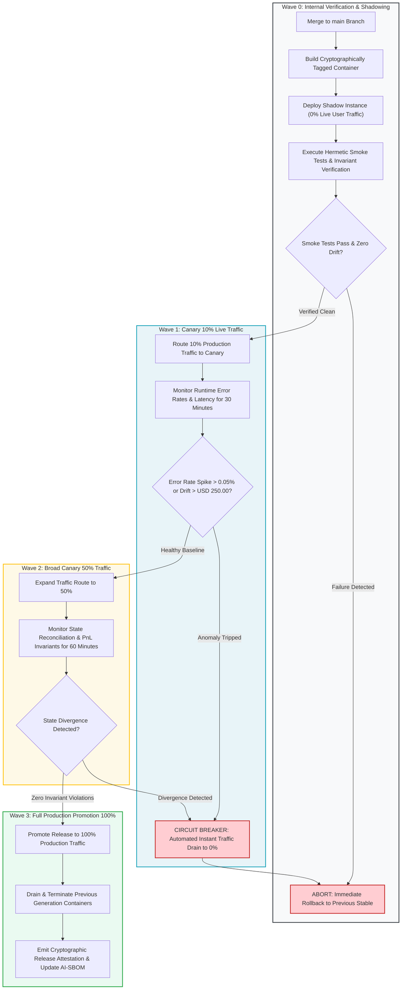

# Module 3: Deployment Pipeline Modularity & Progressive Canary Rollouts

## 🧠 Theory: Pipeline Modularity & Blast Radius Containment

In continuous integration and delivery engineering, monolithic pipeline definitions create severe operational fragility. A single CI/CD workflow file exceeding 1,000 lines introduces three catastrophic failure modes:

1. **Context Window Attention Dilution**: When an autonomous agent attempts to modify a deployment step at line 850 in a 1,500-line YAML file, the model suffers from attention dilution. It frequently corrupts indentation, misconfigures environment variables, or accidentally deletes security verification steps in line 120.
2. **Blast Radius Cascades**: A minor change to a test dependency forces the entire monolithic workflow to re-execute, risking accidental triggers of downstream production deployment jobs.
3. **Impenetrable Debugging**: When an automated release fails in a monolithic script, diagnosing whether the failure originated in environment setup, compilation, security scanning, or cloud credential exchange requires extensive manual triage.

To eliminate these failure modes, BuilderOps engineers enforce the **Architectural Modularity Ceiling**:
* **Maximum 400 Lines of Code per Workflow or Composite Action**.
* **Refactoring Trigger at 350 Lines**.
* **Strict Separation of Concerns**: Isolate pipeline logic into atomic, reusable workflow blocks.



---

## 🌊 Progressive Canary Wave Deployment Topology

When autonomous systems deploy software into production, releases must never transition from 0% to 100% traffic instantaneously. Instead, BuilderOps pipelines execute **Progressive Canary Wave Deployments**:

1. **Wave 0 (Internal Synthetic Shadow)**: Deploys the release to an isolated shadow environment and mirrors 5% of production read traffic without committing external writes.
2. **Wave 1 (Canary 10%)**: Routes 10% of live user traffic to the canary instance for 30 minutes while evaluating automated health and divergence metrics.
3. **Wave 2 (Broad Canary 50%)**: If Wave 1 exhibits zero metric anomalies, traffic scales to 50% for 60 minutes.
4. **Wave 3 (Full Promotion 100%)**: Release is promoted to 100% production traffic; older container tasks are gracefully drained and decommissioned.



---

## 📜 Reusable GitHub Composite Actions Pattern

Instead of embedding raw shell commands into top-level deployment workflows, encapsulate deployment primitives inside dedicated **Composite Actions** located in `.github/actions/`:

### Example: `.github/actions/verify-ast-drift/action.yml` (< 80 LOC)

```yaml
name: "Verify AST Registry Zero-Drift"
description: "Executes AST generators and asserts byte parity across context registries"

runs:
  using: "composite"
  steps:
    - name: Run AST Registry Synchronizers
      shell: bash
      run: |
        python3 scripts/update_state_registry.py
        python3 scripts/update_math_registry.py
        python3 scripts/generate_living_context.py

    - name: Assert Zero Git Diff
      shell: bash
      run: |
        if ! git diff --exit-code; then
          echo "❌ ERROR: Uncommitted changes detected in context registries!"
          exit 1
        fi
        echo "✅ AST Registries are in 100% byte parity with source code."
```

---

## 🌐 Dual-Use Regulated Comparison: Progressive Deployment Across Sectors

| Progressive Rollout Phase | Healthcare / Medical Device Cloud Platform | Core Banking Wire Settlement Gateway |
| :--- | :--- | :--- |
| **Canary Traffic Routing** | Routes 5% of non-critical telemetry streams to the canary cluster; patient telemetry processing remains on the certified baseline. | Routes 5% of low-value consumer transfers to the new settlement container; high-value wholesale transactions remain on the legacy engine. |
| **Automated Rollback Metric** | An algorithmic divergence exceeding 2.0% in calculated vital scores triggers an immediate, zero-downtime rollback. | Any ledger balance mismatch exceeding \$0.01 between parallel engines trips an immediate execution halt and traffic rollback. |
| **Regulatory Validation** | Generates an automated Design Verification audit record showing 0 regression errors across 10,000 de-identified historical clinical test traces. | Generates a Federal Reserve SR 11-7 model outcome analysis record demonstrating mathematical equivalence to historical ledger entries. |

---

## 🛠️ Hands-On Pipeline Decomposition Exercise

**Scenario**: You inherit a legacy 900-line `.github/workflows/main_ci_cd.yml` workflow that handles linting, testing, Docker building, Helm charting, and database migrations.

**Your Refactoring Plan**:
1. Decompose the monolithic file into four discrete workflows, each under 300 LOC:
   - `.github/workflows/01_verify_quality.yml`: AST zero-drift, linting, and hermetic socket testing.
   - `.github/workflows/02_build_artifacts.yml`: Container compilation, Trivy scanning, and AI-SBOM signing.
   - `.github/workflows/03_migrate_database.yml`: Idempotent schema migration and immutable quarantine verification.
   - `.github/workflows/04_canary_deploy.yml`: Progressive traffic shifting (10% $\to$ 50% $\to$ 100%) with automated rollback triggers.
2. Author the workflow dependency chaining using GitHub Actions `workflow_run` or `needs` triggers.

---

## Production Reality & Operational Failure Modes in the AI Era

### The Mid-2026 Production Baseline (The Verification Trap & Context Debt)

> [!WARNING]
> **Monolithic CI/CD Fragility**: Giant workflow files cause attention dilution in AI assistants and prevent progressive canary rollouts.

In the median mid-2026 enterprise, CI/CD is a 1,200-line monolithic YAML file. When engineers add steps, they prompt AI assistants to edit the monolith directly.

This monolithic pattern causes critical delivery failures:
* **Attention Dilution & Injected Bugs**: The model appends nested bash and loose conditionals, corrupting indentation and breaking unrelated steps.
* **All-or-Nothing 'Big Bang' Releases**: Deployments route 100% traffic immediately, because the brittle pipeline cannot support progressive traffic shifts.
* **45-Minute Feedback Loops**: When a build fails, the team waits 45 minutes for the entire monolith to rerun from line 1.

### Ungoverned Production Failure Modes
Deploying all-or-nothing releases via monolithic, unsegmented pipelines creates severe operational exposure:
- **Blast Radius Catastrophe**: A subtle deceptive compliance bug—AI-generated code that passed all superficial unit tests but contains an unhandled edge case in database serialization—ships directly to 100% of users. Within minutes, production databases suffer thread starvation, taking down the entire service.
- **Rollback Gridlock**: Because the deployment pipeline is monolithic and tightly coupled to database migrations, initiating a rollback requires another 45-minute CI build and manual database intervention, turning a minor regression into a multi-hour Sev-1 outage.
- **DORA Instability Paradox Realized**: When teams accelerate deployment frequency using unconstrained AI code generators without canary guardrails, Change Failure Rate (CFR) spikes above 30%, fulfilling Google DORA's warning that ungoverned AI generation amplifies deployment instability.

### Deterministic Engineering Defenses & Operational Takeaways
To contain blast radius and eliminate deployment paralysis, teams must institute four deterministic delivery patterns:
1. **Decompose the Monolith Under the 300-LOC Ceiling**: Split any CI/CD workflow exceeding 300 lines into chained, single-responsibility workflows: (1) Quality & Invariant Verification, (2) Artifact Compilation & Signing, (3) Schema Migration, and (4) Canary Deployment.
2. **Implement Canary Gates with Automated Health Rollbacks**: Configure an automated progressive rollout policy (e.g., 10% traffic for 15 minutes, shifting to 50% then 100%). If p99 latency increases by $> 15\%$ or 5xx error rates exceed $0.5\%$, trigger an automated, zero-touch traffic rollback.
3. **Decouple Database Migrations from Traffic Deployment**: Mandate that all database schema changes execute as backward-compatible, zero-downtime migrations prior to application traffic shifts.
4. **Enforce Pipeline Step Caching**: Ensure test, build, and lint stages are independently cached so that fixing a failed step does not require re-executing unchanged upstream stages.

---

[**Next: Module 4 — Infrastructure Context Engineering & The Resource Map →**](./04_cloud_resource_maps_and_staging_airgaps.md) | [**Return to Deployment Lead Hub →**](./README.md)

