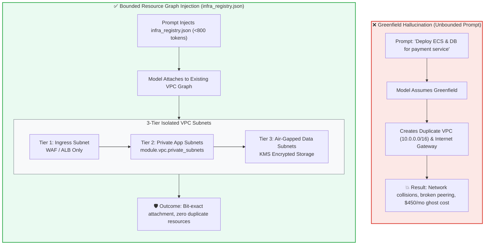

# Module 4: Cloud Resource Maps & Staging Environment Air-Gapping

## 🧠 Theory: Bounding the Cloud Resource Graph

When software developers prompt an artificial intelligence model to write feature code, the model reads source code files. When BuilderOps engineers prompt an AI model to write infrastructure configuration, the model must read the **Cloud Resource Graph**.

If an engineering team does not supply a formal, bounded map of existing cloud infrastructure, the model will assume a **Greenfield Environment**. Under greenfield assumptions, the model will synthesize redundant Virtual Private Clouds (VPCs), duplicate internet gateways, unmanaged security groups, and new IAM users for every feature ticket. This defect pattern causes **State Bloat, Network Collisions, and Uncontrolled Cloud Cost Inflation**.

**Infrastructure Context Engineering** is the discipline of extracting, minifying, and injecting the **Approved Cloud Surface** into deployment agent prompts, mathematically preventing resource guessing.



---

## 🛠️ 1. The Machine-Readable Infrastructure Registry (`infra_registry.json`)

To prevent model guessing, BuilderOps pipelines generate a deterministic, minified **Infrastructure Registry**. This JSON file contains the explicit resource identifiers, network boundaries, and approved machine types for the target environment:

### Canonical Specification: `docs/infra/infra_registry.json` (< 800 tokens)

```json
{
  "schema_version": "1.2.0",
  "environment": "production-us-east-1",
  "network_boundary": {
    "vpc_id": "vpc-0a1b2c3d4e5f6g7h8",
    "vpc_cidr": "10.100.0.0/16",
    "private_app_subnets": [
      "subnet-0111aaaa",
      "subnet-0222bbbb",
      "subnet-0333cccc"
    ],
    "isolated_data_subnets": [
      "subnet-0444dddd",
      "subnet-0555eeee",
      "subnet-0666ffff"
    ],
    "public_ingress_subnets": []
  },
  "compute_governance": {
    "allowed_instance_types": ["m6i.large", "m6i.xlarge", "c6i.xlarge"],
    "banned_instance_families": ["gpu-p4d", "gpu-g5", "t2", "t3.nano"],
    "approved_container_runtime": "AWS Fargate (Linux/ARM64)"
  },
  "security_boundaries": {
    "kms_default_key_arn": "arn:aws:kms:us-east-1:123456789012:key/mrk-8a1b2c3d",
    "approved_iam_execution_role": "arn:aws:iam::123456789012:role/EnterpriseAppExecutionRole",
    "public_egress_mode": "NAT_GATEWAY_FILTERED"
  }
}
```

By prepending this registry to infrastructure modification prompts, the agent is structurally constrained to reference approved subnets and KMS key ARNs.

---

## 🏛️ 2. Architectural Guardrails: The Immutable Cloud Invariants

Instead of relying on ambiguous architectural references, deployment systems enforce four concrete, spelled-out cloud guardrails:

### 1. High-Availability Multi-AZ Topology Guardrail
* **The Intended Guardrail**: All production databases, message queues, and compute clusters must deploy across a minimum of three distinct Availability Zones. Single-node deployments in production environments are strictly prohibited.
* **The Failure Mode It Prevents**: Regional cloud data center disruptions causing unrecoverable application downtime or physical data loss.

### 2. Mandatory Network Isolation Guardrail
* **The Intended Guardrail**: Production datastores, internal microservices, and AI inference runners must never reside in public subnets or possess public IP addresses. All ingress must traverse an audited application load balancer or private VPC endpoint.
* **The Failure Mode It Prevents**: Direct port exploitation, automated internet bot scans, and unauthorized database access.

### 3. Customer-Managed Key Encryption Guardrail
* **The Intended Guardrail**: All storage volumes, database tables, object buckets, and message queues must be encrypted at rest using customer-managed KMS keys (CMKs) with annual automated key rotation. Default cloud provider keys are forbidden.
* **The Failure Mode It Prevents**: Regulatory non-compliance under HIPAA, PCI-DSS, and GDPR, where shared-tenancy default encryption keys fail legal data sovereignty standards.

### 4. Zero Hardcoded Credentials Guardrail
* **The Intended Guardrail**: Passwords, API tokens, and database connection strings must never appear as plaintext in Terraform, Kubernetes manifests, or environment variables. All secrets must reference an external secrets manager with runtime secret injection.
* **The Failure Mode It Prevents**: Permanent credential leaks in git history and unauthorized developer access to production credentials.

---

## 🌐 Dual-Use Regulated Comparison: Cloud Resource Maps Across Domains

| Topology Dimension | Healthcare / FDA Medical Device Cloud Backend | High-Throughput Banking Settlement Gateway |
| :--- | :--- | :--- |
| **Subnet Partitioning** | Three-tier isolation: Ingress Tier $\to$ Application Tier $\to$ Air-Gapped Clinical PHI Data Tier. No routing between ingress and data tier. | Core settlement databases reside in dedicated Hardware Security Module (HSM) isolated subnets with dual-custody access control. |
| **KMS Key Derivation** | Dedicated, customer-managed KMS keys per patient tenant; cryptographic envelope encryption enforced on all clinical files. | FIPS 140-3 Level 3 validated HSM keys for transaction record signing; master keys stored in air-gapped banking hardware. |
| **Ingress Control** | Web Application Firewall (WAF) enforcing strict rate-limiting, geo-blocking, and OWASP Top 10 automated request filtering. | Private leased lines (AWS Direct Connect / SWIFT Alliance Gateway) with mutual TLS 1.3 certificate validation on all packet ingress. |

---

## 🛠️ Hands-On Exercise: Injecting Context for a Microservice Addition

**Scenario**: A software development team needs to deploy a new asynchronous notification worker on AWS Fargate. If the prompt does not supply the approved IAM role and subnet IDs, the model will generate new security groups and an unmanaged IAM role with full administrative privileges.

**Your Action**:
1. Formulate the bounded 3-Part Directive that injects `infra_registry.json`.
2. Explicitly bind the task to `network_boundary.private_app_subnets` and `security_boundaries.approved_iam_execution_role`.
3. Assert that the generated ECS task definition specifies rootless container execution and logs strictly to AWS CloudWatch with a 30-day retention lock.

---

## Production Reality & Operational Failure Modes in the AI Era

### The Mid-2026 Production Baseline (The Verification Trap & Context Debt)

> [!WARNING]
> **Undocumented Cloud Topography**: Lacking a machine-readable infrastructure registry causes AI agents to hallucinate arbitrary subnet IDs and open security groups.

In the median mid-2026 engineering organization, cloud infrastructure relies on tribal knowledge. AI assistants operate with zero awareness of VPC topology, subnet allocation, or security group hierarchies.

This greenfield assumption causes widespread operational debt:
* **Hallucinated Resource Names**: The model synthesizes plausible names (`prod-redis-cache`, `vpc-default-subnet-1`) and binds services to the default VPC.
* **Unbounded Internal Ingress**: New security groups are generated with open internal ingress rules.
* **Eyeball Reviews**: Over 80% of teams maintain no machine-readable resource map, missing critical subnet misconfigurations during hasty PR reviews.

### Ungoverned Production Failure Modes
Generating cloud resources without an authoritative, machine-readable resource map creates severe infrastructure failure modes:
- **Environment Cross-Contamination**: An AI-generated staging worker is provisioned into a shared VPC and misconfigured to point to a production database subnet due to hallucinated subnet IDs. Staging test writes drop or corrupt production customer tables.
- **Runaway Resource Proliferation & Bill Shock**: Every developer asking an AI assistant for infrastructure creates duplicate, orphaned NAT gateways, unattached EBS volumes, and oversized RDS instances. The cloud bill surges by thousands of dollars each billing cycle without any traceable owner.
- **HIPAA / PCI-DSS Audit Non-Compliance**: Regulators require clear physical or logical separation between public-facing tiers and sensitive data storage. An AI-generated configuration that collapses these tiers into a single flat subnet immediately violates HIPAA Security Rule § 164.312 and PCI-DSS Requirement 1, resulting in severe compliance penalties.

### Deterministic Engineering Defenses & Operational Takeaways
To ensure absolute network isolation and prevent resource hallucination, organizations must implement four structural mechanisms:
1. **Publish a Versioned `infra_registry.json`**: Generate and commit a single, machine-readable JSON/YAML registry containing all authorized VPC IDs, subnet tiers (ingress, app, air-gapped data), security groups, and KMS keys.
2. **Inject the Resource Map into Every Infrastructure Directive**: Mandate that all prompts generating Terraform, CloudFormation, or Kubernetes manifests inject `infra_registry.json` as the immutable Context Boundary.
3. **Deploy a CI Infrastructure Conformance Sentinel**: Add an automated CI check that parses IaC pull requests and verifies that every referenced subnet ID, VPC, and IAM role exists in `infra_registry.json`. Reject any PR referencing undeclared or hardcoded resource identifiers.
4. **Implement Hard Network Airgaps Between Environments**: Remove all VPC peering routes and transit gateway attachments between staging subnets and production data tiers, enforcing an absolute physical/logical network airgap.

---

[**Next: Module 5 — Automated Traceability, CI Drift Monitors & AI-SBOM Standards →**](./05_automated_traceability.md) | [**Return to Deployment Lead Hub →**](./README.md)

