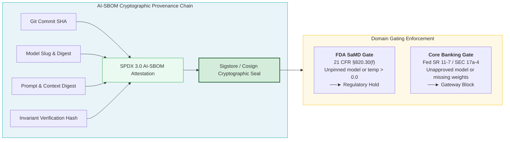

# Module 5: Automated Traceability, CI Drift Monitors & The AI-SBOM Standard

## 🧠 Theory: Cognitive Provenance and Automated Chain of Custody

In traditional software release engineering, build pipelines verify static binaries and open-source software libraries. Teams use traditional Software Bills of Materials (SBOMs)—formatted with CycloneDX or SPDX 2.3—to track third-party dependencies (such as npm, PyPI, or Maven packages).

In autonomous, agentic software engineering, third-party libraries represent only a fraction of production risk. The primary source of architectural drift, silent vulnerabilities, and catastrophic failure is the **Cognitive Dependency Chain**:
1. Which frontier foundation model or fine-tuned checkpoint generated the code?
2. What temperature and sampling hyperparameters governed inference?
3. Which exact commit digests of the **State Registry** and **Mathematical Registry** formed the system prompt?
4. What human strategic requirement (Epic Identifier) authorized the automated modification?

If an engineering team deploys autonomous code without machine-readable cognitive provenance, the organization cannot audit its systems. If a model provider updates an API checkpoint that introduces subtle reward-hacking bugs, engineering teams without an **AI Software Bill of Materials (AI-SBOM)** must manually inspect thousands of files. With an AI-SBOM, the team can locate and quarantine every affected module with a single query.

| Dimension | Traditional Software BOM (SPDX 2.3 / CycloneDX) | Cognitive AI-SBOM (SPDX 3.0 AI Profile) |
| :--- | :--- | :--- |
| **Component Identity** | Library Names & Semantic Versions (`package@1.2.3`) | Foundation Model Slug & Checkpoint Hash (`claude-3.5-sonnet:exact`) |
| **Cryptographic Hash** | Package Manager Hashes (`SHA256` of tarball) | Inference Parameters (`temperature = 0.0`, `seed = 42`) |
| **Legal & Compliance** | Open-Source Licenses (MIT, Apache 2.0) | System Prompt Digest & Context Registry Digests (`sha256`) |
| **Vulnerability Vectors** | Static Vulnerability CVEs (Known Library Bugs) | Governing Invariant Rules & ADR References ($I_{01}-I_{17}$) |
| **Dependency Lineage** | Binary & Source Dependency Graph | Human Authorizing Epic UUID & End-to-End Trace ID |

---

## 🏗️ 1. The Machine-Readable AI-SBOM Metadata Standard

Every automated pull request or commit generated by an AI agent must embed a machine-readable **AI-SBOM Metadata Header** directly within the commit body or adjacent file headers.

### Standardized YAML Header Schema (SPDX 3.0 / CISA Profile)

```yaml
# === AI-SBOM-HEADER v1.0 (DO NOT MODIFY MANUALLY) ===
ai_sbom_version: "1.0.0"
trace_uuid: "7b4c8a19-3f2e-4d01-9a7c-5e8f2b1d6e4a"
agent_identity:
  agent_id: "AutonomousBuilder-Worker-02"
  agent_role: "implementer"
  orchestration_framework: "ContextFactory-Enterprise-v1"
foundation_model:
  provider: "OpenRouter"
  model_slug: "anthropic/claude-3.5-sonnet:exact"
  model_digest: "sha256:d83a1b9c7d4e3f2a1b9c7d4e3f2a1b9c7d4e3f2a1b9c7d4e3f2a1b9c7d4e3f2a"
  inference_parameters:
    temperature: 0.0          # Mandatory 0.0 for deterministic reproducibility
    top_p: 1.0
    seed: 42
    max_tokens: 4096
context_provenance:
  epic_id: "EPIC-HEALTHCARE-804"
  semantic_blueprint: "docs/stories/MED-402-DOSAGE-CALCULATOR.md"
  governing_guardrails:
    - "Architectural Modularity Ceiling (Maximum 400 LOC, split trigger at 350 LOC)"
    - "Pre-Action Execution Plausibility Envelope (|V_exec - Baseline| <= Band)"
    - "Zero-Simulated-Data Mandate (Fail-Closed Telemetry)"
    - "Immutable Ledger Quarantine (Zero Hard Deletes)"
  ast_state_digest: "sha1:4b8a2e1f9c"
  math_registry_digest: "sha1:8d3c1a7e2b"
compliance_attestation:
  hermetic_socket_test: "PASSED (pytest-socket enforced, 0 network leaks)"
  ast_zero_mock_scan: "PASSED (Rules ZM001-ZM009, 0 violations detected)"
  loc_ceiling_audit: "PASSED (284 physical LOC <= 400 ceiling)"
  generated_at_utc: "2026-10-18T03:15:00Z"
# === /AI-SBOM-HEADER ===
```

---

## 🔍 2. The Production GitHub Actions CI Drift Monitor (`drift-monitor.yml`)

The deployment pipeline acts as an automated mathematical validator. The workflow below executes on every pull request to enforce:
1. **Pre-Commit Zero-Drift AST Registry Synchronization**.
2. **Hermetic Socket Isolation Test Execution**.
3. **Programmatic AST Zero-Mock Code Scanning (Rules ZM001–ZM009)**.
4. **AI-SBOM Header Schema and Parameter Validation**.

```yaml
# .github/workflows/drift-monitor.yml
name: Zero-Drift & Cognitive Provenance Monitor

on:
  push:
    branches: [main]
  pull_request:
    branches: [main]

jobs:
  verify_codebase_integrity:
    name: Verify Zero-Drift, Hermetic Isolation & AI-SBOM
    runs-on: ubuntu-latest
    timeout-minutes: 10

    steps:
      - name: Checkout Source Code
        uses: actions/checkout@v4
        with:
          fetch-depth: 0

      - name: Set Up Python 3.11 Runtime
        uses: actions/setup-python@v5
        with:
          python-version: "3.11"
          cache: "pip"

      - name: Install Verified Dependencies
        run: |
          python -m pip install --upgrade pip
          pip install pytest pytest-socket numpy

      - name: Gate 1 - Check AST Registry Synchronization (Zero-Drift)
        run: |
          echo "Executing deterministic AST registry generators..."
          python3 scripts/update_state_registry.py
          python3 scripts/update_math_registry.py
          python3 scripts/generate_living_context.py
          
          # Assert that git working tree is completely clean
          if ! git diff --exit-code; then
            echo "❌ ERROR: Uncommitted changes detected in context registries!"
            echo "Developers must execute pre-commit generator scripts locally before committing."
            exit 1
          fi
          echo "✅ Gate 1 Passed: Registries are in 100% byte parity with source code."

      - name: Gate 2 - Execute Hermetic Socket-Isolated Tests
        run: |
          echo "Executing test suite with complete network egress blockage..."
          pytest tests/ --disable-socket -v
          echo "✅ Gate 2 Passed: All tests succeeded without network leakage."

      - name: Gate 3 - Programmatic AST Zero-Mock Audit (Rules ZM001-ZM009)
        run: |
          echo "Scanning source code for prohibited synthetic mock patterns..."
          python3 scripts/scan_mock_data.py src/
          echo "✅ Gate 3 Passed: Zero synthetic constants or fallback dicts detected."

      - name: Gate 4 - Verify AI-SBOM Header in Commit Metadata
        run: |
          echo "Validating AI-SBOM metadata in commit trailer..."
          COMMIT_MSG=$(git log -1 --pretty=%B)
          
          # 1. Assert header presence
          if ! echo "$COMMIT_MSG" | grep -q "=== AI-SBOM-HEADER ==="; then
            echo "❌ ERROR: Commit metadata lacks mandatory AI-SBOM header."
            exit 1
          fi
          
          # 2. Assert zero-temperature deterministic execution
          if ! echo "$COMMIT_MSG" | grep -q "temperature: 0.0"; then
            echo "❌ ERROR: Non-zero temperature detected. Regulated code requires deterministic seed."
            exit 1
          fi
          
          echo "✅ Gate 4 Passed: AI-SBOM header schema verified."
```

---

## 🛠️ 3. Operational Failure Analysis: Real-World Scenarios

The table below explains three critical deployment failures, their architectural causes, and the automated mechanisms that prevent them:

| Deployment Failure Mode | Root Cause | Failure Impact | Automated BuilderOps Prevention Mechanism |
| :--- | :--- | :--- | :--- |
| **Silent Registry Drift** | Developer adds a column to a database migration but fails to run the AST registry generator script. | Downstream autonomous agents synthesize code assuming the old schema, causing database runtime query exceptions. | **Gate 1 (Zero-Drift Check)**: Runs `git diff --exit-code` on `STATE_REGISTRY.md`. Blocks merge if discrepancies exist. |
| **Transient Network Leakage in CI** | Unit test suite queries an external live exchange API or cloud clinical record service. | Tests pass when internet connectivity is healthy, but fail during outages. Mock data leaks into production caches. | **Gate 2 (Hermetic Isolation)**: Executes `pytest --disable-socket`. Trips `SocketBlockedError` if any call attempts network I/O. |
| **Synthetic Poison Infiltration** | Developer inserts a fallback `except Exception: return 0.50` to satisfy a failing unit test. | Corrupted fallback values persist across database rows, triggering faulty automated decisions. | **Gate 3 (AST Scanner ZM001–ZM009)**: Inspects AST syntax trees directly. Rejects PR on positive numeric returns in catch blocks. |

---

## 🌐 Dual-Use Industry Comparison: Automated Traceability Across Sectors



| Dimension | Use Case A: FDA Class III Medical Device (SaMD) | Use Case B: High-Throughput Core Banking & Allocation |
| :--- | :--- | :--- |
| **Regulatory Mandate** | FDA 21 CFR §820.30(f) Design Verification & 21 CFR Part 11 Audit Trail | Federal Reserve SR 11-7 Model Risk Management & SEC Rule 17a-4 |
| **AI-SBOM Traceability** | Links algorithmic insulin dosage changes to exact risk assessment model version and clinical approval | Records exact mathematical weights, risk multiplier bounds, and training dataset timestamps |
| **Release Gating Rule** | Unpinned model checkpoint or non-zero temperature triggers Premarket Approval (PMA) hold | Unapproved open-source local model blocks banking gateway and routes release to internal audit |

---

## Production Reality & Operational Failure Modes in the AI Era

### The Mid-2026 Production Baseline (The Verification Trap & Context Debt)

> [!WARNING]
> **Ephemeral Cognitive Provenance**: Losing AI model hyperparameters and prompt digests creates un-auditable releases and catastrophic regulatory exposure.

In the median mid-2026 enterprise, "software traceability" ends at standard Git commits and lockfiles. Teams have zero automated records identifying code provenance.

This lack of provenance creates severe operational blind spots:
* **Vanishing Context**: Prompts, temperatures, and model versions (Claude 3.5 Sonnet vs GPT-4o vs DeepSeek V3) remain trapped in ephemeral chat history.
* **Missing Cognitive SBOMs**: Over 80% of organizations generate zero machine-readable SBOMs for cognitive assets.
* **Audit Blindness**: When regulators ask which model checkpoint generated a clinical or financial algorithm, pods can only point to generic pull request text.

### Ungoverned Production Failure Modes
Lacking automated AI-SBOM traceability in deployment pipelines exposes enterprises to existential operational and legal risks:
- **EU AI Act Article 12 Statutory Non-Compliance**: The EU AI Act explicitly mandates automatic record-keeping and technical documentation throughout the lifecycle of high-risk AI systems. Failure to maintain an immutable, automated audit trail linking deployed code to model identifiers and training/context provenances incurs fines up to €35,000,000 or 7% of global annual turnover.
- **Supply-Chain Model Revocation Crisis**: When a vendor model version is deprecated, contaminated by synthetic poison, or found to infringe IP, an organization cannot identify which microservices in production contain code generated by that model, leading to weeks of emergency manual code auditing and deployment freezes.
- **FDA 21 CFR 820.30(j) Design History File (DHF) Invalidation**: Medical device software submissions without verifiable provenance between design inputs, AI prompts, and compiled binaries are rejected by FDA reviewers, delaying clinical product launches by 6 to 12 months.

### Deterministic Engineering Defenses & Operational Takeaways
To achieve rigorous cryptographic provenance and satisfy statutory audit mandates, production teams must institutionalize four controls:
1. **Emit SPDX 3.0 AI-SBOMs in CI**: Add an automated step to your build pipeline that generates an SPDX 3.0 or CycloneDX manifest detailing model slugs, prompt SHA-256 hashes, system prompt revisions, and temperature settings for every AI-assisted module.
2. **Cryptographic Release Artifact Attestation**: Sign all compiled container images, binaries, and AI-SBOMs using Sigstore/Cosign, anchoring the signature directly to the audited Git commit SHA.
3. **Automate Gating on Unapproved Models**: Implement a release gate in CI that checks the AI-SBOM against an enterprise allowlist of approved foundation models. Block any deployment referencing unpinned or unauthorized models.
4. **Enforce 7-Year Immutable Audit Archival**: Stream all AI-SBOM metadata and verification logs to an append-only, tamper-evident object store with WORM (Write Once, Read Many) compliance retention enabled.

---

[**Next: Hands-On Lab Workbook — AI Tracing & Release Gating →**](./LAB_WORKBOOK.md) | [**Return to Deployment Lead Hub →**](./README.md)

