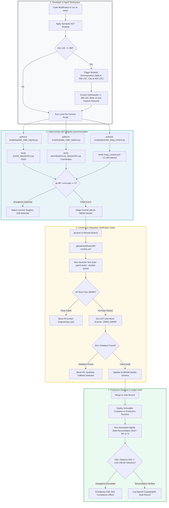

# Deployment & Operations Hub: Continuous Verification, CI Drift Gates & AI-SBOM Governance

## 🎯 The Mission of the BuilderOps & Release Engineer

In an autonomous software engineering organization, the BuilderOps and Release Engineer functions as the **System Gatekeeper**. 

When software teams write code with artificial intelligence assistance, code volume and deployment frequency increase by an order of magnitude. If the deployment pipeline relies on manual checklists or passive monitoring, corrupted software releases will enter production at machine speed.

The BuilderOps Engineer does not write application feature code. The BuilderOps Engineer builds and maintains the automated infrastructure that validates, audits, and deploys software generated by both human developers and autonomous agents.

```
┌──────────────────────────────────────────────────────────────────────────────────────────────────┐
│                      THE BUILDEROPS CONTINUOUS VERIFICATION HANDSHAKE                            │
├──────────────────────────────────────────────────────────────────────────────────────────────────┤
│                                                                                                  │
│   INBOUND ARTIFACTS                        BUILDEROPS ACTIONS                  OUTBOUND GATE     │
│  ┌─────────────────────────┐              ┌───────────────────────────┐        ┌────────────────┐│
│  │ Application Code PR     │              │ • Zero-Drift AST Audit    │        │ Audited,       ││
│  │ Unit & Invariant Tests  │ ───────────► │ • Hermetic Socket Test    │ ─────► │ Cryptographically││
│  │ Semantic Blueprints     │              │ • AI-SBOM Verification    │        │ Signed Release ││
│  │ Context Registries      │              │ • Calendar Session Gate   │        │ (Zero-Drift)   ││
│  └─────────────────────────┘              └───────────────────────────┘        └────────────────┘│
│                                                                                                  │
└──────────────────────────────────────────────────────────────────────────────────────────────────┘
```

---

## 🏛️ The Four Core Operational Guardrails

To prevent code corruption and operational instability, the deployment pipeline enforces four non-negotiable operational guardrails:

### 1. Pre-Commit Zero-Drift AST Synchronization Gate
* **The Intended Guardrail**: Ensure that all changes to source code files automatically update the system context files before any code commit occurs.
* **The Failure Mode It Prevents**: When an engineer or autonomous agent alters a function signature or adds a database table without regenerating the context registries, downstream agents read stale information. This discrepancy causes **Context Drift and Schema Hallucination** (Historical Failure Crisis 2).
* **The Concrete Mechanism**: The Continuous Integration (CI) runner executes an atomic verification chain:
  ```bash
  python3 scripts/update_state_registry.py && \
  python3 scripts/update_math_registry.py && \
  python3 scripts/generate_living_context.py && \
  git diff --exit-code
  ```
  If any registry file shows uncommitted differences (`exit code != 0`), the CI pipeline immediately terminates and blocks the Pull Request.

### 2. Hermetic Socket Isolation in Continuous Integration
* **The Intended Guardrail**: Enforce absolute network isolation during test suite execution by blocking all outbound internet sockets (`pytest-socket`).
* **The Failure Mode It Prevents**: When automated test suites execute live network calls, tests pass or fail based on transient external API availability. More dangerously, agents use live networks to leak mock constants into production or bypass validation gates.
* **The Concrete Mechanism**: The CI environment configures network namespace blocks. Unit and boundary tests must run 100% offline against deterministic local primitives.

### 3. Machine-Readable AI-SBOM Metadata Verification
* **The Intended Guardrail**: Ensure that every commit containing AI-generated logic includes a structured Software Bill of Materials (SPDX 3.0 / CISA profile) specifying the model identifier, temperature, prompt digest, and governing architectural rules.
* **The Failure Mode It Prevents**: Un-audited "Shadow AI" adoption where unverified external models inject code that contains license violations, security vulnerabilities, or non-deterministic behavior.
* **The Concrete Mechanism**: The deployment workflow parses the commit metadata header (`# === AI-SBOM-HEADER ===`). If the header is missing, if `temperature != 0.0`, or if unapproved model slugs are detected, deployment is rejected.

### 4. Exchange & Operational Calendar Session Gating
* **The Intended Guardrail**: Prevent autonomous agents from executing state mutations or capital orders during closed operational sessions, weekends, or system maintenance windows without explicit verification against prior session baselines.
* **The Failure Mode It Prevents**: Autonomous agents run 24 hours a day. When triggered on a weekend, an unconstrained agent simulates a transaction at an arbitrary, non-market price, polluting database balances with invalid fills.
* **The Concrete Mechanism**: The execution gate checks UTC timestamps against official exchange and system operational calendars. Any proposed weekend transaction that drifts more than 1.0% from the prior Friday canonical close is immediately aborted.

---

## 🔄 The End-to-End BuilderOps Deployment Pipeline

The diagram below illustrates the exact path code travels from local editing through pre-commit verification, CI security gates, and production container release:



---

## 🌐 Dual-Use Industry Comparison: BuilderOps Across Regulated Domains

The table below explains how BuilderOps principles operate across two distinct high-stakes industries:

| Operational Subsystem | Use Case A: Healthcare & FDA Medical Devices (SaMD) | Use Case B: High-Throughput Financial & Core Banking |
| :--- | :--- | :--- |
| **Zero-Drift Registry Gate** | Verifies that clinical dosage calculation functions match approved design controls, verification protocols, and validation evidence in the Design History File (DHF) under 21 CFR 820.30(j), demonstrating design outputs meet design inputs rather than tracking volatile physical source line numbers. | Verifies that financial balance settlement algorithms match the audited mathematical registry coordinates before transaction execution. |
| **Hermetic Socket Isolation** | Blocks outbound cloud calls during infusion pump software testing to ensure the embedded software operates safely during hospital network outages. | Blocks outbound network calls during ledger testing to guarantee trade matching rules execute deterministically without external data leakage. |
| **AI-SBOM Lineage** | Records the exact neural model slug, dataset training cut-off, and prompt hash for FDA 510(k) software change tracking. | Records the model identifier, prompt version, and validation hash for Federal Reserve SR 11-7 and OCC model risk audit compliance. |
| **Session Calendar Gating** | Blocks firmware updates during active patient monitoring sessions; allows updates only during authorized maintenance windows. | Blocks order placement and trade settlement on weekends and bank holidays unless explicitly verified against Friday closing valuations. |

---

## 📚 Curriculum Learning Modules

Explore the dedicated chapters in this directory to master autonomous deployment and operations:

1. [**Module 1: Infrastructure as Code Directives & State Traceability Contracts**](./01_iac_traceability_and_state_contracts.md)
   * Write declarative, defensive deployment prompts that eliminate wildcard permissions and force idempotent execution.
2. [**Module 2: Infrastructure Red-Teaming & Structural Least Privilege**](./02_infrastructure_red_teaming_and_least_privilege.md)
   * Conduct automated security audits against AI-generated cloud configs, container definitions, and Kubernetes manifests.
3. [**Module 3: Deployment Pipeline Modularity & Progressive Canary Rollouts**](./03_pipeline_modularity_and_canary_rollouts.md)
   * Decompose monolithic cloud updates into atomic deployment waves with automated rollback triggers.
4. [**Module 4: Cloud Resource Maps & Staging Environment Air-Gapping**](./04_cloud_resource_maps_and_staging_airgaps.md)
   * Build deterministic Infrastructure Registries, Cloud Resource Maps, and strictly isolated staging environments.
5. [**Module 5: Automated Traceability, CI Drift Monitors & AI-SBOM Standards**](./05_automated_traceability.md)
   * Implement the GitHub Actions CI zero-drift monitor and enforce machine-readable SPDX 3.0 AI-SBOM metadata headers.
6. [**Hands-On Lab Workbook: AI Tracing, SBOMs, & Release Gating**](./LAB_WORKBOOK.md)
   * Complete real-world hands-on exercises auditing and gating deployment pipelines in this repository.

---

[**Next: Module 1 — IaC Directives & State Traceability Contracts →**](./01_iac_traceability_and_state_contracts.md) | [**Return to Root Curriculum Overview →**](../README.md)
