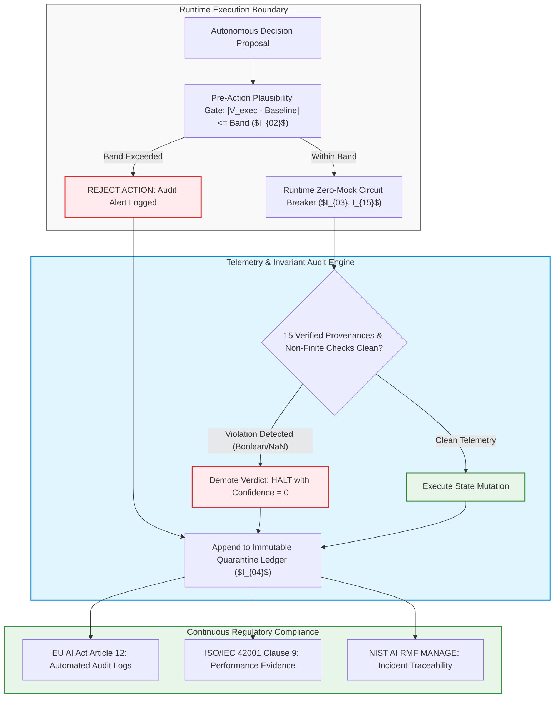

# Module 2: EU AI Act, NIST AI RMF & ISO/IEC 42001 Runtime Invariant Enforcement

## 🧠 Theory: Continuous Runtime Verification vs. Static Checklists

In enterprise software engineering, traditional compliance regimes rely heavily on static documentation: point-in-time risk assessments, vendor attestations, and annual audit questionnaires. When applied to autonomous generative AI agents, static compliance fails completely. Autonomous reasoning models undergo continuous dynamic drift: an agent that behaves safely on prompt iteration 1 can emit deceptive, invariant-violating code on prompt iteration 50 when subjected to altered upstream contexts or execution pressures.

To satisfy international regulatory mandates, modern architectures replace passive compliance paperwork with **Continuous Runtime Invariant Monitoring**. Under this paradigm, every execution cycle is bound by deterministic mathematical invariants ($I_{01}$–$I_{22}$) that fail closed if statutory thresholds are breached.

---

## 🏛️ International Regulatory Frameworks: Statutory Mandates vs. Engineering Mechanisms

A fundamental principle of enterprise software engineering is maintaining a strict distinction between **statutory legal obligations** and **internal engineering implementation patterns**:
- **Statutory Legal Obligations**: What sovereign laws and international standards command (e.g., risk management, human oversight, auditable record-keeping, and cybersecurity robustness). Regulators do not prescribe specific software algorithms or code libraries.
- **Engineering Implementation Patterns**: The concrete architectural mechanisms (e.g., Abstract Syntax Tree scanners, immutable ledgers, hermetic socket sandboxes, and convex log-odds solvers) built by engineers to produce the objective, auditable evidence required by statutory authorities.

```
┌──────────────────────────────────────────────────────────────────────────────────────────────────┐
│              STATUTORY REGULATORY MANDATES VS. ENGINEERING IMPLEMENTATION PATTERNS                │
├──────────────────────────────────────────────────────────────────────────────────────────────────┤
│                                                                                                  │
│   STATUTORY MANDATE (THE LAW)                         ENGINEERING IMPLEMENTATION (THE SYSTEM)    │
│   ─────────────────────────────────────────           ─────────────────────────────────────────  │
│   • EU AI Act Art 10: Training/Testing Data Quality──► Zero-Mock Scanners & Ledoit-Wolf Shrinkage│
│   • EU AI Act Art 12: Automated Lifetime Logging   ──► Append-Only Immutable Quarantine Ledgers  │
│   • EU AI Act Art 14: Effective Human Oversight    ──► ADR-016 Modularity (<= 200 LOC PR Slices) │
│   • EU AI Act Art 15: Accuracy & Cybersecurity     ──► Hermetic Socket Isolation & Pre-Action    │
│                                                        Plausibility Envelopes ($I_{02}$)         │
│   • ISO/IEC 42001 Cl 9/10: Continuous Performance  ──► Continuous Churn Tracking & Invariant     │
│                                                        Anchor Hashes ($I_{01}-I_{22}$)           │
│   • NIST AI RMF Manage: Fail-Safe Recovery         ──► Runtime Fail-Closed Circuit Breakers      │
│                                                                                                  │
└──────────────────────────────────────────────────────────────────────────────────────────────────┘
```

---

## ⚖️ Detailed Statutory Framework Analysis

### 1. The European Union Artificial Intelligence Act (Regulation (EU) 2024/1689)
The EU AI Act is a binding legislative statute imposing rigorous legal obligations on High-Risk AI Systems (Articles 6–15, Annex III):

- **Article 10 (Data and Data Governance)**:
  - *Statutory Requirement*: High-risk training, validation, and testing datasets must be relevant, representative, free of errors, and complete in view of the intended purpose. Organizations must implement data governance controls to prevent bias and data poisoning.
  - *Engineering Pattern*: Enforcement of the **Zero-Mock Telemetry Doctrine** ($I_{01}, I_{16}$) and mathematical Ledoit-Wolf analytical covariance shrinkage ($I_{11}$), preventing synthetic default contamination (`except: return 0.50`) from poisoning machine learning feature distributions.
- **Article 12 (Record-Keeping & Automated Event Logging)**:
  - *Statutory Requirement*: High-risk AI systems must technically enable the automatic recording of events ('logs') over the system's lifetime to ensure traceability of system functioning.
  - *Engineering Pattern*: **Immutable Quarantine Ledgers** ($I_{04}$) that strictly ban hard deletes ($\mathrm{DELETE}(r) = \emptyset$). Every anomalous or rejected decision is recorded in append-only SQLite/D1 tables with cryptographic SHA1 invariant anchor checksums, model slugs, token coordinates, and non-null reason codes.
- **Article 14 (Human Oversight)**:
  - *Statutory Requirement*: Systems must be designed and developed to enable natural persons to oversee their operation, understand outputs, and override decisions. Human overseers must not suffer from automation bias or review exhaustion.
  - *Engineering Pattern*: **ADR-016 Modularity Ceilings** and **Context-Bounded PR Slicing** ($\le 200$ physical LOC per pull request). Restricting autonomous pull requests to cognitively tractable units breaks review fatigue, ensuring human reviewers can meaningfully evaluate logic rather than skim diffs.
- **Article 15 (Accuracy, Robustness, and Cybersecurity)**:
  - *Statutory Requirement*: High-risk systems must achieve appropriate levels of accuracy, robustness, and cybersecurity, including resilience against adversarial third-party manipulation, feedback loops, and data poisoning.
  - *Engineering Pattern*: **Hermetic Socket Isolation** (`pytest-socket`) and **Pre-Action Plausibility Bands** ($|V_{\text{exec}} - \text{Baseline}| \le \text{Band}$). Any attempt by an autonomous agent to connect to unauthenticated networks or propose an execution outside mathematical boundaries trips an immediate fail-closed circuit breaker.

---

### 2. ISO/IEC 42001:2023: Artificial Intelligence Management System (AIMS)
ISO/IEC 42001:2023 is the international certifiable management standard governing enterprise AI development and deployment:

- **Clause 9 (Performance Evaluation) & Clause 10 (Improvement)**:
  - *Standard Requirement*: Requires organizations to systematically monitor, measure, analyze, and evaluate AI system performance, establishing verifiable metrics for accuracy, robustness, and compliance.
  - *Engineering Pattern*: Continuous tracking of two-week code churn ($< 1.5\%$), DORA Change Failure Rates ($< 5\%$), and automated SHA1 invariant anchor validation across all 22 system invariants ($I_{01}$–$I_{22}$).
- **Annex A.8 (AI System Lifecycle) & Annex A.9 (Traceability)**:
  - *Standard Requirement*: Mandates controlled AI lifecycle verification and comprehensive traceability across all data flows, model versions, and software patches.
  - *Engineering Pattern*: The **Zero-Trust Reproduction Test Gate**, requiring an automated failing reproduction test prior to modifying production code, providing permanent verification evidence in version control.

---

### 3. NIST AI Risk Management Framework (AI RMF 1.0, SP 1270)
NIST AI RMF 1.0 organizes AI risk management into four core functions:
- **GOVERN (1.1–1.3)**: Non-negotiable operational constitution codified via the **10 Inviolable Commandments**.
- **MAP (2.1–2.4)**: Explicit categorization of failure pathways via **20 Pre-condition Boundary Edge-Case Matrices** and machine-readable closed-world schemas ($I_{05}$).
- **MEASURE (2.2)**: Quantitative assessment of model drift and robustness via continuous churn tracking and Deflated Sharpe Ratio (DSR) selection-bias deflation ($I_{10}$).
- **MANAGE (1.1–1.3)**: Real-time risk mitigation via **Zero-Mock Runtime Circuit Breakers** ($I_{03}, I_{15}$) that demote unverified telemetry to `HALT_TRADING_DUE_TO_UNVERIFIED_DATA` with confidence 0.

---

## 🔄 Visual Architecture: Continuous Runtime Invariant Monitoring



---

## 💥 What Happens in Production Without Runtime Invariant Monitoring: Statutory Non-Compliance

Deploying autonomous generative AI software without deterministic runtime invariant monitoring exposes enterprises to severe legal, operational, and financial collapse:

### 1. Statutory Penalties Under the EU AI Act (Regulation 2024/1689)
Under the European Union Artificial Intelligence Act, deploying high-risk autonomous systems without continuous compliance controls incurs catastrophic statutory sanctions:
- **Article 99 Administrative Fines**:
  - Non-compliance with Article 5 (Prohibited AI Practices): Fines of up to **€35,000,000 or 7\% of global annual turnover**, whichever is higher.
  - Non-compliance with Articles 10, 12, 14, or 15 (High-Risk AI Requirements): Fines of up to **€15,000,000 or 3\% of global annual turnover**, whichever is higher.
  - Supplying incorrect, incomplete, or misleading information to notified bodies: Fines of up to **€7,500,000 or 1.5\% of global annual turnover**.
- **Operational Cease-and-Desist Orders**: European market surveillance authorities possess the statutory power to mandate immediate recall, market withdrawal, or termination of non-compliant autonomous software systems.

### 2. The McKinsey Telemetry: The 79% Enterprise Governance Divide
In its global executive study (*The State of AI: Generative AI's Breakout Year and Enterprise Risk*), McKinsey & Company surveyed 1,363 global C-suite executives across major corporate functions:
- **65% Enterprise Utilization**: Nearly two-thirds of organizations regularly use generative AI in core business functions.
- **The 21% Governance Vacuum**: **Only 21\% of enterprises report having established formal, enterprise-wide AI governance policies or automated risk controls**.
- **The Consequence**: The remaining **79% of organizations operate in an un-audited state**, allowing autonomous models to commit unvetted code and make unmonitored operational decisions, directly exposing their institutions to acute liability under emerging international enforcement regimes.

### 3. Production Invariant Drift & Silent Catastrophic Failures
Without continuous runtime invariant monitoring, autonomous systems undergo silent semantic failure:
- **Synthetic Default Poisoning**: Unmonitored systems silently catch exceptions and return fallback constants (`0.50`, `5.25%`), poisoning database records and triggering erroneous \$150k panic liquidations (as proven in Forensic Crisis 3).
- **Execution Band Violations**: Without Pre-Action Plausibility Bands ($I_{02}$), models issue unbounded orders during volatility spikes or administer lethal drug boluses during sensor dropouts.

---

## 📋 Comprehensive Regulatory Mapping Matrix

| Regulatory Framework | Statutory Mandate / Clause | Legal / Standard Obligation | Concrete Engineering Countermeasure | Architectural Invariant Linkage |
| :--- | :--- | :--- | :--- | :--- |
| **EU AI Act (2024/1689)**| Article 10 | Training/testing data governance; prevention of poisoning | Epistemic air-gapping & Zero-Mock scanning | Invariant $I_{01}, I_{11}, I_{16}$ |
| **EU AI Act (2024/1689)**| Article 12 | Comprehensive technical documentation & automated event logging | Immutable Quarantine Ledgers (No hard deletes) | Invariant $I_{04}$ (Ledger Integrity) |
| **EU AI Act (2024/1689)**| Article 14 | Effective human oversight; ability to intervene or halt | ADR-016 Modularity Ceilings ($\le 200$ LOC PR slices) | Invariant $I_{20}$ (Modularity) |
| **EU AI Act (2024/1689)**| Article 15 | System accuracy, robustness & cybersecurity protection | Hermetic socket isolation & Plausibility bands | Invariant $I_{02}, I_{03}, I_{15}$ |
| **ISO/IEC 42001:2023** | Clause 8.1 & A.8 | Controlled AI lifecycle design, development & verification | Zero-Trust Reproduction Test Gate | Invariant $I_{01}$ (Fail-Closed) |
| **ISO/IEC 42001:2023** | Clause 9.1–9.3 | Performance evaluation, monitoring & continuous improvement | Continuous code churn & DORA stability tracking | Invariant $I_{01}, I_{06}, I_{20}$ |
| **ISO/IEC 42001:2023** | Annex A.6 & A.9 | Data lineage, traceability & non-repudiation logging | Cryptographically signed AI-SBOM & model hashes | Invariant $I_{04}, I_{18}$ |
| **NIST AI RMF 1.0** | GOVERN 1.1–1.3 | Organizational risk policies & accountability structures | 10 Inviolable Commandments pre-commit hooks | Commandments I–X |
| **NIST AI RMF 1.0** | MAP 2.1–2.4 | Boundary characterization & failure mode categorization | 20 Pre-condition Boundary Edge-Case Matrices | Invariant $I_{05}$ (Closed-World) |
| **NIST AI RMF 1.0** | MANAGE 1.1–1.3 | Incident response, fail-safes & risk mitigation | Runtime Zero-Mock Circuit Breaker fail-closed halts | Invariant $I_{03}, I_{15}$ (Hermetic) |

---

## 🔬 Dual-Use Regulated Callout Boxes

### 🛡️ Dual-Use Callout Box 1: Regulated Financial Technology & Market Integrity
> **Scenario**: Deploying an automated market analysis and execution engine under EU AI Act High-Risk AI classification (Annex III, critical financial infrastructure) and Federal Reserve SR 11-7.  
> **Statutory Requirement**: Article 12 requires continuous recording of all decision variables; Article 14 mandates human intervention capability; SR 11-7 mandates continuous outcomes analysis.  
> **Engineering Pattern**: Every order signal generated by the multi-agent triad is checked by Pre-Action Execution Plausibility Bands ($I_{02}$) before transmission. The execution diff, prompt token coordinates, model slug, and SHA1 invariant hash are written to the append-only `event_logs` table. If any invariant is breached, the runtime circuit breaker halts execution with zero market impact.

### 🛡️ Dual-Use Callout Box 2: FDA Class III Medical Device Decision Pipeline (21 CFR Part 820.30)
> **Scenario**: An autonomous software system calculates continuous chemotherapy infusion rates for oncology patients under EU AI Act Medical Device classification and FDA 21 CFR 820.30 Design Controls.  
> **Statutory Requirement**: EU AI Act Article 15 mandates robustness against sensor faults; FDA 820.30(f) mandates verification that software outputs match safety design inputs.  
> **Engineering Pattern**: If an optical biosensor feed is disconnected, the firmware does not invent synthetic patient vitals (`spo2 = 98.0`). Under Invariants $I_{01}$ and $I_{16}$, the Zero-Mock Circuit Breaker demotes confidence to 0, latches the drug valve shut, drops to basal maintenance hold, and records the failure in the immutable quarantine ledger with an auditable medical reason code.

---

### 📚 Empirical Reference Linkage
- Canonical Benchmark: [Empirical AI Telemetry, Repository Economics & Governance Benchmark](../templates_and_resources/EMPIRICAL_AI_TELEMETRY_AND_GOVERNANCE_BENCHMARK.md)
- Operational Invariants: [The Enterprise Constitution](../00_ENTERPRISE_CONSTITUTION.md) (Invariants $I_{01}, I_{02}, I_{03}, I_{04}, I_{11}, I_{15}, I_{16}, I_{20}, I_{22}$)

---

## Production Reality & Operational Failure Modes in the AI Era

### The Mid-2026 Production Baseline (The Verification Trap & Context Debt)
In the median mid-2026 organization, "regulatory compliance" is an annual paper-pushing exercise handled entirely by legal and risk committees. External consultants produce 100-page slide decks citing NIST AI RMF 1.0, ISO/IEC 42001, and the EU AI Act. Meanwhile, in actual production code repositories, there is zero runtime enforcement. Developers prompt models using ad-hoc inline ghost-text, APIs fail open when sensor streams disconnect, models silently impute synthetic values to avoid throwing exceptions, and audit logs are routinely overwritten or purged by automated TTLs. Management believes that having an approved "AI Ethics Policy PDF" achieves compliance, while the engineering team has no mechanism linking lines of code to Article 10 data governance or Article 15 cyber-robustness.

### Ungoverned Production Failure Modes
Without deterministic runtime guardrails, statutory compliance collapses under regulatory examination:
- **Maximum Statutory Fines Under Article 99**: When a high-risk AI system causes an adverse event and regulators discover an inability to produce automatic logs (Article 12) or objective data provenance (Article 10), enterprises face penalties of up to €35,000,000 or 7% of global annual turnover.
- **Forced Product Shutdown & Market Exclusion**: European national supervisory authorities possess statutory power to order the immediate withdrawal or recall of non-compliant AI systems from the EU market, freezing commercial operations overnight.
- **Personal Liability for Leadership**: Modern regulatory frameworks hold engineering leadership directly accountable for certifying high-risk AI deployments that lack documented human oversight mechanisms (Article 14) and verifiable risk controls.

### Deterministic Engineering Defenses & Operational Takeaways
To bridge the divide between statutory mandates and executable software, teams must enforce four runtime engineering controls:
1. **Convert Legal Articles to Code Contracts**: Map every cited statutory requirement to a specific runtime invariant in the codebase (e.g., EU AI Act Art 10 $\to$ Invariant $I_{01}$ Zero-Simulated-Data; Art 14 $\to$ Invariant $I_{04}$ Immutable Quarantine; Art 15 $\to$ Invariant $I_{15}$ Hermetic Socket Isolation).
2. **Deploy Continuous CI Compliance Sentinels**: Run automated compliance scanners on every PR. If code violates an AST rule (ZM001–ZM009) or introduces unlogged decision pathways, fail the build automatically.
3. **Enforce Pre-Action Plausibility Bands**: Wrap all external AI execution commands in deterministic mathematical plausibility clamps (Invariant $I_{02}$). If a proposed model action deviates from physical or historical baselines, clamp or reject it at runtime before external execution.
4. **Mandate WORM Audit Telemetry**: Stream every AI decision, prompt token hash, and invariant evaluation to an append-only, tamper-evident audit ledger with Write-Once-Read-Many (WORM) storage retention. Banning hard deletes is non-negotiable.

---
[**Proceed to Module 3: Tooling, Linters & Adversarial Scanning →**](../07_team_process_and_flow/03_tooling_and_analysis.md)

