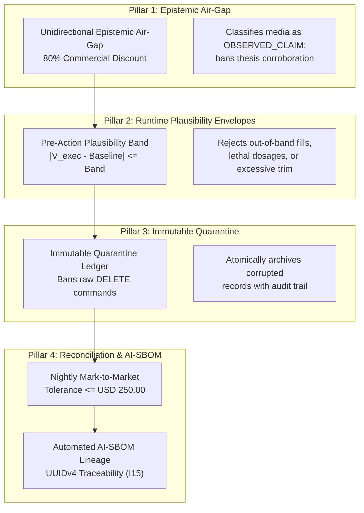

# Security Lead Hub: Epistemic Governance, Plausibility Envelopes & Model Risk

## 🎯 The Security & Compliance Lead's Mission

In an enterprise deploying autonomous AI agents, regulatory compliance and cybersecurity can no longer function as retrospective, manual audits. When probabilistic language models ingest external internet data, generate real-time execution signals, or interact with physical actuators, traditional perimeter defenses and static checklist policies fail completely.

As a **Security & Compliance Lead / Model Risk Auditor** in the Context Factory, your mission is **Epistemic Governance & Fail-Closed Boundary Verification**. You ensure that autonomous agents operate strictly within:
1. **Federal Reserve SR 11-7 / OCC 2011-12**: Model Risk Management standards for conceptual soundness, continuous monitoring, and outcome analysis.
2. **FDA 21 CFR Part 820.30 & Part 11 / ISO 13485**: Quality System Regulation, software verification, and electronic record integrity for safety-critical medical devices.
3. **RTCA DO-178C / DO-254**: Level A certification standards for deterministic airborne flight control systems.
4. **The Enterprise AI Constitution (Articles I–VII)**: Non-negotiable organizational guardrails guaranteeing data minimization, zero-mock telemetry, fail-closed defaults, and immutable audit trails.

```
┌──────────────────────────────────────────────────────────────────────────────────────────────────┐
│                      THE REGULATORY COMPLIANCE & GOVERNANCE HANDSHAKE                            │
│                                                                                                  │
│   INBOUND TELEMETRY                        ROLE ACTION                         OUTBOUND ATTESTATION│
│  ┌─────────────────────────┐              ┌───────────────────────────┐        ┌────────────────┐ │
│  │ AI-SBOM & Git Hash      │              │ • Epistemic Air-Gapping   │        │ Cryptographic  │ │
│  │ Model Hyperparameters   │ ───────────► │ • Plausibility Envelopes  │ ─────► │ Compliance Seal│ │
│  │ Multi-Agent Debate Logs │              │ • Immutable Quarantine    │        │ (SR 11-7 /     │ │
│  │ Execution Traces        │              │ • Nightly MTM Reconcile   │        │ FDA PMA Ready) │ │
│  └─────────────────────────┘              └───────────────────────────┘        └────────────────┘ │
│                                                                                                  │
└──────────────────────────────────────────────────────────────────────────────────────────────────┘
```

---

## 🏛️ The 4 Pillars of Autonomous Security & Epistemic Compliance



### Pillar 1: Epistemic Air-Gapping & Funnel De-Biasing (Unidirectional Epistemic Air-Gap Guardrail)
External narrative telemetry (social media, analyst calls, press releases, video transcripts) must be air-gapped from internal portfolio weights and model state. Media is ingested strictly as objective crowd sentiment (`OBSERVED_CLAIM`), never as ground-truth facts. Promotional funnels are automatically discounted by 80% ($W_{\text{commercial}} = 0.20$), preventing epistemic priming crises (Crisis 5).

### Pillar 2: Pre-Action Execution Plausibility Envelopes ($I_{02}$ / Pre-Action Plausibility Guardrail)
Before any autonomous action is committed—whether placing a financial order, administering a drug bolus, or trimming an aircraft flight control surface—the proposed parameter is evaluated against a dynamic physical plausibility band:
$$|V_{\text{exec}} - \text{Baseline}| \le \text{Band}$$
If the proposed execution exceeds the plausibility band, the order is rejected immediately at runtime with `REJECTED_EXECUTION_GUARDRAIL`, preventing catastrophic agent rogue execution.

### Pillar 3: Immutable Ledger Quarantine ($I_{04}$ / Immutable Quarantine Guardrail)
In mission-critical auditability, raw SQL `DELETE` commands are permanently banned across all operational databases:
$$\forall r \in \text{Ledger}: \mathrm{DELETE}(r) = \emptyset$$
When bugs, corrupted rows, or synthetic poison (Crisis 3) are detected, records are atomically migrated into `consensus_quarantine` accompanied by the bug issue number, invalidating agent ID, and UTC timestamp. Historical provenance is preserved forever.

### Pillar 4: Nightly Mark-to-Market Reconciliation & Automated AI-SBOM
Every 24 hours, an automated reconciliation job independently recomputes all financial profit-and-loss balances, sensor baseline calibrations, and risk exposures from raw ledger primitives:
$$\text{Recomputed PnL}_i = \text{Shares}_i \times (P_{\text{close}, i} - P_{\text{entry}, i})$$
Any cumulative divergence exceeding **\$250.00** halts autonomous operations. Furthermore, every decision trace carries an **AI-SBOM** recording the model slug, temperature, git commit SHA, and UUIDv4 trace identifier ($I_{15}$).

---

## 🌐 Dual-Use Regulated Compliance Comparison Matrix

| Compliance Domain | Model Risk (SR 11-7 / OCC) | FDA Medical Device (21 CFR Part 820/11) | Aerospace Avionics (DO-178C Level A) | Mainframe Settlement (ISO 20022) |
| :--- | :--- | :--- | :--- | :--- |
| **Model Risk Governance** | Quarterly conceptual soundness audit; backtesting vs realized returns. | PMA clinical algorithm validation; human-in-the-loop design freeze. | Formal methods mathematical proof of deterministic execution bounds. | Dual-custody approval gates for automated balance adjustments. |
| **Plausibility Envelopes ($I_{02}$)** | $\|P_{\text{exec}} - \text{EMA}_5\| \le \max(3\text{ATR}_{14}, 0.08\text{EMA}_5)$. | $\|\text{Dose} - \text{Basal}\| \le \min(2.5\,\text{IOB}, 0.15\,\text{DailyDose})$. | $\|\delta_{\text{elevator}} - \delta_{\text{trim}}\| \le \min(5^\circ/\text{s}, f(\text{Mach}))$. | $\|T_{\text{amount}} - \mu_{\text{entity}}\| \le 3.5 \cdot \sigma_{\text{history}}$. |
| **Audit Trails & Quarantine** | Immutable trade blotters; records migrated to `quarantine`. | 21 CFR Part 11 electronic signatures; immutable DHF records. | Non-volatile black-box flight data recording (FDR). | Append-only ledger; zero raw database deletions. |
| **Epistemic Air-Gap ($I_{20}$)** | Social media narrative air-gapped from internal quant engines. | Patient wellness surveys air-gapped from closed-loop titration sensors. | Cabin entertainment Wi-Fi air-gapped from avionics ARINC 429 databus. | Customer chat transcripts air-gapped from core ledger settlement engine. |

---

## 📚 Learning Path

Follow these modules to master regulatory compliance, red-teaming, and model risk auditing for autonomous AI systems:

1. [**Module 1: Auditing the 3-Part Directive (Epistemic Governance & Proxy Risk)**](./01_3_part_directives.md)
   * Detecting proxy variable discrimination, enforcing the 80% commercial discount, and auditing immutable quarantine migrations.
2. [**Module 2: Regulatory Red-Teaming, Plausibility Envelopes & Model Risk**](./02_regulatory_red_teaming.md)
   * Red-teaming against prompt injections, mathematical implementation of pre-action plausibility bands, and nightly reconciliation loops.
3. [**Lab Workbook: The AI Audit, Plausibility Bands & Quarantine Ledger**](./LAB_WORKBOOK.md)
   * Practical hands-on auditing exercises with executable python test harnesses.
