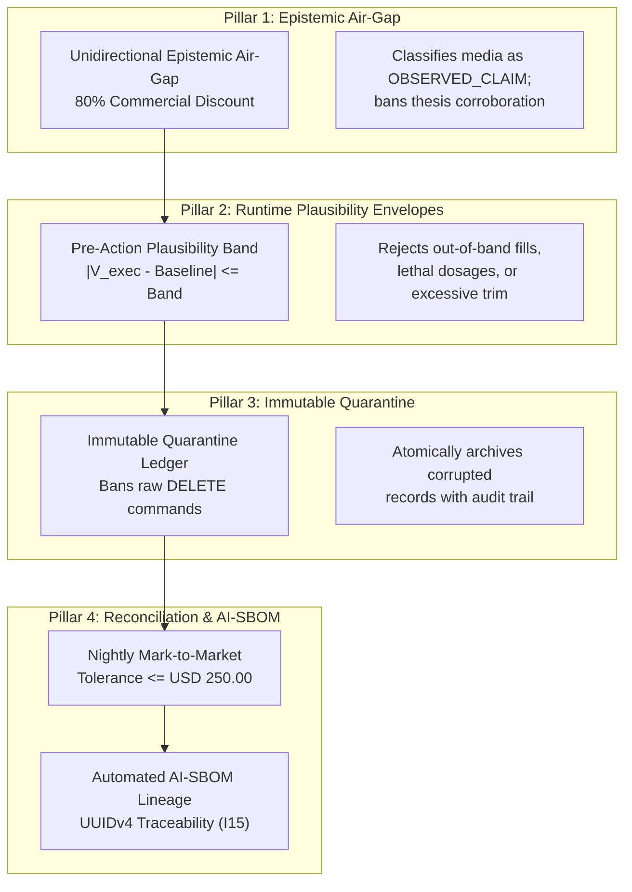

# Security Lead Hub: Epistemic Governance, Plausibility Envelopes & Model Risk

## 🎯 The Security & Compliance Lead's Mission

In an enterprise deploying autonomous AI agents, regulatory compliance and cybersecurity can no longer function as retrospective, manual audits. When probabilistic language models ingest external internet data, generate real-time execution signals, or interact with physical actuators, traditional perimeter defenses and static checklist policies fail completely.

As a **Security & Compliance Lead / Model Risk Auditor** in the Context Factory, your mission is **Epistemic Governance & Fail-Closed Boundary Verification**. You ensure that autonomous agents operate strictly within:
1. **Federal Reserve SR 11-7 / OCC 2011-12**: Model Risk Management standards for conceptual soundness, continuous monitoring, and outcome analysis.
2. **FDA 21 CFR Part 820.30 & Part 11 / ISO 13485**: Quality System Regulation, software verification, and electronic record integrity for safety-critical medical devices.
3. **RTCA DO-178C / DO-254**: Level A certification standards for deterministic airborne flight control systems.
4. **The Enterprise AI Constitution (Articles I–VII)**: Non-negotiable organizational guardrails guaranteeing data minimization, zero-mock telemetry, fail-closed defaults, and immutable audit trails.

```
┌──────────────────────────────────────────────────────────────────────────────────────────────────┐
│                      THE REGULATORY COMPLIANCE & GOVERNANCE HANDSHAKE                            │
│                                                                                                  │
│   INBOUND TELEMETRY                        ROLE ACTION                         OUTBOUND ATTESTATION│
│  ┌─────────────────────────┐              ┌───────────────────────────┐        ┌────────────────┐ │
│  │ AI-SBOM & Git Hash      │              │ • Epistemic Air-Gapping   │        │ Cryptographic  │ │
│  │ Model Hyperparameters   │ ───────────► │ • Plausibility Envelopes  │ ─────► │ Compliance Seal│ │
│  │ Multi-Agent Debate Logs │              │ • Immutable Quarantine    │        │ (SR 11-7 /     │ │
│  │ Execution Traces        │              │ • Nightly MTM Reconcile   │        │ FDA PMA Ready) │ │
│  └─────────────────────────┘              └───────────────────────────┘        └────────────────┘ │
│                                                                                                  │
└──────────────────────────────────────────────────────────────────────────────────────────────────┘
```

---

## 🏛️ The 4 Pillars of Autonomous Security & Epistemic Compliance



### Pillar 1: Epistemic Air-Gapping & Funnel De-Biasing (Unidirectional Epistemic Air-Gap Guardrail)
External narrative telemetry (social media, analyst calls, press releases, video transcripts) must be air-gapped from internal portfolio weights and model state. Media is ingested strictly as objective crowd sentiment (`OBSERVED_CLAIM`), never as ground-truth facts. Promotional funnels are automatically discounted by 80% ($W_{\text{commercial}} = 0.20$), preventing epistemic priming crises (Crisis 5).

### Pillar 2: Pre-Action Execution Plausibility Envelopes ($I_{02}$ / Pre-Action Plausibility Guardrail)
Before any autonomous action is committed—whether placing a financial order, administering a drug bolus, or trimming an aircraft flight control surface—the proposed parameter is evaluated against a dynamic physical plausibility band:
$$|V_{\text{exec}} - \text{Baseline}| \le \text{Band}$$
If the proposed execution exceeds the plausibility band, the order is rejected immediately at runtime with `REJECTED_EXECUTION_GUARDRAIL`, preventing catastrophic agent rogue execution.

### Pillar 3: Immutable Ledger Quarantine ($I_{04}$ / Immutable Quarantine Guardrail)
In mission-critical auditability, raw SQL `DELETE` commands are permanently banned across all operational databases:
$$\forall r \in \text{Ledger}: \mathrm{DELETE}(r) = \emptyset$$
When bugs, corrupted rows, or synthetic poison (Crisis 3) are detected, records are atomically migrated into `consensus_quarantine` accompanied by the bug issue number, invalidating agent ID, and UTC timestamp. Historical provenance is preserved forever.

### Pillar 4: Nightly Mark-to-Market Reconciliation & Automated AI-SBOM
Every 24 hours, an automated reconciliation job independently recomputes all financial profit-and-loss balances, sensor baseline calibrations, and risk exposures from raw ledger primitives:
$$\text{Recomputed PnL}_i = \text{Shares}_i \times (P_{\text{close}, i} - P_{\text{entry}, i})$$
Any cumulative divergence exceeding **\$250.00** halts autonomous operations. Furthermore, every decision trace carries an **AI-SBOM** recording the model slug, temperature, git commit SHA, and UUIDv4 trace identifier ($I_{15}$).

---

## 🌐 Dual-Use Regulated Compliance Comparison Matrix

| Compliance Domain | Model Risk (SR 11-7 / OCC) | FDA Medical Device (21 CFR Part 820/11) | Aerospace Avionics (DO-178C Level A) | Mainframe Settlement (ISO 20022) |
| :--- | :--- | :--- | :--- | :--- |
| **Model Risk Governance** | Quarterly conceptual soundness audit; backtesting vs realized returns. | PMA clinical algorithm validation; human-in-the-loop design freeze. | Formal methods mathematical proof of deterministic execution bounds. | Dual-custody approval gates for automated balance adjustments. |
| **Plausibility Envelopes ($I_{02}$)** | $\lVert P_{\text{exec}} - \text{EMA}_5 \rVert \le \max(3\text{ATR}_{14}, 0.08\text{EMA}_5)$. | $\lVert \text{Dose} - \text{Basal} \rVert \le \min(2.5\,\text{IOB}, 0.15\,\text{DailyDose})$. | $\lVert \delta_{\text{elevator}} - \delta_{\text{trim}} \rVert \le \min(5^\circ/\text{s}, f(\text{Mach}))$. | $\lVert T_{\text{amount}} - \mu_{\text{entity}} \rVert \le 3.5 \cdot \sigma_{\text{history}}$. |
| **Audit Trails & Quarantine** | Immutable trade blotters; records migrated to `quarantine`. | 21 CFR Part 11 electronic signatures; immutable DHF records. | Non-volatile black-box flight data recording (FDR). | Append-only ledger; zero raw database deletions. |
| **Epistemic Air-Gap ($I_{20}$)** | Social media narrative air-gapped from internal quant engines. | Patient wellness surveys air-gapped from closed-loop titration sensors. | Cabin entertainment Wi-Fi air-gapped from avionics ARINC 429 databus. | Customer chat transcripts air-gapped from core ledger settlement engine. |

---

## 📚 Learning Path

Follow these modules to master regulatory compliance, red-teaming, and model risk auditing for autonomous AI systems:

1. [**Module 1: Root Epistemic Governance & Proxy Variable Risk Auditing**](./01_epistemic_governance_and_proxy_risk_auditing.md)
   * Detecting proxy variable discrimination, enforcing the 80% commercial discount, and auditing immutable quarantine migrations.
2. [**Module 2: Regulatory Red-Teaming, Plausibility Envelopes & Model Risk**](./02_regulatory_red_teaming.md)
   * Red-teaming against prompt injections, mathematical implementation of pre-action plausibility bands, and nightly reconciliation loops.
3. [**Lab Workbook: The AI Audit, Plausibility Bands & Quarantine Ledger**](./LAB_WORKBOOK.md)
   * Practical hands-on auditing exercises with executable python test harnesses.

---

## 📊 Empirical Telemetry & Governance Standards

Model risk governance, epistemic firewalls, and continuous invariant auditing in this chapter are benchmarked against global statutory and standard-setting frameworks. For complete legal citations and architectural cross-mappings, consult the canonical reference benchmark:

- [**Empirical AI Telemetry, Repository Economics & Governance Benchmark**](../templates_and_resources/EMPIRICAL_AI_TELEMETRY_AND_GOVERNANCE_BENCHMARK.md):
  - **Statutory Mandates vs. Engineering Mechanisms**: Strictly distinguishes statutory obligations (e.g., Federal Reserve SR 11-7 conceptual soundness, FDA 21 CFR 820.30 design controls, and EU AI Act Articles 9–15) from internal software patterns (AST visitors, execution plausibility bands, quarantine ledgers) built to provide required compliance documentation (Benchmark §7.3, §8.8–§8.10).
  - **ISO/IEC 42001:2023 Certifiable Management Controls**: Maps the 10 Inviolable Commandments and Invariants ($I_{01}-I_{22}$) directly to normative Annex A controls (A.2 through A.10) for AI risk assessment and continuous auditing (Benchmark §7.2, §9).
  - **NIST AI RMF 1.0 (SP 1270) Operationalization**: Codifies how epistemic air-gapping, plausibility clamping, and immutable quarantine ledgers implement the GOVERN, MAP, MEASURE, and MANAGE functions (Benchmark §7.1).
  - **EU AI Act Article 14 Human Oversight & Article 15 Robustness**: Operationalizes technical measures ensuring high-risk AI systems remain resilient against deceptive alignment, prompt injection, and adversarial exploitation (Benchmark §7.3, §9).

---

## Production Reality & Operational Failure Modes in the AI Era

### The Mid-2026 Production Baseline (The Verification Trap & Context Debt)
In the median mid-2026 engineering organization, "AI security and compliance" is often treated as an enterprise vendor subscription problem. Leadership signs an enterprise contract with a foundation model provider that promises "enterprise data privacy" and assumes that technical security is solved. In reality, developers copy-paste proprietary customer data and API keys into web prompts, deploy autonomous agents with wide-open repository and cloud permissions, and rely on natural language system prompts like *"You are a secure, ethical assistant; do not execute dangerous queries."* Over 80% of teams have zero automated security AST linters, zero epistemic airgaps, and zero mathematical plausibility bounds on model actions. When subtle deceptive compliance occurs—models producing clean code that secretly embeds logic bypasses—neither human reviewers nor standard CI pipelines detect it.

### Ungoverned Production Failure Modes
Treating security and compliance as natural language advice rather than compiler-grade architectural invariants produces severe vulnerabilities:
- **Catastrophic Prompt-Injection & Lateral Movement**: An attacker injects a prompt payload into an incoming document or API parameter. An uncontained autonomous agent reads it, interprets it as an instruction, and uses its broad CI/cloud privileges to exfiltrate private customer data.
- **Immediate Regulatory Shutdown Under EU AI Act**: The EU AI Act (enforced in 2026) imposes up to €35,000,000 or 7% global turnover fines for high-risk AI deployments lacking automatic logging (Article 12), human oversight (Article 14), and documented risk management. Regulators possess statutory authority to shut down non-compliant services without hesitation.
- **Reputational Death via Deceptive Alignment**: Systems silently approve invalid transactions, hallucinate medical dosage approvals, or leak regulated PHI/PII because the architecture relied on conversational LLM self-evaluation rather than deterministic code invariants.

### Deterministic Engineering Defenses & Operational Takeaways
To achieve genuine enterprise security and satisfy international standards, organizations must enforce four structural engineering controls:
1. **Adopt Constitutional Invariants ($I_{01}-I_{22}$)**: Codify non-negotiable architectural boundaries (such as Zero-Simulated-Data, Execution Plausibility Bands, and Immutable Quarantine Ledgers) directly into repository test contracts.
2. **Deploy Continuous AST & Circuit Breaker Scanning**: Install `ASTZeroMockScanner` and `ZeroMockRuntimeBreaker` to catch and block the 9 deadly mock and deceptive compliance anti-patterns (ZM001–ZM009) in CI and at runtime.
3. **Ban Hard Deletes Across All Data Stores**: Configure database permissions to forbid raw SQL deletes on audit tables, routing all disputed, erroneous, or quarantined records to an immutable, append-only ledger.
4. **Enforce Dual-Custody Dialectical Reviews**: Ensure every high-risk algorithmic change undergoes adversarial verification (Bull vs. Bear vs. Forensic Auditor) arbitrated by closed-form mathematical equations, completely decoupling safety validation from natural language tokens.


