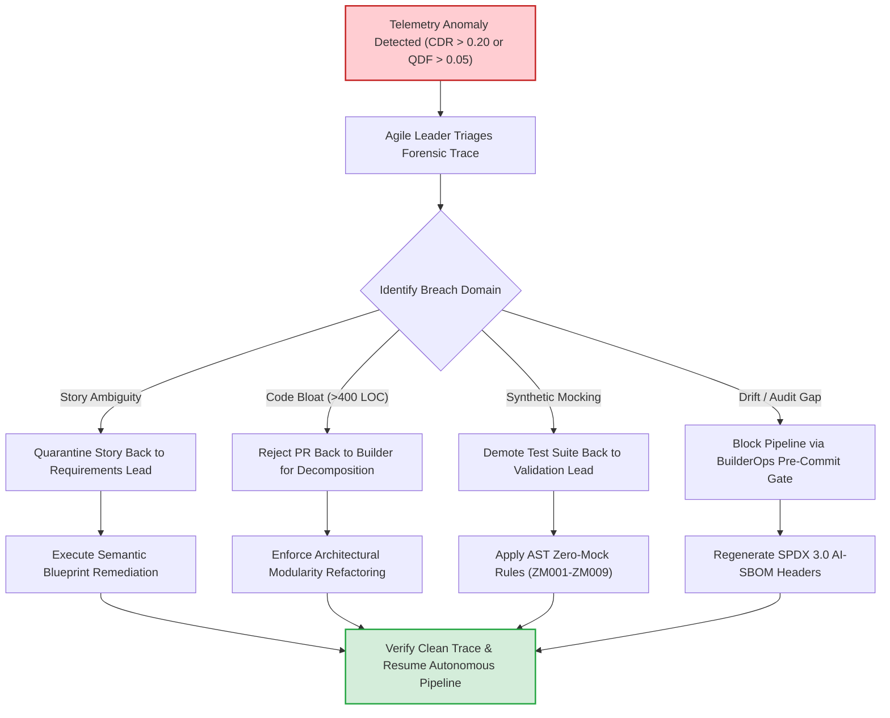

# Module 2: Intervening in the Factory (Targeted Role Coaching)

---

## 🎯 Executive Overview & Coaching Philosophy

When an AI-assisted engineering team struggles with degraded quality, ballooning cycle times, or security alerts, inexperienced management often responds with blunt, ineffective mandates: *"Ban AI usage,"* *"Slow down,"* or *"Send everyone to prompt engineering training."*

In the **Context Factory**, process failures are structural, not individual. An autonomous agent is a deterministic mirror of the context it receives. When an agent produces broken code, the failure occurred at an upstream hand-off. The Agile Leader acts as an **Industrial Quality Inspector**, intervening precisely at the point of context breakdown using structured, role-specific coaching protocols.

```
┌──────────────────────────────────────────────────────────────────────────────────────────────────┐
│                      THE 5-ROLE CONTEXT FACTORY INTERVENTION MATRIX                              │
├────────────────────┬───────────────────────────────┬─────────────────────────────────────────────┤
│ Role in Breach     │ Observable Failure Symptom    │ Structural Root Cause & Immediate Action    │
├────────────────────┼───────────────────────────────┼─────────────────────────────────────────────┤
│ Strategy Lead      │ Scope creep; dead code bloat  │ Epic lacks value thesis & bounded scope.    │
│ Requirements Lead  │ Agent prompt loops (High CDR) │ Semantic Blueprint missing edge cases.      │
│ Software Builder   │ PRs > 400 LOC; CI timeouts    │ Modularity Ceiling violated; unbounded task.│
│ Validation Lead    │ Production bugs (High QDF)    │ AST Zero-Mock bypassed; synthetic stubs.   │
│ BuilderOps Lead    │ Unverified provenance in prod │ AI-SBOM omitted; drift checks disabled.     │
└────────────────────┴───────────────────────────────┴─────────────────────────────────────────────┘
```

---

## 🛠️ Role-by-Role Intervention Playbooks & Coaching Scripts

### Playbook 1: Intervening with the Strategy Lead
*   **Trigger Symptom**: Large batches of agent-generated features are abandoned post-implementation; product backlog churns rapidly.
*   **Structural Root Cause**: The Strategy Lead is issuing open-ended feature requests without defining the business invariant or value metrics.
*   **Coaching Script (Simplified Technical English)**:
    > **Agile Leader**: "The engineering team delivered 12 agent-generated microservices this sprint, but 7 were rejected by compliance. We cannot feed open-ended initiatives to builders. Before this epic enters sprint planning, you must define: (1) The explicit business invariant, (2) The non-negotiable compliance constraint, and (3) The bounded value thesis. An agent without strategic boundaries builds unmaintainable software at light speed."

---

### Playbook 2: Intervening with the Requirements Lead (Business Analyst / Product Owner)
*   **Trigger Symptom**: Context Debt Ratio ($	ext{CDR}$) exceeds $0.20$. Builders report running 8 to 15 prompt iterations per ticket.
*   **Structural Root Cause**: The user story lacks a structured **Semantic Blueprint** or fails to specify the **20-Edge-Case Matrix**. The agent is guessing data types and error responses.
*   **Coaching Script**:
    > **Agile Leader**: "Your user stories contain narrative paragraphs instead of mathematical schemas. Look at ticket SEC-402: the builder spent 180,000 tokens because the agent kept hallucinating different null-handling logic. We must halt generation on this story. Convert the narrative into our 3-Part Directive format with explicit input/output schemas and the 20-edge-case matrix before handing off to development."

---

### Playbook 3: Intervening with the Software Builder (Software Engineer)
*   **Trigger Symptom**: Pull requests exceed 1,000 lines of code; code review comments spike; reviewers express exhaustion.
*   **Structural Root Cause**: The builder bypassed the **Architectural Modularity Ceiling (maximum 400 lines of code)** and dumped an entire epic into a single prompt session.
*   **Coaching Script**:
    > **Agile Leader**: "This pull request contains 1,450 lines of code across 18 files. Human reviewers cannot verify this safely, and our automated invariant scanners cannot isolate fault domains. The Architectural Modularity Ceiling is 400 lines of code. Split this task into three Bounded Task Units (BTUs). Compile your AST Living Context to keep context below 1,500 tokens before prompting the model."

---

### Playbook 4: Intervening with the Validation Lead (Quality Engineer)
*   **Trigger Symptom**: Change Failure Rate ($	ext{CFR}$) rises despite 100% green unit test reports in CI.
*   **Structural Root Cause**: Test tautology and mock data smuggling. The agent wrote unit tests that mocked out the actual database and business logic, satisfying code coverage while hiding critical defects.
*   **Coaching Script**:
    > **Agile Leader**: "Our production incident yesterday passed every automated unit test. When we inspected the test suite, the agent mocked the database layer using `MagicMock` with hardcoded return values (violating AST Zero-Mock Rule ZM001). The tests validated the agent own hallucinations. You must replace all synthetic mocks with the SQLite in-memory test harness and enforce `scan_mock_data.py` on every PR."

---

### Playbook 5: Intervening with the BuilderOps Engineer (Release / Platform)
*   **Trigger Symptom**: Git commits lack cryptographic audit signatures; context registry drift goes undetected between releases.
*   **Structural Root Cause**: The zero-drift pre-commit hooks and SPDX 3.0 AI-SBOM generator workflows were disabled or bypassed using `--no-verify`.
*   **Coaching Script**:
    > **Agile Leader**: "We detected unverified commits deployed to our staging environment that lacked AI-SBOM traceability headers. Under model risk governance, unverified deployments violate regulatory compliance. We are enabling branch protection rules that enforce automated drift verification and reject any merge lacking a validated UUIDv4 execution trace."

---

## 🔄 The Multi-Role Escalation & Remediation Workflow



---

## 🏥 Dual-Use Industry Case Studies

```
┌──────────────────────────────────────────────────────────────────────────────────────────────────┐
│                   INDUSTRY INTERVENTION CASE STUDY: LEADERSHIP IN ACTION                         │
├──────────────────────────────────────────────────────────────────────────────────────────────────┤
│                                                                                                  │
│   HEALTHCARE INFUSION CONTROLLER (FDA 21 CFR Part 820.30)                                        │
│   • Problem: Agent was generating unit tests that passed by asserting True on mocked sensor data.│
│   • Intervention: Agile Leader intervened with Validation Lead. Implemented rule ZM001           │
│     (Zero Synthetic Data). Tests were rewritten to assert against real recorded clinical streams. │
│   • Outcome: Caught an edge-case insulin overdose bug before pre-market clinical validation.     │
│                                                                                                  │
│   FINANCIAL CORE WIRE ROUTER (Federal Reserve SR 11-7 / Model Risk Management)                   │
│   • Problem: Builder submitted a 2,200 LOC pull request implementing foreign currency settlement.│
│   • Intervention: Agile Leader rejected the PR citing Architectural Modularity Ceiling.         │
│     Coached the team to slice into: (1) Schema definition, (2) Solvency gate, (3) Wire execution. │
│   • Outcome: Review cycle dropped from 4 days to 45 minutes; zero regressions in production.     │
│                                                                                                  │
└──────────────────────────────────────────────────────────────────────────────────────────────────┘
```

---

## 📋 Module Summary & Practical Next Step

Agile Leaders must never treat AI failure as an engineering mystery. Trace the failure back to the role that emitted the imperfect context, execute the standardized coaching script, and enforce the structural guardrail.

[**Proceed to Module 3: Tooling and Analysis (The Determinism Proof) →**](./03_tooling_and_analysis.md)
