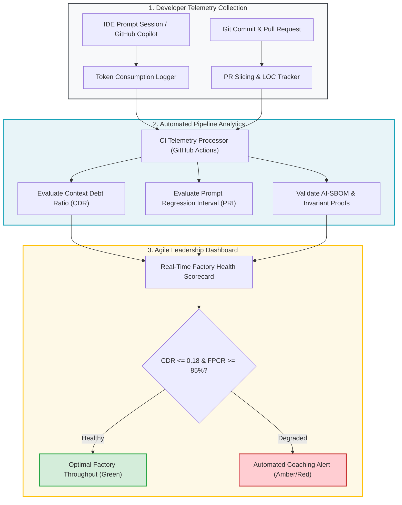

# Module 3: Tooling, Telemetry & Analysis (The Determinism Proof)

---

## 🎯 Executive Overview & The Determinism Thesis

Executive leadership and finance committees frequently ask engineering leaders: *"What is the actual return on investment (ROI) of our AI developer tools?"*

When engineering teams adopt AI without a structured Context Factory, the ROI is often negative: developers consume expensive model tokens generating bloated code, while senior architects spend double the hours triaging subtler bugs, security vulnerabilities, and context drift.

The objective of an Agile Leader is to mathematically demonstrate the **Determinism Proof**: proving that anchoring autonomous agents with explicit Semantic Blueprints, AST State Registries, and Invariant Guardrails transforms AI from an unpredictable stochastic generator into a deterministic, cost-effective engineering compiler.

```
┌──────────────────────────────────────────────────────────────────────────────────────────────────┐
│                     THE STOCHASTIC VS. DETERMINISTIC ENGINEERING SPECTRUM                        │
├────────────────────────────────┬─────────────────────────────────────────────────────────────────┤
│ Zero-Context / Ad-Hoc Prompting│ The Context Factory Framework                                   │
├────────────────────────────────┼─────────────────────────────────────────────────────────────────┤
│ Model guesses repository state │ Model consumes pre-compiled Living Context (<1,500 tokens)      │
│ Ingests 50,000+ unbounded LOC  │ Ingests cohesive AST node scopes                                │
│ High hallucination and drift   │ Pinned to AST State & Mathematical Registries                   │
│ Unpredictable token burn       │ Bounded Task Units (BTU <= 25,000 tokens)                       │
│ Synthetic mocks hide defects   │ AST Zero-Mock Rules (ZM001-ZM009) enforce truth                 │
└────────────────────────────────┴─────────────────────────────────────────────────────────────────┘
```

---

## 📊 Mathematical ROI & Determinism Metrics

To justify the engineering discipline of the Context Factory to executive sponsors, track three objective mathematical indices:

### 1. Token Cost Efficiency Ratio (TCER)
Quantifies the direct token savings achieved by compiling living context instead of dumping entire repositories:

$$\text{TCER} = \frac{\text{Tokens Expended (Zero-Context Run)}}{\text{Tokens Expended (Context Factory Run)}}$$

*   **Zero-Context Baseline**: Dumping a 50,000 LOC repository $\approx 150,000$ prompt tokens $\approx$ \$1.50 per invocation.
*   **Context Factory Run**: Living Context JSON (1,200 tokens) + 3-Part Directive (600 tokens) $\approx$ 1,800 tokens $\approx$ \$0.018 per invocation.
*   **Expected Efficiency**: $\text{TCER} \ge 80\times$ token cost reduction per development cycle.

### 2. First-Pass Convergence Rate (FPCR)
Measures the percentage of agent pull requests that pass CI and merge without requiring prompt re-generation or rollbacks:

$$\text{FPCR} = \frac{\text{PRs Merged on First Generation Cycle}}{\text{Total PRs Initiated}} \times 100\%$$

*   **Zero-Context Baseline**: $< 20\%$ (Developers struggle through 4–8 iterations).
*   **Context Factory Target**: $\ge 85\%$ first-pass convergence.

### 3. Reviewer Epistemic Velocity (REV)
Measures the human cognitive time spent verifying pull requests:

$$\text{REV} = \frac{\text{Minutes Spent on Human Peer Review}}{\text{Net Lines of Code Added}}$$

With deterministic AI-SBOM headers, invariant proofs, and modular PRs ($\le 400$ LOC), $\text{REV}$ drops from $1.8\text{ min/LOC}$ down to $\le 0.15\text{ min/LOC}$.

---

## 🛠️ Automated Telemetry Tooling & Dashboard Architecture



---

## 🤖 The Automated "Coach-of-Coaches" Audit Engine

Agile Leaders cannot manually inspect thousands of pull requests. Use a structured LLM audit prompt to batch-analyze PR review comments and flag recurring context defects:

```python
"""
coach_meta_audit.py: Automated Pull Request Context Diagnostic
Scans PR review comments to pinpoint upstream Context Factory breakdowns.
"""
import json
import re

def audit_review_comments(comments: list[str]) -> dict:
    diagnostic = {
        "architectural_ceiling_breaches": 0,
        "mock_smuggling_violations": 0,
        "semantic_ambiguity_queries": 0,
        "primary_recommendation": "Maintain standard flow"
    }

    for comment in comments:
        c_lower = comment.lower()
        if re.search(r"(too large|break up this pr|exceeds 400 loc|split)", c_lower):
            diagnostic["architectural_ceiling_breaches"] += 1
        elif re.search(r"(mock|synthetic data|test pass on fake|zm001)", c_lower):
            diagnostic["mock_smuggling_violations"] += 1
        elif re.search(r"(what does this mean|unclear requirement|edge case|ambiguous)", c_lower):
            diagnostic["semantic_ambiguity_queries"] += 1

    # Triage dominant root cause
    if diagnostic["semantic_ambiguity_queries"] >= 3:
        diagnostic["primary_recommendation"] = "Intervene with Requirements Lead: Story specifications lack edge-case clarity."
    elif diagnostic["architectural_ceiling_breaches"] >= 2:
        diagnostic["primary_recommendation"] = "Intervene with Builder: Enforce Architectural Modularity Ceiling (<= 400 LOC)."
    elif diagnostic["mock_smuggling_violations"] >= 1:
        diagnostic["primary_recommendation"] = "Intervene with Validation Lead: Enforce AST Zero-Mock Rules (ZM001-ZM009)."

    return diagnostic

# Example Test Case
if __name__ == "__main__":
    sample_comments = [
        "This function is 650 lines long, please break it up into smaller modules.",
        "Why is this test using MagicMock for the database? We need SQLite in-memory.",
        "The PR description exceeds our bounded scope."
    ]
    result = audit_review_comments(sample_comments)
    print(json.dumps(result, indent=2))
```

---

## 🏥 Dual-Use Industry Case Studies

```
┌──────────────────────────────────────────────────────────────────────────────────────────────────┐
│                   INDUSTRY DETERMINISM CASE STUDY: ROI COMPARISON                                │
├──────────────────────────────────────────────────────────────────────────────────────────────────┤
│                                                                                                  │
│   HEALTHCARE MEDICAL SOFTWARE (FDA Class III Cardiac Monitor)                                   │
│   • Before: Developers prompted general-purpose LLMs without bounded context. Token burn was    │
│     1.4M tokens per feature. Reviewers rejected 82% of PRs due to unverified medical math.       │
│   • After: Implemented AST Mathematical Registry and AST Zero-Mock test enforcement.            │
│   • Metric Shift: FPCR rose from 18% to 91%; TCER reached 94x; zero FDA non-conformance flags.  │
│                                                                                                  │
│   CORE BANKING & FINANCIAL TRANSACTIONS (High-Value Swift Wire Gateways)                         │
│   • Before: Teams attempted autonomous agent coding with zero-context prompting. Developers      │
│     reported 4-day lead times and constant hallucinations around ISO 20022 message schemas.      │
│   • After: Enforced 3-Part Directives, Living Context compiler, and AI-SBOM SPDX 3.0 headers.   │
│   • Metric Shift: Lead time plummeted from 96 hours to 4.2 hours; 100% trace compliance.        │
│                                                                                                  │
└──────────────────────────────────────────────────────────────────────────────────────────────────┘
```

---

## 📋 Module Summary & Practical Next Step

---

## Production Reality & Operational Failure Modes in the AI Era

### The Mid-2026 Production Baseline (The Verification Trap & Context Debt)
In the median mid-2026 engineering department, process tooling consists of an off-the-shelf SaaS dashboard that tracks AI code assistant seat utilization and simple "acceptance rates." Engineering leadership observes an 80% acceptance rate and assumes developers are 80% more productive. In reality, developers accept ghost-text suggestions, discover minutes later that the code fails compilation or breaks cross-file contracts, and spend substantial time debugging the regression. Teams rarely instrument First-Pass Compile Rate (FPCR), Token Cost Efficiency Ratio (TCER), or AST rule violation density. The organization operates without essential telemetry—spending tens of thousands of dollars each month on frontier model inference without measuring whether that compute produces durable software assets or throwaway churn.

### Ungoverned Production Failure Modes
Operating software factories without rigorous process telemetry and deterministic tooling triggers acute operational breakdowns:
- **Severe Model Inference OpEx Inefficiency**: Organizations spend \$157.50 per 1,000 tasks on unconstrained monolithic frontier models when an AST-decoupled pipeline costs \$25.50 (an 83.8% structural OpEx waste), burning millions of dollars annually at enterprise scale.
- **Uncontrolled Context Debt Explosion**: Without automated PR review comment classification, recurring context failures (missing schemas, unpinned dependencies, style drift) replicate endlessly across repositories, cementing technical debt directly into development workflows.
- **Silent Degradation of Core Architecture**: Without automated AST analyzers enforcing modularity ceilings and zero-mock rules, codebases silently accumulate 800-line monolithic files and mocked test fixtures that destroy system test fidelity.

### Deterministic Engineering Defenses & Operational Takeaways
To replace vanity adoption metrics with verifiable production instrumentation, engineering teams must deploy four telemetry systems:
1. **Deploy the First-Pass Compile Rate (FPCR) CI Sentinel**: Track whether code generated on the first prompt passes compilation and test suites without human intervention; set a minimum acceptable threshold of $75\%$.
2. **Implement Automated PR Comment Categorization**: Run an automated script on PR review comments to tag whether requested changes stem from Requirements (BA), Schemas (Architect), Modularity (Builder), or Tests (QE).
3. **Calculate and Benchmark Pod TCER Monthly**: Measure the Token Cost Efficiency Ratio ($\text{TCER} \ge 80\times$) across all teams; flag any pod with low TCER for context pipeline remediation.
4. **Embed AST Linting into IDE Pre-Commit Hooks**: Prevent non-compliant code from ever reaching remote pull requests by running AST zero-mock (ZM001–ZM009) and line-count ceiling analyzers directly in local pre-commit git hooks.

---

[**Proceed to Agile Leader Hands-On Lab Workbook →**](./LAB_WORKBOOK.md)

