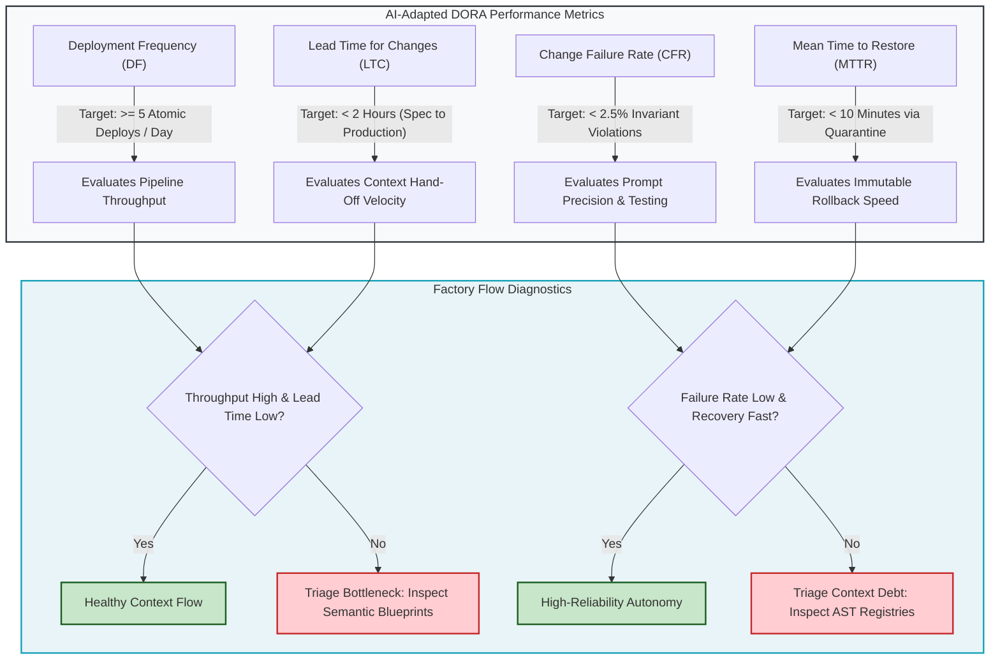

# Agile Leader Hub: Managing Context Debt, Flow Telemetry & AI-Adapted DORA Metrics

## 🎯 The Mission of the Agile Leader & Scrum Master

In an AI-augmented engineering organization, the Scrum Master, Agile Coach, and Engineering Manager function as the **System Optimizer**.

When autonomous agents and developers collaborate, code generation velocity is no longer the primary constraint. An AI agent can synthesize hundreds of lines of code in seconds. However, if the upstream context supplied to the agent contains ambiguity or structural drift, the agent will synthesize **incorrect code at machine scale**.

The Agile Leader does not write system instructions or review pull request diffs. The Agile Leader monitors the **Flow Telemetry of the Context Factory**:
1. Where are handoffs breaking between Product Owners, Business Analysts, Builders, and Quality Engineers?
2. How much **Context Debt** is accumulating across user stories and registries?
3. Are team deployment pipelines accelerating actual customer value or amplifying regression rework?

```
┌──────────────────────────────────────────────────────────────────────────────────────────────────┐
│                      THE AGILE LEADER FLOW TELEMETRY HANDSHAKE                                   │
├──────────────────────────────────────────────────────────────────────────────────────────────────┤
│                                                                                                  │
│   INBOUND TELEMETRY                        AGILE LEADER ACTIONS                OUTBOUND GOVERNANCE│
│  ┌─────────────────────────┐              ┌───────────────────────────┐        ┌────────────────┐│
│  │ DORA & CI Failure Rates │              │ • Context Debt Triage     │        │ High-Velocity, ││
│  │ Token Budget Burn Rates │ ───────────► │ • Story Decomposition     │ ─────► │ Low-Rework     ││
│  │ PR Review Iteration Cyc │              │ • Role Bottleneck Coaching│        │ Delivery Flow  ││
│  │ Registry Drift Alerts   │              │ • Micro-Budget Governance │        │ (Zero Backlog) ││
│  └─────────────────────────┘              └───────────────────────────┘        └────────────────┘│
│                                                                                                  │
└──────────────────────────────────────────────────────────────────────────────────────────────────┘
```

---

## 📊 The Transition: From Velocity Story Points to Bounded Task Units

In traditional Agile software engineering, teams measure capacity in abstract **Story Points** based on human estimation. In an autonomous engineering factory, story points lose predictive utility because an AI model solves a complex 8-point algorithmic task in thirty seconds, but fails on a simple 1-point configuration task if context is missing.

Agile Leaders transition organizations to **Bounded Task Units and Token Budgets**:

```
┌──────────────────────────────────────────────────────────────────────────────────────────────────┐
│                   TRADITIONAL AGILE VS. CONTEXT FACTORY DELIVERY                                 │
├──────────────────────────────────────────────────────────────────────────────────────────────────┤
│                                                                                                  │
│   TRADITIONAL AGILE METHODOLOGY                       CONTEXT FACTORY METHODOLOGY                │
│   ─────────────────────────────                       ───────────────────────────                │
│   • Planning Unit: Story Points (Fibonacci)           • Planning Unit: Bounded Task Units (BTUs) │
│   • Sizing Metric: Human Time & Effort                • Sizing Metric: Context Scope (<= 80 LOC) │
│   • Sprint Cadence: 2-Week Iteration Batches          • Flow Cadence: Continuous Atomic Releases │
│   • Failure Metric: Unfinished Sprint Backlog         • Failure Metric: Prompt Regression / Drift│
│   • Estimation Risk: Underestimated Engineering Work  • Estimation Risk: Context Window Dilution │
│                                                                                                  │
└──────────────────────────────────────────────────────────────────────────────────────────────────┘
```

### The Sizing Rules for Bounded Task Units:
1. **The Semantic Slice & Focus Window Rule**: A task is appropriately sized if the necessary code change can be contained within a cohesive AST scope (e.g., single function or class definition, typically $\le 80$ lines focus window).
2. **The Single-Role Responsibility Rule**: A user story must never require an autonomous agent to simultaneously modify requirements, architecture, and test suites. Each role handoff must be an independent, verified commit.
3. **The Micro-Spend Budget Cap**: A single task execution must operate within a \$0.10 to \$0.40 budget quota (approx. 25,000 to 100,000 prompt tokens per cycle, with a standard BTU ceiling of $\le 25,000$ active context tokens), preventing runaway agent loops.

---

## 📈 Adapted DORA & SPACE Metrics for Autonomous Systems

Agile Leaders track four adapted DevOps Research and Assessment (DORA) metrics to evaluate autonomous delivery health:



### The AI-Specific Metrics Catalog:
1. **Context Debt Ratio (CDR)**: Tracks structural and economic context waste:
   - *Structural CDR*: The ratio of un-indexed source code lines to indexed AST registry lines ($\text{CDR}_{\text{structural}} = \frac{\text{Un-indexed Source LOC}}{\text{Total Indexed AST LOC}}$). A $\text{CDR}_{\text{structural}} > 0.05$ indicates that developers or agents are adding code without running AST registry generators.
   - *Economic / Token CDR*: The ratio of tokens expended on rework, refactoring, and rollbacks to total production tokens expended ($\text{CDR}_{\text{token}} = \frac{\text{Tokens Expended on Rework \& Rollbacks}}{\text{Total Production Tokens Expended}}$), where $\text{CDR}_{\text{token}} \le 0.18$ represents the healthy operational ceiling.
2. **Prompt Regression Interval (PRI)**: Measures execution churn and rework frequency:
   - *Turn-Based PRI*: The number of automated interaction turns an agent executes before successfully passing the unit test suite ($\text{PRI}_{\text{turns}}$). A $\text{PRI}_{\text{turns}} > 3$ indicates an ambiguous 3-Part Directive.
   - *Temporal PRI*: The ratio of rollback engineering hours to active engineering hours ($\text{PRI}_{\text{hours}} = \frac{\sum_{i=1}^M \tau_{\text{revert}}^{(i)}}{\sum_{j=1}^N \tau_{\text{commit}}^{(j)}}$), targeting $\text{PRI} \le 0.08$.
3. **Quarantine Demotion Frequency (QDF)**: The rate at which records are migrated to `consensus_quarantine` due to synthetic mock poisoning or corrupted inputs.

---

## 🛠️ The Agile Leader Diagnostic Coaching Matrix

When an autonomous pipeline stalls or generates high defect rates, the Agile Leader consults the diagnostic matrix below to coach the responsible team role:

| Symptom / Metric Failure | Root Cause in Factory Flow | Responsible Role | Agile Leader Coaching Intervention |
| :--- | :--- | :--- | :--- |
| **High PR Review Iteration Count (>4 cycles)** | The user story lacked explicit format constraints or negative edge cases. | **Business Analyst / Requirements Lead** | Coach the BA to author **Semantic Blueprints** with mandatory 20 pre-condition edge cases and explicit type signatures. |
| **Model Inadvertently Erases Code (Rule 14 Violation)** | File size exceeded the 400-LOC modular ceiling; agent suffered attention dilution. | **Software Engineer / Builder Lead** | Coach the developer on **Architectural Modularity Decomposition** (splitting files at 350 LOC into focused submodules). |
| **Flaky Test Failures in CI** | Unit test suite attempted live network egress instead of hermetic local execution. | **Validation Lead / QE** | Enforce **Hermetic Socket Isolation** (`pytest-socket`) and replace live API calls with deterministic recorded fixtures. |
| **Silent Cloud Resource Collisions** | IaC prompt omitted approved VPC subnets and existing IAM roles. | **BuilderOps / Release Engineer** | Ensure the **Infrastructure Registry (`infra_registry.json`)** is injected into the prompt context before execution. |

---

## 🌐 Dual-Use Regulated Comparison: Team Flow Across Critical Sectors

| Agile Flow Dimension | Healthcare / FDA Medical Device Team | Banking Core Mainframe Settlement Team |
| :--- | :--- | :--- |
| **Sprint Backlog Structure** | Each backlog item must map to a specific Software Safety Classification (IEC 62304 Class A, B, or C) with traced verification tests. | Backlog items link to specific financial risk controls under SOX Section 404 and Federal Reserve SR 11-7 model inventories. |
| **Definition of Done (DoD)** | Code compiles with 0 warnings, passes 100% hermetic unit tests, satisfies AST Zero-Mock rules (ZM001–ZM009), and includes AI-SBOM. | Code passes double-entry accounting reconciliation, executes within plausibility envelopes ($I_{02}$), and includes audit trail UUIDs. |
| **Retrospective Cadence** | Bi-weekly retrospectives review AI-generated code rejection logs and evaluate clinical safety guardrail effectiveness. | Sprints review token expenditure quotas, prompt regression intervals, and quarantine ledger migration frequencies. |

---

## 📚 Curriculum Learning Modules

Explore the dedicated chapters in this directory to master agile AI team operations:

1. [**Module 1: Interpreting AI Metrics & DORA Telemetry**](./01_interpreting_ai_metrics.md)
   * Read, analyze, and optimize automated telemetry emitted by AI pipelines.
2. [**Module 2: Intervening in the Factory & Role Bottleneck Triage**](./02_intervening_in_the_factory.md)
   * Identify which role handoff is failing and apply targeted coaching interventions.
3. [**Module 3: Tooling, ROI Quantification & Prompt Regression Tracking**](./03_tooling_and_analysis.md)
   * Measure real-world developer productivity, calculate token ROI, and track prompt regressions.
4. [**Hands-On Lab Workbook: The Agile Metrics Audit**](./LAB_WORKBOOK.md)
   * Apply all metrics and coaching techniques to audit a simulated enterprise factory pipeline.

---

[**Next: Module 1 — Interpreting AI Metrics →**](./01_interpreting_ai_metrics.md) | [**Return to Root Curriculum Overview →**](../README.md)
