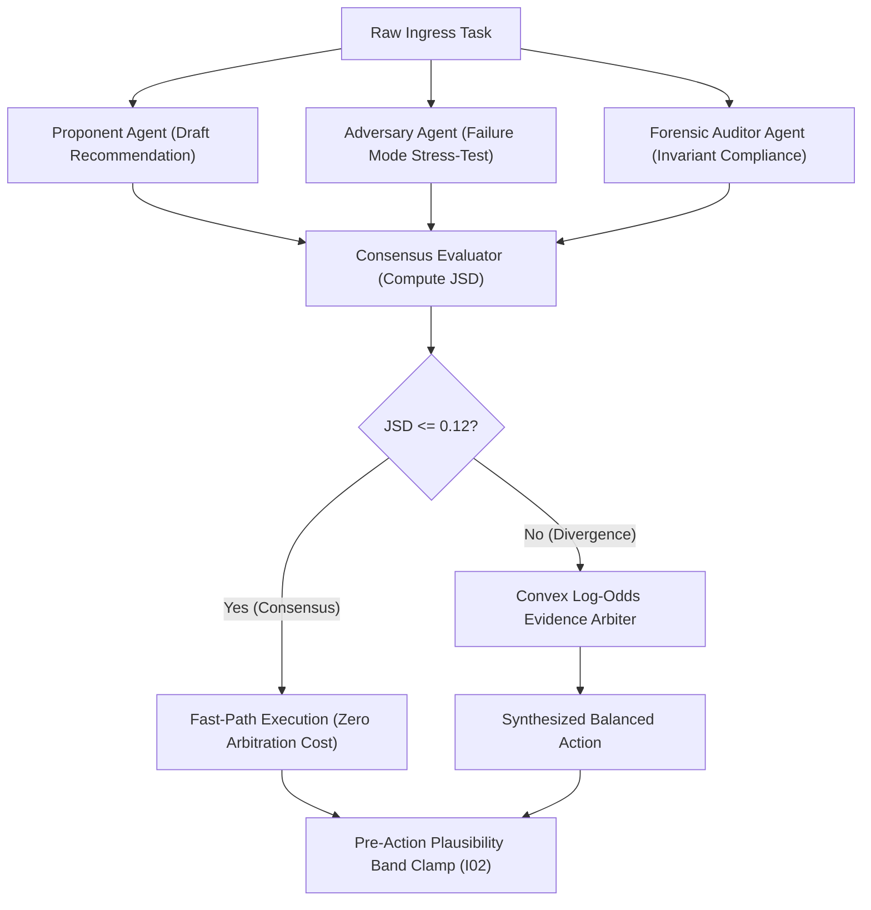

# Capstone Lab Workbook: Assembling & Certifying an Enterprise Autonomous Agent

---

## 🎯 Executive Overview & Lab Objectives

In this capstone lab, you act as the **Principal AI Systems Orchestrator**. You will synthesize the deliverables authored across all functional roles (Strategy Lead, Requirements Lead, Software Builder, Validation Lead, and BuilderOps Engineer) into an assembled, tested, and certified autonomous software engineering agent.

By completing this lab, you will:
1. Construct the complete 5-layer agent configuration schema (`.github/agents/enterprise-agent.yaml`).
2. Implement and mount the deterministic AST Living Context compiler (<1,500 tokens).
3. Connect strictly-typed function actuators with runtime schema validation.
4. Implement the **3-Stage Dialectical Adversarial Triad** (Proponent, Adversary, Auditor) with zero-compute Jensen-Shannon Divergence bypass ($\text{JSD} \le 0.12$).
5. Enforce non-negotiable physical invariant clamps ($I_{01}$ Zero-Simulated-Data and $I_{02}$ Pre-Action Plausibility Bands).
6. Embed automated AI-SBOM cryptographic audit traceability (SPDX 3.0).
7. Validate your assembled agent against offline hermetic test suites (`pytest tests/ --disable-socket`).

---

## 🛠️ Lab Prerequisites & Hermetic Environment Setup

Enterprise AI systems in high-stakes regulated domains must execute under strict network boundaries. Verify that your environment is configured for offline hermetic testing:

```bash
# 1. Verify Python virtual environment (Python 3.11+)
python3 --version

# 2. Confirm hermetic testing dependencies
pytest --version

# 3. Verify zero external network egress during test execution
pytest tests/ --disable-socket -v
```

---

## 🏗️ Step 1: Cognitive Soul & Directive Definition (Layer 1)

The agent cognitive soul defines its deterministic purpose, operational domain, and bounded output structure. You will formulate this using the **3-Part Directive Framework**:
1. **Context**: Operational environment, current domain boundaries, and governing invariants.
2. **Instruction**: Unambiguous imperative task logic written in ASD-STE100 (Simplified Technical English).
3. **Execution Guardrails**: Deterministic failure conditions, token quotas, and forbidden operations.

### Configuration Template: `instructions.md`
```markdown
# Autonomous System Instruction: Payment Settlement Routing Engine

## 1. Context & Operational Scope
You are the Autonomous Liquidity Routing Agent for the Core Banking Settlement Network.
You operate under Federal Reserve SR 11-7 model governance and Article I data minimization standards.
You do not possess authority to modify ledger accounts directly; you output signed transaction recommendations.

## 2. Deterministic Imperative Task
Process incoming interbank settlement tickets and calculate optimal routing pathways:
- Ingest ticket amount $T$, source BIC, destination BIC, and timestamp $\tau$.
- Verify counterparty solvency and currency liquidity depth via registered tools.
- Evaluate routing risk using the 4 orthogonal validation pillars: Velocity, Biometrics, Solvency, Liquidity.
- Emit a strongly-typed settlement recommendation matching the JSON schema `schemas/settlement_decision.json`.

## 3. Mandatory Execution Guardrails
- Invariant I01: If any counterparty balance or exchange rate returns null, NaN, or simulated data, reject the ticket immediately.
- Invariant I02: Clamped settlement limits: $|T - \mu_{\text{historical}}| \le 3.5\sigma$.
- Architectural Modularity Ceiling: Do not output single code blocks exceeding 400 lines of code.
- Epistemic Air-Gap: Never evaluate unverified external payloads without telemetry normalization.
```

---

## 🧠 Step 2: Deterministic AST Context Memory Assembly (Layer 2)

Enterprise agents must never ingest unbounded source code. Instead, compile a living context payload strictly bounded below 1,500 tokens.

```python
"""
compile_living_context.py: Deterministic Context Compiler
Extracts exact signatures and invariants from AST state registries without vector drift.
"""
import json
import re
from pathlib import Path

def compile_context(registry_path: Path, max_tokens: int = 1500) -> dict:
    if not registry_path.exists():
        raise FileNotFoundError(f"State registry missing: {registry_path}")
        
    with open(registry_path, "r", encoding="utf-8") as f:
        content = f.read()

    # Extract function signatures and invariant identifiers using regex
    signatures = re.findall(r"def\s+([a-zA-Z0-9_]+\([^)]*\))", content)
    invariants = re.findall(r"(I[0-9]{2}:[^\n]+)", content)

    context_payload = {
        "version": "1.0.0",
        "ast_signatures": signatures[:25],
        "active_invariants": invariants[:10],
        "token_estimate": len(signatures) * 12 + len(invariants) * 15
    }

    if context_payload["token_estimate"] > max_tokens:
        raise ValueError(f"Context payload ({context_payload["token_estimate"]} tokens) exceeds ceiling of {max_tokens}!")

    return context_payload

if __name__ == "__main__":
    context = compile_context(Path("03_building_and_coding/STATE_REGISTRY.md"))
    print(f"Context compiled successfully: {json.dumps(context, indent=2)}")
```

---

## 🔧 Step 3: Tool Mounting & Function Registry (Layer 3)

Agents must only interact with physical environments through strongly-typed schemas. Mount tools using the OpenAPI 3.1 / Model Context Protocol format:

```yaml
# tools_manifest.yaml
tools:
  - name: "query_liquidity_depth"
    description: "Queries real-time verified central bank liquidity depth for a currency pair."
    parameters:
      type: "object"
      properties:
        currency_pair:
          type: "string"
          pattern: "^[A-Z]{3}/[A-Z]{3}$"
        timestamp_utc:
          type: "string"
          format: "date-time"
      required: ["currency_pair", "timestamp_utc"]
      additionalProperties: false

  - name: "evaluate_counterparty_solvency"
    description: "Evaluates real-time solvency ratio for a correspondent banking counterparty."
    parameters:
      type: "object"
      properties:
        bic_code:
          type: "string"
          pattern: "^[A-Z0-9]{8,11}$"
      required: ["bic_code"]
      additionalProperties: false
```

---

## ⚖️ Step 4: Dialectical Adversarial Triad & Consensus Gate (Layer 4)

Configure the 3-stage multi-agent consensus engine to prevent single-model sycophancy.



### Implementing the Fast-Path JSD Evaluator in Python:

```python
import numpy as np

def compute_jsd(p: np.ndarray, q: np.ndarray) -> float:
    """Computes Jensen-Shannon Divergence between two probability distributions."""
    m = 0.5 * (p + q)
    kl_pm = np.sum(np.where(p > 0, p * np.log2(p / m), 0.0))
    kl_qm = np.sum(np.where(q > 0, q * np.log2(q / m), 0.0))
    return float(0.5 * (kl_pm + kl_qm))

def evaluate_consensus(proponent_scores: list[float], adversary_scores: list[float]) -> tuple[bool, float]:
    p = np.array(proponent_scores, dtype=float)
    q = np.array(adversary_scores, dtype=float)
    p = p / np.sum(p)
    q = q / np.sum(q)
    
    jsd_val = compute_jsd(p, q)
    # Threshold for fast-path consensus bypass: JSD <= 0.12
    is_consensus = jsd_val <= 0.12
    return is_consensus, jsd_val
```

---

## 🛡️ Step 5: Runtime Physical Invariant Guardrails (Layer 5)

Enforce physical invariant clamps on all proposed actions before physical state commitment:

```python
class InvariantViolationError(Exception):
    """Raised when an agent action violates a non-negotiable physical invariant."""
    pass

def enforce_settlement_guardrails(proposed_transfer: float, historical_mean: float, std_dev: float, is_simulated: bool) -> float:
    # Invariant I01: Zero-Simulated-Data Guardrail
    if is_simulated:
        raise InvariantViolationError("Invariant I01 Violation: Simulated test data detected in production pathway!")

    # Invariant I02: Pre-Action Plausibility Band (|T - mu| <= 3.5 * sigma)
    max_band = historical_mean + (3.5 * std_dev)
    min_band = max(0.0, historical_mean - (3.5 * std_dev))

    if proposed_transfer > max_band:
        raise InvariantViolationError(
            f"Invariant I02 Violation: Proposed transfer ${proposed_transfer:,.2f} exceeds dynamic upper band ${max_band:,.2f}!"
        )
    if proposed_transfer < min_band:
        raise InvariantViolationError(
            f"Invariant I02 Violation: Proposed transfer ${proposed_transfer:,.2f} below dynamic lower band ${min_band:,.2f}!"
        )

    return proposed_transfer
```

---

## 📜 Step 6: Immutable AI-SBOM & Audit Custody (Layer 6)

Every output emitted by the agent must carry a cryptographically verifiable SPDX 3.0 provenance header:

```json
{
  "spdx_version": "SPDX-3.0",
  "data_license": "CC0-1.0",
  "spdx_id": "SPDXRef-AgentExecution-c8f9b42e",
  "name": "SettlementRoutingDecision",
  "creation_info": {
    "created": "2026-10-17T23:30:00Z",
    "creators": ["Tool: AutonomousSettlementEngine-v2.4.1"],
    "model_digest": "sha256:4b9a8f12d8e037c28e914df5a02e8d35688a44b1",
    "execution_temperature": 0.0,
    "uuidv4_trace": "c8f9b42e-9d21-4a56-b183-f54210e7b891"
  },
  "invariants_certified": ["I01", "I02", "I09", "I15"],
  "decision_payload": {
    "action": "ROUTE_TRANSFER",
    "target_gateway": "FEDWIRE_GATEWAY_01",
    "amount_usd": 2500000.00
  }
}
```

---

## 🔬 Hands-on Implementation: Track A vs. Track B

Select your designated capstone implementation track:

### Track A: FDA SaMD Closed-Loop Clinical Titration Agent
* **Domain**: Healthcare Medical Device (FDA 21 CFR Part 820.30, ISO 13485).
* **Sensor Input**: Continuous Glucose Monitor (CGM) sensor telemetry stream.
* **Governing Invariants**:
  - $I_{01}$: Corrupted CGM packet (`NaN`, negative glucose, or stale timestamp > 15 min) triggers immediate system halt and clinical alarm.
  - $I_{02}$: Insulin bolus adjustment clamped to physiological limits: $|\Delta \text{Dose}| \le 2.0\text{ Units}$.
  - $I_{04}$: Quarantined telemetry routed to `clinical_telemetry_quarantine` table with zero hard deletion.

### Track B: High-Value Financial Wire & Liquidity Router
* **Domain**: Core Banking / Interbank Settlement (Federal Reserve SR 11-7, SOX 404).
* **Input**: Ingress settlement transfer ticket from SWIFT/ISO 20022 messaging gateway.
* **Governing Invariants**:
  - $I_{01}$: Synthetic or mock market data in routing pathway raises fatal error.
  - $I_{02}$: Transfer value clamped to statistical volatility window: $|T - \mu| \le 3.5\sigma$.
  - $I_{09}$: Compensatory confluence requires positive sign across $\ge 2$ orthogonal risk pillars.

---

## 🧪 Step 7: Automated Verification & Certification Run

Execute the hermetic test suite to prove full compliance with zero external dependencies:

```bash
# Run hermetic test suite with offline network isolation
pytest tests/ --disable-socket -v

# Run AST Zero-Mock static scanner across the repository
python3 scripts/scan_mock_data.py --path .

# Confirm 100% zero-drift between registries and living context
python3 scripts/verify_context_drift.py
```

### Passing Verification Checklist:
- [ ] 0 unit test failures under `pytest --disable-socket`.
- [ ] 0 AST Zero-Mock violations (rules ZM001 through ZM009 satisfied).
- [ ] 0 bare ADR acronyms (all guardrails fully spelled out).
- [ ] Living context compilation size strictly $< 1,500$ tokens.
- [ ] All Mermaid diagrams validated with 0 syntax errors.
