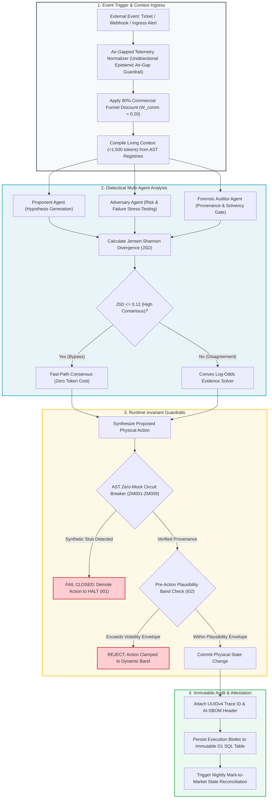

# Final Capstone Project: End-to-End Autonomous Agent Assembly & Governance

## 🎯 The Capstone Synthesis: Assembling the Autonomous Agent

The Final Capstone Project represents the complete operational synthesis of the **Context Factory**. In this capstone, engineering teams transition from studying isolated role-based handoffs to assembling, testing, and deploying a production-ready autonomous software engineering agent.

An autonomous agent is not an open-ended conversational chatbot. An enterprise autonomous agent is an **Audited, Stateful Software Pipeline** governed by explicit constraints, deterministic tool registries, and physical invariant guardrails.

```
┌──────────────────────────────────────────────────────────────────────────────────────────────────┐
│                      THE 7-LAYER ENTERPRISE AGENT ARCHITECTURE                                    │
├──────────────────────────────────────────────────────────────────────────────────────────────────┤
│                                                                                                  │
│   LAYER 1: IDENTITY & MISSION (COGNITIVE SOUL)                                                   │
│   • Authored by Strategy Lead (Epic Strategic Blueprint & Value Thesis).                         │
│   • Defines deterministic operational purpose, bounded goals, and anti-bias invariants.          │
│                                                                                                  │
│   LAYER 2: REQUIREMENTS & LOGIC CONSTRAINTS                                                      │
│   • Authored by Requirements Lead (3-Part Directives & 20-Row Edge-Case Matrices).               │
│   • Enforces explicit input boundaries, closed-world fallbacks, and data minimization.           │
│                                                                                                  │
│   LAYER 3: AST STRUCTURAL MEMORY (LIVING CONTEXT)                                                │
│   • Authored by Software Architects (AST State & Mathematical Registries).                       │
│   • Deterministic Living Context (<1,500 tokens) with zero vector drift and zero hallucination.  │
│                                                                                                  │
│   LAYER 4: TOOLS & OPERATIONAL ACTUATORS (THE HANDS)                                             │
│   • Authored by Software Builders (Function Registry / OpenAPI 3.1 & Model Context Protocol).    │
│   • Strongly-typed tool interfaces with strict schema validation on all argument payloads.       │
│                                                                                                  │
│   LAYER 5: ADVERSARIAL BOUNDS & ZERO-MOCK GATING (THE SENTRY)                                    │
│   • Authored by Validation Leads & QEs (Rules ZM001–ZM009 & Socket Isolation).                   │
│   • Eliminates synthetic fallbacks, unanchored mocks, and deceptive boolean smuggling.           │
│                                                                                                  │
│   LAYER 6: PHYSICAL EXECUTION CLAMPS (THE GUARDIAN)                                              │
│   • Authored by Security Officers (Invariants I01-I22 & Pre-Action Plausibility Bands).          │
│   • Intercepts every proposed action with mathematical clamps (|V_exec - Baseline| <= Band).     │
│                                                                                                  │
│   LAYER 7: AUDIT CUSTODY & ATTESTATION (THE CUSTODIAN)                                           │
│   • Authored by BuilderOps & Release Engineers (Machine-Readable SPDX 3.0 AI-SBOM Headers).      │
│   • Embeds immutable UUIDv4 traces, git commit digests, and zero-temperature audit records.      │
│                                                                                                  │
└──────────────────────────────────────────────────────────────────────────────────────────────────┘
```

---

## 🏛️ The Complete Cross-Functional Assembly Matrix

Building an enterprise autonomous agent is an assembly line where each role contributes an essential layer to the agent configuration:

| Layer | Agent Subsystem | Responsible Role | Context Factory Deliverable | Governing Invariant |
| :--- | :--- | :--- | :--- | :--- |
| **Layer 1** | **Identity & Mission** | Strategy Lead | Epic Strategic Blueprint & Value Thesis | Article VI (Fairness & Anti-Bias) |
| **Layer 2** | **Logic & Constraints** | Requirements Lead | 3-Part Directive & 20 Edge-Case Matrix | Article I (Data Minimization / No PII) |
| **Layer 3** | **AST Context Memory** | Software Architect | Living Context JSON (<1,500 tokens) | Invariant $I_{22}$ (Zero-Drift Registry Parity) |
| **Layer 4** | **Actuation Tools** | Software Builder | Function Registry (OpenAPI / MCP Tools) | Architectural Modularity Ceiling (<= 400 LOC) |
| **Layer 5** | **Adversarial Bounds** | Validation Lead (QE) | Programmatic AST Zero-Mock Rules (ZM001–ZM009) | Invariant $I_{01}$ (Zero-Simulated-Data) |
| **Layer 6** | **Execution Clamps** | Security Auditor | Pre-Action Plausibility Bands ($\lvert V - B \rvert \le \Delta$) | Invariant $I_{02}$ (Execution Plausibility Band) |
| **Layer 7** | **Audit Custody** | BuilderOps Engineer | CI Zero-Drift Workflow & AI-SBOM Header | Invariant $I_{15}$ (UUID Cryptographic Trace) |

---

## 🔄 End-to-End Agent Execution & Gating Lifecycle

The diagram below illustrates the exact execution lifecycle of an assembled enterprise autonomous agent:



---

## 🌐 The Dual-Track Capstone Specifications

Students and engineering teams select one of two production capstone implementation tracks:

### Track A: Healthcare / FDA-Regulated SaMD (Closed-Loop Clinical Titration Agent)
* **Operational Goal**: Build an autonomous clinical decision-support agent that monitors patient continuous glucose monitoring (CGM) telemetry and recommends automated insulin bolus titration adjustments.
* **Governing Regulatory Standards**: FDA 21 CFR Part 820.30 (Design Controls), 21 CFR Part 11 (Electronic Records), and ISO 13485:2016.
* **Non-Negotiable Guardrails**:
  1. **Invariant $I_{01}$ (Zero-Simulated-Data)**: If glucose sensor reports stale or non-finite readings (`NaN`/`Inf`), the agent must immediately fail closed, emit zero dosage recommendations, and trip an audible bedside nurse alarm.
  2. **Invariant $I_{02}$ (Plausibility Envelope)**: Proposed insulin bolus is mechanically clamped by the physiological envelope:
     $$|\text{Dose}_{\text{proposed}} - \text{Basal}_{\text{baseline}}| \le \min(2.5 \cdot \text{IOB}_{\text{decayed}}, \; 0.15 \cdot \text{DailyDose})$$
  3. **Invariant $I_{04}$ (Immutable Quarantine)**: Corrupted sensor packets are migrated to `clinical_telemetry_quarantine`; hard deletes are permanently forbidden.

---

### Track B: Mission-Critical Financial Transaction & Payment Router
* **Operational Goal**: Build an autonomous algorithmic liquidity and wire routing agent that allocates high-value capital transfers across correspondent banking gateways.
* **Governing Regulatory Standards**: Federal Reserve SR 11-7 (Model Risk Management), SOX Section 404, and SEC Rule 17a-4.
* **Non-Negotiable Guardrails**:
  1. **Invariant $I_{01}$ (Zero-Simulated-Data)**: If foreign exchange rates or counterparty solvency metrics are unverified, transactions fail closed with zero synthetic estimation.
  2. **Invariant $I_{02}$ (Pre-Action Plausibility Band)**: Transaction settlement amounts exceeding historical account kinematics ($|T - \mu| > 3.5\sigma$) are diverted to cryptographic dual-custody hold.
  3. **Invariant $I_{09}$ (Compensatory Confluence)**: Wire routing requires positive agreement across $\ge 2$ orthogonal validation pillars (velocity, biometrics, counterparty risk, liquidity depth).
  4. **Invariant $I_{15}$ (Audit Lineage)**: Every routing decision generates an AI-SBOM header with exact model digest, temperature 0.0, and UUIDv4 audit trace.

---

## 🏁 Capstone Evaluation & Certification Criteria

To achieve formal capstone certification, the submitted agent repository must satisfy four rigorous verification gates:

1. **Compilation & Hermetic Test Suite**: All unit, invariant, and integration tests must pass under 100% offline network isolation (`pytest tests/ --disable-socket`).
2. **AST Zero-Mock Static Analysis**: The codebase must pass the automated AST scanner (`scripts/scan_mock_data.py`) with zero violations of rules ZM001 through ZM009.
3. **Adversarial Red-Team Stress Test**: The agent must successfully detect and reject adversarial prompt injection attempts, boolean smuggling attacks, and non-finite float inputs.
4. **Zero-Drift CI Parity**: The repository must demonstrate 100% byte parity across `STATE_REGISTRY.md`, `MATHEMATICAL_REGISTRY.md`, and `living_context.json`.

---

[**Proceed to Capstone Hands-On Lab Workbook →**](./LAB_WORKBOOK.md) | [**Return to Root Curriculum Overview →**](../README.md)
