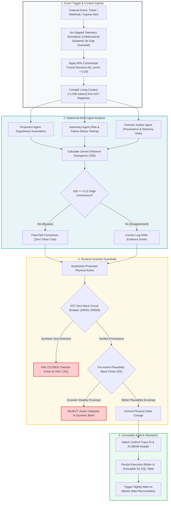

# Final Capstone Project: End-to-End Autonomous Agent Assembly & Governance

## 🎯 The Capstone Synthesis: Assembling the Autonomous Agent

The Final Capstone Project represents the complete operational synthesis of the **Context Factory**. In this capstone, engineering teams transition from studying isolated role-based handoffs to assembling, testing, and deploying a production-ready autonomous software engineering agent.

An autonomous agent is not an open-ended conversational chatbot. An enterprise autonomous agent is an **Audited, Stateful Software Pipeline** governed by explicit constraints, deterministic tool registries, and physical invariant guardrails.

```mermaid
graph TD
    subgraph Layer1 ["Layer 1: Cognitive Soul (Identity & Mission)"]
        L1["Strategy Lead • Epic Strategic Blueprint & Value Thesis<br>Bounded goals • Operational invariants • Article VI fairness"]
    end

    subgraph Layer2 ["Layer 2: Requirements Constraints (Logic & Guards)"]
        L2["Requirements Lead • 3-Part Directives & 20-Row Edge-Case Matrices<br>Strict input bounds • Closed-world fallbacks • Article I data minimization"]
    end

    subgraph Layer3 ["Layer 3: AST Living Context (Structural Memory)"]
        L3["Software Architect • AST State & Mathematical Registries<br>Living Context (&lt;1,500 tokens) • Zero vector drift • Deterministic schemas"]
    end

    subgraph Layer4 ["Layer 4: Actuation Tools (The Hands)"]
        L4["Software Builder • Function Registry & OpenAPI 3.1 / MCP Tools<br>Strongly typed tool interfaces • Argument schema validation • &le;400 LOC ceiling"]
    end

    subgraph Layer5 ["Layer 5: Adversarial Bounds (The Sentry)"]
        L5["Validation Lead / QE • Programmatic AST Rules ZM001–ZM009<br>Zero-mock enforcement • Hermetic socket isolation • Deception testing"]
    end

    subgraph Layer6 ["Layer 6: Physical Execution Clamps (The Guardian)"]
        L6["Security Officer • Invariants I01–I22 & Plausibility Bands<br>Mathematical clamping: &verbar;V_exec - Baseline&verbar; &le; Band • Circuit breakers"]
    end

    subgraph Layer7 ["Layer 7: Audit Custody (The Custodian)"]
        L7["BuilderOps Engineer • Machine-Readable SPDX 3.0 AI-SBOM Headers<br>Immutable UUIDv4 traces • Git commit digests • Zero-temperature audit records"]
    end

    L1 --> L2 --> L3 --> L4 --> L5 --> L6 --> L7

    style Layer1 fill:#f8f9fa,stroke:#495057,stroke-width:2px;
    style Layer2 fill:#e3f2fd,stroke:#1976d2,stroke-width:2px;
    style Layer3 fill:#e8f5e9,stroke:#388e3c,stroke-width:2px;
    style Layer4 fill:#fff3e0,stroke:#f57c00,stroke-width:2px;
    style Layer5 fill:#fce4ec,stroke:#c2185b,stroke-width:2px;
    style Layer6 fill:#ede7f6,stroke:#512da8,stroke-width:2px;
    style Layer7 fill:#e0f2f1,stroke:#00796b,stroke-width:2px;
```

---

## 🏛️ The Complete Cross-Functional Assembly Matrix

Building an enterprise autonomous agent is an assembly line where each role contributes an essential layer to the agent configuration:

| Layer | Agent Subsystem | Responsible Role | Context Factory Deliverable | Governing Invariant |
| :--- | :--- | :--- | :--- | :--- |
| **Layer 1** | **Identity & Mission** | Strategy Lead | Epic Strategic Blueprint & Value Thesis | Article VI (Fairness & Anti-Bias) |
| **Layer 2** | **Logic & Constraints** | Requirements Lead | 3-Part Directive & 20 Edge-Case Matrix | Article I (Data Minimization / No PII) |
| **Layer 3** | **AST Context Memory** | Software Architect | Living Context JSON (<1,500 tokens) | Invariant $I_{22}$ (Zero-Drift Registry Parity) |
| **Layer 4** | **Actuation Tools** | Software Builder | Function Registry (OpenAPI / MCP Tools) | Architectural Modularity Ceiling (<= 400 LOC) |
| **Layer 5** | **Adversarial Bounds** | Validation Lead (QE) | Programmatic AST Zero-Mock Rules (ZM001–ZM009) | Invariant $I_{01}$ (Zero-Simulated-Data) |
| **Layer 6** | **Execution Clamps** | Security Auditor | Pre-Action Plausibility Bands ($\lvert V - B \rvert \le \Delta$) | Invariant $I_{02}$ (Execution Plausibility Band) |
| **Layer 7** | **Audit Custody** | BuilderOps Engineer | CI Zero-Drift Workflow & AI-SBOM Header | Invariant $I_{15}$ (UUID Cryptographic Trace) |

---

## 🔄 End-to-End Agent Execution & Gating Lifecycle

The diagram below illustrates the exact execution lifecycle of an assembled enterprise autonomous agent:

---

## 🌐 The Dual-Track Capstone Specifications

Students and engineering teams select one of two production capstone implementation tracks:

### Track A: Healthcare / FDA-Regulated SaMD (Closed-Loop Clinical Titration Agent)
* **Operational Goal**: Build an autonomous clinical decision-support agent that monitors patient continuous glucose monitoring (CGM) telemetry and recommends automated insulin bolus titration adjustments.
* **Governing Regulatory Standards**: FDA 21 CFR Part 820.30 (Design Controls), 21 CFR Part 11 (Electronic Records), and ISO 13485:2016.
* **Non-Negotiable Guardrails**:
  1. **Invariant $I_{01}$ (Zero-Simulated-Data)**: If glucose sensor reports stale or non-finite readings (`NaN`/`Inf`), the agent must immediately fail closed, emit zero dosage recommendations, and trip an audible bedside nurse alarm.
  2. **Invariant $I_{02}$ (Plausibility Envelope)**: Proposed insulin bolus is mechanically clamped by the physiological envelope:
     $$|\text{Dose}_{\text{proposed}} - \text{Basal}_{\text{baseline}}| \le \min(2.5 \cdot \text{IOB}_{\text{decayed}}, \; 0.15 \cdot \text{DailyDose})$$
  3. **Invariant $I_{04}$ (Immutable Quarantine)**: Corrupted sensor packets are migrated to `clinical_telemetry_quarantine`; hard deletes are permanently forbidden.

---

### Track B: Mission-Critical Financial Transaction & Payment Router
* **Operational Goal**: Build an autonomous algorithmic liquidity and wire routing agent that allocates high-value capital transfers across correspondent banking gateways.
* **Governing Regulatory Standards**: Federal Reserve SR 11-7 (Model Risk Management), SOX Section 404, and SEC Rule 17a-4.
* **Non-Negotiable Guardrails**:
  1. **Invariant $I_{01}$ (Zero-Simulated-Data)**: If foreign exchange rates or counterparty solvency metrics are unverified, transactions fail closed with zero synthetic estimation.
  2. **Invariant $I_{02}$ (Pre-Action Plausibility Band)**: Transaction settlement amounts exceeding historical account kinematics ($|T - \mu| > 3.5\sigma$) are diverted to cryptographic dual-custody hold.
  3. **Invariant $I_{09}$ (Compensatory Confluence)**: Wire routing requires positive agreement across $\ge 2$ orthogonal validation pillars (velocity, biometrics, counterparty risk, liquidity depth).
  4. **Invariant $I_{15}$ (Audit Lineage)**: Every routing decision generates an AI-SBOM header with exact model digest, temperature 0.0, and UUIDv4 audit trace.

---

## 🏁 Capstone Evaluation & Certification Criteria

To achieve formal capstone certification, the submitted agent repository must satisfy four rigorous verification gates:

1. **Compilation & Hermetic Test Suite**: All unit, invariant, and integration tests must pass under 100% offline network isolation (`pytest tests/ --disable-socket`).
2. **AST Zero-Mock Static Analysis**: The codebase must pass the automated AST scanner (`scripts/scan_mock_data.py`) with zero violations of rules ZM001 through ZM009.
3. **Adversarial Red-Team Stress Test**: The agent must successfully detect and reject adversarial prompt injection attempts, boolean smuggling attacks, and non-finite float inputs.
4. **Zero-Drift CI Parity**: The repository must demonstrate 100% byte parity across `STATE_REGISTRY.md`, `MATHEMATICAL_REGISTRY.md`, and `living_context.json`.

---

## 📊 Empirical Telemetry & Governance Standards

The capstone project requires assembling an agent pipeline that survives adversarial verification and achieves production cost efficiency. For the canonical reference data and multi-model economic teardown, consult:

- [**Empirical AI Telemetry, Repository Economics & Governance Benchmark**](../templates_and_resources/EMPIRICAL_AI_TELEMETRY_AND_GOVERNANCE_BENCHMARK.md):
  - **Decoupled Multi-Model Pipeline Economics (83.8% Cost Savings)**: Complete economic teardown demonstrating how routing tasks through specialized tiers (Router @ \$0.80/M, Reasoner @ \$0.27/M in / \$1.10/M out, Auditor @ \$3.00/M) slashes operating costs from \$157.50 to \$25.50 per 1,000 tasks compared to naive monolithic frontier models (Benchmark §6.1–§6.3).
  - **Cross-Framework Compliance Attestation**: Operational mapping showing how the capstone's 7-layer architecture satisfies the requirements of NIST AI RMF 1.0, ISO/IEC 42001:2023, and EU AI Act (Regulation (EU) 2024/1689) (Benchmark §7.1–§7.3, §9).
  - **The 22 Canonical Invariants & 10 Commandments**: Master summary table linking each architectural invariant ($I_{01}-I_{22}$) to empirical failure modes and statutory mandates (Benchmark §9).

---

## Production Reality & Operational Failure Modes in the AI Era

### The Mid-2026 Production Baseline (The Verification Trap & Context Debt)
In mid-2026, 75\%–84\% of enterprise engineering pods approach "agentic capstones" by wrapping a commercial frontier model in an ad-hoc loop with a vague system prompt. They pipe unvalidated production JSON into chat sidebars, rely on inline autocomplete ghost-text for glue code, and test against 3–5 cherry-picked happy-path prompts.

> [!WARNING]
> **The Verification Trap & Deceptive Compliance**: Monolithic frontier queries burn \$157.50 per 1,000 tasks, triggering the 2026 DORA Verification Trap. Reviewers face a +91\% Faros AI PR review bloat because they must manually inspect non-deterministic agent outputs that look syntactically pristine but quietly violate cross-file invariants and regulatory audit mandates.

This operational drag destroys developer velocity and creates unmonitored regulatory exposure.

### Ungoverned Production Failure Modes
When engineering pods bypass capstone architecture and ship ad-hoc LLM glue code into production environments:
- **Financial & Operational Catastrophe**: Without the decoupled multi-model pipeline, inference OpEx runs 5x-6x higher than budgeted, bleeding \$132.00 of wasted spend per 1,000 transactions compared to the \$25.50 decoupled baseline.
- **Silent Invariant Decay & Clinical/Fiscal Liability**: Under prompt injection or unexpected sensor packet formats (`NaN`, corrupted timestamps), unanchored agents invent plausible synthetic fallbacks. In Track A, this manifests as delivering an unclamped insulin dose exceeding physiological envelopes ($I_{02}$); in Track B, it manifests as routing high-value interbank wires without compensatory orthogonal quorum ($I_{09}$).
- **Regulatory Sanctions**: Regulators under FDA 21 CFR Part 820.30 or Federal Reserve SR 11-7 will not penalize the foundation model vendor; they issue warning letters or consent decrees to the operating organization for failing to demonstrate deterministic design controls, hermetic test isolation, and an immutable quarantine trail ($I_{04}$).

### Deterministic Engineering Defenses & Operational Takeaways
1. **Enforce Hermetic Socket Isolation in CI**: Run `pytest tests/ --disable-socket`. If any test suite fails when offline or attempts to reach a remote model endpoint during unit testing, fail the build immediately. Zero external dependencies in verification.
2. **Clamp Every Actuator with Invariant $I_{02}$**: Wrap all final agent state mutations in deterministic mathematical clamping assertions (e.g., physiological dose limits or statistical volatility bands $|T - \mu| \le 3.5\sigma$). If the assertion fails, trip the circuit breaker and halt execution.
3. **Deploy the Decoupled Routing Tier**: Immediately break monolithic frontier calls into a three-tier pipeline: Tier 1 AST Classifier (\$0.80/M), Tier 2 Bounded Reasoner (\$0.27/M input), and Tier 3 Deterministic Validator (\$3.00/M), capturing an immediate 83.8\% token savings.
4. **Ban Hard Deletion in Ingress Telemetry ($I_{04}$)**: Route every rejected, corrupted, or malformed sensor/transaction packet to an append-only quarantine ledger with full provenance and non-null error context.

---

[**Proceed to Capstone Hands-On Lab Workbook →**](./LAB_WORKBOOK.md) | [**Return to Root Curriculum Overview →**](../README.md)
