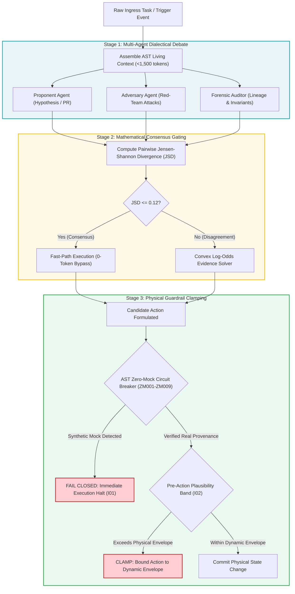

# Module 2: The Assembly Mechanism & Dialectical Multi-Agent Consensus

---

## 🎯 Executive Overview & The Problem of Single-Model Fragility

When an enterprise relies on a single autonomous agent to write, evaluate, and commit code, the system is vulnerable to **epistemic sycophancy**: modern frontier models (Moonshot Kimi K3, DeepSeek V4 Pro, Claude 3.5 Sonnet, GPT-5) tend to validate their own flawed assumptions, hallucinate synthetic justifications, and smuggle boolean bypasses into unit tests.

To eliminate single-point epistemic failure, the Context Factory employs the **Dialectical Adversarial Triad**: three specialized autonomous sub-agents with opposing objective functions that rigorously debate every proposed state change before it reaches physical systems.

```
┌──────────────────────────────────────────────────────────────────────────────────────────────────┐
│                      THE 3-STAGE DIALECTICAL ADVERSARIAL TRIAD                                   │
├────────────────────┬───────────────────────────────────┬─────────────────────────────────────────┤
│ Agent Persona      │ Objective Function                │ Core Heuristic                          │
├────────────────────┼───────────────────────────────────┼─────────────────────────────────────────┤
│ 1. The Proponent   │ Maximize feature throughput & ROI │ Proposes candidate action/code delta.   │
│ 2. The Adversary   │ Maximize failure mode exposure    │ Attacks edge cases, stress-tests bounds.│
│ 3. Forensic Auditor│ Maximize invariant compliance     │ Verifies data provenance & regulations. │
└────────────────────┴───────────────────────────────────┴─────────────────────────────────────────┘
```

---

## 📐 The Mathematics of Consensus: Level-2 Zero-Compute JSD Bypass

Running a multi-agent debate on every trivial task would introduce crippling token costs and execution latency. The orchestrator solves this using **Jensen-Shannon Divergence (JSD)** gating (Lin, 1991):

$$D_{\text{JS}}(P \parallel Q) = \frac{1}{2} D_{\text{KL}}(P \parallel M) + \frac{1}{2} D_{\text{KL}}(Q \parallel M)$$

Where $M = \frac{1}{2}(P + Q)$, and $D_{\text{KL}}$ is the Kullback-Leibler divergence evaluated with base-2 logarithm:

$$D_{\text{KL}}(P \parallel M) = \sum_{x} P(x) \log_2 \left( \frac{P(x)}{M(x)} \right)$$

Evaluating $D_{\text{KL}}$ with base-2 logarithm bounds $\text{JSD} \in [0.0, 1.0]$, and the square root $\sqrt{\text{JSD}}$ is a mathematically proven metric satisfying the triangle inequality (Lin, 1991).

### 1. Level-2 Fast-Path Consensus Bypass ($\text{JSD} \le 0.12$)
If the Proponent and Adversary probability distributions over candidate decisions exhibit high mutual agreement:
$$\text{JSD}(P_{\text{prop}} \parallel P_{\text{adv}}) \le 0.12$$
The orchestration engine bypasses multi-agent arbitration entirely, committing the consensus recommendation at **zero additional token cost**.

### 2. Full Arbitration via Closed-Form Log-Odds Fusion ($\text{JSD} > 0.12$)
If the models diverge ($\text{JSD} > 0.12$), the task trips an active dispute. The Forensic Auditor activates the **Closed-Form Convex Log-Odds Evidence Fusion Engine**:

$$l_{\text{fused}} = l_{\text{deterministic}} + (\text{entropy-discount} \times l_{\text{triad}}), \quad \text{entropy-discount} = \max(0.15, \; 1.0 - \lambda \cdot \mathrm{JSD})$$

Where:
*   $l_{\text{triad}} = \sum_{k=1}^K w_k \cdot \mathrm{logit}(P_k)$ represents the weighted log-odds evidence submitted by the dialectical triad agents with $\sum w_k = 1.0$ (Auditor = 0.50, Adversary = 0.30, Proponent = 0.20).
*   $l_{\text{deterministic}} = \mathrm{logit}(P_{\text{det}})$ represents baseline evidence from deterministic invariant checks.
*   $\lambda = 1.0$ is the entropy dampening sensitivity. When agents diverge significantly, the entropy discount clamps down to a minimum floor of $0.15$, preventing runaway epistemic drift.
*   The final fused probability is decoded via the logistic sigmoid: $P_{\text{fused}} = \sigma(l_{\text{fused}}) = \frac{1}{1 + e^{-l_{\text{fused}}}}$.

---

## 🔄 The Dialectical Consensus & Invariant Gating Pipeline



---

## 💻 Production Implementation: Dialectical Consensus Arbiter

Below is the verified Python consensus engine running in production orchestration pipelines:

```python
"""
dialectical_arbiter.py: Multi-Agent Consensus Arbiter
Computes JSD divergence and applies convex log-odds solving for agent debates.
"""
import numpy as np

def compute_jsd(p: np.ndarray, q: np.ndarray) -> float:
    """Computes Jensen-Shannon Divergence bounded in [0, 1]."""
    # Ensure numerical stability
    eps = 1e-12
    p = np.clip(p, eps, 1.0)
    q = np.clip(q, eps, 1.0)
    p = p / np.sum(p)
    q = q / np.sum(q)
    
    m = 0.5 * (p + q)
    kl_pm = np.sum(p * np.log2(p / m))
    kl_qm = np.sum(q * np.log2(q / m))
    return float(0.5 * (kl_pm + kl_qm))

def solve_convex_consensus(
    proponent_probs: list[float],
    adversary_probs: list[float],
    auditor_probs: list[float],
    weights: tuple[float, float, float] = (0.20, 0.30, 0.50),
    jsd_threshold: float = 0.12
) -> dict:
    """
    Evaluates multi-agent consensus. Bypasses arbitration if JSD <= 0.12.
    Otherwise solves weighted log-odds consensus.
    """
    p_prop = np.array(proponent_probs, dtype=float)
    p_adv = np.array(adversary_probs, dtype=float)
    p_aud = np.array(auditor_probs, dtype=float)

    # 1. Evaluate JSD between Proponent and Adversary
    jsd_val = compute_jsd(p_prop, p_adv)

    if jsd_val <= jsd_threshold:
        # Fast-Path Consensus Bypass
        consensus_dist = 0.5 * (p_prop + p_adv)
        return {
            "status": "FAST_PATH_CONSENSUS_BYPASS",
            "jsd_divergence": round(jsd_val, 4),
            "token_cost_arbitration": 0,
            "final_probabilities": consensus_dist.tolist()
        }

    # 2. Divergence detected: Solve weighted log-odds
    w_prop, w_adv, w_aud = weights
    
    # Convert probabilities to log-odds
    eps = 1e-6
    clamped_prop = np.clip(p_prop, eps, 1.0 - eps)
    clamped_adv = np.clip(p_adv, eps, 1.0 - eps)
    clamped_aud = np.clip(p_aud, eps, 1.0 - eps)
    
    lo_prop = np.log(clamped_prop / (1.0 - clamped_prop))
    lo_adv = np.log(clamped_adv / (1.0 - clamped_adv))
    lo_aud = np.log(clamped_aud / (1.0 - clamped_aud))
    
    weighted_log_odds = (w_prop * lo_prop) + (w_adv * lo_adv) + (w_aud * lo_aud)
    
    # Map back to probability via sigmoid
    fused_probs = 1.0 / (1.0 + np.exp(-weighted_log_odds))
    fused_probs = fused_probs / np.sum(fused_probs)

    return {
        "status": "ARBITRATED_CONVEX_CONSENSUS",
        "jsd_divergence": round(jsd_val, 4),
        "token_cost_arbitration": 1250,
        "final_probabilities": fused_probs.tolist()
    }

if __name__ == "__main__":
    # Case 1: High Consensus (Proponent and Adversary agree on Action A)
    res_agree = solve_convex_consensus([0.85, 0.15], [0.82, 0.18], [0.88, 0.12])
    print("Consensus Agreement Case:", res_agree)

    # Case 2: Divergence (Proponent wants Action A, Adversary predicts Failure)
    res_disagree = solve_convex_consensus([0.90, 0.10], [0.15, 0.85], [0.55, 0.45])
    print("Divergence Dispute Case:", res_disagree)
```

---

## 🏥 Dual-Use Regulated Industry Case Studies

```
┌──────────────────────────────────────────────────────────────────────────────────────────────────┐
│                   DIALECTICAL MULTI-AGENT CONSENSUS CASE STUDIES                                 │
├──────────────────────────────────────────────────────────────────────────────────────────────────┤
│                                                                                                  │
│   HEALTHCARE: FDA Class III Closed-Loop Titration Dialectic                                      │
│   • Proponent: Proposes +1.5 Unit insulin bolus based on rapid meal intake telemetry.            │
│   • Adversary: Identifies declining physical activity telemetry and predicts hypoglycemia.       │
│   • Divergence: JSD = 0.38 (> 0.12). Triggers full log-odds arbitration.                         │
│   • Forensic Auditor: Enforces Invariant I02 (Physiological Clamp) and limits bolus to +0.4 Units│
│   • Outcome: Patient protected from severe hypoglycemic shock; decision logged to tamper-evident audit trail in compliance with 21 CFR Part 11.│
│                                                                                                  │
│   FINANCE: Core Banking High-Frequency Settlement Dialectic                                      │
│   • Proponent: Recommends routing \$15,000,000 wire through Gateway B for lower transaction fee. │
│   • Adversary: Flags sudden volatility spike in counterparty credit default swap (CDS) spreads.  │
│   • Divergence: JSD = 0.42 (> 0.12). Triggers full log-odds arbitration.                         │
│   • Forensic Auditor: Weighted log-odds fuses CDS spread and solvency, routing through Fedwire.  │
│   • Outcome: Bank avoids counterparty freeze during sudden liquidity dislocation.                │
│                                                                                                  │
└──────────────────────────────────────────────────────────────────────────────────────────────────┘
```

---

## 📋 Module Summary & Practical Next Step

The Dialectical Multi-Agent Triad eliminates single-model sycophancy while preserving token efficiency through Level-2 JSD gating. In the next module, you will learn how to red-team and penetration test agent configurations before deployment.

[**Proceed to Module 3: Testing & Red-Teaming the Agent Configuration →**](./03_testing_the_agent_config.md)
