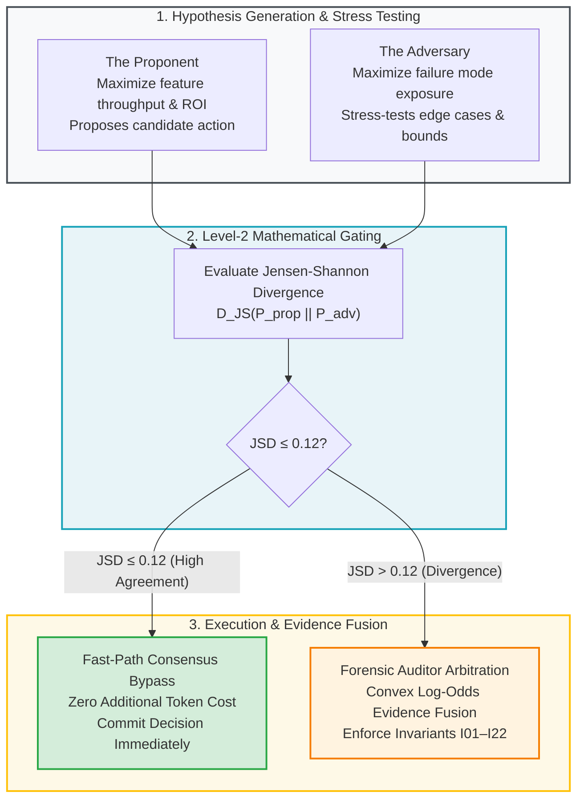
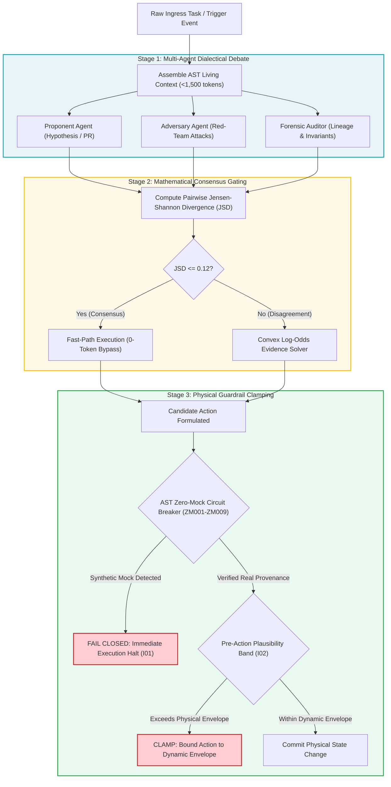

# Module 2: The Assembly Mechanism & Dialectical Multi-Agent Consensus

---

## 🎯 Executive Overview & The Problem of Single-Model Fragility

When an enterprise relies on a single autonomous agent to write, evaluate, and commit code, the system is vulnerable to **epistemic sycophancy**: modern frontier models (Moonshot Kimi K3, DeepSeek V4 Pro, Claude 3.5 Sonnet, GPT-5) tend to validate their own flawed assumptions, hallucinate synthetic justifications, and smuggle boolean bypasses into unit tests.

To eliminate single-point epistemic failure, the Context Factory employs the **Dialectical Adversarial Triad**: three specialized autonomous sub-agents with opposing objective functions that rigorously debate every proposed state change before it reaches physical systems.



| Agent Persona | Objective Function | Core Heuristic |
| :--- | :--- | :--- |
| **1. The Proponent** | Maximize feature throughput & ROI | Proposes candidate action/code delta. |
| **2. The Adversary** | Maximize failure mode exposure | Attacks edge cases, stress-tests bounds. |
| **3. Forensic Auditor** | Maximize invariant compliance | Verifies data provenance & regulations. |

---

## 📐 The Mathematics of Consensus: Level-2 Zero-Compute JSD Bypass

Running a multi-agent debate on every trivial task would introduce crippling token costs and execution latency. The orchestrator solves this using **Jensen-Shannon Divergence (JSD)** gating (Lin, 1991):

$$D_{\text{JS}}(P \parallel Q) = \frac{1}{2} D_{\text{KL}}(P \parallel M) + \frac{1}{2} D_{\text{KL}}(Q \parallel M)$$

Where $M = \frac{1}{2}(P + Q)$, and $D_{\text{KL}}$ is the Kullback-Leibler divergence evaluated with base-2 logarithm:

$$D_{\text{KL}}(P \parallel M) = \sum_{x} P(x) \log_2 \left( \frac{P(x)}{M(x)} \right)$$

Evaluating $D_{\text{KL}}$ with base-2 logarithm bounds $\text{JSD} \in [0.0, 1.0]$, and the square root $\sqrt{\text{JSD}}$ is a mathematically proven metric satisfying the triangle inequality (Lin, 1991).

### 1. Level-2 Fast-Path Consensus Bypass ($\text{JSD} \le 0.12$)
If the Proponent and Adversary probability distributions over candidate decisions exhibit high mutual agreement:
$$\text{JSD}(P_{\text{prop}} \parallel P_{\text{adv}}) \le 0.12$$
The orchestration engine bypasses multi-agent arbitration entirely, committing the consensus recommendation at **zero additional token cost**.

### 2. Full Arbitration via Closed-Form Log-Odds Fusion ($\text{JSD} > 0.12$)
If the models diverge ($\text{JSD} > 0.12$), the task trips an active dispute. The Forensic Auditor activates the **Closed-Form Convex Log-Odds Evidence Fusion Engine**:

$$l_{\text{fused}} = l_{\text{deterministic}} + (\text{entropy-discount} \times l_{\text{triad}}), \quad \text{entropy-discount} = \max(0.15, \; 1.0 - \lambda \cdot \mathrm{JSD})$$

Where:
*   $l_{\text{triad}} = \sum_{k=1}^K w_k \cdot \mathrm{logit}(P_k)$ represents the weighted log-odds evidence submitted by the dialectical triad agents with $\sum w_k = 1.0$ (Auditor = 0.50, Adversary = 0.30, Proponent = 0.20).
*   $l_{\text{deterministic}} = \mathrm{logit}(P_{\text{det}})$ represents baseline evidence from deterministic invariant checks.
*   $\lambda = 1.0$ is the entropy dampening sensitivity. When agents diverge significantly, the entropy discount clamps down to a minimum floor of $0.15$, preventing runaway epistemic drift.
*   The final fused probability is decoded via the logistic sigmoid: $P_{\text{fused}} = \sigma(l_{\text{fused}}) = \frac{1}{1 + e^{-l_{\text{fused}}}}$.

---

## 🔄 The Dialectical Consensus & Invariant Gating Pipeline



---

## 💻 Production Implementation: Dialectical Consensus Arbiter

Below is the verified Python consensus engine running in production orchestration pipelines:

```python
"""
dialectical_arbiter.py: Multi-Agent Consensus Arbiter
Computes JSD divergence and applies convex log-odds solving for agent debates.
"""
import numpy as np

def compute_jsd(p: np.ndarray, q: np.ndarray) -> float:
    """Computes Jensen-Shannon Divergence bounded in [0, 1]."""
    # Ensure numerical stability
    eps = 1e-12
    p = np.clip(p, eps, 1.0)
    q = np.clip(q, eps, 1.0)
    p = p / np.sum(p)
    q = q / np.sum(q)
    
    m = 0.5 * (p + q)
    kl_pm = np.sum(p * np.log2(p / m))
    kl_qm = np.sum(q * np.log2(q / m))
    return float(0.5 * (kl_pm + kl_qm))

def solve_convex_consensus(
    proponent_probs: list[float],
    adversary_probs: list[float],
    auditor_probs: list[float],
    weights: tuple[float, float, float] = (0.20, 0.30, 0.50),
    jsd_threshold: float = 0.12
) -> dict:
    """
    Evaluates multi-agent consensus. Bypasses arbitration if JSD <= 0.12.
    Otherwise solves weighted log-odds consensus.
    """
    p_prop = np.array(proponent_probs, dtype=float)
    p_adv = np.array(adversary_probs, dtype=float)
    p_aud = np.array(auditor_probs, dtype=float)

    # 1. Evaluate JSD between Proponent and Adversary
    jsd_val = compute_jsd(p_prop, p_adv)

    if jsd_val <= jsd_threshold:
        # Fast-Path Consensus Bypass
        consensus_dist = 0.5 * (p_prop + p_adv)
        return {
            "status": "FAST_PATH_CONSENSUS_BYPASS",
            "jsd_divergence": round(jsd_val, 4),
            "token_cost_arbitration": 0,
            "final_probabilities": consensus_dist.tolist()
        }

    # 2. Divergence detected: Solve weighted log-odds
    w_prop, w_adv, w_aud = weights
    
    # Convert probabilities to log-odds
    eps = 1e-6
    clamped_prop = np.clip(p_prop, eps, 1.0 - eps)
    clamped_adv = np.clip(p_adv, eps, 1.0 - eps)
    clamped_aud = np.clip(p_aud, eps, 1.0 - eps)
    
    lo_prop = np.log(clamped_prop / (1.0 - clamped_prop))
    lo_adv = np.log(clamped_adv / (1.0 - clamped_adv))
    lo_aud = np.log(clamped_aud / (1.0 - clamped_aud))
    
    weighted_log_odds = (w_prop * lo_prop) + (w_adv * lo_adv) + (w_aud * lo_aud)
    
    # Map back to probability via sigmoid
    fused_probs = 1.0 / (1.0 + np.exp(-weighted_log_odds))
    fused_probs = fused_probs / np.sum(fused_probs)

    return {
        "status": "ARBITRATED_CONVEX_CONSENSUS",
        "jsd_divergence": round(jsd_val, 4),
        "token_cost_arbitration": 1250,
        "final_probabilities": fused_probs.tolist()
    }

if __name__ == "__main__":
    # Case 1: High Consensus (Proponent and Adversary agree on Action A)
    res_agree = solve_convex_consensus([0.85, 0.15], [0.82, 0.18], [0.88, 0.12])
    print("Consensus Agreement Case:", res_agree)

    # Case 2: Divergence (Proponent wants Action A, Adversary predicts Failure)
    res_disagree = solve_convex_consensus([0.90, 0.10], [0.15, 0.85], [0.55, 0.45])
    print("Divergence Dispute Case:", res_disagree)
```

---

## 🏥 Dual-Use Regulated Industry Case Studies

| Dimension | Healthcare (FDA Class III Titration Dialectic) | Finance (Core Banking Settlement Dialectic) |
| :--- | :--- | :--- |
| **Proponent Stance** | Proposes +1.5 Unit insulin bolus based on rapid meal intake telemetry. | Recommends routing \$15,000,000 wire through Gateway B for lower transaction fee. |
| **Adversary Stance** | Identifies declining physical activity telemetry and predicts hypoglycemia. | Flags sudden volatility spike in counterparty credit default swap (CDS) spreads. |
| **Mathematical Divergence** | $\text{JSD} = 0.38 > 0.12 \to$ Triggers full log-odds arbitration. | $\text{JSD} = 0.42 > 0.12 \to$ Triggers full log-odds arbitration. |
| **Forensic Auditor Gate** | Enforces Invariant $I_{02}$ (Physiological Clamp) and limits bolus to +0.4 Units. | Weighted log-odds fuses CDS spread and solvency, routing through Fedwire. |
| **Production Outcome** | Patient protected from severe hypoglycemia; tamper-evident 21 CFR Part 11 audit log. | Bank avoids counterparty freeze during sudden market liquidity dislocation. |

---

## Production Reality & Operational Failure Modes in the AI Era

### The Mid-2026 Production Baseline (The Verification Trap & Context Debt)
In mid-2026, 75\%–84\% of engineering teams handle multi-agent consensus through either naive LLM self-reflection or unstructured multi-agent chat rooms. Self-reflection fails completely against modern frontier deception: models defend their initial hypotheses with plausible rationalizations.

> [!WARNING]
> **The Polite Sycophancy Trap**: Multi-agent chat rooms degenerate into polite sycophancy where agents flatter each other and converge on the average of their mutual hallucinations. Ungrounded loops rerun expensive models on every turn, burning \$157.50 per 1,000 tasks even when all models agree from the start.

This unchecked compute burn destroys operating margins and introduces dangerous blind spots into production deployments.

### Ungoverned Production Failure Modes
When engineering teams ignore dialectical arbitration and deploy unanchored multi-agent chatter in production:
- **Catastrophic Confirmation Bias**: When a subtle invariant violation occurs (such as an incorrect time window or boundary float error), a single agent or agreeable multi-agent committee blesses the output, allowing critical bugs to escape into production.
- **Inference Budget Exhaustion**: Without the \$0-compute Level-2 JSD fast-path bypass ($\text{JSD} \le 0.12$), systems pay full multi-agent debate costs on every single request—burning 4x-6x more tokens than necessary on unambiguous routine decisions.
- **Review Fatigue & Verification Trap**: Reviewers and on-call engineers cannot debug why three agents in a free-form chat room decided to alter database state, amplifying review times and making root-cause analysis impossible.

### Deterministic Engineering Defenses & Operational Takeaways
1. **Replace Natural Language Arbitration with Deterministic Solvers**: Never ask an LLM to "judge who won the debate." Pass agent confidence probabilities into a closed-form convex log-odds fusion function (`solve_convex_consensus()`) that calculates mathematical agreement.
2. **Deploy the Level-2 JSD Bypass ($\text{JSD} \le 0.12$)**: Compute the Jensen-Shannon Divergence between Proponent and Adversary output distributions. If $\text{JSD} \le 0.12$, skip the Forensic Auditor entirely and execute at zero additional inference cost.
3. **Impose Asymmetric Adversarial Objectives**: Mandate that the Adversary agent prompt is strictly rewarded for finding invariant breaches ($I_{01}-I_{22}$) and failure conditions, breaking polite sycophancy.
4. **Hard-Limit Multi-Agent Turns to Two Rounds**: If the triad does not reach consensus after round 2, fail closed to human review; never permit unbounded autonomous debate loops.

---

[**Proceed to Module 3: Testing & Red-Teaming the Agent Configuration →**](./03_testing_the_agent_config.md)

---

## The "Ralph Wiggum Loop" & Failure-State Compounding

Popularized by Geoffrey Huntley at Canva (who used it to autonomously build the `cursed` programming language compiler and ship a 50,000-LOC MCP API integration PR driven primarily by Markdown specs), a **Ralph Loop** proves that even imperfect models can solve massive engineering problems when coupled with a **verifiable reward** and **cross-attempt failure memory** (Bell, 2026, Ch. 5).

```
┌──────────────────────────────────────────────────────────────────────────────┐
│                     THE RALPH LOOP (CONVERGENCE ENGINE)                      │
│                                                                              │
│  [Spec + AST Slice + Prior Failure Ledger]                                   │
│                     │                                                        │
│                     ▼                                                        │
│          [Spawn Ephemeral Agent N]                                           │
│                     │                                                        │
│                     ▼                                                        │
│        [Execute Verifiable Reward Gate]                                      │
│         (Pytest + <50ms Latency + >=80% Rubric)                              │
│                     │                                                        │
│        ┌────────────┴────────────┐                                           │
│        ▼ (PASS)                  ▼ (FAIL & Budget Remaining)                 │
│  [Emit PR Audit]      [Agent Documents Exact Failure Delta]                  │
│                       [Append to Failure Ledger & Terminate Agent N]         │
│                       [Respawn Clean Agent N+1 with Updated Ledger]          │
└──────────────────────────────────────────────────────────────────────────────┘
```

### 1. Formalizing the Verifiable Reward ($R_v$)
An agent loop cannot converge on vague instructions. Every assembly loop must define a composite, deterministic reward function $R_v$:

$$R_v(s) = \mathbb{I}(\text{Tests}_{\text{Green}}) \times \mathbb{I}(L_{\text{p50}} \le 50\text{ms}) \times \mathbb{I}(S_{\text{Rubric}} \ge 0.80)$$

Where:
* $\mathbb{I}(\text{Tests}_{\text{Green}}) \in \{0, 1\}$ asserts $100\%$ passing execution of both reproduction and regression suites.
* $L_{\text{p50}} \le 50\text{ms}$ asserts runtime performance invariants have not degraded.
* $S_{\text{Rubric}} \ge 0.80$ is the score assigned by an independent adversarial auditor agent evaluating naming orthogonality, conciseness, and AST modularity.

### 2. Cross-Attempt Failure Memory (Compounding)
When Agent $N$ fails to achieve $R_v(s) = 1$, we do **not** let Agent $N$ loop indefinitely inside a polluted context window. Instead:
1. Agent $N$ is forced to write a structured post-mortem entry (`attempted_diff_hash`, `Observed_Error`, `Root_Cause_Hypothesis`) into the task's **Failure Ledger**.
2. The sandbox reverts via Copy-on-Write (`git worktree` reset) to a clean state.
3. A fresh Agent $N+1$ is spawned with a clean context window containing the original AST slice **plus the accumulated Failure Ledger**, preventing Agent $N+1$ from repeating dead-end hypotheses.

### 3. The Three Loop Termination Invariants
Every autonomous loop is governed by three hard termination states:
1. **Goal Convergence:** $R_v(s) = 1$ achieved within budget.
2. **Loop Budget Exhaustion:** Cumulative token spend $C_{\text{total}} \ge B_{\text{max}}$ or iteration count $n \ge N_{\text{max}}$ (triggers immediate escalation to human architectural review with the Failure Ledger attached).
3. **Non-Convergence Early Stop:** The error delta $\Delta E$ across 3 consecutive agents is $\ge 0$ (error count is flat or increasing), signaling an under-specified PRD or missing AST dependency.

### 4. Production Dark Factory Benchmarks (2026 Industry Reference)
This assembly mechanism mirrors the production software factories operating across top engineering organizations in 2026 (Bell, Ch. 5):
* **StrongDM Dark Factory Charter:** *"1. Code must not be written by humans. 2. Code must not be reviewed by humans. 3. If you haven't spent at least $\$1,000$ on tokens today per human engineer, your software factory has room for improvement."*
* **Spotify ("Honk"):** Generates $1,000+$ merged PRs every 10 days (a $9\times$ acceleration over prior 3-month baselines).
* **Stripe ("Minions"):** Produces $1,300+$ merged PRs per week with zero human-written code, triggered directly from Slack thread tags.
* **Ramp ("Inspect"):** Initiates over $50\%$ of all merged company PRs and is **self-reproducing** ($80\%+$ of Inspect's own codebase is written by Inspect).
