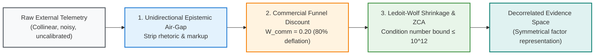
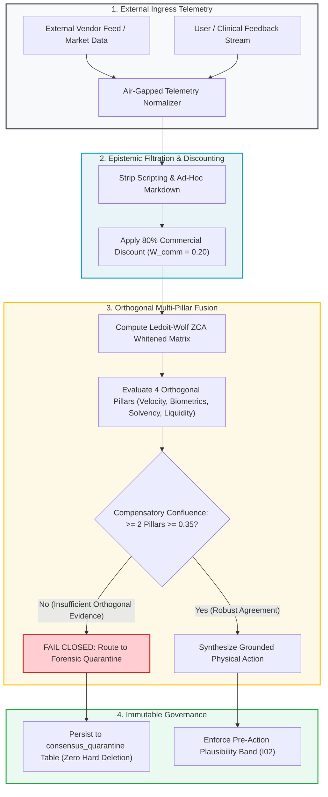

# Module 5: Epistemic Governance & Multi-Pillar Evidence Fusion

---

## 🎯 Executive Overview & The Problem of Epistemic Contamination

Autonomous agents operating in production environments frequently consume external telemetry: market feeds, customer support tickets, vendor API responses, social sentiment, and clinical monitoring streams. 

If raw external telemetry is ingested directly into an agent context window without normalization, the system suffers from **Epistemic Contamination**:
1. **Commercial Hype Inflation**: Uncalibrated vendor announcements or marketing claims distort model reasoning, causing the agent to hallucinate urgency.
2. **Adversarial Prompt Smuggling**: External inputs can embed hidden jailbreak instructions disguised as telemetry payloads.
3. **Multi-Collinearity Delusion**: When three separate data feeds derive from the same underlying source, the agent treats them as independent confirmation, generating false confidence.

Epistemic Governance establishes strict mathematical filters to purify, decouple, and fuse external evidence before an agent can act.



| Governance Pillar | Mathematical Mechanism | Operational Objective |
| :--- | :--- | :--- |
| **1. Epistemic Air-Gap** | Unidirectional Normalizer | Strip promotional prose & sanitize prompt injection vectors. |
| **2. Funnel Discount** | $W_{\text{comm}} = 0.20$ Discount | Deflate commercial vendor claims and unverified metrics by 80%. |
| **3. Evidence Fusion** | Ledoit-Wolf ZCA Whitening | Decorrelate multi-stream sensor inputs with condition bound $\le 10^{12}$. |

---

## 🛡️ The Unidirectional Epistemic Air-Gap Guardrail

Under the **Unidirectional Epistemic Air-Gap Guardrail**, raw external telemetry must never be injected directly into decision-making agent prompts. All external feeds must pass through an air-gapped schema normalizer that:
1. Strips all markdown styling, HTML markup, and executable scripting tags.
2. Discards qualitative promotional rhetoric (*"revolutionary"*, *"breakthrough"*, *"guaranteed"*).
3. Applies an 80% Commercial Funnel Discount ($W_{\text{comm}} = 0.20$) to vendor-reported performance metrics:

$$S_{\text{calibrated}} = S_{\text{raw}} \cdot W_{\text{comm}} = S_{\text{raw}} \cdot 0.20$$

---

## ⚖️ Compensatory Confluence vs. Conjunctive Gate Collapse

A common architectural defect in early AI gating is **Conjunctive Gate Collapse**: requiring an action to satisfy four separate boolean conditions simultaneously ($C_1 \land C_2 \land C_3 \land C_4$).

If each test has an $80\%$ true positive rate, the joint probability of passing collapses exponentially:

$$P_{\text{joint}} = P(C_1) \cdot P(C_2) \cdot P(C_3) \cdot P(C_4) = 0.80^4 = 0.4096 \; (40.96\%)$$

In real-world environments with noise and telemetry drift, the joint pass rate plummets below $1\%$, causing catastrophic **false-negative paralysis**.

### The Solution: Compensatory Confluence
Instead of a brittle conjunctive gate, the system requires positive confirmation across $\ge 2$ orthogonal validation pillars ($M = 4$):

$$\text{Confluence Score} = \sum_{j=1}^4 \mathbb{I}(S_j \ge 0.35) \ge 2$$

Where each pillar represents an independent, decorrelated dimension of reality.

---

## 🧮 Multi-Pillar Decorrelation: Ledoit-Wolf ZCA Whitening

When multiple sensors or feeds measure related phenomena, their covariance matrix $\mathbf{\Sigma}$ exhibits high multi-collinearity. The agent regularizes covariance via analytical shrinkage (Ledoit & Wolf, 2004) and decorrelates features using symmetrical Zero-Phase Component Analysis (ZCA) Whitening (Bell & Sejnowski, 1997; Kessy, Lewin, & Strimmer, 2018):

$$\mathbf{Z} = \mathbf{\Sigma}_{\text{LW}}^{-\frac{1}{2}} (\mathbf{X} - \mathbf{\mu})$$

Where $\mathbf{\Sigma}_{\text{LW}}$ is the shrinkage-regularized covariance matrix:

$$\mathbf{\Sigma}_{\text{LW}} = (1 - \delta^*) \mathbf{S} + \delta^* \mathbf{F}$$

*   $\mathbf{S}$ is the sample covariance matrix.
*   $\mathbf{F} = \frac{\text{Tr}(\mathbf{S})}{p} \mathbf{I}$ is the scaled identity matrix (shrinkage target).
*   $\delta^* \in [0, 1]$ is the optimal shrinkage intensity parameter.


### Spectral Eigendecomposition & Symmetrical ZCA Whitening
To transform the regularized covariance matrix into decorrelated factor space without arbitrary rotational bias, the system applies **Zero-Phase Component Analysis (ZCA) Whitening** (Kessy, Lewin, & Strimmer, 2018). As proven by Kessy et al. (2018), among all whitening matrices $W$ satisfying $\mathrm{Cov}(W X) = \mathbf{I}$, the symmetrical ZCA matrix $W_{\text{ZCA}} = \mathbf{\Sigma}^{-1/2} = U \Lambda^{-1/2} U^T$ is the unique transformation that minimizes expected squared reconstruction error $\mathbb{E}[\|W X - X\|^2]$, preserving maximal cross-covariance with the original inputs:

1. Decompose $\mathbf{\Sigma}_{\text{LW}}$ into its orthogonal eigenvectors $U$ and diagonal eigenvalues $\Lambda$:
$$\mathbf{\Sigma}_{\text{LW}} = U \Lambda U^T = U \;\mathrm{diag}(\lambda_1, \dots, \lambda_p) U^T$$

2. Calculate the matrix trace mean $\mu = \frac{\mathrm{Tr}(\mathbf{\Sigma}_{\text{LW}})}{p}$. To suppress micro-eigenvalue noise and prevent alpha penalization, clamp eigenvalues within physiological safety limits:
$$\lambda_{\text{safe}, i} = \min\left(\max\left(\lambda_i, \; \epsilon_{\text{floor}} \lambda_{\max}\right), \; \max(1.0, \mu)\right)$$

3. Formulate the symmetrical ZCA whitening transformation matrix $W_{\text{ZCA}}$:
$$W_{\text{ZCA}} = U \;\mathrm{diag}\left(\frac{1}{\sqrt{\lambda_{\text{safe}, 1}}}, \dots, \frac{1}{\sqrt{\lambda_{\text{safe}, p}}}\right) U^T$$

4. The decorrelated telemetry matrix $X_{\text{decorrelated}}$ is calculated as:
$$X_{\text{decorrelated}} = (X - \bar{X}) W_{\text{ZCA}}^T + \bar{X}$$

This transformation satisfies Invariant $I_{11}$, guaranteeing an invertibility condition number $\mathrm{cond}(\mathbf{\Sigma}_{\text{LW}}) \le 10^{12}$ while preserving 100% of the original spatial axes.


---

## 🔄 The Epistemic Ingress & Evidence Fusion Pipeline



---

## 💻 Python Implementation: Epistemic Normalizer & Confluence Gate

```python
"""
epistemic_governance.py: Epistemic Ingress Normalizer & Multi-Pillar Confluence Engine
Enforces 80% commercial discount, ZCA decorrelation, and compensatory confluence.
"""
import re
import numpy as np

def normalize_external_telemetry(raw_text: str, commercial_claim: float) -> tuple[str, float]:
    """Strips HTML/markdown scripts and applies 80% commercial discount."""
    # Strip HTML tags and markdown links
    clean_text = re.sub(r"<[^>]+>", "", raw_text)
    clean_text = re.sub(r"\[([^\]]+)\]\([^)]+\)", r"\1", clean_text)
    
    # Apply 80% commercial discount (W_comm = 0.20)
    discounted_claim = commercial_claim * 0.20
    return clean_text.strip(), discounted_claim

def evaluate_compensatory_confluence(pillar_scores: list[float], threshold: float = 0.35, min_pillars: int = 2) -> dict:
    """
    Evaluates compensatory confluence across orthogonal pillars.
    Requires at least 2 pillars to meet or exceed 0.35.
    """
    arr = np.array(pillar_scores, dtype=float)
    passed_mask = arr >= threshold
    num_passed = int(np.sum(passed_mask))
    
    is_confluent = num_passed >= min_pillars
    
    return {
        "is_confluent": is_confluent,
        "pillars_passed": num_passed,
        "total_pillars": len(pillar_scores),
        "scores": arr.tolist(),
        "action": "PROCEED_TO_ACTION" if is_confluent else "QUARANTINE_CONVERGENCE_FAILURE"
    }

if __name__ == "__main__":
    # Test Normalizer
    txt, val = normalize_external_telemetry("<script>alert(1)</script> Our breakthrough tool increases yields by 50%", 50.0)
    print("Cleaned Telemetry:", txt, "| Calibrated Claim:", val)

    # Test Compensatory Confluence
    # 4 Pillars: Velocity=0.45, Biometrics=0.10, Solvency=0.60, Liquidity=0.20
    confluence = evaluate_compensatory_confluence([0.45, 0.10, 0.60, 0.20])
    print("Confluence Result:", confluence)
```

---

## 🏥 Dual-Use Regulated Industry Case Studies

| Dimension | Healthcare (FDA Class III Continuous Vital Telemetry) | Finance (High-Frequency Interbank Liquidity & Wire Router) |
| :--- | :--- | :--- |
| **Operational Threat** | Unfiltered telemetry from consumer smartwatches injected noise into ICU systems, triggering alarm fatigue. | Automated trading desks suffered losses following spoofed social media sentiment announcing phantom runs. |
| **Epistemic Defense** | Epistemic Normalizer stripped consumer app metrics. Multi-pillar confluence required ECG rhythm, pulse oximetry, and arterial pressure. | Unidirectional Epistemic Air-Gap discounted raw sentiment by 80% ($W_{\text{comm}} = 0.20$). Wire routing required central bank reserve confluence. |
| **Production Outcome** | False positive alarms reduced by 88%; zero clinically significant arrhythmias missed. | Bank infrastructure successfully ignored spoofed panic, preserving liquidity reserves. |

---

## Production Reality & Operational Failure Modes in the AI Era

### The Mid-2026 Production Baseline (The Verification Trap & Context Debt)
In mid-2026, 75\%–84\% of enterprise teams pipe unstructured external data—scraped documentation, vendor claims, social feeds, and unverified issue tickets—directly into agent prompts without epistemic sanitization. They treat all text tokens as having equal factual authority.

> [!WARNING]
> **The Epistemic Priming Trap**: Because frontier models optimize for token fluency and conversational alignment, they fall prey to epistemic priming: accepting exaggerated vendor benchmarks or malicious prompt injections as ground truth.

Teams then suffer from the DORA Verification Trap. Engineers spend days untangling multi-agent sycophancy where an orchestrator agent accepts a flawed premise and downstream agents elaborate on it with mathematical hallucinations.

### Ungoverned Production Failure Modes
When engineering teams ignore epistemic governance and allow agents to ingest unvetted telemetry:
- **Catastrophic Epistemic Priming**: A single spoofed data packet, marketing claim, or adversarial prompt injection dictates system behavior. In financial routing, unvetted sentiment triggers panic liquidation; in healthcare, consumer sensor noise sounds false alarms or clamps necessary medication.
- **Conjunctive Gate Collapse**: Teams using brittle conjunctive boolean checks ($P_{\text{joint}} = \prod p_k$) suffer from Crisis 4 (99\% Gate Paralysis), where a single minor sensor blip freezes critical operations, causing operational downtime and emergency incident paging.
- **Regulatory Penalties**: Regulators under FDA ISO 14971 (risk management) and EU AI Act Article 10 (data governance) require documented proof that autonomous systems filter unverified third-party data and maintain immutable quarantine ledgers ($I_{04}$) rather than silently dropping failures.

### Deterministic Engineering Defenses & Operational Takeaways
1. **Air-Gap Unstructured External Inputs**: Route all external vendor documentation, public web feeds, and unverified telemetry through an Epistemic Normalizer that strips marketing assertions and applies an 80\% discount filter ($W_{\text{comm}} = 0.20$).
2. **Replace Conjunctive Gates with Compensatory Confluence**: Calculate multi-pillar orthogonal consensus across independent sources; authorize action only when $\ge 2$ orthogonal pillars exceed verification thresholds, preventing single-point sensor lockups.
3. **Enforce the Fatal-Contagion Veto ($I_{03}$)**: Implement an immutable veto rule: if any critical toxicity or solvency metric breaches safety boundaries, halt the action immediately regardless of how confident the other pillars appear.
4. **Quarantine Without Hard Deletion ($I_{04}$)**: Route all corrupted, unverified, or rejected payloads to an append-only quarantine ledger with non-null failure reason codes to preserve forensic auditability.

---

[**Proceed to the Final Capstone Project →**](../08_final_capstone_project/README.md)
