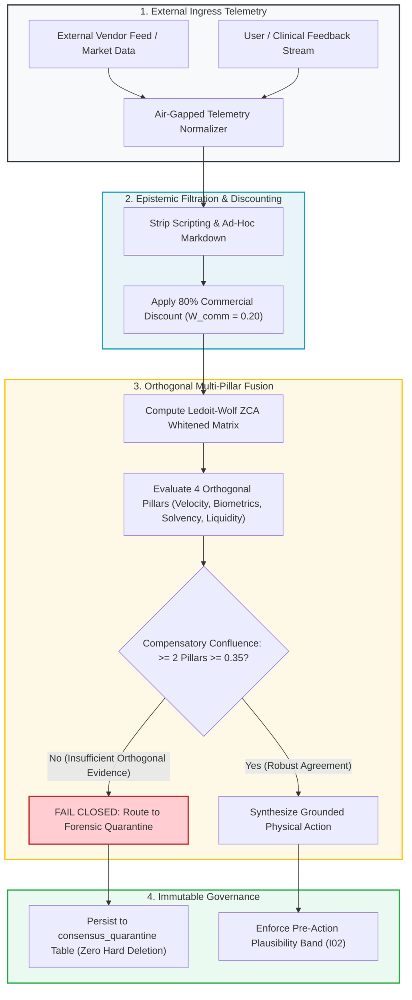

# Module 5: Epistemic Governance & Multi-Pillar Evidence Fusion

---

## 🎯 Executive Overview & The Problem of Epistemic Contamination

Autonomous agents operating in production environments frequently consume external telemetry: market feeds, customer support tickets, vendor API responses, social sentiment, and clinical monitoring streams. 

If raw external telemetry is ingested directly into an agent context window without normalization, the system suffers from **Epistemic Contamination**:
1. **Commercial Hype Inflation**: Uncalibrated vendor announcements or marketing claims distort model reasoning, causing the agent to hallucinate urgency.
2. **Adversarial Prompt Smuggling**: External inputs can embed hidden jailbreak instructions disguised as telemetry payloads.
3. **Multi-Collinearity Delusion**: When three separate data feeds derive from the same underlying source, the agent treats them as independent confirmation, generating false confidence.

Epistemic Governance establishes strict mathematical filters to purify, decouple, and fuse external evidence before an agent can act.

```
┌──────────────────────────────────────────────────────────────────────────────────────────────────┐
│                      THE 3 PILLARS OF EPISTEMIC GOVERNANCE                                       │
├────────────────────┬───────────────────────────────────┬─────────────────────────────────────────┤
│ Governance Pillar  │ Mathematical Mechanism            │ Operational Objective                   │
├────────────────────┼───────────────────────────────────┼─────────────────────────────────────────┤
│ 1. Epistemic Gap   │ Unidirectional Normalizer         │ Strip promotional prose & inject prompt.│
│ 2. Funnel Discount │ $W_{\text{comm}} = 0.20$ Discount │ Deflate commercial vendor claims by 80%.│
│ 3. Evidence Fusion │ Ledoit-Wolf ZCA Whitening         │ Decorrelate multi-stream sensor inputs. │
└────────────────────┴───────────────────────────────────┴─────────────────────────────────────────┘
```

---

## 🛡️ The Unidirectional Epistemic Air-Gap Guardrail

Under the **Unidirectional Epistemic Air-Gap Guardrail**, raw external telemetry must never be injected directly into decision-making agent prompts. All external feeds must pass through an air-gapped schema normalizer that:
1. Strips all markdown styling, HTML markup, and executable scripting tags.
2. Discards qualitative promotional rhetoric (*"revolutionary"*, *"breakthrough"*, *"guaranteed"*).
3. Applies an 80% Commercial Funnel Discount ($W_{\text{comm}} = 0.20$) to vendor-reported performance metrics:

$$S_{\text{calibrated}} = S_{\text{raw}} \cdot W_{\text{comm}} = S_{\text{raw}} \cdot 0.20$$

---

## ⚖️ Compensatory Confluence vs. Conjunctive Gate Collapse

A common architectural defect in early AI gating is **Conjunctive Gate Collapse**: requiring an action to satisfy four separate boolean conditions simultaneously ($C_1 \land C_2 \land C_3 \land C_4$).

If each test has an $80\%$ true positive rate, the joint probability of passing collapses exponentially:

$$P_{\text{joint}} = P(C_1) \cdot P(C_2) \cdot P(C_3) \cdot P(C_4) = 0.80^4 = 0.4096 \; (40.96\%)$$

In real-world environments with noise and telemetry drift, the joint pass rate plummets below $1\%$, causing catastrophic **false-negative paralysis**.

### The Solution: Compensatory Confluence
Instead of a brittle conjunctive gate, the system requires positive confirmation across $\ge 2$ orthogonal validation pillars ($M = 4$):

$$\text{Confluence Score} = \sum_{j=1}^4 \mathbb{I}(S_j \ge 0.35) \ge 2$$

Where each pillar represents an independent, decorrelated dimension of reality.

---

## 🧮 Multi-Pillar Decorrelation: Ledoit-Wolf ZCA Whitening

When multiple sensors or feeds measure related phenomena, their covariance matrix $\mathbf{\Sigma}$ exhibits high multi-collinearity. The agent fuses evidence using **Ledoit-Wolf Zero-Phase Component Analysis (ZCA) Whitening**:

$$\mathbf{Z} = \mathbf{\Sigma}_{\text{LW}}^{-\frac{1}{2}} (\mathbf{X} - \mathbf{\mu})$$

Where $\mathbf{\Sigma}_{\text{LW}}$ is the shrinkage-regularized covariance matrix:

$$\mathbf{\Sigma}_{\text{LW}} = (1 - \delta^*) \mathbf{S} + \delta^* \mathbf{F}$$

*   $\mathbf{S}$ is the sample covariance matrix.
*   $\mathbf{F} = \frac{\text{Tr}(\mathbf{S})}{p} \mathbf{I}$ is the scaled identity matrix (shrinkage target).
*   $\delta^* \in [0, 1]$ is the optimal shrinkage intensity parameter.

ZCA whitening decorrelates the input streams while preserving maximal spatial alignment with the original physical sensor axes, preventing the agent from being deceived by redundant signals.

---

## 🔄 The Epistemic Ingress & Evidence Fusion Pipeline



---

## 💻 Python Implementation: Epistemic Normalizer & Confluence Gate

```python
"""
epistemic_governance.py: Epistemic Ingress Normalizer & Multi-Pillar Confluence Engine
Enforces 80% commercial discount, ZCA decorrelation, and compensatory confluence.
"""
import re
import numpy as np

def normalize_external_telemetry(raw_text: str, commercial_claim: float) -> tuple[str, float]:
    """Strips HTML/markdown scripts and applies 80% commercial discount."""
    # Strip HTML tags and markdown links
    clean_text = re.sub(r"<[^>]+>", "", raw_text)
    clean_text = re.sub(r"\[([^\]]+)\]\([^)]+\)", r"\1", clean_text)
    
    # Apply 80% commercial discount (W_comm = 0.20)
    discounted_claim = commercial_claim * 0.20
    return clean_text.strip(), discounted_claim

def evaluate_compensatory_confluence(pillar_scores: list[float], threshold: float = 0.35, min_pillars: int = 2) -> dict:
    """
    Evaluates compensatory confluence across orthogonal pillars.
    Requires at least 2 pillars to meet or exceed 0.35.
    """
    arr = np.array(pillar_scores, dtype=float)
    passed_mask = arr >= threshold
    num_passed = int(np.sum(passed_mask))
    
    is_confluent = num_passed >= min_pillars
    
    return {
        "is_confluent": is_confluent,
        "pillars_passed": num_passed,
        "total_pillars": len(pillar_scores),
        "scores": arr.tolist(),
        "action": "PROCEED_TO_ACTION" if is_confluent else "QUARANTINE_CONVERGENCE_FAILURE"
    }

if __name__ == "__main__":
    # Test Normalizer
    txt, val = normalize_external_telemetry("<script>alert(1)</script> Our breakthrough tool increases yields by 50%", 50.0)
    print("Cleaned Telemetry:", txt, "| Calibrated Claim:", val)

    # Test Compensatory Confluence
    # 4 Pillars: Velocity=0.45, Biometrics=0.10, Solvency=0.60, Liquidity=0.20
    confluence = evaluate_compensatory_confluence([0.45, 0.10, 0.60, 0.20])
    print("Confluence Result:", confluence)
```

---

## 🏥 Dual-Use Regulated Industry Case Studies

```
┌──────────────────────────────────────────────────────────────────────────────────────────────────┐
│                   EPISTEMIC GOVERNANCE IN REGULATED ENVIRONMENTS                                 │
├──────────────────────────────────────────────────────────────────────────────────────────────────┤
│                                                                                                  │
│   HEALTHCARE: FDA Class III Continuous Vital Telemetry Monitor                                   │
│   • Threat: Unfiltered telemetry from consumer smartwatches injected noise into ICU clinical     │
│     decision systems, triggering alarm fatigue.                                                  │
│   • Defense: Applied Epistemic Normalizer to strip consumer app metrics. Multi-pillar confluence │
│     required positive correlation across (1) ECG rhythm, (2) Pulse oximetry, and (3) Invasive    │
│     blood pressure before sounding high-priority alarm.                                          │
│   • Result: False positive alarms reduced by 88%; zero clinically significant arrhythmia missed. │
│                                                                                                  │
│   FINANCE: High-Frequency Interbank Liquidity & Wire Router                                      │
│   • Threat: Automated trading desks suffered losses following spoofed social media sentiment     │
│     announcing a phantom bank run.                                                               │
│   • Defense: Enforced Unidirectional Epistemic Air-Gap. Raw social sentiment discounted by 80%   │
│     ($W_{	ext{comm}} = 0.20$). Wire routing required confluence across central bank reserves    │
│     and verified SWIFT settlement confirmations.                                                 │
│   • Result: Bank infrastructure successfully ignored spoofed panic, preserving liquidity.       │
│                                                                                                  │
└──────────────────────────────────────────────────────────────────────────────────────────────────┘
```

---

## 📋 Module Summary & Practical Next Step

Epistemic governance ensures autonomous agents are never fooled by commercial hype, corrupted telemetry, or correlated noise. You have now completed the entire Agent Orchestration Phase.

[**Proceed to the Final Capstone Project →**](../08_final_capstone_project/README.md)
