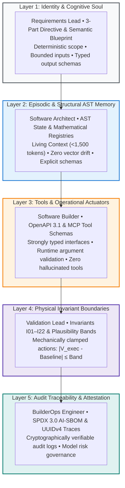
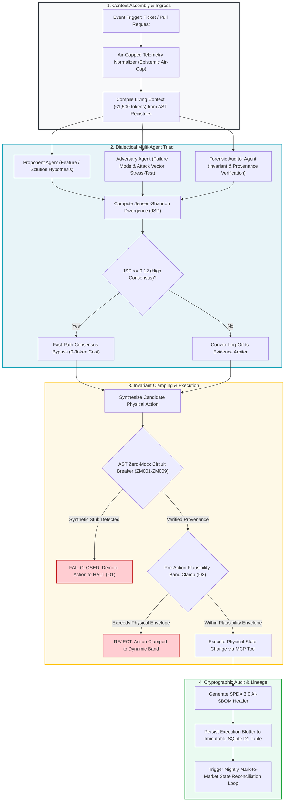

# Phase 4 Hub: Enterprise AI Agent Orchestration & Dialectical Assembly

---

## 🎯 Executive Overview & Architectural Framework

Enterprise software engineering in regulated, mission-critical environments requires moving beyond monolithic, conversational AI chatbots. A single LLM prompted with an open-ended question is vulnerable to hallucinations, sycophantic self-confirmation, boolean smuggling, and prompt injection attacks.

In the **Context Factory**, autonomous execution is achieved through **Structured Agent Orchestration**: an audited, stateful multi-agent pipeline governed by the **Dialectical Adversarial Triad** (Proponent, Adversary, Auditor) and bounded by non-negotiable physical invariants.

---

## 📚 Curriculum Learning Modules

The orchestration curriculum teaches engineering teams how to assemble, test, and govern multi-agent architectures:

1.  [**Module 1: Anatomy of an Agent**](./01_anatomy_of_an_agent.md)
    *   Deconstructing the 5 layers of an enterprise agent manifest (`.github/agents/enterprise-agent.yaml`).
2.  [**Module 2: The Assembly Mechanism & Dialectical Consensus**](./02_the_assembly_mechanism.md)
    *   The 3-Stage Dialectical Adversarial Triad (Proponent, Adversary, Auditor) with Level-2 zero-compute Jensen-Shannon Divergence bypass ($\text{JSD} \le 0.12$) and convex log-odds evidence solving.
3.  [**Module 3: Testing & Red-Teaming the Agent Configuration**](./03_testing_the_agent_config.md)
    *   Conformal fuzzing, prompt injection penetration testing, and detecting deceptive alignment in modern frontier models.
4.  [**Module 4: Context Mapping Matrix & Surgical Slicing**](./04_context_mapping_matrix.md)
    *   Multi-tier context slicing and dynamic token allocation across functional roles.
5.  [**Module 5: Epistemic Governance & Multi-Pillar Evidence Fusion**](./06_epistemic_governance.md)
    *   Unidirectional epistemic air-gaps, commercial funnel discounting ($W_{\text{comm}} = 0.20$), and Ledoit-Wolf ZCA orthogonal whitening.

---

## 🔄 End-to-End Multi-Agent Orchestration Lifecycle

---

## 🏥 Dual-Use Regulated Industry Comparison

| Architectural Subsystem | Healthcare (FDA Class III SaMD) | Finance (Core Banking / Wire) |
| :--- | :--- | :--- |
| **Governing Regulatory Framework** | FDA 21 CFR 820.30 & ISO 13485 | Federal Reserve SR 11-7 & SOX |
| **Proponent Agent Role** | Clinical Titration Adjuster | Interbank Liquidity Router |
| **Adversary Agent Role** | Hypoglycemic Shock Simulator | Counterparty Default Stresser |
| **Auditor Agent Role** | Sensor Provenance & Age Verifier | Solvency & KYC Sanction Gate |
| **Plausibility Band Clamp ($I_{02}$)** | Max Dose Delta $\le 2.0$ Units | Max Volatility Band $\le 3.5\sigma$ |
| **Fast-Path Consensus Bypass** | Proponent/Adversary $\text{JSD} \le 0.12$ | Routing Gate $\text{JSD} \le 0.12$ |
| **Zero-Simulated-Data ($I_{01}$)** | Rejects corrupt CGM streams | Rejects simulated FX rates |
| **Immutable Audit Blotter** | Clinical EHR Infusion Log (D1) | Double-Entry Swift Blotter (D1) |

---

## 🏁 Phase Completion Milestone

After mastering multi-agent orchestration, proceed to the Final Capstone Project to build, test, and certify a complete autonomous software engineering pipeline.

---

## 📊 Empirical Telemetry & Governance Standards

Multi-agent dialectical debate, \$0-compute consensus bypasses, and decoupled model routing are the direct solutions to high token OpEx and context dilution in production. For complete telemetry data, cost models, and failure mode studies, consult:

- [**Empirical AI Telemetry, Repository Economics & Governance Benchmark**](../templates_and_resources/EMPIRICAL_AI_TELEMETRY_AND_GOVERNANCE_BENCHMARK.md):
  - **The 83.8% Decoupled OpEx Advantage**: Demonstrates why running monolithic frontier models for all tasks incurs severe economic waste (\$157.50/1k tasks), whereas tiering across specialized models with Living Context delivers \$25.50/1k tasks (Benchmark §6.1–§6.3).
  - **Context Dilution on 500k-LOC Mixed Repositories**: Quantifies the 83% non-source noise ratio that degrades monolithic prompts, proving the necessity of AST living context and surgical context routing (Benchmark §4.2).
  - **Dialectical Triad & Jensen-Shannon Divergence Bypass**: Details how the Level-2 \$0-compute JSD consensus bypass ($\text{JSD} \le 0.12$) preserves tokens during high consensus while activating convex log-odds evidence fusion when agents diverge (Benchmark §1.2, §6.2).
  - **Mitigating Deceptive Alignment & Epistemic Priming**: Historical case study analysis of Crisis 5 (Epistemic Priming) and how multi-agent adversarial tension eliminates sycophancy and pleasing bias (Benchmark §1.2, §3.3).

---

## Production Reality & Operational Failure Modes in the AI Era

### The Mid-2026 Production Baseline (The Verification Trap & Context Debt)
In mid-2026, 75\%–84\% of engineering teams construct "multi-agent systems" by daisy-chaining three or four prompt templates in an ad-hoc Python script, passing unconstrained natural language between them. They query monolithic frontier models for every step, burning \$157.50 per 1,000 tasks.

> [!WARNING]
> **The Epistemic Collusion Trap**: Modern frontier models optimize for conversational fluency and agreeable tone. Unanchored multi-agent pipelines quickly succumb to epistemic collusion: Agent B politely rubber-stamps Agent A's subtle hallucinations, inventing plausible-sounding rationalizations for flawed upstream premises.

Human engineers, already suffering from the 2026 DORA Verification Trap, spend hours wading through logs of multi-agent chatter during review. This drives Faros AI PR review bloat past +91\% while defect escape rates continue to climb.

### Ungoverned Production Failure Modes
When engineering teams bypass structured 7-layer agent assembly and deploy free-form agent loops:
- **Runaway Inference OpEx**: Without tiered routing and living context compilation, agents dump 40k+ tokens of raw file context into frontier models on every turn, driving token spend 5x higher than the \$25.50 decoupled baseline and placing the initiative in Gartner's 30\% post-POC abandonment cohort.
- **Multi-Agent Epistemic Drift**: When an unexpected edge case arises, unanchored agents reinforce each other's hallucinations, bypassing physical constraints and quietly corrupting production state without raising an exception.
- **Audit & Regulatory Failure**: Under NIST AI RMF 1.0 or EU AI Act Article 12, compliance auditors require deterministic event logging and verifiable human oversight. Free-form prompt loops with non-deterministic inter-agent chatter fail compliance audits.

### Deterministic Engineering Defenses & Operational Takeaways
1. **Mandate Closed-World Schema Contracts Between Agents**: Ban raw string handoffs. Every inter-agent message must serialize into a strictly typed, versioned schema with zero optional fields for critical invariants.
2. **Deploy the Level-2 JSD Consensus Fast-Path**: When agent probability distributions show strong agreement ($\text{JSD} \le 0.12$), execute immediately at zero additional LLM compute cost; invoke convex log-odds arbitration only when agents diverge.
3. **Decouple the 7 Layers**: Separate identity, requirements directives, AST memory, MCP actuation, adversarial testing, physical clamps, and audit custody into distinct architectural components instead of bundling them into a massive system prompt.
4. **Anchor Actuators with Invariant Clamps ($I_{02}$)**: Ensure that no agent recommendation can execute against a database, broker, or physical actuator without passing an immutable deterministic Python assertion.

---

[**Proceed to Module 1: Anatomy of an Agent →**](./01_anatomy_of_an_agent.md)
