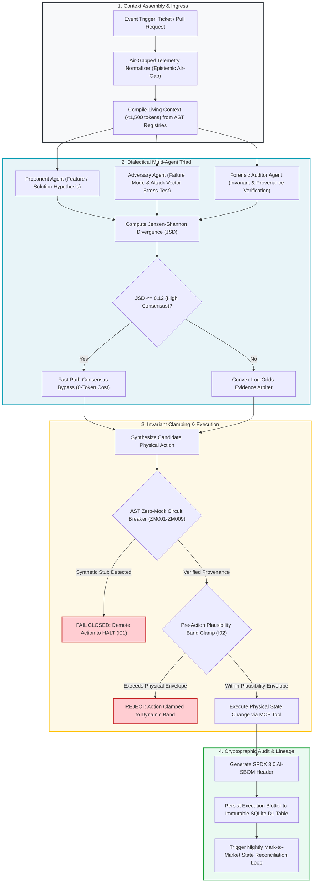

# Phase 4 Hub: Enterprise AI Agent Orchestration & Dialectical Assembly

---

## 🎯 Executive Overview & Architectural Framework

Enterprise software engineering in regulated, mission-critical environments requires moving beyond monolithic, conversational AI chatbots. A single LLM prompted with an open-ended question is vulnerable to hallucinations, sycophantic self-confirmation, boolean smuggling, and prompt injection attacks.

In the **Context Factory**, autonomous execution is achieved through **Structured Agent Orchestration**: an audited, stateful multi-agent pipeline governed by the **Dialectical Adversarial Triad** (Proponent, Adversary, Auditor) and bounded by non-negotiable physical invariants.

```
┌──────────────────────────────────────────────────────────────────────────────────────────────────┐
│                      THE 5-LAYER ENTERPRISE AGENT ARCHITECTURE                                    │
├──────────────────────────────────────────────────────────────────────────────────────────────────┤
│                                                                                                  │
│   LAYER 1: IDENTITY & COGNITIVE SOUL                                                             │
│   • Grounded in the 3-Part Directive & Semantic Blueprint (Requirements Lead).                   │
│   • Enforces deterministic scope, bounded inputs, and typed output schemas.                      │
│                                                                                                  │
│   LAYER 2: EPISODIC & STRUCTURAL AST MEMORY                                                      │
│   • Grounded in AST State & Mathematical Registries (Software Architect).                        │
│   • Compiles deterministic Living Context (<1,500 tokens) with zero vector drift.               │
│                                                                                                  │
│   LAYER 3: TOOLS & OPERATIONAL ACTUATORS (THE HANDS)                                             │
│   • Grounded in OpenAPI 3.1 & Model Context Protocol (MCP) Schemas (Software Builder).           │
│   • Strongly-typed tool interfaces with strict runtime argument validation.                      │
│                                                                                                  │
│   LAYER 4: PHYSICAL INVARIANT BOUNDARIES (THE GUARDIAN)                                         │
│   • Grounded in Invariants I01-I22 & Pre-Action Plausibility Bands (Validation Lead).            │
│   • Mechanically clamps proposed actions before physical state commitment.                       │
│                                                                                                  │
│   LAYER 5: AUDIT TRACEABILITY & ATTESTATION (THE CUSTODIAN)                                      │
│   • Grounded in SPDX 3.0 AI-SBOM & UUIDv4 Traces (BuilderOps Engineer).                          │
│   • Generates cryptographically verifiable audit logs for model risk governance.                 │
│                                                                                                  │
└──────────────────────────────────────────────────────────────────────────────────────────────────┘
```

---

## 📚 Curriculum Learning Modules

The orchestration curriculum teaches engineering teams how to assemble, test, and govern multi-agent architectures:

1.  [**Module 1: Anatomy of an Agent**](./01_anatomy_of_an_agent.md)
    *   Deconstructing the 5 layers of an enterprise agent manifest (`.github/agents/enterprise-agent.yaml`).
2.  [**Module 2: The Assembly Mechanism & Dialectical Consensus**](./02_the_assembly_mechanism.md)
    *   The 3-Stage Dialectical Adversarial Triad (Proponent, Adversary, Auditor) with Level-2 zero-compute Jensen-Shannon Divergence bypass ($\text{JSD} \le 0.12$) and convex log-odds evidence solving.
3.  [**Module 3: Testing & Red-Teaming the Agent Configuration**](./03_testing_the_agent_config.md)
    *   Conformal fuzzing, prompt injection penetration testing, and detecting deceptive alignment in modern frontier models.
4.  [**Module 4: Context Mapping Matrix & Surgical Slicing**](./04_context_mapping_matrix.md)
    *   Multi-tier context slicing and dynamic token allocation across functional roles.
5.  [**Module 5: Epistemic Governance & Multi-Pillar Evidence Fusion**](./05_epistemic_governance.md)
    *   Unidirectional epistemic air-gaps, commercial funnel discounting ($W_{\text{comm}} = 0.20$), and Ledoit-Wolf ZCA orthogonal whitening.

---

## 🔄 End-to-End Multi-Agent Orchestration Lifecycle



---

## 🏥 Dual-Use Regulated Industry Comparison

```
┌──────────────────────────────────────────────────────────────────────────────────────────────────┐
│              MULTI-AGENT ORCHESTRATION IN MISSION-CRITICAL DOMAINS                               │
├────────────────────────────────┬─────────────────────────────────────────────────────────────────┤
│ Architectural Subsystem        │ Healthcare (FDA Class III SaMD) │ Finance (Core Banking / Wire) │
├────────────────────────────────┼─────────────────────────────────┼───────────────────────────────┤
│ Governing Regulatory Framework │ FDA 21 CFR 820.30 & ISO 13485   │ Federal Reserve SR 11-7 & SOX │
│ Proponent Agent Role           │ Clinical Titration Adjuster     │ Interbank Liquidity Router    │
│ Adversary Agent Role           │ Hypoglycemic Shock Simulator    │ Counterparty Default Stresser │
│ Auditor Agent Role             │ Sensor Provenance & Age Verifier│ Solvency & KYC Sanction Gate  │
│ Plausibility Band Clamp (I02)  │ Max Dose Delta <= 2.0 Units     │ Max Volatility Band <= 3.5σ   │
│ Fast-Path Consensus Bypass     │ Proponent/Adversary JSD <= 0.12 │ Routing Gate JSD <= 0.12      │
│ Zero-Simulated-Data (I01)      │ Rejects corrupt CGM streams     │ Rejects simulated FX rates    │
│ Immutable Audit Blotter        │ Clinical EHR Infusion Log (D1)  │ Double-Entry Swift Blotter(D1)│
└────────────────────────────────┴─────────────────────────────────┴───────────────────────────────┘
```

---

## 🏁 Phase Completion Milestone

After mastering multi-agent orchestration, proceed to the Final Capstone Project to build, test, and certify a complete autonomous software engineering pipeline.

[**Proceed to Module 1: Anatomy of an Agent →**](./01_anatomy_of_an_agent.md)
