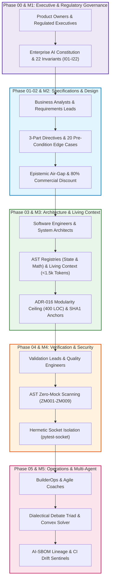

# Project: AI Software Foundations — Enterprise Curriculum Transformation

## Architecture
The `AI_Software_Foundations` curriculum provides an exhaustive, textbook-grade manual for cross-functional enterprise teams (Product Owners, Business Analysts, System Architects, Software Engineers, Quality Engineers, and Scrum Masters) deploying autonomous AI agents in high-stakes regulated environments (FDA Class III medical devices, aerospace avionics, fintech algorithmic trading, and mission-critical banking mainframes).

### The Empirical Context Divide: 75% Median Ad-Hoc Usage vs. Compiler-Grade Context Engineering

Enterprise AI software development is characterized by an acute productivity and governance divide. While over 76% of software engineers have adopted AI tooling (Stack Overflow 2024–2025 Surveys), **over 75% of practitioners operate at Level 1 and Level 2 Ad-Hoc Context Maturity**: relying on conversational prompt-engineering, manual snippet pasting, unconstrained directory dumps, and naive semantic vector RAG.

Longitudinal developer telemetry and empirical industry research demonstrate the severe failure modes of unmanaged ad-hoc context:
1. **The 63.3% Context Wall (Stack Overflow Telemetry)**: 63.3% of professional developers identify finding, navigating, and assembling codebase context as their primary daily productivity bottleneck when working with AI tools.
2. **The 83% Non-Source Noise Ratio**: In mixed 500k-LOC enterprise repositories, 83% of files are non-source clutter (markdown documentation, lockfiles, build manifests, test fixtures, logs). Stuffing this into monolithic prompts triggers quadratic attention entropy dispersion ($\mathcal{H}(A_i) \to \ln N$), causing a 40% to 75% retrieval loss ("Lost in the Middle").
3. **The GitClear 211M LOC Code Churn Inversion**: Longitudinal analysis of 211 million lines of code (GitClear 2024–2026) reveals that un-governed AI generation accelerates **code churn by +39%** and drives a **10x surge in duplicate copy-paste blocks**, while refactoring and code reuse invert sharply in favor of cloned logic.
4. **The 2026 Google Cloud DORA Verification Trap & Tax**: In un-governed environments, while AI generation costs fall to near zero, the cognitive tax of verifying superficially clean, "almost right" code explodes. DORA telemetry shows that every 25% increase in un-governed AI adoption drives a **7.2% drop in organizational delivery stability**, while Faros AI PR review telemetry demonstrates a **+91% increase in PR review duration** and a **+9% spike in post-merge defects**.

To resolve these failure modes, the curriculum is structured around the **Enterprise Context Pipeline** and **Level 5: Compiler-Grade Context Engineering**:
- **Deterministic Structural Memory**: Compiling machine-readable Abstract Syntax Tree (AST) Living Context (<1,500 tokens) with strict dual-schema database-to-DTO mappings.
- **Zero-Trust Reproduction Test Gates**: Requiring autonomous agents to generate an automated failing reproduction test prior to code patch execution, breaking the GitClear churn and DORA review traps.
- **Decoupled Multi-Model Token Economics**: Slashing operating expenditures by **83.8%** (\$25.50 vs \$157.50 per 1,000 tasks) by routing tasks through a tiered multi-model pipeline (Router @ \$0.80/M, Reasoner @ \$0.27/M in / \$1.10/M out, Auditor @ \$3.00/M) rather than brute-forcing monolithic frontier models.
- **Fail-Closed Statutory Governance**: Providing concrete technical implementations and audit artifacts for NIST AI RMF 1.0 (GOVERN/MAP/MEASURE/MANAGE), ISO/IEC 42001:2023 (Annex A controls), and EU AI Act (Regulation (EU) 2024/1689 Articles 9–15).

For the complete longitudinal telemetry data, economic formulas, and citation register, see the canonical reference guide:  
👉 [**templates_and_resources/EMPIRICAL_AI_TELEMETRY_AND_GOVERNANCE_BENCHMARK.md**](./templates_and_resources/EMPIRICAL_AI_TELEMETRY_AND_GOVERNANCE_BENCHMARK.md).



### The Enterprise Cross-Functional Context Pipeline

| Enterprise Discipline | Curriculum Milestones | Core Capabilities & Deliverables |
| :--- | :--- | :--- |
| **Product Owners & Regulated Executives** | `00_` Foundations & `08_` Governance | Enterprise Constitution (Articles I–VII), 22 Bedrock Invariants ($I_{01}$–$I_{22}$), AI-SBOM & Model Risk Governance (FDA Pre-Market / ISO 13485 / SR 11-7) |
| **Business Analysts / Requirements Leads** | `01_` Strategy & `02_` Requirements | 3-Part Directives with Invariant Bindings, Epistemic Air-Gap (ADR-030) & 80% Commercial Funnel Discount, Semantic Blueprints with 20 Edge-Case Pre-conditions |
| **Software Engineers & Architects** | `03_` Building & Coding | ADR-016 400-LOC Hard Ceiling & AST-Scoped Surgical Slices, AST State & Math Registries, Living Context Compiler (<1,500 tokens) & Invariant SHA1 Anchors |
| **Validation Leads & Quality Engineers** | `04_` Testing & `06_` Security | AST Zero-Mock Code Scanner Rules (ZM001–ZM009), Hermetic Socket Isolation (`pytest-socket`), Compensatory 4-Pillar Orthogonal Confluence vs Conjunctive Gate Collapse, Cartesian Fault-Injection & Conformal Fuzzing |
| **Scrum Masters & Agile Coaches** | `07_` Team Process & Flow | Bounded Task Decomposition & Context Debt Tracking, AI-Assisted DORA & SPACE Blast Radius Metrics, 90-Day 4-Phase Organizational Rollout Roadmap |
| **Autonomous Agent Orchestrators** | `09_` Agent Orchestration | Dialectical Adversarial Triad (Bull / Bear / Forensic Auditor), Deterministic Convex Solver Evidence Fusion & Level-2 \$0-Compute JSD Bypass, Runtime Execution Plausibility Bands & Nightly Reconciliation |

### Architectural Comparison: Mid-2026 Ad-Hoc Baseline vs. Enterprise Level 5 Context Factory

| Dimension | Mid-2026 Ad-Hoc Baseline | Enterprise Level 5 Context Factory |
| :--- | :--- | :--- |
| **Context Strategy** | Unstructured prompts / 40k raw token dumps | Compiled Living Context (<1,500 tokens) |
| **Verification Gate** | Manual human code review / Prompt retry | Zero-Trust automated red test before code generation |
| **Test Sandboxing** | Live network calls & fake mock objects | Hermetic socket isolation (`pytest-socket`) & AST Zero-Mock |
| **Token Economics** | Monolithic frontier model ($157.50 / 1k tasks) | Decoupled 3-tier routing ($25.50 / 1k tasks — 83.8% savings) |
| **Code Modularity** | Sprawling monolithic files (>1,200 LOC) | ADR-016 modular ceiling ($\le 400$ LOC, trigger at 350) |
| **Audit Provenance** | Zero provenance; informal git commits | Machine-readable SPDX 3.0 AI-SBOM & UUIDv4 lineage |

## Feature Inventory
Every feature extracted during the Survey phase is mapped to an assigned milestone:

| # | Feature | Description | Milestone | Source |
|---|---------|-------------|-----------|--------|
| 1 | $O(N^2)$ Attention & Entropy | LaTeX proof of transformer FLOPs scaling and attention entropy $\mathcal{H}(A_i) = -\sum A_{ij}\ln A_{ij}$ | M1 | Survey §4.1 |
| 2 | Lost in the Middle U-Curve | Formalization of 15%–85% degradation valley and retrieval loss function $F(x)$ | M1 | Survey §4.2 |
| 3 | Continuous Half-Life Decay | Exponential half-life decay $w(\Delta t) = w_0 (1/2)^{\Delta t/t_{1/2}}$ across 4 horizons | M1 | Survey §4.5 |
| 4 | Conjunctive Gate Collapse Proof | Proof of joint failure collapse $\prod p_k = 0.243\%$ vs Compensatory Confluence $\ge 2$ of 4 | M1 | Survey §4.8 |
| 5 | Convex Evidence Fusion & JSD | Closed-form log-odds fusion $\text{logit}(P)$ with JSD discounting $\max(0.15, 1 - \lambda \cdot \text{JSD})$ | M1 | Survey §4.10 |
| 6 | Ledoit-Wolf & ZCA Whitening | Covariance shrinkage $\text{cond}(\Sigma) \le 10^{12}$ and symmetrical ZCA whitening without alpha loss | M1 | Survey §4.12 |
| 7 | Deflated Sharpe Ratio (DSR) | Bailey & López de Prado DSR formulation deflating selection bias across $N$ trials | M1 | Survey §4.14 |
| 8 | 22 Canonical Invariants | Full formal definition and binding of $I_{01}$ through $I_{22}$ | M1 | Survey §5 |
| 9 | 10 Inviolable Commandments | Inviolable principles of autonomous enterprise software engineering | M1 | Survey §5 |
| 10 | Enterprise Constitution | Formalization of Articles I–VII with fail-closed safety and immutable quarantine | M1 | Survey §5 |
| 11 | BA 3-Part Directives | Requirements directives binding context, constraints, and invariant bounds | M2 | Survey §3 (#7) |
| 12 | Epistemic Air-Gap (ADR-030) | Unidirectional firewall decoupling narrative sentiment from internal state | M2 | Survey §3 (#7) |
| 13 | 80% Commercial Funnel Discount | Slashing commercial promotional polarity by 80% ($W_{\text{commercial}} = 0.20$) | M2 | Survey §3 (#8) |
| 14 | Semantic Blueprints with 20 Edges | Deterministic interface contracts with 20 pre-condition boundary edge cases | M2 | Survey §3 (#1-20) |
| 15 | ADR-016 400-LOC Hard Ceiling | Modular ceiling, 350-LOC refactor trigger, AST-scoped surgical view slices | M3 | Survey §3 (#5) |
| 16 | AST State & Math Registries | Static AST parser indexing functions, LOC, algorithmic LaTeX, and test bindings | M3 | Survey §3 (#1, #2) |
| 17 | Living Context Compilation | Deterministic minification of active schemas and model matrices (<1,500 tokens) | M3 | Survey §3 (#3) |
| 18 | SHA1 Invariant Anchors | In-code `# === INVARIANT-BLOCK` with deterministic SHA1 checksum verification | M3 | Survey §5 |
| 19 | Zero-Drift Pre-commit Chains | Automated git hooks and CI workflows enforcing zero AST/schema drift | M3 | Survey §3 (#4) |
| 20 | AST Zero-Mock Rules (ZM001–ZM009)| Static AST visitor rules intercepting numeric defaults, catch fallbacks, mocks | M4 | Survey §3 (#17) |
| 21 | Hermetic Socket Isolation | OS-level socket interception via `pytest-socket` raising `SocketBlockedError` | M4 | Survey §3 (#22) |
| 22 | Compensatory 4-Pillar Engine | Multi-pillar confluence with isolated fatal contagion vetoes | M4 | Survey §3 (#23) |
| 23 | Cartesian Fault-Injection Fuzzing| Stress testing with NaN, inf, ill-conditioned matrices, and extreme drift | M4 | Survey §3 (#24) |
| 24 | CI/CD Automated Traceability | AI-SBOM generation, provenance attestation, and PR header enforcement | M5 | Survey §3 (#15) |
| 25 | Bounded Task Decomposition | Replacing monolithic velocity with context-bounded cognitive units | M5 | Survey §8 |
| 26 | AI Blast Radius & DORA Metrics | Telemetry tracking hallucination loops, PR churn, review choke-points | M5 | Survey §8 |
| 27 | Dialectical Debate Triad | 3-stage Bull, Bear, Auditor debate arbitrated by convex solver | M5 | Survey §3 (#10) |
| 28 | Level-2 \$0-Compute JSD Bypass | Zero-compute consensus bypass when pillar divergence $\text{JSD} \le 0.12$ | M5 | Survey §3 (#11) |
| 29 | Pre-Action Plausibility Bands | Runtime envelope $\lvert V_{\text{exec}} - \text{Baseline} \rvert \le \text{Band}$ across domains | M5 | Survey §3 (#19) |
| 30 | Nightly Reconciliation Loop | Automated mark-to-market reconciliation and state integrity audit | M5 | Survey §3 (#19) |
| 31 | 6 Forensic Failure-Mode Crises | Deep case studies (Cron Poller, Context Drift, Synthetic Poison, 99% Gate, Epistemic Priming, Channel Desync)| M1-M5 | Survey §6 |
| 32 | Dual-Use Regulated Callout Boxes | Domain pairing (Fintech Algorithmic Trading alongside FDA Class III Medical Devices & Aerospace)| M1-M5 | Survey §7 |
| 33 | Visual Mermaid Diagrams (8 diagrams)| Architectural diagrams across chapters (AST lifecycle, air-gap, triad, confluence, etc.)| M1-M5 | Survey §8 |
| 34 | E2E 4-Tier Verification Suite | Opaque-box automated test harness covering Tiers 1 through 4 | M6 (E2E)| Survey §9 |
| 35 | Empirical AI Telemetry & Governance Benchmark | Longitudinal telemetry (GitClear 211M LOC, DORA Verification Trap, Faros AI review bloat), 83.8% decoupled pipeline economics, and regulatory mappings (NIST/ISO 42001/EU AI Act) | M4 | Survey & Benchmark |

## Milestones
| # | Name | Scope | Dependencies | Status |
|---|------|-------|-------------|--------|
| M1 | Foundations, Mathematics & Invariants | `00_` root files (`00_THE_MATHEMATICS_OF_AI_RISK.md`, `00_THE_CONTEXT_PIPELINE.md`, `00_ENTERPRISE_CONSTITUTION.md`, `00_REGULATORY_MODEL_GOVERNANCE.md`, `00_EXECUTIVE_ALIGNMENT_STRATEGY.md`, `00_PREREQUISITES_AND_BASELINES.md`, `README.md`) | none | DONE |
| M2 | Requirements, Specifications & Product | `01_strategy_and_vision/`, `02_requirements_and_design/` | M1 contracts | DONE |
| M3 | Architecture, Modular Coding & Living Context | `03_building_and_coding/` | M1 contracts | DONE |
| M4 | Quality Engineering, Zero-Mock & Security | `04_testing_and_validation/`, `06_security_and_compliance/` | M1 contracts | IN_PROGRESS |
| M5 | Operations, Process, Capstone & Orchestration | `05_deployment_and_operations/`, `07_team_process_and_flow/`, `08_final_capstone_project/`, `09_ai_agent_orchestration/` | M1, M3 contracts | PLANNED |
| M6 | 100% E2E Verification & Adversarial Hardening | Comprehensive test harness covering Tiers 1-4 across entire curriculum and reference code | M1-M5 | PLANNED |

## Interface Contracts

### M1 ↔ M2 (Constitution & Mathematics to Requirements & Blueprints)
- $I_{20}$ (Epistemic News Isolation) defines the contract for BA 3-Part Directives.
- 80% Commercial Funnel Discount ($W_{\text{commercial}} = 0.20$) governs all unstructured external intelligence ingestion.
- The 20 pre-condition boundary edge cases are standardized across requirement blueprints.

### M1 ↔ M3 (Invariants & Context Pipeline to Code Implementation)
- Invariants $I_{01}-I_{22}$ must be formatted as verifiable SHA1 anchor blocks (`# === INVARIANT-BLOCK v1 ... /INVARIANT [sha1:xxxxxxxx]`).
- ADR-016 defines the hard 400-LOC ceiling, 350-LOC refactor threshold, and AST-scoped context slice contract.
- Living Context schema must compile into `<1,500` tokens of JSON (`openrouter_context.json`).

### M1/M3 ↔ M4 (Invariants to Zero-Mock & Quality Engineering)
- Invariant $I_{01}$ (Zero-Simulated-Data) binds to AST rules ZM001–ZM009.
- Socket isolation contract: all unit test runs must execute under hermetic isolation (`pytest-socket`) where outbound network raises `SocketBlockedError`.
- Compensatory Confluence Engine: $M=2$ of $N=4$ orthogonal pillars with isolated Fatal Contagion Veto ($I_{03}$).

### M1/M3/M4 ↔ M5 (Operations, Governance & Multi-Agent Orchestration)
- Dialectical Debate Triad: 3-stage Path C flow (Pre-Gates $\to$ Triad $\to$ Convex Solver).
- Level-2 \$0-Compute JSD Consensus Bypass: divergence threshold $\text{JSD} \le 0.12$.
- Pre-Action Plausibility Band: $|V_{\text{exec}} - \text{Baseline}| \le \text{Band}$ enforced runtime gate.

## Code Layout
```
AI_Software_Foundations/
├── 00_THE_MATHEMATICS_OF_AI_RISK.md
├── 00_THE_CONTEXT_PIPELINE.md
├── 00_ENTERPRISE_CONSTITUTION.md
├── 00_REGULATORY_MODEL_GOVERNANCE.md
├── 00_EXECUTIVE_ALIGNMENT_STRATEGY.md
├── 00_PREREQUISITES_AND_BASELINES.md
├── README.md
├── PROJECT.md
├── TEST_INFRA.md
├── TEST_READY.md (published upon test suite completion)
├── 01_strategy_and_vision/
│   ├── README.md
│   ├── 02_strategic_intent_and_invariants.md
│   ├── 03_strategic_red_teaming.md
│   ├── 04_epic_decomposition_and_blast_radius.md
│   ├── 05_epistemic_firewalls_and_market_airgaps.md
│   └── LAB_WORKBOOK.md
├── 02_requirements_and_design/
│   ├── README.md
│   ├── 01_ba_semantic_contracts_and_invariants.md
│   ├── 02_telemetry_decay_and_edge_case_matrix.md
│   ├── 03_feature_slicing_and_confluence.md
│   ├── 04_semantic_blueprints_and_closed_world_schemas.md
│   ├── 05_prompt_injection_defense.md
│   ├── SEMANTIC_BLUEPRINT_SPECIFICATION.md
│   └── LAB_WORKBOOK.md
├── 03_building_and_coding/
│   ├── README.md
│   ├── 01_architectural_directives_and_working_memory.md
│   ├── 02_builder_red_teaming_and_cron_crisis.md
│   ├── 03_code_modularity_ceiling_and_pr_slicing.md
│   ├── 04_ast_registries_and_living_context.md
│   ├── 05_context_chaining_and_routing.md
│   ├── 06_information_routing_structure.md
│   ├── adr_template.md
│   ├── function_registry.md
│   ├── REFERENCE_ARCHITECTURE.md
│   ├── skills.md
│   ├── examples/
│   └── LAB_WORKBOOK.md
├── 04_testing_and_validation/
│   ├── README.md
│   ├── 01_validation_contracts_and_invariant_assertions.md
│   ├── 02_forensic_failure_modes_and_deception_testing.md
│   ├── 03_test_isolation_and_socket_sandboxing.md
│   ├── 04_ast_zero_mock_scanning_and_circuit_breakers.md
│   ├── TEST_ARCHITECTURE.md
│   ├── examples/
│   └── LAB_WORKBOOK.md
├── 05_deployment_and_operations/
│   ├── README.md
│   ├── 01_iac_traceability_and_state_contracts.md
│   ├── 03_infrastructure_red_teaming_and_least_privilege.md
│   ├── 04_pipeline_modularity_and_canary_rollouts.md
│   ├── 05_cloud_resource_maps_and_staging_airgaps.md
│   ├── 06_automated_traceability.md
│   ├── github_action_trace_example.yml
│   └── LAB_WORKBOOK.md
├── 06_security_and_compliance/
│   ├── README.md
│   ├── 01_epistemic_governance_and_proxy_risk_auditing.md
│   ├── 03_regulatory_red_teaming.md
│   └── LAB_WORKBOOK.md
├── 07_team_process_and_flow/
│   ├── README.md
│   ├── 01_interpreting_ai_metrics.md
│   ├── 02_intervening_in_the_factory.md
│   ├── 03_tooling_and_analysis.md
│   ├── examples/
│   └── LAB_WORKBOOK.md
├── 08_final_capstone_project/
│   ├── README.md
│   ├── LAB_WORKBOOK.md
│   └── examples/
├── 09_ai_agent_orchestration/
│   ├── README.md
│   ├── 01_anatomy_of_an_agent.md
│   ├── 02_the_assembly_mechanism.md
│   ├── 03_testing_the_agent_config.md
│   └── 04_context_mapping_matrix.md
├── templates_and_resources/
│   ├── README.md
│   ├── EMPIRICAL_AI_TELEMETRY_AND_GOVERNANCE_BENCHMARK.md
│   ├── master_router.md
│   ├── functions_registry.md
│   ├── context/
│   ├── platforms/
│   ├── stories/
│   ├── skills/
│   └── agents/
├── tests/
│   ├── conftest.py (hermetic socket isolation)
│   ├── e2e_curriculum_validator.py
│   ├── test_tier1_feature_contracts.py
│   ├── test_tier2_boundary_invariants.py
│   ├── test_tier3_cross_chapter_parity.py
│   └── test_tier4_real_world_workloads.py
```

---

## Production Reality & Operational Failure Modes in the AI Era

### The Mid-2026 Production Baseline (The Verification Trap & Context Debt)

> [!WARNING]
> **The 75% Enterprise Ad-Hoc Trap**: Between 75% and 84% of engineering leadership teams believe modernizing an engineering organization for the AI era simply means purchasing enterprise AI assistant seats. They leave repository structures unchanged: sprawling 2,500-LOC files, ad-hoc unit tests with mock stubs, and zero machine-readable architecture manifests.

#### Observed Empirical Failure Cycle:
1. **The Context Wall**: Engineers spend over 63% of their day manually searching and compiling codebase context (Stack Overflow).
2. **The Verification Tax**: Raw commit volume increases by 30%, but delivery stability drops by 7.2% per 25% AI adoption (DORA), and PR review duration increases by +91% (Faros AI).
3. **The Churn Inversion**: Tech leads and senior engineers spend their entire working week reviewing low-quality AI-generated code bloat instead of designing scalable systems.

### Ungoverned Production Failure Modes
When engineering organizations deploy AI agents across legacy, unanchored codebases without formal architectural contracts:
- **Sprawling Monolithic Churn**: Without ADR-016 modularity ceilings ($\le 400$ LOC), AI assistants continuously append cloned logic to existing files, exacerbating GitClear's documented 10x explosion in duplicate code blocks and +39\% code churn.
- **Hermetic Testing Failure**: Without mandatory socket isolation (`pytest --disable-socket`), test suites pass locally using fake mock objects while failing catastrophically in staging when real network and schema boundaries are hit.
- **Architectural Bankruptcy**: Without machine-readable AST registries and living context compilation, developers and agents alike query monolithic frontier models with raw context dumps, burning \$157.50 per 1,000 tasks until executive finance cancels the initiative.

### Deterministic Engineering Defenses & Operational Takeaways
1. **Enforce ADR-016 Modularity Ceilings in CI**: Add an automated linter check in CI rejecting any source file exceeding 400 lines of code (with automated warnings at 350 LOC) to force bounded, modular system design.
2. **Automate Living Context Generation**: Run `scripts/compile_living_context.py` on git commit to maintain a synchronized, AST-indexed context file strictly $< 1,500$ tokens, eliminating raw repository prompt dumps.
3. **Establish Hermetic Test Boundaries**: Configure test runners with socket isolation flags enabled by default; require all mock fixtures to pass AST Zero-Mock scanner rules ZM001–ZM009.
4. **Mandate Small-Batch PR Slicing ($I_{20}$)**: Cap pull request diffs at 200 lines of code per slice, breaking the Faros AI review bottleneck and ensuring human reviewers can catch subtle deceptive compliance.

---

[**Return to Curriculum Overview →**](./README.md) | [**Begin Curriculum: The Mathematics of AI Risk →**](./00_THE_MATHEMATICS_OF_AI_RISK.md)
