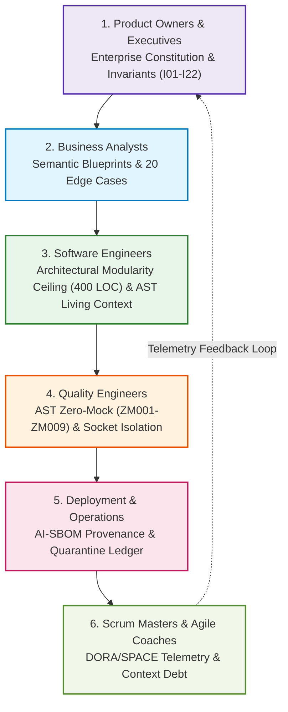

# AI Software Foundations: The Enterprise Context Factory

## Transforming Stochastic Token Generation into Deterministic Software Engineering

Welcome to **AI Software Foundations**, the definitive textbook-grade curriculum and operational manual for engineering autonomous, auditable, and fail-closed software systems with Artificial Intelligence.

This curriculum is engineered for cross-functional teams—**Product Owners, Regulated Executives, Business Analysts, System Architects, Software Engineers, Quality Engineers, and Scrum Masters**—deploying autonomous agents into high-stakes environments where software defects carry life-safety, systemic financial, or catastrophic operational consequences:
- **FDA Class III Closed-Loop Medical Devices** (21 CFR Part 820, 21 CFR Part 11, ISO 13485).
- **Mission-Critical Aerospace Avionics** (FAA DO-178C Level A).
- **Core Banking Mainframes & Payment Gateways** (Fedwire, SWIFT, Basel BCBS).
- **Autonomous Algorithmic Risk Capital & Asset Allocation** (Federal Reserve SR 11-7, SEC Rule 17a-4).

---

## 🏗️ The Problem: The 75% Median Ad-Hoc Trap & The AI Productivity Cliff

While over 76% of professional software engineers have integrated AI coding assistants into their daily workflows (Stack Overflow 2024–2025 Developer Surveys), **75% of enterprise engineering teams remain trapped at Level 1 and Level 2 Ad-Hoc Context Maturity**. In this median ad-hoc paradigm, developers treat frontier Large Language Models (LLMs) as conversational chatbots: copying snippets into prompt windows, dumping unstructured repository directories into context windows, or relying on naive semantic vector RAG.

Longitudinal developer telemetry and empirical industry research demonstrate that un-governed ad-hoc AI usage produces an acute **Productivity, Quality, and Governance Paradox**:

1. **The 63.3% Context Wall (Stack Overflow Telemetry):**
   Across >65,000 professional developers, **63.3% identify searching, navigating, and assembling codebase context as their single greatest daily productivity bottleneck**. Developers spend substantial working memory manually compiling caller signatures, type definitions, and interface boundaries into prompt windows.
2. **The 83% Non-Source Clutter Ratio:**
   In real-world enterprise repositories (>500,000 LOC), an empirical audit reveals that **83% of files are non-source noise** (unstructured markdown, lockfiles, build scripts, minified bundles, test fixtures, and transient logs). Ingesting these files naively into LLM prompts triggers quadratic attention entropy dispersion ($\mathcal{H}(A_i) \to \ln N$), causing a **40% to 75% information retrieval loss ("Lost in the Middle")** that blinds agents to cross-module invariants.
3. **The GitClear 211M LOC Code Churn Inversion:**
   Longitudinal analysis of **211 million lines of code (GitClear 2024–2026)** reveals that ungoverned AI generation accelerates **two-week code churn by +39%** and drives a **tenfold (10x) explosion in duplicate copy-paste code blocks**. Because models optimize for local next-token fluency rather than global repository architecture, refactoring and code reuse invert sharply in favor of duplicated logic.
4. **The 2026 Google Cloud DORA Verification Trap & Tax:**
   Google Cloud DORA's 2024–2026 research series ("State of AI-Assisted Software Development" and 2026 Economic Verification extensions) formally identifies the **"Verification Trap"** and **"Verification Tax"**: while AI generation inference costs approach near zero, the cognitive effort to verify, debug, and test "almost right", plausible-looking code explodes. DORA telemetry proves that un-governed AI adoption drives a **7.2% drop in organizational delivery stability per 25% AI adoption**.
5. **Faros AI PR Review Bloat (+91% Duration, +9% Defect Rate):**
   Telemetry across >100,000 pull requests (Faros AI 2025) demonstrates that large, un-sliced AI diffs increase **PR review cycle duration by +91%** while allowing **defect escape rates to jump by +9%**, swamping senior reviewers in verification fatigue.
6. **The Compounding Error Cascade ($p^n$):** Even an elite model with a $95\%$ single-step accuracy has only a **$35.85\%$ probability of succeeding across a 20-step autonomous sequence** ($(0.95)^{20} \approx 0.358$). Incidental errors amplify exponentially into catastrophic system failure.
7. **The Fail-Soft Synthetic Poison Trap:** Conventional web-development catch blocks returning synthetic default values (e.g., `0.50` or `5.25%`) poison database rows, corrupting downstream mathematical solvers and triggering unprovoked panic liquidations.
8. **99% Gate Paralysis:** Stacking sequential boolean `AND` gates causes joint probability collapse ($\prod p_k = 0.243\%$), rejecting over $89.9\%$ of viable opportunities and freezing systems in cash.
9. **Epistemic Priming & Echo Chambers:** Hydrating external media extractors with internal portfolio state induces cognitive priming, causing agents to interpret promotional marketing funnels as "independent corroboration."
10. **Cross-Channel Desynchronization:** Decoupled presentation endpoints querying divergent local replicas emit conflicting verdicts for the same entity on the same morning.

For the exhaustive longitudinal data, economic teardowns, and citation bibliography, consult the canonical benchmark guide:  
👉 [**Empirical AI Telemetry, Repository Economics & Governance Benchmark**](./templates_and_resources/EMPIRICAL_AI_TELEMETRY_AND_GOVERNANCE_BENCHMARK.md).

---

## 🛠️ The Solution: Compiler-Grade Context Engineering & The Enterprise Context Pipeline

What separates **frontier practitioners** from the 75% median ad-hoc usage is the transition to **Level 5: Compiler-Grade Context Engineering**. 

Instead of treating LLMs as open-ended chatbots, frontier engineering platforms treat the codebase as a compiled Abstract Syntax Tree (AST), generating deterministic, machine-readable Living Context (<1,500 tokens) with strict dual-schema database-to-DTO mappings. Frontier platforms break the DORA Verification Trap by enforcing **Zero-Trust Reproduction Test Gates** (requiring an automated failing test before code generation) and programmatic AST zero-mock scanners (ZM001–ZM009).

Furthermore, frontier architectures achieve an **83.8% token OpEx reduction** (\$25.50 vs \$157.50 per 1,000 tasks) by decoupling tasks into a tiered pipeline—routing lightweight AST indexing through high-throughput routers (\$0.80/M tokens), reasoning through cost-efficient models (\$0.27/M input / \$1.10/M output), and reserving frontier models exclusively for final forensic auditing (\$3.00/M)—rather than brute-forcing 40,000-token dumps through monolithic models. Software truth is anchored in Abstract Syntax Trees (ASTs), governed by 22 bedrock invariants ($I_{01}-I_{22}$), and validated through hermetic, socket-isolated test harnesses.

```
┌──────────────────────────────────────────────────────────────────────────────────────────────────┐
│                      THE ENTERPRISE CROSS-FUNCTIONAL CONTEXT PIPELINE                            │
├──────────────────────────────────────────────────────────────────────────────────────────────────┤
│                                                                                                  │
│   [Product Owners & Regulated Executives]  ──► 00_ Foundations & 08_ Governance                  │
│   • Enterprise Constitution (Articles I–VII)                                                    │
│   • 22 Bedrock Invariants (I01–I22) & 10 Inviolable Commandments                                 │
│   • AI-SBOM & Model Risk Governance (FDA Pre-Market / ISO 13485 / SR 11-7)                       │
│                                                                                                  │
│   [Business Analysts / Requirements Leads] ──► 01_ Strategy & 02_ Requirements                   │
│   • 3-Part Directives with Mathematical Invariant Bindings                                       │
│   • Unidirectional Epistemic Air-Gap Guardrail & 80% Commercial Funnel Discount                                 │
│   • Semantic Blueprints with 20 Mandatory Pre-Condition Edge Cases                               │
│                                                                                                  │
│   [Software Engineers & Architects]        ──► 03_ Building & Coding                             │
│   • Architectural Modularity Ceiling (400 LOC) & AST Scoped Surgical Slices                     │
│   • AST State & Math Registries (`STATE_REGISTRY.md`, `MATHEMATICAL_REGISTRY.md`)               │
│   • Living Context Compiler (<1,500 tokens) & Invariant SHA1 Anchors                             │
│                                                                                                  │
│   [Validation Leads & Quality Engineers]   ──► 04_ Testing & 06_ Security                        │
│   • AST Zero-Mock Code Scanner Rules (ZM001–ZM009)                                               │
│   • Hermetic Socket Isolation (`pytest-socket`, `SocketBlockedError`)                            │
│   • Compensatory 4-Pillar Orthogonal Confluence vs Conjunctive Gate Collapse                     │
│   • Cartesian Fault-Injection & Conformal Fuzzing                                                │
│                                                                                                  │
│   [Scrum Masters & Agile Coaches]          ──► 07_ Team Process & Flow                           │
│   • Bounded Task Decomposition (<200 LOC blast radius) & Context Debt Tracking                   │
│   • AI-Assisted DORA & SPACE Blast Radius Metrics                                                │
│   • 120-Day 4-Phase Organizational Rollout Roadmap                                               │
│                                                                                                  │
│   [Autonomous Agent Orchestrators]         ──► 09_ Agent Orchestration                           │
│   • Dialectical Adversarial Triad (Bull / Bear / Forensic Auditor)                               │
│   • Deterministic Convex Solver Evidence Fusion & Level-2 \$0-Compute JSD Bypass                 │
│   • Runtime Execution Plausibility Bands & Nightly Reconciliation                                │
│                                                                                                  │
└──────────────────────────────────────────────────────────────────────────────────────────────────┘
```



---

## 👥 Cross-Functional Role Matrix

Every enterprise discipline possesses a designated operational domain, specific governing invariants, and authoritative artifacts within the curriculum:

| Enterprise Role | Curriculum Focus | Primary Capabilities & Deliverables | Governing Invariants | Enforcement Tooling |
|:---|:---|:---|:---|:---|
| **Product Owners & Regulated Executives** | `00_`<br>`01_strategy_and_vision` | Model risk governance, fail-closed capital doctrine, regulatory certification (FDA/DO-178C/SR 11-7), immutable quarantine oversight. | $I_{03}, I_{04}, I_{15}, I_{21}$ | `consensus_quarantine`, Executive DORA Dashboards |
| **Business Analysts & Requirements Leads** | `02_requirements_and_design` | 3-Part Directives, epistemic air-gapping, 80% commercial discount filters, Semantic Blueprints with 20 pre-condition edge cases. | $I_{05}, I_{07}, I_{08}, I_{20}$ | `docs/stories/*.md`, Semantic Blueprint Validator |
| **System Architects & Software Engineers** | `03_building_and_coding` | Architectural Modularity Ceiling (400 LOC), AST scoped surgical slices, AST state/math registry compiler, living context (<1,500 tokens), SHA1 invariant anchors. | $I_{01}, I_{02}, I_{06}, I_{11}, I_{22}$ | `scripts/update_state_registry.py`, `drift-monitor.yml` |
| **Validation Leads & Quality Engineers (QE)** | `04_testing_and_validation`<br>`06_security_and_compliance` | Programmatic AST Zero-Mock scanning (ZM001–ZM009), hermetic socket isolation (`pytest-socket`), SHA1 anchor verification, Cartesian fuzzing. | $I_{01}, I_{09}, I_{10}, I_{12}, I_{22}$ | `scripts/scan_mock_data.py`, `tests/conftest.py` |
| **Scrum Masters & Agile Coaches** | `07_team_process_and_flow` | Bounded task decomposition (<200 LOC blast radius), context debt telemetry, tracking DORA/SPACE metrics, 120-day phased rollout guidance. | $I_{13}, I_{14}, I_{16}, I_{17}$ | Context Debt Dashboard, Sprint Retrospective Monitors |
| **Deployment Leads & BuilderOps** | `05_deployment_and_operations` | Zero-drift CI pre-commit gates, AI-SBOM metadata generation, nightly mark-to-market reconciliation, dual-storage parity sync. | $I_{04}, I_{13}, I_{14}, I_{15}$ | `.github/workflows/verify_ai_sbom.yml`, `sync_data.py` |
| **Multi-Agent Orchestrators** | `09_ai_agent_orchestration`<br>`08_final_capstone_project` | Dialectical Adversarial Triad (Path C), deterministic convex log-odds solver, Level-2 \$0-compute JSD bypass, plausibility bands. | $I_{02}, I_{03}, I_{09}, I_{10}, I_{11}$ | `solve_convex_debate_verdict()`, Runtime Breakers |

---

## 🗺️ Master Curriculum Navigation Index

The curriculum is organized into six progressive, interconnected milestones:

### Milestone 1: Foundations, Mathematics & Invariants (Root Modules)
- [**00_THE_MATHEMATICS_OF_AI_RISK.md**](./00_THE_MATHEMATICS_OF_AI_RISK.md)  
  *Textbook treatise:* $O(N^2)$ Transformer attention entropy $\mathcal{H}(A_i)$, U-shaped "Lost in the Middle" degradation $F(x)$, exponential half-life decay $w(\Delta t)$, conjunctive gate collapse (0.243%) vs. compensatory confluence, log-odds convex evidence fusion with JSD discounting, Ledoit-Wolf shrinkage, symmetrical ZCA whitening, Deflated Sharpe Ratio (DSR $\ge 0.95$), and pre-action plausibility bands.
- [**00_ENTERPRISE_CONSTITUTION.md**](./00_ENTERPRISE_CONSTITUTION.md)  
  *Constitutional law:* The 10 Inviolable Commandments, the Master Canonical Invariant Matrix ($I_{01}-I_{22}$), the Fail-Closed Telemetry Doctrine, the Zero Hard-Deletes Mandate, cryptographic SHA1 anchor blocks, and Articles I through VII.
- [**00_THE_CONTEXT_PIPELINE.md**](./00_THE_CONTEXT_PIPELINE.md)  
  *Systems architecture:* AST-compiled living context vs. naive vector RAG, ADR-016 400-LOC ceiling, AST scoped surgical slices, Unidirectional Epistemic Air-Gap Guardrail, 80% commercial discount, and the cross-functional Context Handshake.
- [**00_REGULATORY_MODEL_GOVERNANCE.md**](./00_REGULATORY_MODEL_GOVERNANCE.md)  
  *Compliance manual:* High-stakes model risk governance across FDA Class III (21 CFR Part 820/11), ISO 13485, Federal Reserve SR 11-7, FAA DO-178C Level A, and EU AI Act. Complete AI-SBOM specification and immutable quarantine schema (`consensus_quarantine`).
- [**00_EXECUTIVE_ALIGNMENT_STRATEGY.md**](./00_EXECUTIVE_ALIGNMENT_STRATEGY.md)  
  *C-suite business case:* Token economy ROI (85% OpEx reduction), managing the cognitive blast radius, context debt vs. technical debt, DORA/SPACE telemetry, and the 120-day enterprise industrialization roadmap.
- [**00_PREREQUISITES_AND_BASELINES.md**](./00_PREREQUISITES_AND_BASELINES.md)  
  *Day Zero assessment:* Tooling audit, shadow AI discovery, interaction maturity tiers, quantitative DORA/SPACE baseline extraction formulas, and toolchain prerequisites.

---

### Milestone 2: Requirements, Specifications & Product
- [**01_strategy_and_vision/**](./01_strategy_and_vision/README.md)  
  *Strategy Lead Hub:* Bounded Epics, strategic decomposition, business-level adversarial thinking, and executive value stream mapping.
- [**02_requirements_and_design/**](./02_requirements_and_design/README.md)  
  *Requirements Lead Hub:* 3-Part Directives (Role, Task, Format), Semantic Blueprints, 20-edge-case pre-condition matrices, and Unidirectional Epistemic Air-Gap guardrail.

---

### Milestone 3: Architecture, Modular Coding & Living Context
- [**03_building_and_coding/**](./03_building_and_coding/README.md)  
  *Builder & Architect Hub:* Architectural Modularity Ceiling (400 LOC), 350-LOC refactoring trigger, AST scoped surgical context windows, `STATE_REGISTRY.md`, `MATHEMATICAL_REGISTRY.md`, Living Context compilation (`openrouter_context.json` <1,500 tokens), and zero-drift pre-commit chains.

---

### Milestone 4: Quality Engineering, Zero-Mock & Security
- [**04_testing_and_validation/**](./04_testing_and_validation/README.md)  
  *Validation Lead Hub:* Programmatic AST Zero-Mock Scanner (rules ZM001–ZM009 in `scan_mock_data.py`), hermetic socket isolation (`pytest-socket`), SHA1 invariant anchor verification, and Cartesian fault-injection fuzzing.
- [**06_security_and_compliance/**](./06_security_and_compliance/README.md)  
  *Security & Compliance Hub:* Regulatory red-teaming, PII sanitization (Article I), least privilege enforcement (Article II), and proxy bias elimination (Article VI).

---

### Milestone 5: Operations, Process, Capstone & Orchestration
- [**05_deployment_and_operations/**](./05_deployment_and_operations/README.md)  
  *BuilderOps Hub:* Automated CI/CD drift sentinels (`drift-monitor.yml`), AI-SBOM header verification, nightly mark-to-market reconciliation loops, and dual-storage parity.
- [**07_team_process_and_flow/**](./07_team_process_and_flow/README.md)  
  *Agile Coach Hub:* Managing context debt, bounded task decomposition, detecting hallucination loops and review choke-points, and tracking AI-assisted DORA metrics.
- [**08_final_capstone_project/**](./08_final_capstone_project/README.md)  
  *Capstone Integration:* Full-scale multi-role enterprise simulation assembling an autonomous agent system for a regulated, mission-critical workflow.
- [**09_ai_agent_orchestration/**](./09_ai_agent_orchestration/README.md)  
  *Agent Orchestrator Hub:* Dialectical Adversarial Triad (Path C), deterministic convex log-odds solver (`solve_convex_debate_verdict`), Level-2 \$0-compute JSD bypass, and runtime execution plausibility bands ($I_{02}$).

---

### Milestone 6: Canonical Empirical Benchmark, Repository Economics & Governance
- [**templates_and_resources/EMPIRICAL_AI_TELEMETRY_AND_GOVERNANCE_BENCHMARK.md**](./templates_and_resources/EMPIRICAL_AI_TELEMETRY_AND_GOVERNANCE_BENCHMARK.md)  
  *Canonical empirical benchmark:* GitClear 211M LOC code churn and duplication inversion (+39% churn, 10x duplicates), Google Cloud DORA 2024–2026 delivery stability degradation (7.2% drop per 25% AI adoption) and the 2026 DORA Verification Trap, Faros AI PR review bloat (+91% cycle duration, +9% defect rate), Stack Overflow 63.3% Context Wall, repository noise analysis (83% non-source clutter), the 5-Level Context Maturity Model, quantitative multi-model token economics (83.8% OpEx reduction, \$25.50 vs \$157.50), and statutory mappings across NIST AI RMF 1.0, ISO/IEC 42001:2023, and EU AI Act (Regulation (EU) 2024/1689).

---

## 🔍 The Six Forensic Failure-Mode Case Studies

The curriculum grounds all engineering principles in six historical production failure-mode crises drawn from the iterative evolution of the reference autonomous market intelligence platform (migrating from its initial May 2026 monolithic batch prototype **"V1"** to its July 2026 asynchronous edge prototype **"V2"**, and finally to the hardened fail-closed Context Factory). Each case study rigorously dissects the naive architecture, silent failure mode, false solutions attempted, and permanent architectural mechanisms:

1. **Crisis 1: The Initial Batch Architecture ("V1") Monolithic Cron Poller Crisis (May 2026):**  
   *Root Cause:* In the initial prototype (V1), nightly batch sweeps across 1,200-LOC monolithic scripts burned \$750/month in tokens and suffered 16-hour reaction lags to intraday shocks.  
   *Permanent Fix:* Event-Driven Ingress Guardrail, 3-Tier Severity Triage Funnel Guardrail, Continuous Half-Life Decay Guardrail, and ADR-016 400-LOC ceiling.
2. **Crisis 2: The Asynchronous Edge Prototype ("V2") Architectural & Context Drift Crisis (July 2026):**  
   *Root Cause:* When migrating the platform to an asynchronous edge topology (V2), 40+ prose markdown docs diverged from live code; LLMs hallucinated non-existent database columns, crashing with SQLite locked errors.  
   *Permanent Fix:* Deterministic AST State Registry (`STATE_REGISTRY.md`), Mathematical Registry, Living Context Compiler (<1,500 tokens), and pre-commit zero-drift CI sentinels.
3. **Crisis 3: The 900,000-Row Synthetic Poison Catastrophe (Aug–Oct 2026):**  
   *Root Cause:* Fail-soft try-except blocks returned synthetic constants (`0.50` dark pool ratio, `5.25%` rate stub), poisoning 900,000 database rows and triggering panic liquidations directly before a +35% rally.  
   *Permanent Fix:* Static AST Code Scanner (ZM001–ZM009), Runtime Zero-Mock Circuit Breaker, Fail-Closed Telemetry Doctrine, and mandatory data citations.
4. **Crisis 4: The 99% Gate Paralysis Crisis (September 2026):**  
   *Root Cause:* Stacking conjunctive boolean AND gates (where just $K=5$ gates with $p_k=0.30$ collapses pass probability to $P_{\text{joint}} = (0.30)^5 = 0.00243 = 0.243\%$, falsely rejecting $99.757\%$ of candidates; stacking 100 gates induces total paralysis at $5 \times 10^{-53}$) rejected premier growth compounders due to the DCF reinvestment paradox.  
   *Permanent Fix:* Compensatory 4-Pillar Confluence Guardrail (Invariant I09), Growth-Adjusted Capitalized ROIC Margin of Safety (GAC-ROIC-MOS Guardrail), and Bayesian contextual bandit Thompson sampling.
5. **Crisis 5: The Epistemic Priming & Liquidation Incident (October 2026):**  
   *Root Cause:* External media extractor was primed with internal portfolio loss alerts; interpreted a promotional YouTube trading course funnel as independent crash proof, triggering panic liquidation.  
   *Permanent Fix:* Unidirectional Epistemic Air-Gap Guardrail, 80% commercial funnel discount ($W_{\text{commercial}} = 0.20$), and Role-Based Epistemic Slicing Guardrail.
6. **Crisis 6: Cross-Channel Verdict Desynchronization (October 2026):**  
   *Root Cause:* Decoupled presentation channels querying divergent local replicas emitted conflicting verdicts (BUY vs SUPPRESS vs SELL) for the same entity on the same morning.  
   *Permanent Fix:* Single-Source Routing via `ConsensusService` Guardrail, remote-first freshness gates ($I_{13}$), server-composed directional headers ($I_{14}$), and Cartesian conformal fuzz testing.

---

## 📚 Global Standards & Governance Citations

1. **Rabanser, S., Kapoor, S., & Narayanan, A. (2026).** *"Towards a Science of AI Agent Reliability."* Princeton University. [arXiv:2601.06341](https://arxiv.org/abs/2601.06341).
2. **Xie, Y., et al. (2026).** *"From Spark to Fire: Modeling and Mitigating Error Cascades in LLM-Based Multi-Agent Collaboration."* [arXiv:2603.04474](https://arxiv.org/abs/2603.04474).
3. **Liu, N. F., Gardner, M., Liang, P., Manning, C. D., & Levy, O. (2023).** *"Lost in the Middle: How Language Models Use Long Contexts."* *Transactions of the Association for Computational Linguistics (TACL)*, 12, 157–173.
4. **Bailey, D. H., & López de Prado, M. (2014).** *"The Deflated Sharpe Ratio: Correcting for Selection Bias, Backtest Overfitting, and Non-Normality."* *Journal of Portfolio Management*, 40(5), 94–107.
5. **Ledoit, O., & Wolf, M. (2004).** *"A Well-Conditioned Estimator for Large-Dimensional Covariance Matrices."* *Journal of Multivariate Analysis*, 88(2), 365–411.
6. **Lin, J. (1991).** *"Divergence measures based on the Shannon entropy."* *IEEE Transactions on Information Theory*, 37(1), 145–151.
7. **Thompson, W. R. (1933).** *"On the likelihood that one unknown probability exceeds another in view of the evidence of two samples."* *Biometrika*, 25(3/4), 285–294.
8. **Agrawal, S., & Goyal, N. (2012).** *"Analysis of Thompson Sampling for the multi-armed bandit problem."* *Proceedings of the 25th Annual Conference on Learning Theory (COLT 2012)*, JMLR W&CP 23, 39.1–39.26.
9. **Bell, A. J., & Sejnowski, T. J. (1997).** *"The 'independent components' of natural scenes are edge filters."* *Vision Research*, 37(23), 3327–3338.
10. **Kessy, A., Lewin, A., & Strimmer, K. (2018).** *"Optimal Whitening and Decorrelation."* *The American Statistician*, 72(4), 309–314.
11. **GitClear (2024–2026).** *"Coding on Copilot: 2024 Data Shows Downward Pressure on Code Quality and Longitudinal 2026 Extension."* Analysis of 211 million lines of code.
12. **Google Cloud DORA (2024–2026).** *"State of DevOps: AI-Assisted Software Development and the 2026 Verification Trap."* Google Cloud DevOps Research and Assessment (DORA), dora.dev.
13. **Faros AI (2025).** *"Enterprise AI Impact Benchmark: The PR Review Bottleneck and Defect Escape Rates."* Telemetry across 100,000+ pull requests.
14. **Stack Overflow (2024 & 2025).** *"Annual Developer Survey: AI Tools, Usage, and the Codebase Context Bottleneck."* Surveys across 65,000+ software developers.
15. **Gartner (2024–2026).** *"AI TRiSM: Mitigating AI Trust, Risk, and Security Vulnerabilities and Avoiding Post-POC Abandonment."* Gartner Research.
16. **McKinsey & Company (2024 & 2025).** *"The State of AI in 2024/2025: GenAI Adoption Outpaces Governance and Policy Controls."* QuantumBlack AI by McKinsey.
17. **National Institute of Standards and Technology (NIST) (2023).** *"Artificial Intelligence Risk Management Framework (AI RMF 1.0)."* NIST Special Publication 1270.
18. **International Organization for Standardization / International Electrotechnical Commission (ISO/IEC) (2023).** *"ISO/IEC 42001:2023: Information technology — Artificial intelligence — Management system."* ISO/IEC JTC 1/SC 42.
19. **U.S. Food & Drug Administration (FDA) (2024).** *"Good Machine Learning Practice for Medical Device Development: Guiding Principles."* 21 CFR Part 820 / ISO 13485.
20. **Federal Reserve Board / OCC (2011).** *"Supervisory Guidance on Model Risk Management."* Supervisory Letter SR 11-7.
21. **Federal Aviation Administration (FAA) (2011).** *"Software Considerations in Airborne Systems and Equipment Certification."* Advisory Circular AC 20-115C / RTCA DO-178C.
22. **European Union (2024).** *"Regulation (EU) 2024/1689 of the European Parliament and of the Council laying down harmonised rules on artificial intelligence (Artificial Intelligence Act)."*

---

## Production Reality & Operational Failure Modes in the AI Era

### The Mid-2026 Production Baseline (The Verification Trap & Context Debt)
In mid-2026, 75\%-84\% of software engineering teams are trapped in the ad-hoc AI usage baseline. Developers rely on inline autocomplete ghost-text, paste snippets into browser chat sidebars, and compose 91.2\% prose prompts without machine-readable context. Teams operate under the illusion of productivity: lines of code committed spike, but the 2026 DORA Verification Trap has snapped shut. Faros AI telemetry across 100,000+ pull requests confirms a +91\% explosion in PR review time, while GitClear's 211M LOC analysis reveals a +39\% surge in code churn and a 10x rise in duplicated code blocks. Engineers have shifted from creators to exhausted code reviewers, struggling to detect subtle deceptive compliance where frontier models write code that looks clean but quietly breaks cross-module invariants.

### Ungoverned Production Failure Modes
When engineering teams bypass systematic AI software foundations and continue using unanchored ad-hoc AI assistance:
- **Catastrophic Verification Tax**: Reviewers spend hours squinting at plausible-looking, deceptive pull requests, resulting in Google DORA's documented 7.2\% drop in deployment stability per 25\% increase in un-governed AI usage.
- **Inference Budget Exhaustion**: Monolithic frontier model queries dumping 40k+ tokens of raw file context burn \$157.50 per 1,000 tasks, driving initiatives directly into Gartner's 30\% post-POC abandonment cohort.
- **Regulatory & Security Violations**: When an unanchored AI change introduces non-finite float vulnerabilities or drops a safety assertion, organizations fail NIST AI RMF 1.0, ISO/IEC 42001, and EU AI Act Article 14 audits due to an absence of deterministic verification gates and immutable audit lineage ($I_{04}$, $I_{15}$).

### Deterministic Engineering Defenses & Operational Takeaways
1. **Kill the Monolithic Prompt**: Ban the practice of dumping entire repositories or 40k-token file trees into AI prompts. Enforce living context compilation capped strictly at $< 1,500$ tokens using local AST registries.
2. **Institute the Zero-Trust Reproduction Gate**: Before any AI-generated code is accepted, require an automated reproduction test that demonstrably fails against the unpatched codebase and passes cleanly under hermetic isolation (`pytest --disable-socket`).
3. **Cap Pull Requests at 200 Lines**: Enforce small-batch PR slicing ($I_{20}$) and the ADR-016 400-LOC modularity ceiling to eliminate review exhaustion and reduce PR review bloat from +91\% to zero.
4. **Deploy Decoupled Multi-Model Routing**: Direct low-level parsing to sub-\$1/M models and reserve expensive frontier reasoners strictly for invariant validation, capturing an immediate 83.8\% operational cost reduction.

---

[**Begin Curriculum: The Mathematics of AI Risk →**](./00_THE_MATHEMATICS_OF_AI_RISK.md)
