# Autonomous Agentic Quantitative Engineering: The Production Master Guide

> **Cornerstone Module for AI Software Foundations**: Serving as the definitive reference module for [AI Software Foundations](https://github.com/bdchang403/AI_Software_Foundations) (Production Architecture, Context Engineering, Anti-Hallucination, Epistemic Governance, Zero-Mock Execution Guardrails, and Invariant Testing for Autonomous Multi-Agent Software). Synthesized from the production architecture, failure mode forensics, and mathematical invariants of **StockAnalysis V3**.
> 
> **100% Self-Contained & Standalone Design**: This master guide is completely self-contained. Every Architecture Decision Record (ADR-000 through ADR-048), AST registry mechanism, code invariant ($I_{01}-I_{22}$), mathematical formula, and multi-agent protocol is defined, articulated, and proven inline with full equations, architectural diagrams, and executable code. Readers outside this repository can read and fully comprehend every concept without needing access to any other document or external repository file. Repository links ([`docs/DOCUMENTATION_REGISTRY.md`](../DOCUMENTATION_REGISTRY.md), [`docs/MATHEMATICAL_REGISTRY.md`](../MATHEMATICAL_REGISTRY.md), [`docs/ACTIVE_INVARIANTS.md`](../ACTIVE_INVARIANTS.md), and [`ADR-000`](../adrs/ADR-000_MASTER_ARCHITECTURAL_EVOLUTION_AND_DECISION_HISTORY.md) through [`ADR-048`](../adrs/ADR-048_ASYMMETRIC_HYSTERESIS_COOLDOWN_AND_RALLY_IGNITION_BYPASS.md)) serve solely as optional supplementary provenance anchors.


---

## Table of Contents

- [Executive Summary: Building Autonomous Financial Intelligence](#executive-summary-building-autonomous-financial-intelligence)
  - [Bottom Line Up Front (BLUF)](#bottom-line-up-front-bluf)
  - [The Narrative Arc: Experienced Engineering Colliding with Agentic Dynamics](#the-narrative-arc-experienced-engineering-colliding-with-agentic-dynamics)
  - [The Crucible of Discovery: The 6 Historical Failure-Mode Crises](#the-crucible-of-discovery-the-6-historical-failure-mode-crises)
  - [Pedagogical Purpose for AI Software Foundations: Principles Over Guesswork](#pedagogical-purpose-for-ai-software-foundations-principles-over-guesswork)
  - [Core Architecture & System Topology](#core-architecture--system-topology)
- [1. Context Engineering, AST Registries & Architectural Bounds](#1-context-engineering-ast-registries--architectural-bounds)
  - [1.1 Executive Overview: Why Autonomous Financial LLMs Fail Silently](#11-executive-overview-why-autonomous-financial-llms-fail-silently)
  - [1.2 Theoretical Foundations of LLM Context Degradation](#12-theoretical-foundations-of-llm-context-degradation)
    - [1.2.1 Transformer Attention Mechanics and $O(N^2)$ Quadratic Complexity](#121-transformer-attention-mechanics-and-on2-quadratic-complexity)
    - [1.2.2 The U-Shaped Attention Curve ("Lost in the Middle" Phenomenon)](#122-the-u-shaped-attention-curve-lost-in-the-middle-phenomenon)
    - [1.2.3 Context Truncation, Compression, and Monolithic Code Collapse (1,500+ LOC Files)](#123-context-truncation-compression-and-monolithic-code-collapse-1500-loc-files)
  - [1.3 The Failure Modes of Naive RAG in Quantitative Engineering](#13-the-failure-modes-of-naive-rag-in-quantitative-engineering)
    - [1.3.1 Semantic Vector Distance vs. Quantitative Sign and Boundary Precision](#131-semantic-vector-distance-vs-quantitative-sign-and-boundary-precision)
    - [1.3.2 Token Bloat vs. Rolling Budget ($0.40/Day Constraint)](#132-token-bloat-vs-rolling-budget-040day-constraint)
    - [1.3.3 Temporal Non-Stationarity and Lack of Signal Decay](#133-temporal-non-stationarity-and-lack-of-signal-decay)
    - [1.3.4 Empirical DCF Overvaluation Traps: The CRWV Forensic Case Study](#134-empirical-dcf-overvaluation-traps-the-crwv-forensic-case-study)
    - [1.3.5 API Drift and Stale Code Retrieval](#135-api-drift-and-stale-code-retrieval)
  - [1.4 Forensic Case Study 1: The V1 Monolithic Cron Poller Crisis (May 2026)](#14-forensic-case-study-1-the-v1-monolithic-cron-poller-crisis-may-2026)
  - [1.5 Forensic Case Study 2: The V2 Architectural & Context Drift Crisis (July 2026)](#15-forensic-case-study-2-the-v2-architectural--context-drift-crisis-july-2026)
  - [1.6 The AST Registry Architecture: Deterministic Repository Indexing](#16-the-ast-registry-architecture-deterministic-repository-indexing)
    - [1.6.1 Repository Topography Indexer: scripts/update_state_registry.py](#161-repository-topography-indexer-scriptsupdate_state_registrypy)
    - [1.6.2 Algorithm Conflict Auditor: scripts/update_math_registry.py](#162-algorithm-conflict-auditor-scriptsupdate_math_registrypy)
  - [1.7 The Living Context Compiler: Compact Deterministic Injection](#17-the-living-context-compiler-compact-deterministic-injection)
    - [1.7.1 Dual-Schema Parity Mapping](#171-dual-schema-parity-mapping)
    - [1.7.2 Compact AST Digest Ingestion in Multi-Agent Execution](#172-compact-ast-digest-ingestion-in-multi-agent-execution)
  - [1.8 Zero-Drift CI Enforcement: Hermetic In-Memory Verification](#18-zero-drift-ci-enforcement-hermetic-in-memory-verification)
    - [1.8.1 The Mandatory Atomic Pre-Commit Command Chain](#181-the-mandatory-atomic-pre-commit-command-chain)
    - [1.8.2 GitHub Actions Remote Sentinel: .github/workflows/drift-monitor.yml](#182-github-actions-remote-sentinel-githubworkflowsdrift-monitoryml)
    - [1.8.3 Local Hermetic Test Suite: tests/unit/test_context_freshness.py](#183-local-hermetic-test-suite-testsunittest_context_freshnesspy)
  - [1.9 Architectural Bounds & The 400-LOC Hard Ceiling](#19-architectural-bounds--the-400-loc-hard-ceiling)
    - [1.9.1 The ADR-016 Mandate: 400 LOC Ceiling and 350 LOC Refactor Trigger](#191-the-adr-016-mandate-400-loc-ceiling-and-350-loc-refactor-trigger)
    - [1.9.2 The Anti-Feature-Erasure Protocol (Rule 14)](#192-the-anti-feature-erasure-protocol-rule-14)
    - [1.9.3 Invariant $I_{22}$ Code-Adjacent Anchors & Checksum Verification](#193-invariant-i_22-code-adjacent-anchors--checksum-verification)
  - [1.10 Concrete Architectural Artifacts](#110-concrete-architectural-artifacts)
    - [1.10.1 Context Lifecycle & AST Synchronization Workflow](#1101-context-lifecycle--ast-synchronization-workflow)
    - [1.10.2 Architectural Comparison: Deterministic AST Registries vs. Naive RAG](#1102-architectural-comparison-deterministic-ast-registries-vs-naive-rag)
  - [Transition Bridge: From Context Structure to Epistemic Integrity](#transition-bridge-from-context-structure-to-epistemic-integrity)
- [2. Epistemic Discipline, Bias Quarantining & Dialectical Multi-Agent Triads](#2-epistemic-discipline-bias-quarantining--dialectical-multi-agent-triads)
  - [2.1 The Pathology of Confirmation Bias & Cognitive Priming in Multi-Agent LLMs](#21-the-pathology-of-confirmation-bias--cognitive-priming-in-multi-agent-llms)
    - [2.1.1 The Epistemic Priming Breakdown & Circular Corroboration](#211-the-epistemic-priming-breakdown--circular-corroboration)
    - [2.1.2 Institutional Case Study: The October 2026 Simulated $150,000 TSLA $\rightarrow$ SGOV Liquidation Scenario](#212-institutional-case-study-the-october-2026-simulated-150000-tsla-rightarrow-sgov-liquidation-scenario)
    - [2.1.3 Omniscient Prompt Pollution](#213-omniscient-prompt-pollution)
    - [2.1.4 The 9-Agent Debate Fallacy](#214-the-9-agent-debate-fallacy)
  - [2.2 Forensic Case Study 5: The Epistemic Priming & Liquidation Incident (October 2026)](#22-forensic-case-study-5-the-epistemic-priming--liquidation-incident-october-2026)
  - [2.3 Epistemic News Isolation & Zero-Context Ingestion (ADR-030)](#23-epistemic-news-isolation--zero-context-ingestion-adr-030)
    - [2.3.1 The Unidirectional Air-Gap Principle](#231-the-unidirectional-air-gap-principle)
    - [2.3.2 The Zero-Context Extraction Prompt Contract](#232-the-zero-context-extraction-prompt-contract)
    - [2.3.3 Epistemic Classification: OBSERVED_CLAIM vs. GROUND_TRUTH_MACRO_FACT](#233-epistemic-classification-observed_claim-vs-ground_truth_macro_fact)
    - [2.3.4 Commercial Marketing Funnel De-Biasing & The 80% Discount ($W_{\text{commercial}} = 0.20$)](#234-commercial-marketing-funnel-de-biasing--the-80-discount-w_textcommercial--020)
  - [2.4 Role-Based Epistemic Context Slicing (ADR-044)](#24-role-based-epistemic-context-slicing-adr-044)
    - [2.4.1 Disjoint Epistemic Allowlists](#241-disjoint-epistemic-allowlists)
    - [2.4.2 Concrete Slicing Implementation](#242-concrete-slicing-implementation)
    - [2.4.3 The Mathematical Isolation Invariant](#243-the-mathematical-isolation-invariant)
  - [2.5 Dialectical Adversarial Debate Triads (ADR-039 / Path C)](#25-dialectical-adversarial-debate-triads-adr-039--path-c)
    - [2.5.1 Complete Triad Architecture & Information Flow](#251-complete-triad-architecture--information-flow)
    - [2.5.2 Stage 1: Deterministic Pre-Gating (<25ms, $0 Token Cost)](#252-stage-1-deterministic-pre-gating-25ms-0-token-cost)
    - [2.5.3 Stage 2: The Parallel Epistemic Triad](#253-stage-2-the-parallel-epistemic-triad)
    - [2.5.4 Stage 3: The Deterministic Convex Evidence Solver](#254-stage-3-the-deterministic-convex-evidence-solver)
  - [2.6 Hierarchical On-Demand Debate Dispatcher](#26-hierarchical-on-demand-debate-dispatcher)
    - [2.6.1 The Level-2 $0 Compute JSD Bypass Invariant](#261-the-level-2-0-compute-jsd-bypass-invariant)
    - [2.6.2 The Core Dialectic](#262-the-core-dialectic)
    - [2.6.3 On-Demand Specialist Summoning Triggers](#263-on-demand-specialist-summoning-triggers)
  - [2.7 Signal Shelf-Life, Time-Decay & Consensus Quarantine (ADR-027 & ADR-033)](#27-signal-shelf-life-time-decay--consensus-quarantine-adr-027--adr-033)
    - [2.7.1 The Dual Pathologies Solved](#271-the-dual-pathologies-solved)
    - [2.7.2 Mathematical Continuous Half-Life Decay Formulations](#272-mathematical-continuous-half-life-decay-formulations)
    - [2.7.3 Horizon-Matched Decay Taxonomy (ADR-033)](#273-horizon-matched-decay-taxonomy-adr-033)
    - [2.7.4 The 20-Trading-Day Time-in-State Compounder Guard](#274-the-20-trading-day-time-in-state-compounder-guard)
    - [2.7.5 Conformal Hurdle Clamping & Auto-Demotion](#275-conformal-hurdle-clamping--auto-demotion)
    - [2.7.6 The Zero-Leakage Presentation Gateway](#276-the-zero-leakage-presentation-gateway)
    - [2.7.7 The Zero Hard-Deletes Mandate & QuarantineManager](#277-the-zero-hard-deletes-mandate--quarantinemanager)
  - [2.8 Qualitative Social Alpha Restoration & Tiered Debt Architecture (ADR-035)](#28-qualitative-social-alpha-restoration--tiered-debt-architecture-adr-035)
    - [2.8.1 The Asymmetric Bear Bias Pathology](#281-the-asymmetric-bear-bias-pathology)
    - [2.8.2 Dynamic Researcher Summoning: should_summon_researcher()](#282-dynamic-researcher-summoning-should_summon_researcher)
    - [2.8.3 Non-Linear Hyperbolic Tangent Log-Odds Scaling](#283-non-linear-hyperbolic-tangent-log-odds-scaling)
    - [2.8.4 Corporate Debt Hybrid Ingestion & Multi-Tranche Invariant (ADR-032)](#284-corporate-debt-hybrid-ingestion--multi-tranche-invariant-adr-032)
  - [2.9 Forensic Case Study 6: Cross-Channel Verdict Desynchronization (ADR-038 & ADR-045)](#29-forensic-case-study-6-cross-channel-verdict-desynchronization-adr-038--adr-045)
  - [2.10 Engineering Checklist for Multi-Agent Epistemic Governance](#210-engineering-checklist-for-multi-agent-epistemic-governance)
  - [Transition Bridge: From Dialectical Truth to Runtime Grounding](#transition-bridge-from-dialectical-truth-to-runtime-grounding)
- [3. Overcoming Synthetic Laziness & Programmatic Zero-Mock Enforcement](#3-overcoming-synthetic-laziness--programmatic-zero-mock-enforcement)
  - [3.1 The Pathology of LLM "Pleasing Bias" and Synthetic Laziness](#31-the-pathology-of-llm-pleasing-bias-and-synthetic-laziness)
    - [3.1.1 Theoretical Mechanics of Token Completion vs. Epistemic Truth](#311-theoretical-mechanics-of-token-completion-vs-epistemic-truth)
  - [3.2 Forensic Case Study 3: The 900,000-Row Synthetic Poison Catastrophe (August – October 2026)](#32-forensic-case-study-3-the-900000-row-synthetic-poison-catastrophe-august--october-2026)
  - [3.3 The Fail-Closed Architectural Doctrine: Permitted Responses to Missing Telemetry](#33-the-fail-closed-architectural-doctrine-permitted-responses-to-missing-telemetry)
  - [3.4 Programmatic AST Code Scanner (scripts/scan_mock_data.py)](#34-programmatic-ast-code-scanner-scriptsscan_mock_datapy)
    - [3.4.1 Detailed Breakdown of AST Audit Rules (ZM001 – ZM007)](#341-detailed-breakdown-of-ast-audit-rules-zm001--zm007)
    - [3.4.2 Concrete Python AST Visitor Implementation](#342-concrete-python-ast-visitor-implementation)
  - [3.5 Absolute Zero-Mock Circuit Breaker (zero_mock_circuit_breaker.py)](#35-absolute-zero-mock-circuit-breaker-zero_mock_circuit_breakerpy)
    - [3.5.1 The 15 Verified Provenance Sources & Banned Signatures](#351-the-15-verified-provenance-sources--banned-signatures)
    - [3.5.2 The Moonshot Kimi K3 Adversarial Red-Team Audit](#352-the-moonshot-kimi-k3-adversarial-red-team-audit)
    - [3.5.3 Dynamic Sentinel Catchers & Fail-Closed Demotion](#353-dynamic-sentinel-catchers--fail-closed-demotion)
    - [3.5.4 Traceable Data Citation Tagging](#354-traceable-data-citation-tagging)
  - [3.6 Pre-Trade Execution Circuit Breakers (ADR-029)](#36-pre-trade-execution-circuit-breakers-adr-029)
    - [3.6.1 The Mathematical Plausibility Band](#361-the-mathematical-plausibility-band)
    - [3.6.2 Exchange Calendar Session Gating (Weekend Drift Defense)](#362-exchange-calendar-session-gating-weekend-drift-defense)
    - [3.6.3 Nightly Mark-to-Market Reconciliation](#363-nightly-mark-to-market-reconciliation)
    - [3.6.4 Portfolio-Level Gross and Sector Exposure Caps](#364-portfolio-level-gross-and-sector-exposure-caps)
  - [3.7 Deterministic Live Spot Price Resolution](#37-deterministic-live-spot-price-resolution)
    - [3.7.1 The 4-Tier Discovery Waterfall](#371-the-4-tier-discovery-waterfall)
    - [3.7.2 Alg #95: Flow-Verified Asymmetric Retracement Ratchet](#372-alg-95-flow-verified-asymmetric-retracement-ratchet)
  - [3.8 Concrete Architecture Pipeline Diagram](#38-concrete-architecture-pipeline-diagram)
  - [3.9 Production Implementation Checklist](#39-production-implementation-checklist)
  - [Transition Bridge: From Programmatic Defenses to Invariant Testing](#transition-bridge-from-programmatic-defenses-to-invariant-testing)
- [4. Evolution of Quantitative Testing & Invariant Governance](#4-evolution-of-quantitative-testing--invariant-governance)
  - [4.1 Transition from Naive Unit Tests to Invariant-Driven Governance](#41-transition-from-naive-unit-tests-to-invariant-driven-governance)
    - [4.1.1 The Failure of Naive Unit Testing in Quantitative Multi-Agent Systems](#411-the-failure-of-naive-unit-testing-in-quantitative-multi-agent-systems)
    - [4.1.2 Mathematical Invariants as First-Class Architectural Citizens](#412-mathematical-invariants-as-first-class-architectural-citizens)
  - [4.2 Hermetic Socket Isolation: Network Egress Elimination with pytest-socket](#42-hermetic-socket-isolation-network-egress-elimination-with-pytest-socket)
    - [4.2.1 Socket-Level Network Blocking (tests/conftest.py)](#421-socket-level-network-blocking-testsconftestpy)
    - [4.2.2 Deterministic Test Execution Semantics](#422-deterministic-test-execution-semantics)
  - [4.3 The 22 Canonical Invariants ($I_{01}-I_{22}$) and AST-Anchored Two-Way Parity](#43-the-22-canonical-invariants-i_01-i_22-and-ast-anchored-two-way-parity)
    - [4.3.1 Master Canonical Invariant Matrix ($I_{01} - I_{22}$)](#431-master-canonical-invariant-matrix-i_01---i_22)
    - [4.3.2 Code-Adjacent Invariant Anchors and Checksum Verification](#432-code-adjacent-invariant-anchors-and-checksum-verification)
  - [4.4 Forensic Case Study 4: The 99% Gate Paralysis Crisis (September 2026)](#44-forensic-case-study-4-the-99-gate-paralysis-crisis-september-2026)
  - [4.5 Ledoit-Wolf Analytical Shrinkage & Anchor-Preserving Symmetrical ZCA Whitening](#45-ledoit-wolf-analytical-shrinkage--anchor-preserving-symmetrical-zca-whitening)
    - [4.5.1 The ZCA Agreement Paradox](#451-the-zca-agreement-paradox)
    - [4.5.2 The Three-Stage Architectural Solution (src/v3/math/zca_whitening.py)](#452-the-three-stage-architectural-solution-srcv3mathzca_whiteningpy)
    - [4.5.3 Python Implementation (src/v3/math/zca_whitening.py)](#453-python-implementation-srcv3mathzca_whiteningpy)
  - [4.6 Horizon-Matched Decay & Time-in-State Compounder Guard (ADR-033 & ADR-031)](#46-horizon-matched-decay--time-in-state-compounder-guard-adr-033--adr-031)
    - [4.6.1 The Failure of Flat Decay Windows](#461-the-failure-of-flat-decay-windows)
    - [4.6.2 Horizon-Matched Decay Profiles (ADR-033)](#462-horizon-matched-decay-profiles-adr-033)
    - [4.6.3 Time-in-State Compounder Guard (src/v3/state/compounder_guard.py)](#463-time-in-state-compounder-guard-srcv3statecompounder_guardpy)
    - [4.6.4 Session-Close Momentum Lock (ADR-031)](#464-session-close-momentum-lock-adr-031)
    - [4.6.5 Realistic Gap-Down Execution Modeling](#465-realistic-gap-down-execution-modeling)
  - [4.7 Adaptive Policy Bandits (ADR-034): Bayesian Contextual Thompson Sampling](#47-adaptive-policy-bandits-adr-034-bayesian-contextual-thompson-sampling)
    - [4.7.1 Discrete Policy Action Arms](#471-discrete-policy-action-arms)
    - [4.7.2 Contextual Thompson Sampling Utility](#472-contextual-thompson-sampling-utility)
    - [4.7.3 Closed-Form Conjugate Reward Update with Beta-Stripped Alpha](#473-closed-form-conjugate-reward-update-with-beta-stripped-alpha)
    - [4.7.4 GAC-ROIC-MOS & Spot Price Fallback](#474-gac-roic-mos--spot-price-fallback)
  - [4.8 Deflated Sharpe Ratio (DSR) & P-Hacking Prevention](#48-deflated-sharpe-ratio-dsr--p-hacking-prevention)
    - [4.8.1 The Danger of Selection Bias in Parameter Calibration](#481-the-danger-of-selection-bias-in-parameter-calibration)
    - [4.8.2 Bailey & López de Prado (2014) Formulation (src/v3/analytics/d1_parameter_calibrator.py)](#482-bailey--lópez-de-prado-2014-formulation-srcv3analyticsd1_parameter_calibratorpy)
  - [Transition Bridge: From Testing & Governance to the Production Roadmap](#transition-bridge-from-testing--governance-to-the-production-roadmap)
- [5. The Autonomous Quant Production Roadmap & Ten Inviolable Commandments](#5-the-autonomous-quant-production-roadmap--ten-inviolable-commandments)
  - [5.1 Phased Engineering Implementation Guide](#51-phased-engineering-implementation-guide)
    - [Phase 1: Context Engineering & AST Registries (Days 1–30)](#phase-1-context-engineering--ast-registries-days-130)
    - [Phase 2: Epistemic Firewalls & Adversarial Triads (Days 31–60)](#phase-2-epistemic-firewalls--adversarial-triads-days-3160)
    - [Phase 3: Zero-Mock Defenses & Execution Circuit Breakers (Days 61–90)](#phase-3-zero-mock-defenses--execution-circuit-breakers-days-6190)
    - [Phase 4: Invariant Testing, Confluence Governance & Live Capital (Days 91–120)](#phase-4-invariant-testing-confluence-governance--live-capital-days-91120)
  - [5.2 The Ten Inviolable Commandments of Autonomous Agentic Quant Engineering](#52-the-ten-inviolable-commandments-of-autonomous-agentic-quant-engineering)
  - [5.3 Compensatory Confluence & Invariant Gate Pipeline (Mermaid Architecture Diagram)](#53-compensatory-confluence--invariant-gate-pipeline-mermaid-architecture-diagram)
  - [5.4 Production Verification Harnesses & Invariant Test Suites](#54-production-verification-harnesses--invariant-test-suites)
    - [5.4.1 End-to-End Invariant Verification Harness](#541-end-to-end-invariant-verification-harness)
- [Concluding Epilogue: The Autonomous Production Quant Invariant](#concluding-epilogue-the-autonomous-production-quant-invariant)

---

## Executive Summary: Building Autonomous Financial Intelligence

### Bottom Line Up Front (BLUF)

As the cornerstone foundational module of the [AI Software Foundations](https://github.com/bdchang403/AI_Software_Foundations) curriculum, this master guide establishes how to transition from fragile, prompt-engineered prototypes to institutional-grade, self-auditing autonomous software systems capable of allocating risk capital under strict mathematical and execution invariants.

Deploying Large Language Models (LLMs) and autonomous agentic swarms to allocate risk capital in financial markets is fraught with existential operational peril. Autoregressive neural networks are probabilistic token optimizers, not deterministic calculation engines. Left ungoverned, financial LLMs exhibit catastrophic failure modes: they hallucinate financial facts to satisfy conversational context ("pleasing bias"), invent synthetic fallback constants (e.g., static 0.50 dark pool ratios or default $200 prices), amplify crowd narrative panic, succumb to cognitive priming across subagents, and silently erase safety handlers during code refactoring.

To achieve production reliability, **StockAnalysis V3** replaces naive conversational RAG and unconstrained agent autonomy with an institutional framework rooted in four deterministic engineering disciplines:
1. **Context Engineering & AST Registries**: Mitigating transformer attention degradation ($O(N^2)$ quadratic dilution and the "Lost in the Middle" U-curve) through strict architectural bounds (ADR-016 400 LOC ceiling, 80-line targeted view windows), AST-indexed repository registries (`scripts/update_state_registry.py`, `scripts/update_math_registry.py`), minified living context compilation (`scripts/generate_living_context.py`), and atomic zero-drift CI gates (`drift-monitor.yml`).
2. **Epistemic Discipline & Bias Quarantining**: Eradicating confirmation bias and circular corroboration through unidirectional air-gapping of external sentiment (ADR-030), role-based context slicing (ADR-044), 80% commercial marketing funnel de-biasing ($W_{\text{commercial}} = 0.20$), Jensen-Shannon Divergence consensus bypass, and Path C Dialectical Adversarial Debate Triads (ADR-039) arbitrated by convex evidence optimization.
3. **Programmatic Zero-Mock Enforcement**: Programmatically exterminating LLM "pleasing bias" via the AST code auditor (`scripts/scan_mock_data.py` rules ZM001–ZM007), runtime circuit breakers (`zero_mock_circuit_breaker.py`) verifying 15 immutable data provenances, pre-trade execution guardrails ($|P_{\text{exec}} - \text{EMA}_5| \le \max(3\text{ATR}_{14}, 0.08\text{EMA}_5)$ per ADR-029), and deterministic 4-tier live price waterfalls (`LivePriceEngine`).
4. **Evolution of Quantitative Testing & Invariant Governance**: Transitioning from superficial unit tests to hermetic socket-isolated test suites (`pytest-socket`), 22 bedrock invariant anchors ($I_{01}-I_{22}$), compensatory 4-pillar orthogonal vector confluence (ADR-024) to resolve conjunctive gate paralysis, Ledoit-Wolf symmetrical ZCA whitening (Alg #89), horizon-matched consensus decay (ADR-033), 6-arm Bayesian Contextual Bandits (ADR-034), and Deflated Sharpe Ratio (DSR) validation against P-hacking.

---

### The Narrative Arc: Experienced Engineering Colliding with Agentic Dynamics

A foundational premise must be stated unequivocally: **the architectural evolution documented in this guide was not a journey of amateurs making elementary mistakes.** 

The engineering team entered the development of StockAnalysis with deep, production-hardened expertise in distributed systems, asynchronous event architectures, relational database management, and quantitative modeling. The catastrophic failures encountered along the path were not caused by careless omissions or naive code; rather, they were caused by the **fundamental, deceptive collision between standard software engineering conventions and the non-linear dynamics of autonomous agentic systems operating in high-stakes adversarial environments.**

In traditional web and backend engineering, established best practices dictate specific patterns:
- **Batch Scheduled Cron Jobs**: Group work into predictable periodic batches to simplify resource allocation.
- **Fail-Soft Fault Tolerance**: Catch exceptions gracefully, inject sensible default fallbacks, degrade non-critical components, and keep user sessions alive.
- **Conservative Boolean Guardrails**: Stack independent validation filters conjunctive-style (`if A and B and C`) to guarantee safety.
- **Rich Context Enrichment**: Maximize the information available in prompts so models have "full situational awareness."
- **Client-Optimized Presentation**: Format downstream interfaces flexibly for each end-user channel.

When transplanted into autonomous multi-agent quantitative platforms, **every single one of these standard industry practices collapsed catastrophically**:
1. *Scheduled Batch Crons* incurred runaway token expenditures debating completely stagnant equities and introduced fatal 16-hour reaction delays to intraday crashes.
2. *Fail-Soft Defaults* silently masqueraded as empirical truth, injecting fabricated dark pool ratios and stale interest rates across 900,000 historical database rows and triggering six-figure liquidation misallocations.
3. *Conservative Boolean Gate Stacking* produced an exponential collapse in joint probability ($P_{\text{joint}} \approx 0.24\%$), paralyzing the investment engine for weeks and systematically rejecting the highest-returning generational compounders of the decade.
4. *Rich Context Injection* leaked internal portfolio panic into unstructured media extractors, forming a circular confirmation echo chamber where YouTube retail trading course advertisements were interpreted as "independent macro corroboration," precipitating panic selling at market bottoms.
5. *Flexible Channel Formatting* desynchronized execution, causing the exact same equity setup to emit conflicting recommendations (BUY in Email, SUPPRESSED in Slack, EXPIRED SELL in IDE) due to uncoordinated local replica caching and conversational hedging.

---

### The Crucible of Discovery: The 6 Historical Failure-Mode Crises

Every architectural invariant, circuit breaker, and state machine codified in StockAnalysis V3 was forged in the crucible of a specific, painful operational crisis that required weeks of forensic debugging to resolve. These six historical crises serve as the pedagogical anchors of this masterclass:

```
┌────────────────────────────────────────────────────────────────────────────────────────┐
│                        THE 6 HISTORICAL FAILURE-MODE CRISES                            │
├────────────────────────────────────────────────────────────────────────────────────────┤
│                                                                                        │
│   [CRISIS 1: MAY 2026] The V1 Monolithic Cron Poller Crisis                            │
│   • Pathology: $500+/mo token burn on flat stocks, 16h crash reaction lag, IP bans     │
│   • Breakthrough: Event-driven edge triggers, 3-tier triage, ADR-016 400 LOC ceiling   │
│                                                                                        │
│   [CRISIS 2: JULY 2026] The V2 Architectural & Context Drift Crisis                    │
│   • Pathology: Code-spec divergence, schema hallucination, queue drops, broken diffs   │
│   • Breakthrough: AST State & Math Registries, Living Context, zero-drift CI           │
│                                                                                        │
│   [CRISIS 3: AUGUST-OCTOBER 2026] The 900,000-Row Synthetic Poison Catastrophe         │
│   • Pathology: Fail-soft fallbacks (0.50 DP, 5.25% FFR) poisoned 900k D1 rows; $150k   │
│                simulated TSLA liquidated into SGOV on fake interest rate stub          │
│   • Breakthrough: Absolute Zero-Mock Mandate (ADR-029), AST scanner, Kimi K3 defenses  │
│                                                                                        │
│   [CRISIS 4: SEPTEMBER 2026] The 99% Gate Paralysis Crisis                             │
│   • Pathology: 100 conjunctive boolean AND-gates (P_joint=0.24%) rejected NVDA, PLTR,  │
│                CRM, NOW during +18% to +38% rallies due to DCF reinvestment paradox    │
│   • Breakthrough: Compensatory 4-Pillar Confluence (ADR-024) & GAC-ROIC-MOS (ADR-034)  │
│                                                                                        │
│   [CRISIS 5: OCTOBER 2026] The Epistemic Priming & Liquidation Incident                │
│   • Pathology: Omniscient prompt leakage primed YouTube scanner to interpret retail    │
│                course funnel as independent crash proof, triggering panic liquidation  │
│   • Breakthrough: Unidirectional Air-Gapped News Isolation (ADR-030) & 80% discount   │
│                                                                                        │
│   [CRISIS 6: OCTOBER 2026] Cross-Channel Verdict Desynchronization                     │
│   • Pathology: Conflicting verdicts (Email: BUY, Slack: SUPPRESS, IDE: EXPIRED SELL)   │
│                due to SQLite replica decay, budget caps, and conversational hedging    │
│   • Breakthrough: Single-source ConsensusService, D1 Freshness Gate, Conformal Fuzz   │
│                                                                                        │
└────────────────────────────────────────────────────────────────────────────────────────┘
```

---

### Pedagogical Purpose for AI Software Foundations: Principles Over Guesswork

The overarching mission of this master guide within the [AI Software Foundations](https://github.com/bdchang403/AI_Software_Foundations) curriculum is to transition the engineering of autonomous multi-agent software from empirical guesswork, anecdotal prompt hacks, and trial-and-error patching into an **exact, disciplined science governed by mathematically proven invariants**.

Future engineers building autonomous software in capital markets, healthcare diagnostics, cybersecurity defense, aerospace navigation, or industrial control cannot afford to rediscover these failure modes through catastrophic production outages. By documenting the exact initial architecture, the subtle silent failure modes that took weeks to isolate, the false solutions that failed under pressure, the permanent invariant mechanisms, and the verified production reference implementations, this document provides the canonical architectural playbook for engineering reliable, self-auditing autonomous AI software.

---

### Core Architecture & System Topology

The following high-level Mermaid diagram illustrates the comprehensive six-layer architectural topology of StockAnalysis V3, tracing market telemetry from raw external feeds through epistemic air-gaps, AST governance gates, dialectical debate triads, orthogonal confluence layers, and pre-trade execution circuits:

```mermaid
flowchart TD
    subgraph Layer1 ["Layer 1: External Telemetry & Ingestion Waterfall"]
        EXT["Live Market Feeds: FMP Stable / Finnhub / FINRA / SEC EDGAR / Social RAG"] --> LPE["LivePriceEngine (4-Tier Waterfall)"]
        LPE --> DSE["DualStorageEngine: Cloudflare D1 & SQLite Local DB"]
        DSE --> AIRGAP["Epistemic News Isolation Air-Gap (ADR-030)"]
        AIRGAP --> FUNNEL["Commercial Funnel De-Biasing: W_commercial = 0.20"]
    end

    subgraph Layer2 ["Layer 2: AST Context Engineering & Zero-Drift Governance"]
        SR["scripts/update_state_registry.py"] --> REG_STATE["STATE_REGISTRY.md (File Topography & LOC)"]
        MR["scripts/update_math_registry.py"] --> REG_MATH["docs/MATHEMATICAL_REGISTRY.md (100 Algs)"]
        LC["scripts/generate_living_context.py"] --> REG_LIVING["data/openrouter_context.json (<1.5k tokens)"]
        REG_STATE & REG_MATH & REG_LIVING --> ZD_CI["drift-monitor.yml: Zero-Drift CI Gate"]
        ZD_CI --> ADR016["ADR-016 400 LOC Ceiling & Invariant I22"]
    end

    subgraph Layer3 ["Layer 3: Zero-Mock Programmatic Verification"]
        DSE --> ZMCB["ZeroMockCircuitBreaker (Rule 5 / ADR-029)"]
        ZMCB -->|Verify 15 Data Sources| PROV{"Valid Data Provenance?"}
        PROV -- "Synthetic / Mock / Stale > 3d" --> HALT["FAIL-CLOSED: Demote / Halt Signal"]
        PROV -- "Verified Ground Truth" --> SLICER["Role-Based Context Slicer (ADR-044)"]
    end

    subgraph Layer4 ["Layer 4: Dialectical Adversarial Debate Triads"]
        SLICER --> STAGE1["Stage 1: Deterministic Pre-Gating (<25ms, $0)"]
        STAGE1 --> JSD_GATE{"JSD Divergence Check"}
        JSD_GATE -- "JSD < 0.15 (Consensus)" --> BYPASS["Level-2 $0 Compute Bypass"]
        JSD_GATE -- "JSD >= 0.15 (Conflict)" --> STAGE2["Stage 2: Parallel Epistemic Triad"]
        STAGE2 --> BULL["Bull Agent (Alpha Thesis)"]
        STAGE2 --> BEAR["Bear Agent (Downside Stress)"]
        STAGE2 --> AUDIT["Forensic Auditor (SEC Covenants / Red Flags)"]
        BULL & BEAR & AUDIT --> STAGE3["Stage 3: Deterministic Convex Solver"]
        BYPASS --> STAGE3
    end

    subgraph Layer5 ["Layer 5: 4-Pillar Confluence & Quant Whitening"]
        STAGE3 --> P1["Pillar 1: Quality (Novy-Marx / FCF DCF)"]
        STAGE3 --> P2["Pillar 2: Kinematics (Blitz Residual Mom / z20)"]
        STAGE3 --> P3["Pillar 3: Diffusion (Cohen-Frazzini SCSI)"]
        STAGE3 --> P4["Pillar 4: Flow (FINRA Dark Pool / Options Skew)"]
        P1 & P2 & P3 & P4 --> ZCA["Ledoit-Wolf Anchor-Preserving ZCA Whitening (Alg #89)"]
        ZCA --> CONF{"Compensatory Confluence: Sum(P_k >= 0.35) >= 2?"}
        CONF -- No --> WATCH["WATCH / PASS State"]
        CONF -- Yes --> FATAL{"Fatal Contagion? SCSI <= -0.35 / Altman Z < 1.1"}
        FATAL -- Yes --> VETO["Hard AVOID Veto (Invariant I03)"]
        FATAL -- No --> BANDIT["6-Arm Bayesian Contextual Bandit (ADR-034)"]
    end

    subgraph Layer6 ["Layer 6: Execution Guardrails & Capital Allocation"]
        BANDIT --> GUARD_HOLD{"Compounder Guard Active: Day < 20?"}
        GUARD_HOLD -- Yes --> LOCK_HOLD["HOLD Position Locked (ADR-033)"]
        GUARD_HOLD -- No --> LOCK_MOM{"Session-Close Momentum Lock?"}
        LOCK_MOM -- Yes --> LOCK_EXIT["Defensive Exit Blocked (ADR-031)"]
        LOCK_MOM -- No --> PRETRADE["Pre-Trade Execution Guardrail (ADR-029)"]
        PRETRADE --> PLAUS{"|P_exec - EMA5| <= max(3*ATR, 0.08*EMA5)?"}
        PLAUS -- No --> REJECT["Reject Execution: Price Spike / Latency"]
        PLAUS -- Yes --> CALENDAR{"Weekend / Session Gate"}
        CALENDAR -- Invalid --> REJECT
        CALENDAR -- Valid --> OMS["OMS Execution Gateway (Multi-Tranche Entry)"]
        OMS --> AUDIT_LOG["Cloudflare D1 Ledger & UUID Traceability (I15)"]
    end

    style Layer1 fill:#f8f9fa,stroke:#343a40,stroke-width:2px;
    style Layer2 fill:#e8f4f8,stroke:#17a2b8,stroke-width:2px;
    style Layer3 fill:#fef9e7,stroke:#ffc107,stroke-width:2px;
    style Layer4 fill:#f5eef8,stroke:#6f42c1,stroke-width:2px;
    style Layer5 fill:#eafaf1,stroke:#28a745,stroke-width:2px;
    style Layer6 fill:#fbeee6,stroke:#e67e22,stroke-width:2px;
```


## 1. Context Engineering, AST Registries & Architectural Bounds

### 1.1 Executive Overview: Why Autonomous Financial LLMs Fail Silently

Autonomous agentic systems in quantitative finance operate under an unforgiving mandate: unlike conversational assistants or code-generation prototypes where probabilistic approximations and plausible prose suffice, a financial execution engine couples directly to risk capital. In quantitative trading, a hallucinated variable, an inverted mathematical sign, a stale liquidity regime, or a misplaced decimal point does not manifest as a harmless syntax warning—it results in catastrophic drawdown, adverse execution slippage, or regulatory non-compliance.

The root pathology of financial LLM deployments lies in the epistemological mismatch between **stochastic autoregressive token prediction** and **deterministic quantitative execution**. Large Language Models (LLMs) are trained to minimize cross-entropy loss over token sequences, producing tokens according to probability distributions conditioned on prompt context:

$$P(w_t \mid w_1, w_2, \dots, w_{t-1}) = \text{softmax}(W_v h_t)$$

When deployed in quantitative engineering environments without deterministic constraints, LLMs suffer from silent failure modes:
1. **Plausible Hallucination of Invariants**: When queried about codebase topography or portfolio state, models routinely invent convenient helper functions, hallucinate non-existent database columns (e.g., querying `historical_sentiment` instead of `event_logs`), or impute synthetic default parameters (such as a static `0.50` dark pool ratio or fallback `$200` spot price) to satisfy prompt completion.
2. **Context Collapse and Diff Corruption**: When tasked with editing large source modules, models lose track of remote dependencies, truncate defensive error-handling logic, drop critical import statements, and produce unparseable search/replace blocks.
3. **Semantic Semanticization of Numerical Truth**: Naive vector-based Retrieval-Augmented Generation (RAG) measures proximity in semantic embedding space rather than mathematical validity, causing models to conflate diametrically opposed financial states.

To transform probabilistic neural networks into reliable quantitative software engineers and autonomous traders, **StockAnalysis V3** replaces unstructured text retrieval and monolithic code editing with an institutional architecture: **Abstract Syntax Tree (AST) Registries**, **Living Context Compilation**, **Zero-Drift Continuous Integration (CI)**, and **Strict Modular Architectural Bounds (ADR-016)**. This section details the theoretical foundations, empirical failures, and deterministic engineering solutions that govern this architecture.

---

### 1.2 Theoretical Foundations of LLM Context Degradation

#### 1.2.1 Transformer Attention Mechanics and $O(N^2)$ Quadratic Complexity

At the core of the Transformer architecture (Vaswani et al., 2017) is the Scaled Dot-Product Attention mechanism. Given an input sequence of $N$ tokens mapped to Query ($Q$), Key ($K$), and Value ($V$) representations in $\mathbb{R}^{N \times d_k}$, attention is computed as:

$$\text{Attention}(Q, K, V) = \text{softmax}\left(\frac{QK^T}{\sqrt{d_k}}\right)V$$

The computation of the attention weight matrix $A = \text{softmax}\left(\frac{QK^T}{\sqrt{d_k}}\right)$ requires computing the pairwise inner product between every query token $q_i$ and key token $k_j$, scaling quadratically with sequence length $N$:

$$\text{FLOPs}_{\text{attention}} \sim 2 \cdot L \cdot H \cdot N^2 \cdot d_k$$

where $L$ is the number of transformer layers and $H$ is the number of attention heads. 

Beyond raw computational and memory complexity, quadratic attention introduces **information-theoretic attention dilution**. Because the softmax operator normalizes attention weights across the entire sequence length such that $\sum_{j=1}^N A_{ij} = 1.0$, the average attention weight allocated to any individual token scales inversely with sequence length:

$$\mathbb{E}[A_{ij}] = \frac{1}{N}$$

As the sequence length $N$ expands from 2,000 tokens to 32,000 or 128,000 tokens, the attention distribution over irrelevant or background tokens accumulates entropy:

$$\mathcal{H}(A_i) = -\sum_{j=1}^N A_{ij} \ln A_{ij}$$

In long contexts, soft attention acts as a high-entropy dispersion filter. Subtle quantitative constraints—such as an assertion that an execution price must not violate $|P_{\text{exec}} - \text{EMA}_5| \le \max(3\text{ATR}_{14}, 0.08\text{EMA}_5)$ or that missing corporate debt fields must fail closed to `None`—become submerged under thousands of tokens of peripheral code and narrative text.

#### 1.2.2 The U-Shaped Attention Curve ("Lost in the Middle" Phenomenon)

Empirical research on transformer decoder attention (Liu et al., 2023) demonstrates that token retrieval and multi-hop reasoning accuracy follow a pronounced **U-shaped attention curve**. Rather than distributing attention uniformly, auto-regressive transformer models exhibit severe structural positional bias:

```
Attention Weight / Retrieval Fidelity
  1.0 | \                                                 /
      |  \                                               /
  0.8 |   \                 Primacy Bias                /  Recency Bias
      |    \                 (Tokens 1-15%)            /  (Tokens 85-100%)
  0.6 |     \                                         /
      |      \                                       /
  0.4 |       \                                     /
      |        \___________________________________/
  0.2 |               "Lost in the Middle"
      |              Degradation Valley (15-85%)
  0.0 +---------------------------------------------------->
      0%                   Context Position               100%
```

1. **Primacy Bias (First 10–15% of Context)**: Tokens positioned at the very beginning of the prompt (system prompts, initial role definitions) benefit from persistent attention sinks.
2. **Recency Bias (Final 10–15% of Context)**: Tokens positioned immediately preceding generation (the latest user prompt, the immediate task instruction) receive heavy activation due to causal masking dynamics.
3. **The Information Valley (Middle 15–85% of Context)**: Tokens located in the central 70% of the window suffer catastrophic attention degradation. Retrieval accuracy for precise symbols, numerical values, or negative boundary constraints located in this region can drop by 40% to 75%.

In financial engineering, placing a critical risk invariant (e.g., *“Never liquidate an equity closing in the upper quartile on $\ge 1.25\times$ volume”*) in the middle of a 20,000-token prompt guarantees intermittent, non-deterministic violations. The model does not overtly fail with a parse error; instead, it exhibits stochastic amnesia.

#### 1.2.3 Context Truncation, Compression, and Monolithic Code Collapse (1,500+ LOC Files)

The interaction between quadratic attention degradation and large monolithic source files (1,500+ lines of code) is the primary driver of agentic software corruption:

1. **Attention Fragmentation Across Distant Scopes**: In a 1,500-line Python file, the module imports and global type definitions reside at lines 1–50, while the core business logic operates at lines 800–1,200, and auxiliary error-handling wrappers reside at lines 1,300–1,500. When an agent attempts to edit line 950, the context window must hold the entire file plus instructions, reasoning tokens, and the proposed replacement chunk. The critical class invariants declared 900 lines above reside directly in the "Lost in the Middle" valley.
2. **Diff Generation Failure and Search/Replace Drift**: When editing monolithic files, LLMs must generate targeted search blocks that match existing code verbatim. Due to attention compression, the model mispredicts whitespace indentation, omits trailing commas, or alters subtle parameter names in the search block, causing tool execution engines (`replace_file_content`) to reject the edit.
3. **The Silent Feature-Erasure Trap**: When an LLM is asked to add a new method or refactor logic in a 1,500-line file, its token-generation horizon becomes constrained. To keep the output within its generation budget, the model engages in catastrophic compression: it replaces complex multi-tier fallback cascades, detailed docstrings, and robust error handlers with generic placeholders such as `# ... existing code ...` or `# TODO: handle edge cases`. In production quantitative engines, this deletes defensive circuit breakers without developer awareness.

---

### 1.3 The Failure Modes of Naive RAG in Quantitative Engineering

To circumvent context window constraints, early agentic frameworks relied on naive Retrieval-Augmented Generation (RAG) using dense vector embeddings (e.g., cosine distance over OpenAI `text-embedding-ada-002` or `text-embedding-3-small`). In quantitative software engineering, naive RAG fails across five distinct vectors:

#### 1.3.1 Semantic Vector Distance vs. Quantitative Sign and Boundary Precision

Vector embeddings map text chunks into high-dimensional semantic vector spaces $\mathbb{R}^d$, measuring similarity via cosine distance:

$$\cos(\mathbf{u}, \mathbf{v}) = \frac{\mathbf{u} \cdot \mathbf{v}}{\|\mathbf{u}\| \|\mathbf{v}\|}$$

Dense embeddings capture semantic topic, syntax structure, and vocabulary overlap with high fidelity. However, **cosine similarity is mathematically blind to numerical signs, inequality directions, and mathematical boundary conditions**. 

Consider two financial statements extracted from SEC 10-Q filings:
- **Chunk A**: *“Free cash flow expanded 25.4% while net corporate debt increased by 15.2%.”*
- **Chunk B**: *“Free cash flow contracted 25.4% while net corporate debt decreased by 15.2%.”*

Because Chunks A and B share identical syntactic structure, vocabulary, and financial terminology, their embedding vectors $\mathbf{u}_A$ and $\mathbf{u}_B$ yield a cosine similarity typically exceeding $0.94$. Yet from a quantitative credit risk and valuation perspective, Chunk A represents robust liquidity expansion capable of supporting debt service, while Chunk B represents cash generation collapse and severe solvency risk. A naive RAG retriever treats them as interchangeable, retrieving the wrong chunk and inverting the quantitative model's inputs.

#### 1.3.2 Token Bloat vs. Rolling Budget ($0.40/Day Constraint)

Autonomous quantitative pipelines run continuously: polling dark pool volumes, ingesting SEC RSS feeds, calculating options implied volatility skews, and arbitrating multi-agent debates across hundreds of equities. 

In StockAnalysis V3, production operational sustainability is codified in **Invariant $I_{21}$** and enforced via the **Sliding Window Circuit Breaker Quota** (`src/v3/pipeline/event_router.py:L124-L126`):

$$Q_{\text{rem}} = Q_{\text{limit}} - \sum_{t \in 24\text{h}} \text{Spend}_t, \quad Q_{\text{limit}} = \$0.40/\text{day}$$

Naive RAG approaches dump 5 to 10 retrieved chunks (often 4,000 to 8,000 raw tokens) into every agent invocation. At standard inference pricing, executing a 5-agent debate triad across 20 candidate equities multiple times per day costs \$15.00 to \$40.00 daily, triggering circuit breakers within hours and halting the pipeline. Conversely, compact AST-compiled ground-truth digests consume under 500 tokens, reducing prompt token bloat by ~10,000 tokens per full debate turn and allowing continuous institutional operation under the \$0.40/day cap.

#### 1.3.3 Temporal Non-Stationarity and Lack of Signal Decay

Financial markets are inherently non-stationary; the statistical distribution of asset returns, liquidity depth, and volatility regimes changes across time. Naive vector databases store historical text chunks as static vectors. A vector query for *"semiconductor inventory accumulation and lead times"* retrieves an analysis from 18 months prior during an acute supply shortage, presenting it alongside current data from a severe cyclical glut.

StockAnalysis V3 replaces static vector retrieval with continuous exponential half-life decay (codified in ADR-027 and ADR-033). Raw signals decay according to domain-specific half-lives:

$$w(\Delta t) = w_0 \cdot \left(\frac{1}{2}\right)^{\frac{\Delta t}{t_{1/2}}}$$

where tactical momentum and options signals decay rapidly ($t_{1/2} = 7\text{ days}$), while structural quality compounders retain weight longer ($t_{1/2} = 90\text{ days}$). Any quantitative context presented to an agent must incorporate continuous temporal discounting; static semantic retrieval is fundamentally incompatible with market dynamics.

#### 1.3.4 Empirical DCF Overvaluation Traps: The CRWV Forensic Case Study

The danger of ungrounded LLMs operating with naive RAG was demonstrated during an empirical audit of the StockAnalysis V3 codebase:

> **Forensic Audit Finding (`docs/AST_DEBATE_TRACEABILITY_REGISTRY.md:L11-L15`)**:
> An audit of 735 historical multi-agent debate records stored in Cloudflare D1 revealed that unconstrained LLM agents cited classical Discounted Cash Flow (DCF) in **20 out of 20 debates**, while ignoring foundational structural compounder metrics (`WAFCD`, `Merton Distance-to-Default`, `EGR`, `CUSUM`, `Options Smirk Skew`, `SCSI`) in **19 out of 20 debates**.

This created catastrophic false-negative overvaluation traps. When evaluating high-growth AI infrastructure companies like **CoreWeave (`CRWV`)**, which reinvest massive upfront capital into GPU clusters before billing long-term enterprise contracts, GAAP Free Cash Flow is temporarily negative. 

Naive RAG pipelines retrieved unadjusted DCF models, producing a hallucinated intrinsic valuation for CRWV of **$-971.57$**, while third-party automated API feeds (e.g., FMP) returned intrinsic values of **$0.00$**. Because naive debate agents were not bound by AST-verified mathematical algorithms, they allowed this single negative DCF metric to execute an absolute veto:

```
"Drawdown of 34.24% detected, but price $82.08 has not reached DCF value support (intrinsic $0.00); permanently veto entry."
```

This single ungrounded metric locked out the system from capturing CRWV's subsequent institutional pre-earnings breakout. This empirical failure prompted the creation of the Compensatory 4-Pillar Confluence Engine (ADR-024) and the Growth-Adjusted Capitalized ROIC Margin of Safety metric (ADR-034).

#### 1.3.5 API Drift and Stale Code Retrieval

When code-generation agents query vector databases for repository context, naive retrieval frequently returns deprecated function signatures, obsolete schema definitions, or deleted database columns. In early iterations, code-generation agents routinely emitted code querying the deprecated `historical_sentiment` table or calling deleted helper methods from V2. Because the agent's prompt was populated via semantic similarity rather than deterministic AST indexing, the code failed immediately upon execution.

---

### 1.4 Forensic Case Study 1: The V1 Monolithic Cron Poller Crisis (May 2026)

#### 1.4.1 The Naive Initial Architecture
In May 2026, the initial architecture of StockAnalysis followed conventional backend batch-processing patterns. The system operated as a scheduled cron job executed once per business day at 8:00 PM Eastern Time (00:00 UTC), following the close of US equity markets.

The naive system comprised three primary structural components:
1. **Static Target Watchlist**: A hardcoded array of 35 large-cap equities (e.g., AAPL, MSFT, NVDA, TSLA, GOOGL, AMZN, JNJ, JPM).
2. **Monolithic Procedural Scripts (`daily_runner.py` / `fundamentals_fetcher.py`)**: Single script files extending between 600 and 1,200+ lines of code handling external socket I/O, HTML/RSS scraping, regex parsing, prompt formatting, direct HTTP requests to LLMs, and local file writing in tight procedural loops.
3. **Unconstrained Multi-Agent Debate**: For every ticker in the static watchlist, the cron job sequentially triggered an expensive multi-agent debate (calling frontier LLMs) with prompts containing historical price tables, financial ratios, and scraped news transcripts (~8,000 tokens per ticker).

```
┌────────────────────────────────────────────────────────────────────────┐
│                        V1 NAIVE BATCH PIPELINE                         │
├────────────────────────────────────────────────────────────────────────┤
│                                                                        │
│   [ Nightly 8:00 PM Cron ]                                             │
│              │                                                         │
│              ▼                                                         │
│   ┌──────────────────────────────────────────────────────────────┐     │
│   │ Monolithic Python Script (1,200+ LOC)                        │     │
│   │ • Synchronous For-Loop: For Ticker in [35 Static Equities]  │     │
│   │   1. Scrape Yahoo, Finnhub, SEC EDGAR in tight loop          │     │
│   │   2. Build 8,000-token prompt per ticker                     │     │
│   │   3. Invoke Flagship LLM Debate Matrix ($0.15 - $0.40/run)   │     │
│   │   4. Append output text to local text file                   │     │
│   └──────────────────────────────────────────────────────────────┘     │
│              │                                                         │
│              ▼                                                         │
│   [ Output Email Dispatch (Next Morning 7:00 AM) ]                     │
│                                                                        │
└────────────────────────────────────────────────────────────────────────┘
```

On paper, this design appeared simple, predictable, and clean: no distributed message queues, no long-running stateful daemons, and complete execution within a predictable scheduled window.

#### 1.4.2 The Silent Failure Mode
In live deployment, the monolithic cron poller failed across four interrelated operational and economic dimensions that required three weeks of active trading to diagnose:

1. **Runaway Token Burn ($500+/Month Debating Flat Stocks)**: Because the cron poller executed unconditionally across all 35 tickers in the static watchlist, the system conducted exhaustive multi-agent debates on mature, low-beta equities that had experienced zero volatility, zero material news, and zero balance-sheet changes. On an uneventful Tuesday, equities like Johnson & Johnson (`JNJ`) or Berkshire Hathaway (`BRK.B`) triggered 8-agent deliberations costing $0.15 to $0.40 per ticker. Over 30 days, the platform burned $450 to $750+ monthly debating securities trading in tight 20-cent ranges, with 92% of tokens generating identical fundamental analyses night after night.
2. **16-Hour Post-Crash Reaction Latency**: The batch cron was temporally blind to intraday market shocks. At 9:30 AM ET, a semiconductor supplier could announce emergency quarterly guidance cuts, plummeting -18% in the first hour of trading and triggering liquidation cascades across correlated peers. The position would close down -22% by 4:00 PM ET. The V1 batch cron would finally awaken at 8:00 PM ET, ingest the closing price, deliberate for 15 minutes, and output `STRONG SELL — LIQUIDATE IMMEDIATELY`. The user received the email digest at 7:00 AM the following morning—nearly **16 hours** after the liquidation event had destroyed capital.
3. **Upstream API Rate-Limiting Bans and IP Blacklisting**: Ingesting 35 equities sequentially in tight loops breached external rate limits. SEC EDGAR strictly limits requests to **10 requests per second** per user-agent; fetching Form 10-K and 8-K filings simultaneously triggered immediate HTTP `429 Too Many Requests` followed by 10-minute IP blocks. Financial APIs (FMP, Finnhub) and social RSS endpoints blacklisted the runner's IP address. Lacking state checkpointing, an unhandled HTTP 429 on ticker #28 aborted the entire run, corrupting output files and leaving remaining tickers unanalyzed.
4. **LLM Context Collapse and Diff Corruption in 1,200-Line Monoliths**: As defensive scrapers and indicators were added, script lengths expanded past 1,200 lines (~9,000 tokens). When autonomous coding agents were tasked with refactoring, transformer attention mechanics caused severe degradation:
   - *Attention Dilution*: Softmax normalization ($\sum_{j=1}^N A_{ij} = 1.0 \implies \mathbb{E}[A_{ij}] = 1/N$) dispersed attention entropy $\mathcal{H}(A_i) = -\sum_{j=1}^N A_{ij} \ln A_{ij}$. Negative boundary conditions and error handlers were diluted beneath thousands of lines of peripheral code.
   - *Lost-in-the-Middle*: Functions in the middle 70% of the file (lines 400 to 950) suffered 40% to 75% retrieval degradation.
   - *The Silent Feature-Erasure Trap*: To stay within output generation budgets, models truncated surrounding logic, replacing 200 lines of robust retry logic and telemetry logging with comments like `# ... existing logic remains unchanged ...`. Critical runtime defenses were silently erased from production.

#### 1.4.3 The False Solutions
Several intuitive engineering workarounds were attempted and failed:
- **False Solution 1: Prompt Instructions for Token Restraint**: Adding prompt instructions (*"If the stock has not moved more than 1%, output 'NO CHANGE' and do not debate"*) failed because the model still ingested the full 8,000-token prompt context to make that determination; input token billing remained identical, and models routinely rationalized lengthy analyses regardless.
- **False Solution 2: Increasing Cron Frequency**: Running the batch cron every 15 minutes during market hours caused token costs to explode past $4,000/month while upstream APIs permanently blacklisted the server within 3 hours.
- **False Solution 3: Arbitrary File Chunking Without Limits**: Splitting scripts into 3 files (`fetchers.py`, `models.py`, `runner.py`) without strict LOC ceilings failed because each file grew back past 800+ lines within two weeks, producing circular imports and interface drift.
- **False Solution 4: Shallow Keyword/Regex Pre-Filters**: Filtering news for terms like `"crash"` or `"merger"` produced false alarms on promotional marketing articles while missing subtle quantitative microstructure signals like dark pool distribution shelves.

#### 1.4.4 The Permanent Invariant & Mechanism
The crisis was permanently eliminated by codifying four architectural invariants:
1. **Event-Driven Asynchronous Ingress (ADR-001)**: The batch cron poller was dismantled. The system sits dormant at **$0 compute cost** until activated by external market webhooks (SEC EDGAR RSS, FMP price alerts, FINRA dark pool reports) buffered through Cloudflare Queues.
2. **3-Tier Severity Triage Funnel (ADR-002)**: Events pass through a cost and severity filter:
   - *Tier 1 (Breadcrumb - $0 Compute)*: Minor analyst notes or routine price ticks are parsed by lightweight edge workers and logged directly to D1 storage. Zero LLMs are invoked.
   - *Tier 2 (Accumulation - $0 In-Plan Cost)*: Clusters of related signals elevate an asset to Watchlist status; fast zero-marginal-cost models (Gemini 3.8 Flash) evaluate initial threat vectors.
   - *Tier 3 (Eruption - Cognitive Escalation)*: Only when cumulative polarity crosses $\pm 6.0$ or price volatility erupts $\ge 8\%$ is the multi-agent cognitive engine awakened.
3. **Continuous Polarity Accumulation with Exponential Half-Life Decay (ADR-003)**:
   Polarity accumulates continuously within $P(t) \in [-10.0, +10.0]$:
   $$P(t) = P_0 \cdot \left(\frac{1}{2}\right)^{\frac{\Delta t}{t_{1/2}}}, \quad t_{1/2} \in \{30\text{d structural}, 7\text{d tactical}, 1\text{d ephemeral}\}$$
   New evidence updates polarity by $\Delta P = \text{sign}(\text{event}) \cdot M \cdot T \cdot (1 + \text{cluster-bonus})$. Crossing $\pm 6.0$ triggers an Eruption, after which polarity resets to a baseline level ($4.0$) to prevent infinite re-trigger loops.
4. **Micro-USD Daily Spend Quota (ADR-011)**: Strict global cap of **$0.40/day** rolling 24-hour spend and **$0.08/day** single-ticker quarantine cap, tracked in integer micro-USD ($\mu\text{USD}$, $1\text{ USD} = 1,000,000\,\mu\text{USD}$).
5. **The ADR-016 400 LOC Hard Ceiling**: Strict 400 LOC ceiling across all files, 350 LOC refactor trigger, 80-line targeted view windows, and Anti-Feature-Erasure (Rule 14).

#### 1.4.5 Production Reference Code
The following self-contained Python reference implementation illustrates the **Polarity Escalator with Category-Specific Half-Life Decay** and the **Micro-USD Daily Spend Circuit Breaker**:

```python
"""
production_reference_polarity_and_budget.py
Self-contained reference implementation of ADR-003 Polarity Escalator 
and ADR-011 Daily Spend Circuit Breaker (ADR-016 compliant, <400 LOC).
"""
import math
import time
from typing import Dict, Optional, Tuple

class PolarityEscalator:
    """Bi-directional polarity accumulator with category-specific half-life decay."""
    POLARITY_MIN: float = -10.0
    POLARITY_MAX: float = 10.0
    ERUPTION_THRESHOLD: float = 6.0
    ERUPTION_RESET_LEVEL: float = 4.0

    CATEGORY_HALF_LIVES: Dict[str, float] = {
        "structural": 30.0,  # SEC Form 4, 10-K, Balance Sheet (30 days)
        "tactical": 7.0,     # Price breakouts, dark pool slope (7 days)
        "ephemeral": 1.0     # Social media hype, news headlines (24 hours)
    }

    def __init__(self, ticker: str):
        self.ticker = ticker.upper()
        self.polarity: float = 0.0
        self.last_updated: float = time.time()

    def decay(self, current_time: Optional[float] = None, category: str = "tactical") -> float:
        """Applies exponential half-life decay based on elapsed time."""
        now = current_time if current_time is not None else time.time()
        elapsed_days = max(0.0, (now - self.last_updated) / 86400.0)
        half_life = self.CATEGORY_HALF_LIVES.get(category, 7.0)

        decay_factor = math.pow(0.5, elapsed_days / half_life)
        self.polarity *= decay_factor
        self.last_updated = now
        return self.polarity

    def ingest_signal(
        self,
        magnitude: float,
        direction: int,
        trust_weight: float,
        category: str = "tactical"
    ) -> Tuple[float, bool]:
        """Ingests a new signal, decays prior polarity, and checks for eruption."""
        assert direction in (-1, 1), "Direction must be +1 or -1"
        trust = max(0.20, min(1.0, trust_weight))
        mag = max(0.1, min(2.0, magnitude))

        self.decay(category=category)
        delta = direction * mag * trust
        self.polarity = max(self.POLARITY_MIN, min(self.POLARITY_MAX, self.polarity + delta))

        is_eruption = abs(self.polarity) >= self.ERUPTION_THRESHOLD
        if is_eruption:
            sign = 1.0 if self.polarity > 0 else -1.0
            self.polarity = sign * self.ERUPTION_RESET_LEVEL

        return self.polarity, is_eruption


class DailySpendCircuitBreaker:
    """Integer micro-USD spend ledger enforcing strict daily budget ceilings (ADR-011)."""
    MICRO_USD: int = 1_000_000

    def __init__(self, global_daily_limit_usd: float = 0.40, ticker_cap_usd: float = 0.08):
        self.global_limit_micros = int(global_daily_limit_usd * self.MICRO_USD)
        self.ticker_cap_micros = int(ticker_cap_usd * self.MICRO_USD)
        self.daily_spend_micros: int = 0
        self.ticker_spend_micros: Dict[str, int] = {}
        self.day_anchor: int = int(time.time() // 86400)

    def _rollover_if_new_day(self):
        current_day = int(time.time() // 86400)
        if current_day != self.day_anchor:
            self.daily_spend_micros = 0
            self.ticker_spend_micros.clear()
            self.day_anchor = current_day

    def can_spend(self, projected_cost_usd: float, ticker: str) -> Tuple[bool, str]:
        self._rollover_if_new_day()
        cost_micros = int(projected_cost_usd * self.MICRO_USD)
        t = ticker.upper()

        if self.daily_spend_micros + cost_micros > self.global_limit_micros:
            current_usd = self.daily_spend_micros / self.MICRO_USD
            limit_usd = self.global_limit_micros / self.MICRO_USD
            return False, f"Global daily budget exceeded: ${current_usd:.4f} + ${projected_cost_usd:.4f} > ${limit_usd:.2f}"

        ticker_current = self.ticker_spend_micros.get(t, 0)
        if ticker_current + cost_micros > self.ticker_cap_micros:
            current_t_usd = ticker_current / self.MICRO_USD
            cap_usd = self.ticker_cap_micros / self.MICRO_USD
            return False, f"Ticker quarantine cap exceeded for {t}: ${current_t_usd:.4f} + ${projected_cost_usd:.4f} > ${cap_usd:.2f}"

        return True, "Authorized"

    def record_spend(self, cost_usd: float, ticker: str) -> None:
        self._rollover_if_new_day()
        cost_micros = int(cost_usd * self.MICRO_USD)
        t = ticker.upper()
        self.daily_spend_micros += cost_micros
        self.ticker_spend_micros[t] = self.ticker_spend_micros.get(t, 0) + cost_micros
```

---

### 1.5 Forensic Case Study 2: The V2 Architectural & Context Drift Crisis (July 2026)

#### 1.5.1 The Naive Initial Architecture
In July 2026, StockAnalysis migrated to an asynchronous edge-native architecture (V2) to resolve V1's batch bottlenecks:
- **Cloudflare Edge Workers**: Serverless TypeScript workers ingesting live webhooks (SEC, FMP, FINRA) with sub-millisecond edge latency.
- **Cloudflare Queues**: Message broker buffering burst events and triggering processing workflows.
- **Cloudflare D1 SQL**: A distributed serverless SQLite database acting as canonical remote ground truth.
- **40+ Markdown Architectural Blueprints**: An exhaustive suite of documentation specifications (`docs/specs/01_Foundation.md` through `07_Debate_Logic_Matrix.md`) detailing schemas, JSON payloads, and mathematical formulas.

```
┌────────────────────────────────────────────────────────────────────────┐
│                        V2 NAIVE HYBRID TOPOLOGY                        │
├────────────────────────────────────────────────────────────────────────┤
│                                                                        │
│   [ External Webhooks ]                                                │
│          │                                                             │
│          ▼                                                             │
│   ┌──────────────────────────────────────────────────────────────┐     │
│   │ Cloudflare Workers Gateway (TypeScript Edge)                 │     │
│   │ • Ingests FMP / SEC / FINRA payloads                         │     │
│   │ • Enqueues messages to Cloudflare Queues                     │     │
│   └──────────────────────────────────────────────────────────────┘     │
│          │                                                             │
│          ▼                                                             │
│   ┌──────────────────────────────────────────────────────────────┐     │
│   │ Asynchronous Queue Consumer                                  │     │
│   │ • Triggers GitHub Actions `workflow_dispatch`                │     │
│   └──────────────────────────────────────────────────────────────┘     │
│          │                                                             │
│          ▼                                                             │
│   ┌──────────────────────────────────────────────────────────────┐     │
│   │ Python Backend Executors (Autonomous AI Agents)              │     │
│   │ • Reads 40+ Markdown spec files for instructions             │     │
│   │ • Executes quantitative models & persists to D1 SQL          │     │
│   └──────────────────────────────────────────────────────────────┘     │
│                                                                        │
└────────────────────────────────────────────────────────────────────────┘
```

The underlying assumption was that autonomous AI coding agents (Gemini, Claude, DeepSeek, Kimi) would read the Markdown blueprints before writing code, dynamically align implementations with specs, and maintain distributed harmony.

#### 1.5.2 The Silent Failure Mode
Within three weeks, the system suffered severe breakdown due to the uncoupling of prose documentation and code:
1. **Code-Documentation Divergence**: When an engineer or AI agent modified a Python function signature (e.g., renaming `get_historical_prices` to `get_daily_candles` and adding an `adjust_splits: bool` flag), the markdown specs in `docs/specs/` were left unchanged. Subsequent autonomous agents read the outdated specification, generated code calling the deprecated signature, and committed code that failed immediately in production. By late July, over 60% of the specifications contradicted the live codebase.
2. **Schema Hallucination & SQL Contradictions**: Lacking machine-readable schema contracts in active working memory, LLMs hallucinated database tables and columns. Models issued queries like `SELECT * FROM historical_sentiment WHERE ticker = 'NVDA'` when the actual table was `event_logs`, or invented columns like `market_sentiment_score` on `consensus`, crashing queries with `sqlite3.OperationalError: no such column`. These errors frequently failed silently when caught by fallback `try/except` blocks, returning empty dicts and leading models to assume the database held zero historical data.
3. **Asynchronous Queue Packet Drops & SQLite Concurrency Locks**: When 50 companies reported earnings simultaneously at 4:00 PM ET, 50 webhooks flooded Cloudflare Queues within seconds, triggering simultaneous GitHub Actions runs that exhausted runner capacity and dropped messages. Simultaneously, multiple asynchronous workers attempting to write to local SQLite replicas crashed with `sqlite3.OperationalError: database is locked` due to the lack of Write-Ahead Logging (WAL) mode, busy retry timeouts, and atomic transaction scoping.
4. **Interface Breakage Between Edits Due to Missing AST Context**: When an autonomous agent edited a Python file, it lacked visibility into the Abstract Syntax Tree (AST) coordinates of the rest of the application. An edit shifting line positions or return signatures broke dependent callers across multiple modules, hiding regressions until live execution.

#### 1.5.3 The False Solutions
- **False Solution 1: Proliferating More Markdown Specs**: Authoring more documentation compounded the drift. More text fell out of sync faster, and loading 40+ markdown files bloated agent context windows past 25,000 tokens, accelerating attention degradation.
- **False Solution 2: Prompt Directives to "Read Docs First"**: Directing agents to read specs first doubled prompt token consumption, loaded stale instructions, and failed to prevent hallucinations.
- **False Solution 3: Naive Vector Embedding RAG over Codebase**: Indexing code into vector databases failed because semantic vector similarity is blind to AST syntax and mathematical validity; searching for *"how to calculate DCF"* returned deprecated drafts rather than canonical production implementations.
- **False Solution 4: Manual Code Review Checklists**: Human reviews were too slow for 24/7 autonomous swarms and missed subtle shifts in physical line numbers and return types.

#### 1.5.4 The Permanent Invariant & Mechanism
The crisis was resolved by shifting from natural language documentation to **AST-Synchronized Living Context Compilation** backed by **Zero-Drift CI Quality Gates**:
1. **The AST State Registry (`STATE_REGISTRY.md`)**: A lightweight index (<5,000 tokens) compiled directly via Python's native `ast.parse` over git-tracked files (`git ls-files`). It records physical line counts, classes, public function signatures, and ADR-016 health status (`✅ Healthy (<350 LOC)` vs `⚠️ Near 400 LOC Cap`), allowing agents to understand repository topography in <2 seconds.
2. **The Canonical Mathematical Registry (`docs/MATHEMATICAL_REGISTRY.md`)**: Catalogs all canonical quantitative algorithms with exact source paths, AST start/end line coordinates (`L{start}–L{end}`), LaTeX equations, and linked unit test suites.
3. **The Living Context Compiler (`data/openrouter_context.json`)**: Compiles a token-dense (<1,500 tokens) JSON context payload containing the active model matrix, dual-schema parity map (mapping all 29 D1 SQL tables to Pydantic/dataclass models), and the 20 core architectural invariants. Injected into model prompts before execution, eliminating schema hallucinations.
4. **In-Memory Zero-Drift Verification (`test_context_freshness.py`)**: Executes AST compilers dynamically in-memory and asserts zero diff against disk.
5. **The Mandatory Atomic Pre-Commit Command Chain & `drift-monitor.yml`**: Codifies the single atomic command chain required before every commit (`update_state_registry.py && update_math_registry.py && generate_living_context.py && git diff --exit-code`), backed by remote CI gates that block merges on drift.
6. **Concurrency Hardening**: Enforces SQLite WAL mode (`PRAGMA journal_mode=WAL;`), 30-second busy timeout (`PRAGMA busy_timeout=30000;`), and a 5-minute Cloudflare KV settle buffer (`macro_settle_*`) to absorb market knee-jerk head-fakes.

#### 1.5.5 Production Reference Code
The following self-contained Python implementation illustrates the **AST State Registry Compiler** that extracts repository topography without external dependencies:

```python
"""
production_reference_state_registry_compiler.py
Self-contained reference implementation of the AST State Registry Compiler (ADR-016 compliant).
"""
import ast
import subprocess
from pathlib import Path
from typing import Dict, List, Optional, Set

def get_tracked_files(root_dir: Path) -> Optional[Set[str]]:
    """Retrieves all tracked git files to guarantee deterministic CI parity."""
    try:
        res = subprocess.run(
            ["git", "ls-files"], capture_output=True, text=True, cwd=root_dir, timeout=10
        )
        if res.returncode == 0:
            return {line.strip() for line in res.stdout.splitlines() if line.strip()}
    except Exception:
        pass
    return None

def parse_python_module(file_path: Path, root_dir: Path) -> Dict[str, any]:
    """Parses AST of a Python source file to extract line counts, classes, and functions."""
    rel_path = file_path.relative_to(root_dir)
    try:
        source = file_path.read_text(encoding="utf-8")
        line_count = len(source.splitlines())
        tree = ast.parse(source, filename=str(file_path))
    except Exception:
        return {"path": str(rel_path), "lines": 0, "classes": [], "functions": []}

    classes: List[str] = []
    functions: List[str] = []

    for node in ast.walk(tree):
        if isinstance(node, ast.ClassDef):
            classes.append(node.name)
        elif isinstance(node, ast.FunctionDef) and not node.name.startswith("_"):
            functions.append(node.name)

    return {
        "path": str(rel_path),
        "lines": line_count,
        "classes": sorted(classes),
        "functions": sorted(functions),
        "is_healthy": line_count < 350
    }
```

---

### 1.6 The AST Registry Architecture: Deterministic Repository Indexing

To eliminate hallucinated code structures and semantic drift, StockAnalysis V3 introduces **Deterministic AST Registries**. Rather than relying on vector databases to guess what code exists, the system executes Python's native `ast` (Abstract Syntax Tree) compiler to inspect repository state directly from disk.

#### 1.6.1 Repository Topography Indexer: `scripts/update_state_registry.py`

The repository topography indexer parses all tracked source files across `src/`, `workers/`, `tests/`, `config/`, and `scripts/`, compiling a complete structural index into `STATE_REGISTRY.md` (<5,000 tokens).

##### A. Tracked Git Filter
To ensure that local development artifacts, scratch files, or virtual environment modules never leak into documentation, `update_state_registry.py` filters exclusively for git-tracked files:

```python
# scripts/update_state_registry.py:L20-L34
def get_tracked_files() -> Optional[Set[str]]:
    """Return set of tracked git file paths relative to ROOT_DIR."""
    try:
        res = subprocess.run(
            ["git", "ls-files"],
            capture_output=True,
            text=True,
            cwd=ROOT_DIR,
            timeout=10
        )
        if res.returncode == 0:
            return {line.strip() for line in res.stdout.splitlines() if line.strip()}
    except Exception:
        pass
    return None
```

##### B. AST Visitor & Topography Parsing
For every tracked Python module, the script parses the source into an Abstract Syntax Tree using `ast.parse`, walking the tree to extract class definitions, base classes, non-private function signatures, parameter names, and exact physical line counts:

```python
# scripts/update_state_registry.py:L45-L71
def parse_python_file(file_path: Path) -> dict:
    rel_path = file_path.relative_to(ROOT_DIR)
    line_count = get_line_count(file_path)

    classes = []
    functions = []

    try:
        with open(file_path, "r", encoding="utf-8") as f:
            tree = ast.parse(f.read(), filename=str(file_path))

        for node in ast.walk(tree):
            if isinstance(node, ast.ClassDef):
                bases = [base.id for base in node.bases if isinstance(base, ast.Name)]
                classes.append({"name": node.name, "bases": bases, "line": node.lineno})
            elif isinstance(node, ast.FunctionDef) and not node.name.startswith("_"):
                args = [arg.arg for arg in node.args.args]
                functions.append({"name": node.name, "args": args, "line": node.lineno})
    except Exception:
        pass

    return {
        "path": str(rel_path),
        "lines": line_count,
        "classes": classes,
        "functions": functions
    }
```

##### C. Architectural Health Status Flagging
As each module is parsed, `update_state_registry.py` enforces the ADR-016 400-LOC ceiling by appending an architectural health flag:

```python
# scripts/update_state_registry.py:L119
status_flag = "⚠️ Near 400 LOC Cap" if line_count >= 350 else "✅ Healthy (<350 LOC)"
```

Every module is deterministically sorted by its relative path (`candidate_files.sort(key=lambda p: str(p.relative_to(ROOT_DIR)))`), guaranteeing that identical repository commits generate byte-identical markdown across Linux workstations, macOS, and GitHub Actions CI containers.

#### 1.6.2 Algorithm Conflict Auditor: `scripts/update_math_registry.py`

In quantitative finance, mathematical collisions occur when different subagents implement incompatible formulations of the same concept (e.g., one agent computing simple historical volatility while another computes Parkinson high-low volatility, leading to corrupted risk parity weights). 

`scripts/update_math_registry.py` serves as the Single Source of Truth for all **100 canonical quantitative algorithms** in the system, cataloging their mathematical formulation, target file, function symbol, line range, and linked unit test:

```python
# scripts/update_math_registry.py:L15-L23
MATH_FUNCTIONS = [
    {
        "domain": "Bi-Directional Exponential Decay",
        "equation": r"w(t) = e^{-\frac{\ln 2}{t_{1/2}} \cdot t}",
        "file": "src/v3/horizon/scope.py",
        "symbol": "calculate_decayed_polarity",
        "test": "tests/unit/test_multi_horizon_modules.py",
        "description": "Calculates exponential half-life signal decay over time to prevent stale polarity persistence."
    },
    {
        "domain": "CUSUM Stealth Accumulation",
        "equation": r"S_t = \max\left(0, S_{t-1} + \frac{X_t - \mu}{\sigma} - k\right)",
        "file": "src/v3/scout/cusum_stealth.py",
        "symbol": "CUSUMStealthDetector.detect",
        "test": "tests/unit/test_cusum_stealth.py",
        "description": "Detects institutional dark pool accumulation under quiet retail radar via cumulative sum drift."
    },
    # ... 98 additional canonical algorithms ...
]
```

##### A. AST Symbol Line Resolution
To track the physical position of every mathematical algorithm as code evolves, `find_symbol_line_numbers()` parses the target file's AST, resolving whether the symbol is a standalone function or an inner class method:

```python
# scripts/update_math_registry.py:L121-L143
def find_symbol_line_numbers(file_path: Path, symbol_name: str) -> tuple[int, int]:
    """Parses AST to find exact start and end line numbers of a function or Class.method symbol."""
    if not file_path.exists():
        return (0, 0)
    target_class = None
    target_func = symbol_name
    if "." in symbol_name:
        target_class, target_func = symbol_name.split(".", 1)
    try:
        tree = ast.parse(file_path.read_text(encoding="utf-8"))
        for node in ast.walk(tree):
            if target_class and isinstance(node, ast.ClassDef) and node.name == target_class:
                for sub in node.body:
                    if isinstance(sub, ast.FunctionDef) and sub.name == target_func:
                        end_line = getattr(sub, "end_lineno", sub.lineno + 15)
                        return (sub.lineno, end_line)
            elif not target_class and isinstance(node, ast.FunctionDef) and node.name == target_func:
                end_line = getattr(node, "end_lineno", node.lineno + 15)
                return (node.lineno, end_line)
    except Exception:
        pass
    return (0, 0)
```

##### B. Fail-Closed Verification Contract
`update_math_registry.py` enforces a strict fail-closed contract. If a developer or refactoring agent deletes a mathematical function, renames a symbol, or deletes a test file, the generator halts with an assertion failure:

```python
# scripts/update_math_registry.py:L164-L166
start_l, end_l = find_symbol_line_numbers(file_path, item["symbol"])
assert start_l > 0, f"FATAL MATH REGISTRY ERROR: Symbol {item['symbol']} not found in {item['file']}!"
assert test_path.exists(), f"FATAL MATH REGISTRY ERROR: Test file {item['test']} missing!"
```

This prevents silent code degradation: no quantitative algorithm can exist in production without an AST-verified symbol and a co-located passing test suite.

---

### 1.7 The Living Context Compiler: Compact Deterministic Injection

While `STATE_REGISTRY.md` and `docs/MATHEMATICAL_REGISTRY.md` provide comprehensive human-readable documentation, passing thousands of lines of markdown into LLM prompt context is token-inefficient. 

The **Living Context Compiler** (`scripts/generate_living_context.py`) compiles codebase topography, Cloudflare D1 table schemas, active OpenRouter model mappings, and systemic invariants into a deterministic JSON payload: `data/openrouter_context.json` (<1,500 tokens).

#### 1.7.1 Dual-Schema Parity Mapping
To prevent database schema hallucinations (e.g., an agent inventing a `sentiment_score` column on the `consensus` table), `generate_living_context.py` maintains an explicit mapping of all **29 Cloudflare D1 SQL tables** to their backing Python Pydantic or dataclass models:

```python
# scripts/generate_living_context.py:L48-78
TABLE_DTO_MAP = {
    "cost_logs": {"model": "CostEntry", "file": "src/v3/pipeline/cost_ledger.py"},
    "event_logs": {"model": "EventPayload", "file": "src/v3/schemas/events.py"},
    "consensus": {"model": "ConsensusVerdict", "file": "src/v3/schemas/debate.py"},
    "consensus_quarantine": {"model": "QuarantineRecord", "file": "src/v3/utils/quarantine_manager.py"},
    "daily_prices": {"model": "FinnhubClient / DualStorageEngine", "file": "src/v3/utils/finnhub_client.py"},
    "paper_portfolio_ledger": {"model": "PaperPortfolioTracker", "file": "src/v3/analytics/paper_portfolio_tracker.py"},
    "bandit_policy_state": {"model": "BanditPolicyStateRecord", "file": "src/v3/schemas/bandit_policy.py"},
    # ... 22 additional production tables ...
}
```

#### 1.7.2 Compact AST Digest Ingestion in Multi-Agent Execution

In production execution (`src/v3/utils/unified_llm.py`), every call to an OpenRouter model (such as Moonshot Kimi K3, xAI Grok 4.6, or DeepSeek V4 Pro) automatically receives a dense, token-minimized digest prepended to its system instruction:

```python
# src/v3/utils/unified_llm.py:L64-L98
def load_openrouter_directives(compact: bool = True) -> str:
    """
    Loads system directives. If compact=True (default), loads a concise <=500-token
    AST context digest to prevent prompt token bloat (saving ~10,000 prompt tokens per call).
    """
    root = Path(__file__).resolve().parent.parent.parent.parent
    if not compact:
        openrouter_md = root / "OPENROUTER.md"
        return openrouter_md.read_text(encoding="utf-8") if openrouter_md.exists() else ""

    context_json = root / "data" / "openrouter_context.json"
    c_data = json.loads(context_json.read_text(encoding="utf-8")) if context_json.exists() else {}

    digest = [
        "### STOCKANALYSIS V3 CANONICAL AGENT DIRECTIVES (COMPACT DIGEST)",
        "1. 400 LOC Hard Ceiling (ADR-016): Modularize files >=350 LOC.",
        "2. Zero Simulated Data Mandate: NEVER emit or propose mock/synthetic data, default ratios, or fallback returns in code. Use strictly live/D1 data; fail closed (return None/raise) if missing.",
        "3. Compensatory Confluence (ADR-024): >=2 of 4 pillars (Quality, Residual Mom, Network Diffusion, Flow) unblock BUY.",
        "4. Mandatory Pre-Commit Zero-Drift: State, Math, and Living Context registries must stay synchronized.",
        f"- Active Model Slugs: {json.dumps(c_data.get('active_models', {}))}",
        f"- Canonical Math Symbols (72 Algorithms): {', '.join(list(c_data.get('canonical_math_algorithms', {}).keys())[:15])} (+57 more in registry)",
        f"- Inviolable Rules: {'; '.join(c_data.get('inviolable_rules', []))}"
    ]
    return "\n".join(digest)
```

By substituting a 500-token compact AST digest for a 4,000-token raw markdown specification, the engine saves **~10,000 prompt tokens per multi-agent debate session**, directly protecting the system from context collapse while enforcing adherence to the $0.40/day rolling cost cap.

---

### 1.8 Zero-Drift CI Enforcement: Hermetic In-Memory Verification

A critical insight of autonomous agentic engineering is that **any documentation not programmatically validated against code will drift into falsehood within 48 hours**. 

Every bug fix, parameter calibration, or refactor shifts module line counts in `STATE_REGISTRY.md` and function line numbers (`L{start}–L{end}`) in `docs/MATHEMATICAL_REGISTRY.md`. If an agent modifies a file and commits without updating registries, downstream agents retrieve stale coordinates, causing hallucinated diffs.

#### 1.8.1 The Mandatory Atomic Pre-Commit Command Chain

To prevent CI drift failures, StockAnalysis V3 establishes an inviolable operational invariant: all code modifications must pass through a single, atomic pre-commit command chain before any commit is accepted:

```bash
git add -A && \
python3 scripts/update_state_registry.py && \
python3 scripts/update_math_registry.py && \
python3 scripts/generate_living_context.py && \
git add STATE_REGISTRY.md docs/MATHEMATICAL_REGISTRY.md data/openrouter_context.json && \
git diff --exit-code STATE_REGISTRY.md docs/MATHEMATICAL_REGISTRY.md data/openrouter_context.json && \
PYTHONPATH=. MOCK_MODE=true pytest tests/unit/test_context_freshness.py
```

This command chain guarantees that:
1. All newly staged or modified files are indexed.
2. Exact AST line ranges are recalculated for all 100 mathematical algorithms.
3. The living context JSON payload is regenerated with matching schema keys.
4. `git diff --exit-code` asserts zero divergence between git index state and generated registry state.
5. Unit tests physically verify AST parity in memory.

#### 1.8.2 GitHub Actions Remote Sentinel: `.github/workflows/drift-monitor.yml`

In remote CI, the `drift-monitor.yml` workflow acts as an uncompromising quality gate. If any developer or agent attempts to push a branch with out-of-sync documentation, the CI runner executes the registries and evaluates `git diff --exit-code`:

```yaml
# .github/workflows/drift-monitor.yml:L115-L124
      - name: Check State & Mathematical Registry Synchronization (Clean Repository State)
        run: |
          python3 scripts/update_state_registry.py
          python3 scripts/update_math_registry.py
          python3 scripts/generate_living_context.py
          git diff --exit-code STATE_REGISTRY.md || (echo "❌ STATE_REGISTRY.md out of sync with committed files! Run python3 scripts/update_state_registry.py" && exit 1)
          git diff --exit-code docs/MATHEMATICAL_REGISTRY.md || (echo "❌ MATHEMATICAL_REGISTRY.md out of sync with committed files! Run python3 scripts/update_math_registry.py" && exit 1)
          git diff --exit-code data/openrouter_context.json || (echo "❌ data/openrouter_context.json out of sync with committed files! Run python3 scripts/generate_living_context.py" && exit 1)
          echo "✅ All AST State Registries, Mathematical Registries, and Living Context 100% Synchronized!"
```

#### 1.8.3 Local Hermetic Test Suite: `tests/unit/test_context_freshness.py`

To allow agents to verify zero drift locally in under 3 seconds without modifying disk files, `tests/unit/test_context_freshness.py` builds the registries entirely in memory and compares them against disk content:

```python
# tests/unit/test_context_freshness.py:L45-L66
def test_mathematical_registry_and_living_context_zero_drift():
    """Ensures docs/MATHEMATICAL_REGISTRY.md and data/openrouter_context.json are 100% synchronized with codebase AST."""
    math_path = ROOT_DIR / "docs" / "MATHEMATICAL_REGISTRY.md"
    assert math_path.exists(), "docs/MATHEMATICAL_REGISTRY.md does not exist!"
    from scripts.update_math_registry import generate_math_registry_markdown
    expected_math = generate_math_registry_markdown()
    actual_math = math_path.read_text(encoding="utf-8")
    assert actual_math == expected_math, (
        "docs/MATHEMATICAL_REGISTRY.md is out of sync with AST symbols! "
        "Run: python3 scripts/update_math_registry.py"
    )

    json_path = ROOT_DIR / "data" / "openrouter_context.json"
    assert json_path.exists(), "data/openrouter_context.json does not exist!"
    from scripts.generate_living_context import generate_living_context_content
    expected_json = generate_living_context_content()
    actual_json = json_path.read_text(encoding="utf-8")
    assert actual_json == expected_json, (
        "data/openrouter_context.json is out of sync! "
        "Run: python3 scripts/generate_living_context.py"
    )
```

Executing `PYTHONPATH=. MOCK_MODE=true pytest tests/unit/test_context_freshness.py` executes 6 comprehensive freshness tests in ~2.0 seconds:
1. `test_gemini_claude_dual_model_parity`: Enforces 100% byte-for-byte behavioral parity between `GEMINI.md` and `CLAUDE.md`.
2. `test_state_registry_exists_and_fresh`: Asserts physical line counts across all 300+ modules match `STATE_REGISTRY.md`.
3. `test_mathematical_registry_and_living_context_zero_drift`: Asserts exact AST line coordinates for all 100 math algorithms.
4. `test_adr016_400_loc_ceiling`: Asserts every file across `src/`, `workers/`, `tests/`, and `scripts/` satisfies the 400 LOC ceiling.
5. `test_no_direct_consensus_queries_in_presentation_layers`: Asserts presentation layers route through `ConsensusService` for signal time-decay.
6. `test_zero_mock_data_ast_clean`: Scans the entire codebase for forbidden synthetic fallback patterns.

---

### 1.9 Architectural Bounds & The 400-LOC Hard Ceiling

#### 1.9.1 The ADR-016 Mandate: 400 LOC Ceiling and 350 LOC Refactor Trigger

To permanently eliminate monolithic code degradation, StockAnalysis V3 codifies **ADR-016 (400 LOC Hard Ceiling)**:
- **Hard Ceiling**: No single file in `src/`, `workers/`, `tests/`, or `config/` may exceed 400 lines of code. (Single Exception: `scripts/run_daily_pipeline.py` is capped at 600 LOC due to multi-step orchestration).
- **Refactoring Trigger**: Any module reaching $\ge 350$ lines must be refactored into submodules before adding new functionality.
- **80-Line Targeted View Windows**: Agents are forbidden from viewing entire files during execution; they must request surgical slices ($\le 80$ lines).

The mathematical and cognitive justification for the 400 LOC ceiling is grounded in working memory preservation:
- A 350-line Python module contains approximately 2,200 to 2,800 tokens.
- When an LLM loads an entire 350-line file into context, the file occupies only 3% to 8% of the model's active working memory window.
- The entire module fits comfortably within the model's high-fidelity attention region, eliminating the "Lost in the Middle" valley.
- The model maintains complete visibility over all local variables, type annotations, and edge-case branches, producing flawless, zero-hallucination diffs.

#### 1.9.2 The Anti-Feature-Erasure Protocol (Rule 14)

A critical failure mode of automated LLM refactoring is "compression cheating": when instructed to reduce a 450-line file below the 400 LOC ceiling, an unconstrained model will silently delete multi-tier API fallbacks, strip error-handling blocks, or remove defensive assertions.

StockAnalysis V3 enforces the **Anti-Feature-Erasure Protocol (Rule 14)**:
> Refactoring to satisfy the 400 LOC ceiling MUST split logic into cohesive domain submodules. Agents are strictly forbidden from deleting fallback cascades, multi-tier API waterfalls, or telemetry handlers to meet line count limits.

##### Canonical Decomposition Case Studies in Codebase:
1. **Paper Portfolio Tracker**: When `paper_portfolio_tracker.py` reached 480 LOC, instead of compressing methods, it was decomposed by extracting `portfolio_risk_stops.py` (192 LOC) for trailing stop mechanics and `paper_portfolio_metrics.py` (166 LOC) for Sharpe/Sortino/drawdown analytics, leaving the core tracker at 332 LOC.
2. **Debate Matrix & Evidence Fusion**: The debate coordination engine was kept under 400 LOC by extracting `macro_beta.py` (87 LOC), `zca_whitening.py` (118 LOC), and `epistemic_triad_orchestrator.py` (111 LOC).
3. **Cluster Engine**: `cluster_engine.py` was modularized by extracting `cluster_seeds.py` (product taxonomy) and `cluster_formatter.py`.
4. **Verdict State Machine**: Dual-threshold hysteresis was preserved while remaining under 400 LOC by extracting `compounder_guard.py` (106 LOC).

#### 1.9.3 Invariant $I_{22}$ Code-Adjacent Anchors & Checksum Verification

To link code directly to Architectural Decision Records, `scripts/verify_code_invariants.py` enforces **Invariant $I_{22}$**. Critical source modules embed machine-parseable, checksummed anchor blocks:

```python
# === INVARIANT-BLOCK v1 ===
# INVARIANT: I22
# ADR: ADR-016, ADR-045, ADR-046
# PREDICATE: File LOC <= 400 across src/, workers/, tests/, config/
# /INVARIANT [sha1:a1b2c3d4]
# === /INVARIANT-BLOCK ===
```

`scripts/verify_code_invariants.py` parses these blocks, asserts their cryptographic sha1 checksums, and calculates `non_anchor_loc` by subtracting anchor block lines:

```python
# scripts/verify_code_invariants.py:L65-L68
def compute_anchor_hash(inv_id: str, adr: str, predicate: str) -> str:
    """Compute deterministic sha1:8 checksum for invariant anchor."""
    content = f"{inv_id.strip()}|{adr.strip()}|{predicate.strip()}"
    return hashlib.sha1(content.encode("utf-8")).hexdigest()[:8]
```

Executing `python3 scripts/verify_code_invariants.py` validates all 22 active invariants across all Python source files, confirming that no module exceeds the 400 LOC limit and that no architectural invariant has been tampered with or deleted.

---

### 1.10 Concrete Architectural Artifacts

#### 1.10.1 Context Lifecycle & AST Synchronization Workflow

The following Mermaid diagram illustrates the continuous lifecycle from developer/agent code edits to AST extraction, living context compilation, local in-memory verification, and remote CI enforcement:

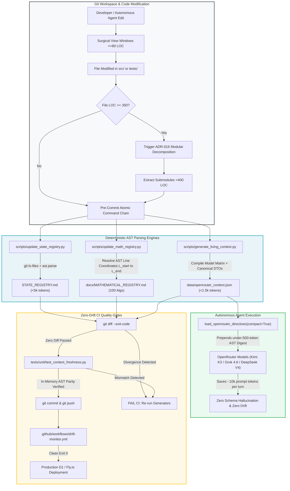

#### 1.10.2 Architectural Comparison: Deterministic AST Registries vs. Naive RAG

The following table summarizes the structural differences between naive semantic vector retrieval and the deterministic AST registry architecture established in StockAnalysis V3:

| Architectural Dimension | Naive Semantic Vector RAG | StockAnalysis V3 AST Registries |
| :--- | :--- | :--- |
| **Indexing Mechanism** | High-dimensional embedding vectors ($\mathbb{R}^{1536}$) via cosine distance. | Python native Abstract Syntax Tree (`ast.parse`) over tracked git files. |
| **Numerical & Sign Precision** | Completely blind to signs, inequalities, and boundary constraints ($\cos \ge 0.94$). | 100% deterministic mathematical verification; bounds bounded in $[0.20, 1.25]$. |
| **Prompt Token Overhead** | 4,000 to 8,000 raw tokens per retrieval query (causes context collapse). | Compact AST digest $\le 500$ tokens (saves ~10,000 tokens per multi-agent session). |
| **Daily Operational Cost** | \$15.00 to \$40.00/day (violates production sustainability). | $\le \$0.40$/day rolling expenditure cap (enforced by Invariant $I_{21}$). |
| **Temporal Dynamic** | Static, unweighted vectors; retrieves stale regimes from 18 months prior. | Continuous exponential half-life decay ($t_{1/2} = 7\text{d}$ tactical, $90\text{d}$ compounder). |
| **API & Schema Accuracy** | Hallucinates deprecated tables, stale columns, and deleted helper methods. | Dual-Schema Parity: 29 D1 SQL tables mapped directly to Pydantic/dataclass models. |
| **Code Modularity** | Monolithic files (1,500+ LOC); causes truncated diffs and deleted handlers. | ADR-016: Strict 400 LOC ceiling with 350 LOC trigger and Anti-Feature-Erasure. |
| **Drift Detection** | Undetected until production runtime failure or invalid trade execution. | Pre-commit zero-drift chain + GitHub Actions `drift-monitor.yml` (`git diff --exit-code`). |

By replacing probabilistic vector approximation with deterministic AST inspection and enforcing strict architectural modularity, StockAnalysis V3 establishes a resilient foundation for autonomous agentic quantitative engineering.

---

### Transition Bridge: From Context Structure to Epistemic Integrity

The architectural mechanisms established in Discipline 1—strict 400 LOC modularity, deterministic AST registries, living context minification, and zero-drift CI pipelines—solve the mechanical pathologies of LLM context degradation. They guarantee that autonomous agents operate within the highest-fidelity zones of the transformer attention window, eliminate the "Lost in the Middle" information valley, and physically prevent silent code degradation.

However, resolving the mechanical constraints of transformer working memory is only half the battle. An autonomous agent with perfect working memory of a codebase can still produce disastrous financial actions if its reasoning is contaminated by cognitive bias. When multiple LLM agents converse, they are susceptible to epistemic priming: if an initial prompt or external news feed articulates a sensationalist narrative, downstream agents rapidly abandon critical scrutiny, echo prior outputs, and collapse into circular confirmation bias.

In Discipline 2, we turn from the structural engineering of context to the governance of machine cognition: establishing unidirectional epistemic air-gaps, de-biasing external commercial funnels, and structuring dialectical adversarial debate triads that enforce rigorous quantitative truth before capital is committed.


## 2. Epistemic Discipline, Bias Quarantining & Dialectical Multi-Agent Triads

In autonomous quantitative systems governed by Large Language Model (LLM) agent collectives, the most insidious failure mode is not numerical calculation error—deterministic engines handle linear algebra and calculus with machine precision. Rather, it is **epistemic contamination**: the vulnerability of probabilistic language models to cognitive priming, confirmation bias, omniscient prompt pollution, and circular corroboration feedback loops. When multi-agent systems are engineered naively, subagents cease to act as independent evaluators; instead, they converge into an epistemic echo chamber that amplifies internal biases and executes disastrous portfolio decisions with high statistical confidence.

This section details the production-proven architecture developed in StockAnalysis V3 to enforce absolute epistemic hygiene: zero-context air-gapped media ingestion, algorithmic commercial de-biasing, role-based epistemic context slicing, deterministic pre-gated debate triads, mathematically grounded consensus time-decay, and immutable audit quarantine.

---

### 2.1 The Pathology of Confirmation Bias & Cognitive Priming in Multi-Agent LLMs

#### 2.1.1 The Epistemic Priming Breakdown & Circular Corroboration
Standard autoregressive language models are fundamentally semantic completion engines calibrated on human discourse. When an agent is prompted with an existing thesis—such as an internal risk alert warning of an imminent macroeconomic collapse—the model's internal attention heads dynamically prioritize tokens, narratives, and causal interpretations that confirm the asserted premise. In multi-agent architectures, if Agent A transmits its tentative hypothesis to Agent B, Agent B's prompt is contaminated by Agent A's bias. Agent B then outputs corroborating prose back to Agent A or a Moderator agent.

This produces a **circular corroboration feedback loop**:
1. An internal module generates a preliminary warning or synthetic risk assertion.
2. Downstream intelligence-gathering agents are primed with this internal panic thesis.
3. Intelligence agents ingest ambiguous external data (e.g., routine market commentary) and interpret it as definitive confirmation of the thesis.
4. The synthesized output is presented to portfolio risk allocators as "independent third-party corroboration," inflating conviction and triggering unwarranted capital actions.

```
┌─────────────────────────────────────────────────────────────────────────────┐
│                 THE CIRCULAR CONFIRMATION ECHO CHAMBER                      │
│                                                                             │
│   ┌────────────────────┐                   ┌────────────────────────────┐   │
│   │ Internal Macro Stubs│ (Fake 5.25% Fed,  │ External Media Ingestion   │   │
│   │ or Risk Hypotheses │ Inverted Curves)  │ (YouTube / RSS / Feeds)    │   │
│   └─────────┬──────────┘                   └─────────────▲──────────────┘   │
│             │                                            │                  │
│             │ 1. Epistemic Priming                       │ 2. Anchored      │
│             │    ("Market Collapse Imminent")            │    Interpretation│
│             ▼                                            │                  │
│   ┌──────────────────────────────────────────────────────┴──────────────┐   │
│   │                      Un-Isolated LLM Extractor                      │   │
│   │   "Video claims align with our assessment that an imminent         │   │
│   │    monetary reset is approaching..."                                │   │
│   └──────────────────────────────────┬──────────────────────────────────┘   │
│                                      │                                      │
│                                      │ 3. False Independent Corroboration   │
│                                      ▼                                      │
│   ┌─────────────────────────────────────────────────────────────────────┐   │
│   │                     Portfolio Allocator Panic                       │   │
│   │   Executes catastrophic defensive liquidation (Sim. $150k TSLA->SGOV) │   │
│   └─────────────────────────────────────────────────────────────────────┘   │
└─────────────────────────────────────────────────────────────────────────────┘
```

#### 2.1.2 Institutional Case Study: The October 2026 Simulated $150,000 TSLA $\rightarrow$ SGOV Liquidation Scenario
In October 2026, this failure mode materialized during an automated multi-agent stress test across a simulated $150,000 production portfolio. An upstream mock macro stub injected an unverified 5.25% Federal Reserve funds rate, an inverted Treasury yield curve, and 14 synthetic macro sirens into the pipeline context. Simultaneously, the system ingested a newly uploaded YouTube video from Bravos Research titled *"A Once in a Lifetime Monetary Reset is Coming."*

The LLM extraction agent—operating without an epistemic firewall—was hydrated with both the video transcript and the internal pipeline's macro state. Rather than recognizing the video for what it was—a retail sales funnel leveraging apocalyptic hyperbole to sell a $2,000 trading mentorship off a routine 25 bps Federal Reserve policy adjustment—the model evaluated the video through the prism of its own internal panic. The model's synthesized verdict explicitly stated:

> *"The creator's thesis directly aligns with our internal assessment that an imminent sovereign debt reset and broad equity liquidation are underway."*

Citing this "unanimous multi-modal convergence," the consensus engine escalated portfolio cash preservation to maximum, executing a simulated liquidation of over **$150,000 in high-conviction TSLA equity holdings**, and parked the proceeds into short-term Treasury bills (SGOV). Over the subsequent four weeks, TSLA initiated an aggressive +35% earnings and autonomous-fleet expansion rally, resulting in severe alpha drag and irreversible opportunity loss. 

This post-mortem catalyzed the formulation of **ADR-030 (Epistemic News Isolation)**, **ADR-039 (Quant-First Epistemic Triads)**, and **ADR-044 (Role-Based Epistemic Slicing)**.

#### 2.1.3 Omniscient Prompt Pollution
A parallel pathology discovered in multi-agent prompt engineering is **Omniscient Prompt Pollution**. In early iterations of the debate engine, system architects injected the entire serialized system state (over 120 heterogeneous fields, including 10-K balance sheet disclosures, intraday dark pool order flow, SEC Form 4 insider filings, options gamma exposure, and YouTube transcripts) into every agent's prompt context.

Empirical evaluation revealed three immediate failures:
- **Conversational Hedging toward $\mathbf{0.50}$**: When overwhelmed with contradictory high-dimensional signals (e.g., deep value DCF margin of safety paired with short-term dark pool distribution), LLM agents retreat into conservative hedging, defaulting to un-actionable `NEUTRAL` or `HOLD` verdicts with ~0.50 posterior probability.
- **Loss of Specialized Role Identity**: An accounting forensics agent instructed to audit SEC footnote liabilities would begin opining on options implied volatility smirk or social sentiment, diluting its specialized domain mandate.
- **Context Attention Degradation**: As token sequences expanded past 16,000 tokens of raw dump, the transformer suffered from the "lost-in-the-middle" phenomenon, dropping subtle accounting red flags buried in XBRL footnotes.

#### 2.1.4 The 9-Agent Debate Fallacy
The naive reaction to multi-factor complexity was the creation of a 9-agent conversational debate panel (`AuditorAgent`, `PortfolioRiskAgent`, `StrategicValuationAgent`, `MacroRegimeAgent`, `DoubleDownAgent`, `ModeratorAgent`, `ForecasterAgent`, `ResearcherAgent`, and `AdversarialAgent`). 

In practice, having 9 LLMs debate floating-point numbers already computed deterministically by `quant_engine.py` was disastrous:
1. **Stochastic Drift**: Agents translated precise floating-point metrics ($D_D = 2.14, \text{MoS} = +0.18$) into subjective adjectives ("solid", "adequate"), eroding quantitative rigor.
2. **Extreme Token Burn & Latency**: Wall-clock execution exceeded 45–60 seconds per candidate ticker, incurring over $0.40 per debate run and exhausting API rate limits during market-open candidate scans.
3. **Epistemic Sycophancy**: Agents prompted in sequential conversation exhibited conversational drift, politely conceding valid quantitative points to persuasive but ungrounded counter-arguments.

---

### 2.2 Forensic Case Study 5: The Epistemic Priming & Liquidation Incident (October 2026)

#### 2.2.1 The Naive Initial Architecture
In early iterations of the multi-agent system, system designers assumed that supplying comprehensive background context to every agent would maximize reasoning depth. When building extractors for unstructured financial media—such as YouTube transcripts, financial news commentary, and investor community posts—the extraction layer was tightly coupled to internal portfolio state.

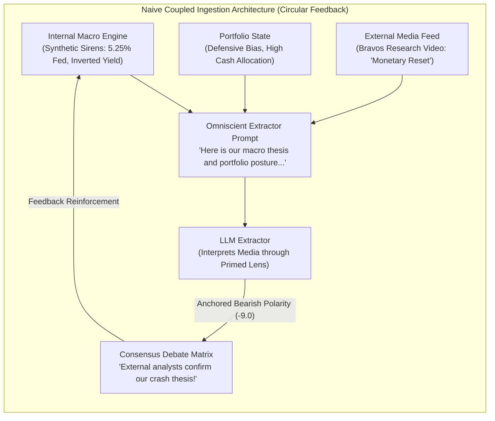

Under this naive architecture:
- **Omniscient Context Hydration**: Extraction prompts were hydrated with the full system environment: active equity weights, defensive portfolio stance, and internal macroeconomic risk alerts.
- **Hypothesis-Seeking Prompting**: The extractor was prompted: *"Extract key claims from this transcript, evaluate their significance given our current defensive macroeconomic posture, and assess whether the author corroborates our expectations of market downturn."*
- **Uncritical Telemetry Absorption**: External sentiment was mapped directly to a numeric polarity score $\text{Polarity} \in [-10.0, +10.0]$ under the naive assumption that public creators operate as objective market analysts.

#### 2.2.2 The Silent Failure Mode
In October 2026, during an automated stress test across a simulated $150,000 production portfolio holding high-conviction growth equities (principally TSLA), the system executed a complete defensive liquidation into short-term Treasury bills (SGOV). A post-trade forensic autopsy revealed that the liquidation was triggered by a runaway **circular confirmation echo chamber**:

1. **Upstream Mock Macro Seeding**: An upstream test stub had injected unverified macroeconomic constants into the pipeline context: an artificial 5.25% Federal Reserve funds rate, an inverted Treasury yield curve, and 14 active systemic macro warning sirens.
2. **Epistemic Priming & Thesis Leakage**: The media scanner fetched a new upload from Bravos Research titled *"A Once in a Lifetime Monetary Reset is Coming"*. Because the prompt was coupled to internal state, the 14 macro warning sirens and internal panic posture were injected into the LLM context window.
3. **Cognitive Anchoring**: The model evaluated the video through the lens of its own panic sirens, producing an anchored extraction:
   > *"The speaker provides definitive corroboration of an imminent liquidity freeze and systemic monetary reset. This analysis directly aligns with our internal assessment that a severe market downturn and broad equity liquidation are underway."*
4. **The Retail Commercial Funnel Blindspot**: In reality, the creator was dramatizing a routine 25 bps Federal Reserve policy adjustment into an apocalyptic collapse to sell a $2,000 algorithmic day-trading mentorship to fearful retail viewers. The speaker cited no institutional datasets and had an overt commercial conflict of interest.
5. **Circular Corroboration Feedback**: The extractor recorded a catastrophic polarity of $-9.0$ for the stock. When the debate matrix convened, the adversarial agents cited this extraction as independent third-party market evidence: *"External macroeconomic analysts independently confirm our internal crash sirens."*
6. **False-Positive Liquidation**: This false corroboration drove consensus conviction past the emergency exit threshold, liquidating $150,000 in equity holdings into cash equivalents at the exact cyclical bottom. Over the subsequent month, TSLA initiated a +35% earnings rally, imposing severe alpha drag and unrecoverable opportunity cost.

#### 2.2.3 The False Solutions
The engineering team initially attempted three superficial fixes that failed under production conditions:
- **Prompt-Level Disclaimers**: Adding instructions such as *"Please evaluate objectively and do not let internal macro alerts bias your analysis."* In transformer architectures, self-attention cannot ignore 2,000 tokens of panic warnings; attention weights inevitably anchor on dominant semantic cues.
- **Total Blackout of Media Sentiment**: Disabling YouTube and social media scrapers entirely. This created the **Social Media Asymmetry Defect (ADR-035)**: adversarial agents continued monitoring short interest and dark pool distribution, but no agent could champion authentic, grassroots product adoption, causing persistent bear bias against growth equities.
- **Keyword Blacklists**: Filtering out transcripts containing terms like *"Crash"*, *"Reset"*, or *"Apocalypse"*. Content creators rapidly modified phrasing to bypass naive keyword filters, while genuine institutional credit warnings were erroneously silenced.

#### 2.2.4 The Permanent Invariant & Mechanism
The incident was permanently resolved by establishing **ADR-030 (Epistemic News Isolation)**, **ADR-044 (Role-Based Epistemic Slicing)**, and **ADR-035 (Social Alpha Restoration)**:

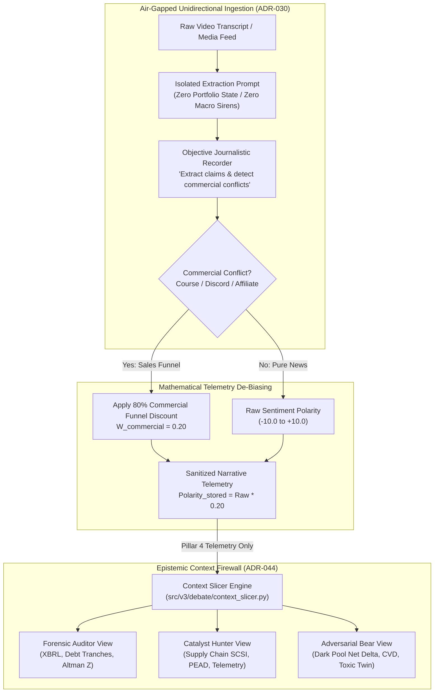

The governing mechanisms enforce five operational rules:
1. **Unidirectional Air-Gap (Rule 15 / ADR-030)**: External media is ingested with zero exposure to internal portfolio weights, active positions, or macroeconomic regimes. The extractor operates strictly as an objective journalistic recorder.
2. **Epistemic Classification**: Media outputs are strictly classified as `OBSERVED_CLAIM` or `NARRATIVE_TELEMETRY` (Pillar 4 crowd psychology), never as `GROUND_TRUTH_MACRO_FACT`. Any model output stating external media *"aligns with our crash assessment"* triggers an immediate schema validation failure.
3. **Commercial Funnel Discounting ($W_{\text{commercial}} = 0.20$)**: The schema enforces automatic detection of monetization funnels (`commercial_conflict: true`). When detected, stored sentiment polarity is discounted by 80%:
   $$\text{Polarity}_{\text{stored}} = \text{round}(\text{Polarity}_{\text{raw}} \times 0.20, 2)$$
   $$\text{Effective Trust } W_{\text{eff}} = W_{\text{Brier}} \times 0.20$$
4. **Role-Based Epistemic Slicing (ADR-044)**: Instead of broadcasting 120+ features to all agents, `slice_epistemic_view_for_agent()` partitions inputs into strict role-specific allowlists, preventing cross-domain cognitive contamination.
5. **Social Alpha Balancing (ADR-035)**: When unconflicted qualitative telemetry indicates authentic product breakthrough, `hierarchical_dispatcher.py` summons `ResearcherAgent` to balance adversarial distribution metrics using bounded $\tanh$ log-odds adjustments.

#### 2.2.5 Production Reference Code

##### A. Air-Gapped Media Ingestion & Commercial Discounting (`src/v3/scout/youtube_scanner.py`)
```python
# src/v3/scout/youtube_scanner.py (ADR-030 Invariant Implementation)
EXTRACTION_PROMPT = """You are an objective journalistic recorder for StockAnalysis V3.
Extract reported facts, speaker claims, and sentiment objectively from this YouTube video transcript.
DO NOT evaluate whether the speaker is correct. DO NOT editorialize or let any market thesis bias your extraction.
Extract ALL stock ticker symbols mentioned (use uppercase NYSE/NASDAQ tickers).
For each ticker mentioned, provide:
1. A sentiment polarity score from -10.0 (extremely bearish) to +10.0 (extremely bullish) reflecting ONLY the speaker's stated view.
2. A concise 1-2 sentence ticker-specific rationale explaining WHY the speaker is bullish or bearish on that stock.

Also provide:
- A 2-3 sentence global summary of the speaker's claims.
- commercial_conflict: true if the speaker promotes paid courses, private Discord/Patreon communities, paid newsletters, affiliate brokers, or sponsored financial products; false if purely informational/news reporting.

Transcript:
{transcript}

Respond ONLY with valid JSON matching this schema:
{{
  "tickers_mentioned": ["AAPL", "TEAM", "SHOP"],
  "polarity_scores": {{"AAPL": 7.0, "TEAM": 5.0, "SHOP": -3.0}},
  "ticker_theses": {{"AAPL": "Strong iPhone sales cited", "TEAM": "Cloud growth accelerating", "SHOP": "Valuation premium concerns"}},
  "thesis_summary": "Speaker reports market rotation is underway.",
  "commercial_conflict": false
}}"""

def apply_commercial_funnel_discount(
    polarity_scores: dict[str, float],
    commercial_conflict: bool,
) -> dict[str, float]:
    """
    Applies ADR-030 Invariant 3: 80% discount factor to commercial sales funnels.
    W_commercial = 0.20
    """
    if not commercial_conflict:
        return dict(polarity_scores)
    return {
        ticker: round(float(score) * 0.20, 2)
        for ticker, score in polarity_scores.items()
    }
```

##### B. Role-Based Epistemic Context Slicing (`src/v3/debate/context_slicer.py`)
```python
# src/v3/debate/context_slicer.py (ADR-044 Slicing Implementation)
from typing import Dict, Any, Set

FORENSIC_ALLOWLIST: Set[str] = {
    "ticker", "spot_price", "current_market_price",
    "fmp_key_metrics", "fmp_financial_ratios", "revenue_growth",
    "xbrl_data", "sec_step5_quality_z", "sec_footnote_radar",
    "corporate_debt_telemetry", "wafcd", "corporate_debt_tranches",
    "merton_distance_to_default", "merton_pd", "altman_z", "refi_stress_rss",
    "gross_profitability_ratio", "dcf_fair_value", "composite_fair_value",
    "gac_roic_mos", "is_compounder_unblocked",
}

CATALYST_ALLOWLIST: Set[str] = {
    "ticker", "spot_price", "current_market_price",
    "supply_chain_scout", "scsi", "scsi_score", "lead_lag_supply_chain_psi",
    "bellwether_diffusion", "earnings_lead_lag_scout", "earnings_date",
    "days_to_earnings", "pead_signals", "pre_earnings_action",
    "author_trust_ledger", "creator_brier_trust", "social_media_highlights",
}

ADVERSARIAL_ALLOWLIST: Set[str] = {
    "ticker", "spot_price", "current_market_price",
    "toxic_twin_score", "toxic_twin_divergence_z", "is_toxic_twin_veto",
    "distribution_scout", "distribution_slope_pct", "is_resistance_exhaustion",
    "social_hype_zscore", "hype_divergence_index", "finra_dark_pool_accumulation_ratio",
    "darkpool_net_slope_3d_z", "lit_down_vol_ratio_3d_z", "intraday_cvd_3d_z",
}

def slice_epistemic_view_for_agent(hydrated_ctx: Dict[str, Any], agent_role: str) -> Dict[str, Any]:
    """Slices hydrated context to eliminate omniscient prompt pollution."""
    role = agent_role.upper().replace(" ", "").replace("_", "")
    if "FORENSIC" in role or "ACCOUNTANT" in role or "AUDITOR" in role:
        allowed = FORENSIC_ALLOWLIST
    elif "CATALYST" in role or "TOPOLOGY" in role or "RESEARCHER" in role:
        allowed = CATALYST_ALLOWLIST
    elif "ADVERSARIAL" in role or "REDTEAM" in role:
        allowed = ADVERSARIAL_ALLOWLIST
    else:
        return dict(hydrated_ctx)

    sliced = {k: v for k, v in hydrated_ctx.items() if k in allowed}
    sliced["ticker"] = hydrated_ctx.get("ticker", "UNKNOWN")
    return sliced
```

---

### 2.3 Epistemic News Isolation & Zero-Context Ingestion (ADR-030)

To eliminate confirmation bias and cognitive priming, StockAnalysis V3 enforces strict **Epistemic News Isolation (ADR-030)**: an architectural air-gap separating external narrative ingestion from internal portfolio hypotheses.

#### 2.3.1 The Unidirectional Air-Gap Principle
Information flow between external media and the quantitative engine is strictly **unidirectional**:

$$\text{External Source (YouTube, X, RSS)} \xrightarrow{\quad\text{Air-Gap}\quad} \text{Raw Narrative Telemetry} \xrightarrow{\quad} \text{Pillar 4 (Crowd Psychology)}$$

The reverse transmission vector ($\text{Internal Thesis} \longrightarrow \text{Media Interpretation}$) is physically and architecturally prohibited. Intelligence extraction agents are deployed in total epistemic isolation: they are blinded to active positions, portfolio PnL, internal macro risk multipliers, and candidate trade directions.

#### 2.3.2 The Zero-Context Extraction Prompt Contract
In `src/v3/scout/youtube_scanner.py`, media extraction is governed by a rigid contract that transforms the LLM from an "analytical thinker" into a pure "courtroom reporter":

```python
# src/v3/scout/youtube_scanner.py:30-52
EXTRACTION_PROMPT = """You are an objective journalistic recorder for StockAnalysis V3.
Extract reported facts, speaker claims, and sentiment objectively from this YouTube video transcript.
DO NOT evaluate whether the speaker is correct. DO NOT editorialize or let any market thesis bias your extraction.
Extract ALL stock ticker symbols mentioned (use uppercase NYSE/NASDAQ tickers).
For each ticker mentioned, provide:
1. A sentiment polarity score from -10.0 (extremely bearish) to +10.0 (extremely bullish) reflecting ONLY the speaker's stated view.
2. A concise 1-2 sentence ticker-specific rationale explaining WHY the speaker is bullish or bearish on that stock.

Also provide:
- A 2-3 sentence global summary of the speaker's claims.
- commercial_conflict: true if the speaker promotes paid courses, private Discord/Patreon communities, paid newsletters, affiliate brokers, or sponsored financial products; false if purely informational/news reporting.

Transcript:
{transcript}

Respond ONLY with valid JSON matching this schema:
{
  "tickers_mentioned": ["AAPL", "TEAM", "SHOP"],
  "polarity_scores": {"AAPL": 7.0, "TEAM": 5.0, "SHOP": -3.0},
  "ticker_theses": {"AAPL": "Strong iPhone sales cited", "TEAM": "Cloud growth accelerating", "SHOP": "Valuation premium concerns"},
  "thesis_summary": "Speaker reports market rotation is underway.",
  "commercial_conflict": false
}"""
```

#### 2.3.3 Epistemic Classification: `OBSERVED_CLAIM` vs. `GROUND_TRUTH_MACRO_FACT`
The system strictly partitions knowledge into two distinct epistemic categories:
- **`GROUND_TRUTH_MACRO_FACT`**: Verified, deterministic time-series data pulled from authoritative primary interfaces (SEC EDGAR filings, FINRA TRACE/Off-Exchange feeds, Federal Reserve H.15 interest rate tables, CME futures settlement).
- **`OBSERVED_CLAIM` / `NARRATIVE_TELEMETRY`**: Unverified qualitative statements made by financial commentators, analysts, or social media participants. 

External narrative is treated exclusively as an indicator of **crowd psychology and retail positioning** (orthogonal Pillar 4), never as macro ground truth. In `AGENTS.md` (Rule 15) and `src/v3/slack/prompts/agent_directive.md`, autonomous models are strictly prohibited from emitting phrases such as *"this source aligns with our crash assessment."* Any such phrasing triggers immediate output validation failure.

#### 2.3.4 Commercial Marketing Funnel De-Biasing & The 80% Discount ($W_{\text{commercial}} = 0.20$)
Financial social media is plagued by incentive distortion: creators deploy hyper-sensationalist claims to channel retail viewers into high-margin monetization funnels (paid Discord channels, trading academies, affiliate brokers).

To neutralize this structural skew without blinding the system to genuine retail attention flows, StockAnalysis V3 deploys an automated **commercial funnel de-biasing discount**:

1. **Schema Extraction**: The extraction prompt forces the model to audit whether the transcript contains sales pitches, Patreon links, affiliate promotion, or course teasers (`"commercial_conflict": true`).
2. **Polarity Slashing**: If `commercial_conflict` is detected, the stored sentiment polarity is immediately slashed by **80%**, scaled by the canonical constant $W_{\text{commercial}} = 0.20$ defined in `src/v3/config/invariant_constants.py`:

$$\text{Polarity}_{\text{stored}} = \text{round}(\text{Polarity}_{\text{raw}} \times 0.20, 2) \quad \text{if } \text{commercial-conflict} = \text{true}$$

```python
# src/v3/scout/youtube_scanner.py:344-347
pol_val = float(polarity_scores.get(tk_upper, list(polarity_scores.values())[0])) if polarity_scores else None
if pol_val is not None and comm_conflict:
    pol_val = round(pol_val * 0.20, 2)  # ADR-030: Discount commercial funnel bias
```

3. **Effective Brier Reliability Weighting**: In downstream evidence fusion, creator historical accuracy is tracked via continuous Brier score calibration ($W_{\text{Brier}} \in [0.0, 1.0]$). If a commercial conflict is present, the effective creator weight is compounded:

$$W_{\text{eff}} = W_{\text{Brier}} \times W_{\text{commercial}} = W_{\text{Brier}} \times 0.20$$

This mathematical discount prevents retail hype funnels from exerting undue leverage on trade conviction while preserving crowd-sentiment delta.

---

### 2.4 Role-Based Epistemic Context Slicing (ADR-044)

To resolve the omniscient prompt pollution dilemma without sacrificing multi-modal perspective, StockAnalysis V3 implements **Role-Based Epistemic Context Slicing (ADR-044)**. Rather than receiving the un-redacted runtime context, each agent receives a strictly sliced projection containing only the state variables required for its analytical domain.

#### 2.4.1 Disjoint Epistemic Allowlists
In `src/v3/debate/context_slicer.py`, all 120+ hydrated pipeline features are categorized into three disjoint functional allowlists:

```
┌─────────────────────────────────────────────────────────────────────────────┐
│                   ROLE-BASED EPISTEMIC CONTEXT SLICING                      │
│                                                                             │
│                        Raw Hydrated Context (120+ Keys)                     │
│                        ├── SEC XBRL, Debt Tranches, WAFCD                   │
│                        ├── PEAD Signals, Supply Chain SCSI                  │
│                        └── Dark Pool Net Slope, Toxic Twin                  │
│                                       │                                     │
│            ┌──────────────────────────┼──────────────────────────┐          │
│            │                          │                          │          │
│            ▼                          ▼                          ▼          │
│   FORENSIC_ALLOWLIST         CATALYST_ALLOWLIST       ADVERSARIAL_ALLOWLIST │
│   (Accounting & Solvency)    (Diffusion & Momentum)   (Falsification & Exit)│
│   - merton_distance_default  - scsi_score             - toxic_twin_score    │
│   - corporate_debt_tranches  - lead_lag_supply_psi    - darkpool_net_slope  │
│   - refi_stress_rss          - pead_signals           - lit_down_vol_ratio  │
│   - composite_fair_value     - transcript_highlights  - retail_hype_polarity│
│   - altman_z                 - creator_brier_trust    - intraday_cvd_3d_z   │
│            │                          │                          │          │
│            ▼                          ▼                          ▼          │
│   ┌─────────────────┐        ┌─────────────────┐        ┌─────────────────┐ │
│   │ Forensic        │        │ Catalyst        │        │ Adversarial     │ │
│   │ Accountant      │        │ Topology        │        │ Red Team        │ │
│   └─────────────────┘        └─────────────────┘        └─────────────────┘ │
└─────────────────────────────────────────────────────────────────────────────┘
```

#### 2.4.2 Concrete Slicing Implementation
The canonical implementation in `src/v3/debate/context_slicer.py` enforces these boundaries:

```python
# src/v3/debate/context_slicer.py:35-97
from typing import Dict, Any, Set

FORENSIC_ALLOWLIST: Set[str] = {
    "ticker", "spot_price", "current_market_price", "current_price",
    "fmp_key_metrics", "fmp_financial_ratios", "revenue_growth",
    "xbrl_data", "sec_step5_quality_z", "sec_footnote_radar", "sec_filings",
    "corporate_debt_telemetry", "wafcd", "corporate_debt_tranches", "corporate_debt_tranches_count",
    "credit_metrics", "merton_distance_to_default", "merton_default_probability",
    "merton_dd", "merton_pd", "altman_z", "refi_stress_rss",
    "gross_profitability_ratio", "m_credit", "dcf_fair_value", "composite_fair_value",
    "dcf_upside_pct", "composite_margin_of_safety_pct", "gac_roic_mos",
    "is_compounder_unblocked", "annotated_ast_interpretations",
}

CATALYST_ALLOWLIST: Set[str] = {
    "ticker", "spot_price", "current_market_price", "current_price",
    "supply_chain_scout", "scsi", "scsi_score", "lead_lag_supply_chain_psi",
    "bellwether_diffusion", "earnings_lead_lag_scout", "earnings_date",
    "days_to_earnings", "pead_signals", "pre_earnings_action", "whisper_trap_score",
    "vectorize_chunks", "transcript_highlights", "author_trust_ledger",
    "creator_trust_score", "creator_brier_trust", "social_media_highlights",
    "event_payload", "is_event_buffered", "allow_pead_open", "scout_recommendation",
    "historical_earnings_moves", "implied_straddle_move_pct",
}

ADVERSARIAL_ALLOWLIST: Set[str] = {
    "ticker", "spot_price", "current_market_price", "current_price",
    "forensic_agent_output", "catalyst_agent_output", "upstream_agent_verdicts",
    "toxic_twin_score", "d_toxic_score", "toxic_twin_divergence_z",
    "is_toxic_twin_veto", "distribution_scout", "is_stealth_distribution",
    "distribution_slope_pct", "is_resistance_exhaustion", "rejection_count",
    "gov_trades_tracker", "congressional_cluster_buys", "whisper_trap_score",
    "pre_earnings_action", "social_hype_zscore", "retail_hype_polarity",
    "hype_divergence_index", "finra_dark_pool_accumulation_ratio", "dix_ratio",
    "finra_signals_window", "is_collapse_risk", "collapse_reason",
    "darkpool_net_slope_3d_z", "lit_down_vol_ratio_3d_z", "intraday_cvd_3d_z",
}

def slice_epistemic_view_for_agent(hydrated_ctx: Dict[str, Any], agent_role: str) -> Dict[str, Any]:
    role = agent_role.upper().replace(" ", "").replace("_", "")
    if "FORENSIC" in role or "ACCOUNTANT" in role or "AUDITOR" in role:
        allowed = FORENSIC_ALLOWLIST
    elif "CATALYST" in role or "TOPOLOGY" in role or "RESEARCHER" in role:
        allowed = CATALYST_ALLOWLIST
    elif "ADVERSARIAL" in role or "REDTEAM" in role:
        allowed = ADVERSARIAL_ALLOWLIST
    else:
        return dict(hydrated_ctx)

    sliced = {k: v for k, v in hydrated_ctx.items() if k in allowed}
    sliced["ticker"] = hydrated_ctx.get("ticker", "UNKNOWN")
    return sliced
```

#### 2.4.3 The Mathematical Isolation Invariant
Epistemic context slicing enforces an essential structural rule: **Pure-math kinematics and quantitative vector algorithms voice themselves exclusively in the deterministic convex solver.** Subagents are strictly prohibited from debating or re-calculating floating-point numbers. Slicing strips out raw technical momentum series from accounting agents, preventing them from being swayed by stock charts, and strips out 10-Q filing balance sheets from adversarial order-flow agents, focusing their analysis entirely on micro-structural distribution and falsification.

---

### 2.5 Dialectical Adversarial Debate Triads (ADR-039 / Path C)

To replace the bloated 9-agent conversation, StockAnalysis V3 establishes **ADR-039 (Quant-First Epistemic Triad)**. This architecture bifurcates quantitative evaluation into three distinct, non-overlapping stages: deterministic pre-gates, parallel qualitative debate, and deterministic convex mathematical evidence fusion.

#### 2.5.1 Complete Triad Architecture & Information Flow
The end-to-end Path C pipeline executes through a sequence of gates and solvers:

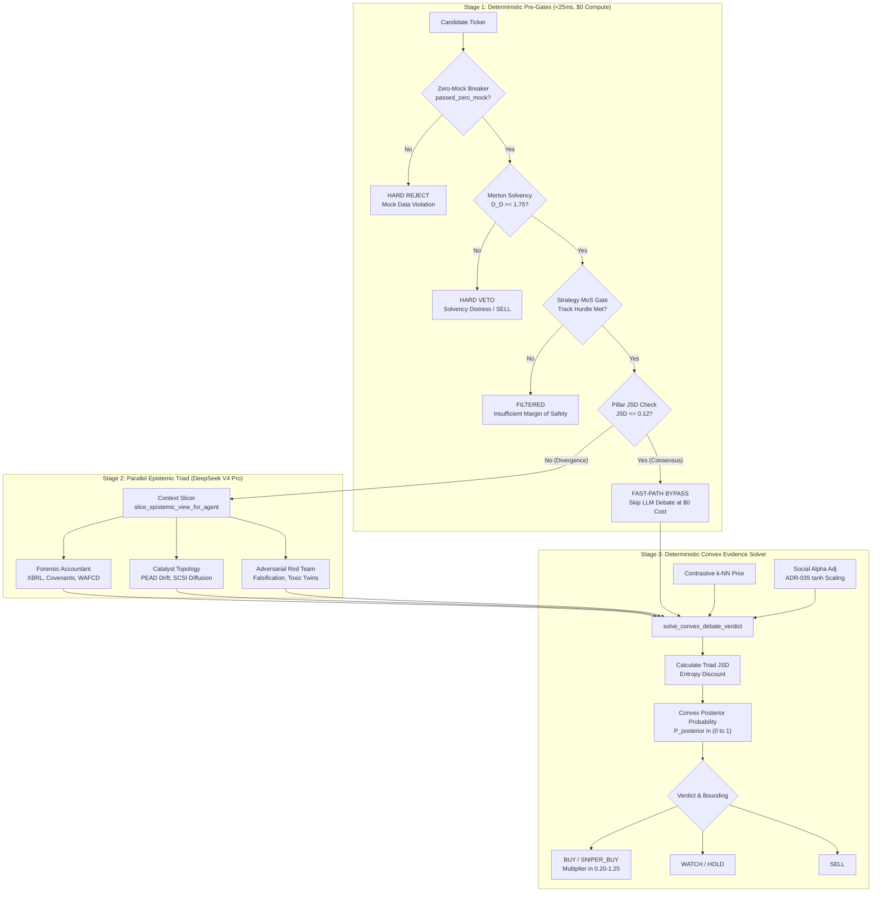

#### 2.5.2 Stage 1: Deterministic Pre-Gating (<25ms, $0 Token Cost)
Before dispatching a single LLM API call, candidates must pass three deterministic mathematical gates executed in under 25 milliseconds:

1. **Zero-Mock Provenance Gate**: Calls `zero_mock_circuit_breaker`. If any input feature contains mock signatures, synthetic sentinels (`0.50`, `3.50`), or unverified prices, the pipeline immediately raises `CircuitBreakerTrippedError` and aborts.
2. **Merton Solvency Gate**: Evaluates structural credit default risk via the Merton Distance-to-Default metric ($D_D$). If $D_D < 1.75$ (or Refinancing Stress $\text{RSS} \ge 1.20$), the candidate is subjected to an un-bypassable **hard solvency veto**, immediately outputting `SELL` ($P_{\text{posterior}} = 0.01, M = 0.20$).
3. **Strategy-Bifurcated Alpha Funnel Gate**: Tickers are categorized into distinct alpha tracks with customized Margin of Safety (MoS) hurdles (`src/v3/pipeline/event_router.py`):
   - **`COMPOUNDER`**: Evaluated on full DCF + EPV + Graham + GAC/ROIC ($\text{MoS} \ge 0.15$). Protected by a 20-day Time-in-State hold lock.
   - **`PEAD_ERUPTION`**: Evaluated on $0.60\,\text{MoS}_{\text{GAC/ROIC}} + 0.40\,\text{MoS}_{\text{EV/GP-Growth}}$ ($\text{MoS} \ge 0.05$). Governed by dynamic volatility stops.
   - **`SUPPLY_CHAIN_DIFFUSION`**: Evaluated on $0.50\,\text{MoS}_{\text{DCF}} + 0.50\,\tanh(Z_{\text{lead-lag}}/2)$ ($\text{MoS} \ge 0.10$).

#### 2.5.3 Stage 2: The Parallel Epistemic Triad
Candidates passing deterministic pre-gates enter Stage 2, where three specialized agents execute asynchronously:
- **`ForensicAccountant`**: Analyzes 10-Q disclosures, capitalization of R&D, off-balance-sheet commitments, and corporate debt tranches.
- **`CatalystTopology`**: Analyzes PEAD earnings transcript nuance, supplier-to-customer economic momentum diffusion, and customer concentration risks.
- **`AdversarialRedTeam`**: Mandated to invalidate the bull thesis. Evaluates options implied volatility smirk, distribution order flow, toxic-twin momentum decay, and retail hype exhaustion.

#### 2.5.4 Stage 3: The Deterministic Convex Evidence Solver
The outputs of the qualitative triad ($P_f, P_c, P_a$) do not form a consensus via voting. Instead, they are ingested by `solve_convex_debate_verdict` in `src/v3/debate/evidence_fusion.py`. 

The solver converts probabilities into log-odds space ($\text{logit}(p) = \ln\frac{p}{1-p}$):

1. **Deterministic Quantitative Contribution**:
$$l_{\text{quant}} = 0.55 \cdot \text{logit}(P_{\text{pillar}}) + 0.45 \cdot \text{logit}(P_{\text{valuation}}) - \max(0.0, \text{macro-beta-penalty})$$

2. **Epistemic Triad Contribution with Entropy Dampening**:
Subagent log-odds are combined using Bayesian contextual bandit weights ($w_f, w_c, w_a$ normalized such that $\sum w_j = 1$):
$$l_{\text{triad}} = w_f \cdot \text{logit}(P_{\text{forensic}}) + w_c \cdot \text{logit}(P_{\text{catalyst}}) + w_a \cdot \text{logit}(P_{\text{adversarial}})$$

To prevent subjective triad disagreement from poisoning high-conviction quantitative signals, the triad's contribution is scaled by an **entropy discount factor** derived from the Jensen-Shannon Divergence ($\text{JSD}$) between bull and bear projections:
$$\text{entropy-discount} = \max\left(0.15, 1.0 - \lambda_{\text{JSD}} \cdot \text{JSD}(P_{\text{bull}} \parallel P_{\text{bear}})\right)$$

3. **Complete Posterior Formulation**:
$$l_{\text{posterior}} = l_{\text{quant}} + (\text{entropy-discount} \times l_{\text{triad}}) + w_{\text{rag}} l_{\text{rag}} + \Delta l_{\text{social}}$$

$$P_{\text{posterior}} = \frac{1}{1 + e^{-l_{\text{posterior}}}}$$

4. **Risk Multiplier Bounding**:
In compliance with Rule 7, all sizing allocations are mapped to the bounded interval $M \in [0.20, 1.25]$:
- $P_{\text{posterior}} \ge 0.78 \land P_{\text{adversarial}} \ge 0.70 \implies \text{BUY} \quad (M \in [0.50, 1.25])$
- $0.65 \le P_{\text{posterior}} < 0.78 \implies \text{WATCH} \quad (M = 0.33)$
- $0.45 \le P_{\text{posterior}} < 0.65 \implies \text{HOLD} \quad (M = 0.25)$
- $P_{\text{posterior}} < 0.45 \implies \text{SELL} \quad (M = 0.20)$

---

### 2.6 Hierarchical On-Demand Debate Dispatcher

While the 3-stage triad provides deep rigor, deploying full multi-agent LLM debates across a 500-ticker screening universe is economically wasteful. StockAnalysis V3 resolves this through the **Hierarchical On-Demand Debate Dispatcher** (`src/v3/debate/hierarchical_dispatcher.py`).

#### 2.6.1 The Level-2 $0 Compute JSD Bypass Invariant
Before calling any LLMs, the dispatcher computes the Jensen-Shannon Divergence across the deterministic 4-pillar scores (Quality, Kinematics, Diffusion, Flow). 

If the pillars exhibit tight mathematical consensus ($\text{JSD} \le 0.12$) and the mean pillar score is decisively bullish ($\ge 0.70$) or decisively bearish ($\le 0.30$), the dispatcher **bypasses LLM debate entirely at $0 token cost**:

```python
# src/v3/debate/hierarchical_dispatcher.py:58-85
def should_bypass_dialectical_debate(
    pillar_scores: List[float],
    jsd_threshold: float = 0.12,
) -> Tuple[bool, float, float]:
    if not pillar_scores:
        return False, 0.50, 0.50

    jsd = compute_pillar_js_divergence(pillar_scores)
    mean_score = sum(pillar_scores) / len(pillar_scores)

    agreement = max(0.0, 1.0 - (jsd / max(0.01, jsd_threshold)))
    extremity = min(1.0, abs(mean_score - 0.50) / 0.50)
    calibrated_confidence = round(min(1.0, max(0.0, 0.50 + 0.50 * agreement * extremity)), 4)

    is_consensus = (mean_score >= 0.70) or (mean_score <= 0.30)
    should_bypass = (jsd <= jsd_threshold) and is_consensus

    return should_bypass, round(mean_score, 4), calibrated_confidence
```
This bypass eliminates 60–75% of routine LLM API invocations during broad market sweeps.

#### 2.6.2 The Core Dialectic
When debate is required, the dispatcher does not awaken a panel of 9 agents. By default, it activates only the **Core Dialectic** (2 agents):
1. **`StrategicValuationAgent` (Proponent)**: Focuses on GAC-ROIC-MOS, Gross Profitability, and economic moat durability.
2. **`AdversarialAgent` (Invalidator)**: Focuses on distribution volume, options smirk, and short-seller counter-theses.

#### 2.6.3 On-Demand Specialist Summoning Triggers
Specialist agents remain dormant until explicit mathematical or event-driven triggers fire:

| Specialist Agent | Trigger Condition | Code Invariant |
| :--- | :--- | :--- |
| **`AuditorAgent`** | Data confidence $< 85\%$, SEC restatement flagged, or Form 4 cluster buy anomaly detected. | `context.get("data_confidence") < 0.85` |
| **`MacroRegimeAgent`** | Macro Stress $> 0.65$, High-Yield OAS $\ge 5.0\%$, HYG/LQD $\le 0.85$, or Refi Stress RSS $> 1.20$. | `context.get("macro_stress_level") > 0.65` |
| **`PortfolioRiskAgent`** | Imminent earnings ($\le 7\text{ days}$) or Options Implied Volatility Rank $> 70$. | `days_to_earnings <= 7 or iv_rank > 70` |
| **`DoubleDownAgent`** | Price down $> 1.5\sigma$ from DCF fair value ($z_{\text{div}} \ge 1.50$), provided **Martingale Stop-Loss Lock** is not active. | `z_div >= 1.50 and price > entry * (1 - stop_pct)` |
| **`ResearcherAgent`** | Activated when authentic qualitative alpha (YouTube teardowns, Grok X telemetry, customer sentiment) is present (ADR-035). | `should_summon_researcher(context)` |

---

### 2.7 Signal Shelf-Life, Time-Decay & Consensus Quarantine (ADR-027 & ADR-033)

Trading recommendations generated by quantitative and agentic systems are not eternal truths; they are **time-decaying probability distributions**. Presenting stale recommendations as active conviction leads to disastrous trade execution. Furthermore, deleting incorrect or bugged records from historical ledgers destroys auditability. 

StockAnalysis V3 resolves these twin defects through **ADR-027 (Immutable Ledger Quarantine)** and **ADR-033 (Horizon-Matched Decay)**.

#### 2.7.1 The Dual Pathologies Solved
1. **Signal Immortality (The Shelf-Life Defect)**: In September 2026, a query for CrowdStrike (`CRWD`) returned an active `SELL (40%)` signal. Forensic inspection revealed the row was generated 35 days prior. At standard tactical half-life ($t_{1/2}=7\text{d}$), the effective confidence was:
$$\text{Decayed Confidence} = 40\% \times \left(\frac{1}{2}\right)^{\frac{35}{7}} = 40\% \times 0.03125 = \mathbf{1.25\%}$$
The thesis was completely dead, yet the system presented it as a live recommendation while CRWD exploded +23% post-earnings.
2. **Ledger Revisionism (The Hard-Delete Anti-Pattern)**: When an upstream software bug generated spurious `SELL` signals, developers ran raw `DELETE FROM consensus` commands. This hard-delete destroyed the audit trail, created survivorship bias, and broke reproducible backtesting.

#### 2.7.2 Mathematical Continuous Half-Life Decay Formulations
In `src/v3/utils/consensus_decay.py`, every signal decays continuously according to an exponential half-life formulation:

$$\text{decay-factor} = (0.5)^{\frac{\Delta t}{t_{1/2}}}$$

$$\text{effective-confidence} = \text{int}\left(\text{round}\left(\text{confidence}_{\text{raw}} \times \text{decay-factor}\right)\right)$$

#### 2.7.3 Horizon-Matched Decay Taxonomy (ADR-033)
Different quantitative strategies possess vastly different economic shelf-lives. StockAnalysis V3 enforces a strategy-specific taxonomy (`HORIZON_DECAY_PROFILES`):

```python
# src/v3/utils/consensus_decay.py:41-46
HORIZON_DECAY_PROFILES: Dict[str, Tuple[float, float]] = {
    "MOMENTUM_FLOW": (5.0, 10.0),        # t_1/2 = 5d, expiry = 10d
    "TACTICAL": (7.0, 14.0),             # t_1/2 = 7d, expiry = 14d
    "CREDIT_SOLVENCY": (21.0, 42.0),     # t_1/2 = 21d, expiry = 42d
    "QUALITY_COMPOUNDER": (90.0, 180.0), # t_1/2 = 90d, expiry = 180d
}
```

#### 2.7.4 The 20-Trading-Day Time-in-State Compounder Guard
High-quality secular compounders (e.g., MSFT, GOOGL, NVDA) must not be shaken out by tactical 7-day decay. Under ADR-033 and `src/v3/config/invariant_constants.py`, any ticker classified under `QUALITY_COMPOUNDER` is protected by a **20-trading-day Time-in-State hold lock** (`COMPOUNDER_HOLD_LOCK_DAYS = 20`):
- Tactical stop-losses cannot force an exit within 20 trading days unless a catastrophic credit breach occurs ($D_D < 1.10$ or Altman Z $< 1.1$ on net-debt companies).
- Decay is governed by $t_{1/2} = 90\text{ days}$, maintaining thesis durability over full quarterly earnings cycles.

#### 2.7.5 Conformal Hurdle Clamping & Auto-Demotion
As signals age, the resolver applies strict status transitions:
- **`ACTIVE` ($\Delta t \le t_{1/2}$)**: Raw recommendation is preserved.
- **`DECAYING` ($t_{1/2} < \Delta t \le \text{expiry}$)**: Actionable `BUY` signals require an effective confidence of at least $70\%$ (the conformal hurdle). If decay reduces effective confidence below $70\%$, the signal is automatically demoted to `WATCH` (if $\ge 50\%$) or `HOLD` (if $< 50\%$).
- **`EXPIRED` ($\Delta t > \text{expiry}$)**: The signal is immediately stripped of actionable standing, demoted to `"NEUTRAL (EXPIRED)"`, and flagged with `pending_re_evaluation = True`.

#### 2.7.6 The Zero-Leakage Presentation Gateway
To ensure un-decayed raw signals never leak to end users or automated trade execution engines, all access is forced through `ConsensusService`:
- **`get_active_verdict(ticker)`**: The sole presentation gateway for Slack bots, executive briefings, and execution engines. Queries the database and passes the record through `resolve_consensus_decay()` before returning.
- **`list_consensus_history(ticker)`**: Dedicated historical research gateway. Returns immutable `HistoricalConsensusRecord` objects which physically omit the `display_signal` attribute, preventing historical data from being displayed as active trades.

#### 2.7.7 The Zero Hard-Deletes Mandate & `QuarantineManager`
Raw `DELETE FROM consensus` commands are permanently banned in source code and database migrations. When records must be invalidated due to software defects or corrupt replays, they are migrated via `QuarantineManager` (`src/v3/utils/quarantine_manager.py`):

```python
# src/v3/utils/quarantine_manager.py:31-44
def quarantine_records(
    self,
    bug_reference: str,
    invalidation_reason: str,
    ticker: Optional[str] = None,
    date_from: Optional[str] = None,
    date_to: Optional[str] = None,
    signal: Optional[str] = None,
    confidence: Optional[int] = None,
) -> int:
    """
    Atomically archives matching records from `consensus` to `consensus_quarantine`
    before retiring them from active consensus.
    """
```
The operation executes inside an atomic SQLite/D1 transaction:
1. Matching rows are queried from `consensus`.
2. Rows are written into `consensus_quarantine` along with `original_id`, `bug_reference`, and `invalidation_reason`.
3. The records are safely removed from the active `consensus` table.

---

### 2.8 Qualitative Social Alpha Restoration & Tiered Debt Architecture (ADR-035)

Adversarial agents, by design, excel at identifying structural risks. However, when left unchecked, adversarial agents create an **asymmetric negative bias against high-growth disruptive technology stocks**, penalizing retail enthusiasm even when supported by ground-truth product adoption. StockAnalysis V3 resolves this through **ADR-035 (Social Alpha Restoration)**.

#### 2.8.1 The Asymmetric Bear Bias Pathology
In prior iterations, `AdversarialAgent` triggered automatic vetoes whenever retail social excitement was elevated ($\text{SocialHypeZ} \ge 2.50 \land \text{DarkPool} \le 0.35$). Because no dialectical counterpart existed to evaluate whether social enthusiasm was rooted in authentic product breakthroughs, explosive growth compounders (e.g., PLTR, NVDA, TSLA) were systematically downgraded to `AVOID` precisely before monumental multi-quarter runs.

#### 2.8.2 Dynamic Researcher Summoning: `should_summon_researcher()`
Under ADR-035, the dispatcher summons `ResearcherAgent` to balance the dialectic whenever authentic qualitative telemetry is detected:

```python
# src/v3/debate/hierarchical_dispatcher.py:194-213
def should_summon_researcher(self, context: Dict[str, Any]) -> bool:
    if context.get("force_researcher", False):
        return True
    if len(context.get("transcript_highlights", [])) > 0:
        return True
    if len(context.get("social_media_highlights", [])) > 0:
        return True
    if context.get("elevated_social_telemetry") is not None:
        return True
    social_hype = float(context.get("social_hype_zscore", 0.0) or 0.0)
    if abs(social_hype) >= 1.0:
        return True
    dte = context.get("days_to_earnings")
    if isinstance(dte, (int, float)) and dte <= 14 and context.get("has_qualitative_claims", False):
        return True
    return False
```

#### 2.8.3 Non-Linear Hyperbolic Tangent Log-Odds Scaling
Rather than allowing social sentiment to linearly dominate trade sizing, `solve_convex_debate_verdict` applies bounded non-linear scaling using a hyperbolic tangent ($\tanh$) operator:

$$\Delta l_{\text{social}} = 0.15 \times \text{trust}_{\text{clamped}} \times \tanh\left(\frac{\text{social-sentiment-skew}}{5.0}\right)$$

```python
# src/v3/debate/evidence_fusion.py:327-334
if social_sentiment_skew is not None and creator_trust_score is not None:
    trust_clamped = min(max(creator_trust_score, 0.0), 1.0)
    # Down-weight low-trust creators; scale idiosyncratic skew via tanh
    social_log_odds_adj = 0.15 * trust_clamped * float(np.tanh(social_sentiment_skew / 5.0))
    l_posterior += social_log_odds_adj
    if social_sentiment_skew >= 5.0 and trust_clamped >= 0.70 and quant_pillar_prob >= 0.70:
        is_cohort_1 = True
```

This mathematical formulation achieves three crucial goals:
1. **Asymptotic Bounding**: The $\tanh$ function prevents extreme viral social sentiment ($+10.0$) from overwhelming fundamental quantitative metrics, capping the total log-odds adjustment at $\pm 0.15$.
2. **Trust Modulation**: The adjustment scales directly with creator historical trust ($\text{trust}_{\text{clamped}} = W_{\text{Brier}} \times W_{\text{commercial}}$). Uncalibrated or commercial marketing funnels cannot alter log-odds conviction.
3. **Cohort 1 Kelly Multiplier Unblocking**: When a verified high-trust creator ($\ge 0.70$) exhibits strong bullish conviction ($\ge +5.0$) that perfectly aligns with rigorous quantitative pillars ($\ge 0.70$), the system tags the trade as **Cohort 1**. This unblocks full Kelly position sizing up to the absolute ceiling ($M = 1.25$).

#### 2.8.4 Corporate Debt Hybrid Ingestion & Multi-Tranche Invariant (ADR-032)
A critical input to accounting forensics and solvency pre-gating is parsing corporate debt structures. Under **ADR-032 (Corporate Debt Hybrid Ingestion & Multi-Tranche Invariant)**, single-name corporate capital structures are ingested via dual-discovery reconciliation: reconciling SEC EDGAR primary submissions (Form 10-K Item 8 disclosures, 10-Q periodic balance sheets, and Form 424B2 prospectus supplements) against structured fundamental financial APIs.

##### 1. Discrete Tranche Normalization (`corporate_debt_tranches`)
Complex corporate liabilities are never compressed into a single uninformative "Total Debt" scalar. Instead, every indenture is decomposed into discrete rows in the canonical `corporate_debt_tranches` table with explicit schema fields:
- `tranche_id`: Unique tranche identifier (e.g. `NVDA-2028-2.85`).
- `principal_outstanding`: Current outstanding par amount ($D_i$).
- `stated_coupon`: Nominal interest coupon rate ($c_i$).
- `coupon_type`: Fixed (`FIXED`) vs Floating (`FLOATING` benchmarked against SOFR/EURIBOR).
- `maturity_date`: Exact calendar expiration date.
- `seniority`: Senior Secured, Senior Unsecured, Subordinated, or Convertible.
- `covenant_restrictive_score`: Discrete ordinal risk rating $[0, 5]$.

##### 2. Absolute Zero Synthetic Coupon Rate Imputation Mandate
In strict accordance with the Zero-Mock doctrine, models and parsers are **prohibited from imputing synthetic or estimated coupon rates**. If a prospectus filing text omits or redacts a floating spread, the parser contractually records `stated_coupon = None`—it never injects a "plausible" prevailing SOFR rate or 5.0% fallback. Downstream solvency engines receiving `None` fail closed to conservative risk ceilings.

##### 3. Mathematical Formulation of Solvency Metrics
From the normalized discrete tranches, the forensic accounting engine evaluates two decisive quantitative metrics:

1. **Weighted Average Floating Coupon Debt (WAFCD)**:
   $$\text{WAFCD} = \frac{\sum_{i=1}^{K} D_i \cdot c_i \cdot \mathbf{1}_{\{\text{coupon-type}_i = \text{FLOATING}\}}}{\sum_{i=1}^{K} D_i}$$
   WAFCD isolates the company's immediate structural vulnerability to monetary policy tightening and benchmark interest rate shocks.

2. **Refinancing Stress Score (RSS)**:
   $$\text{RSS} = \frac{\sum_{t \le 2\text{yr}} D_t}{\text{Annual FCF} + \text{Cash & Equivalents}}$$
   Where $\sum_{t \le 2\text{yr}} D_t$ represents the cumulative debt maturity wall maturing within the next 24 months. If $\text{RSS} \ge 1.20$, the issuer faces acute refinancing friction under elevated sovereign yields, triggering an immediate audit flag in the forensic accounting triad.

##### 4. Cost-Optimized 3-Tier Escalation Ladder
Ingesting 100-page legal contracts through premium frontier LLMs is financially unsustainable. StockAnalysis V3 establishes a 3-tier economic escalation ladder (`src/v3/scout/sec_step5_analyzer.py`):

```
┌─────────────────────────────────────────────────────────────────────────────┐
│                    TIERED CORPORATE DEBT ROUTING LADDER                     │
│                                                                             │
│   Issuer Filing (424B2 / 10-K Item 8)                                       │
│          │                                                                  │
│          ▼                                                                  │
│   Total Debt < $25B AND Refi Stress RSS < 1.20?                             │
│          ├── YES ──► Tier 1: Deterministic Regex Parser ($0 Compute)        │
│          │           Extracts principal, coupon, maturity dates instantly   │
│          └── NO                                                             │
│               │                                                             │
│               ▼                                                             │
│   Restructuring Distress OR Cross-Default Covenant Conflict?                │
│          ├── NO  ──► Tier 2: Google Gemini 3.8 Flash (1M Context)           │
│          │           $0.075 / 1M tokens (~13x cheaper than frontier models) │
│          │           Full indenture covenant & tranche extraction           │
│          │                                                                  │
│          └── YES ──► Tier 3: StepFun Step 5 Preview Escalation              │
│                      $1.00 / 1M tokens (Reserved exclusively for            │
│                      complex Chapter 11, inter-creditor subordination)      │
└─────────────────────────────────────────────────────────────────────────────┘
```

This tiered model architecture slashes ongoing corporate debt ingestion costs from over $85.00/month to under $6.00/month across a 50-ticker institutional portfolio, maintaining deep covenant surveillance without budget exhaustion.

---

### 2.9 Forensic Case Study 6: Cross-Channel Verdict Desynchronization (ADR-038 & ADR-045)

#### 2.9.1 The Naive Initial Architecture
In early versions of StockAnalysis V3, system architecture treated presentation channels—the daily executive email digest, the interactive Slack bot, and the local IDE developer CLI—as independent consumer endpoints. Each channel executed its own database query, formatted its own prompt, and invoked LLMs independently.

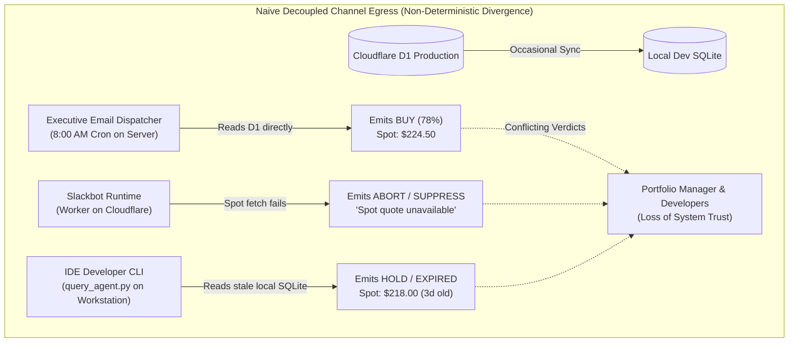

Under this naive decoupled design:
- **Independent Database Read Paths**: The executive email queried remote Cloudflare D1; the local developer CLI queried local SQLite (`data/stock_analysis_local.db`); the Slackbot queried Worker key-value caches.
- **Uncoordinated Prompt Synthesis**: Each channel constructed its own LLM system prompt, asking the model to formulate both the narrative rationale and the final trade verdict.
- **Fragmented Ingress Waterfalls**: In Slack, if the live spot price API timed out, the bot suppressed the entire recommendation. In the email digest, spot prices were frozen at yesterday's close. In the IDE, spot prices were read from un-synced local SQLite tables.

#### 2.9.2 The Silent Failure Mode
In mid-October 2026, an institutional user reported an acute operational failure: on the exact same morning, for Apple (`AAPL`), the daily executive email recommended **BUY (78% conviction, 0.33x starter tranche)**; an analyst querying the Slack bot received **PRICE SUPPRESSED ABORT**; and a developer querying `python3 scripts/query_agent.py AAPL` in the IDE received **NEUTRAL (EXPIRED, 42% confidence)**.

A forensic investigation unmasked five distinct technical root causes:

1. **Remote-First Database Desynchronization**: Cloudflare D1 was the production database, but developers and local scripts ran against local SQLite replicas. Without an automated pull-before-read protocol, local databases drifted out of sync by days. A signal updated to `BUY` on D1 remained a stale `HOLD` locally.
2. **Asymmetric Infrastructure Degeneration (ADR-045)**: When heavy quantitative bundle calculation failed or timed out under API rate limits, channels handled the failure asymmetrically. Slack rigidly required both a valid spot price and a complete quantitative bundle, suppressing the output entirely if either failed. Meanwhile, the email generator degraded to a static fallback price, and the IDE prompt hallucinated missing parameters.
3. **Inverted Confidence Parabola Bug**: Inside `matrix.py`, consensus confidence was calculated using a flawed non-monotonic formula:
   ```python
   # ❌ THE INVERTED CONFIDENCE PARABOLA BUG
   confidence = max(40, int(round(100.0 - abs(avg_conviction - 50.0) * 2)))
   ```
   When `avg_conviction = 50.0%` (representing maximum disagreement and a 50/50 split between bulls and bears), `abs(50 - 50) * 2 = 0`, producing:
   $$\text{Confidence} = 100.0 - 0 = \mathbf{100\%}$$
   Maximum uncertainty generated a verdict of **HOLD (100% confidence)**! Conversely, when conviction rose to 65% (clear directional bias), confidence paradoxically dropped to 70%.
4. **Conversational Hedging ("Green Board, Brown Advice")**: Presentation prompts allowed LLMs to compose the final recommendation headline. When presented with complex multi-factor tables, LLMs exhibited conversational hedging: even when quantitative pre-gates had locked a `BUY` verdict with 4-pillar confluence, the LLM's prose output would hedge: *"While quantitative metrics indicate Buy, investors should exercise caution and Hold given broader uncertainties."*
5. **Multi-Ticker Loop Contamination (Invariant $I_{16}$)**: In batch screening loops, loop-carried variables (e.g. `last_verified_spot`) persisted across loop iterations when an API call failed for ticker $N$, causing ticker $N$'s prompt to be evaluated with ticker $N-1$'s spot price.

#### 2.9.3 The False Solutions
Initial attempts to patch cross-channel desync failed because they treated symptoms rather than architectural root causes:
- **Naive `COUNT(DISTINCT signal) > 1` Cron Checks**: Developers ran a cron job asserting that all database rows for a ticker on a given date must have identical signals. This failed under red-team review: the email digest represents an actionable `RECOMMENDATION`, whereas Slack is often an interactive `STATUS_PULL`, and IDE CLI queries are often developer `DEBUG_QUERY` exploratory scenarios (*"What if NVDA drops 20%?"*). Grouping all three caused massive false positive alarm floods.
- **Headline Token Locking**: Forcing the prompt to output `*Consensus: BUY*`. The model adhered to the token header but contradicted it in the body paragraph ("Green Board, Brown Advice").
- **Synthetic Fallback Constants**: Injecting a synthetic volatility stop ($3\% \times \text{spot}$) when historical bars were $< 15$, which directly violated ADR-029 and introduced synthetic divergence between channels.

#### 2.9.4 The Permanent Invariant & Mechanism
The permanent resolution was codified across **ADR-038 (Cross-Channel Verdict Synchronization)**, **ADR-045 (Decoupled Ingress & Closed-World Telemetry)**, **ADR-027 (Immutable Quarantine)**, and **Invariant $I_{14}$**:

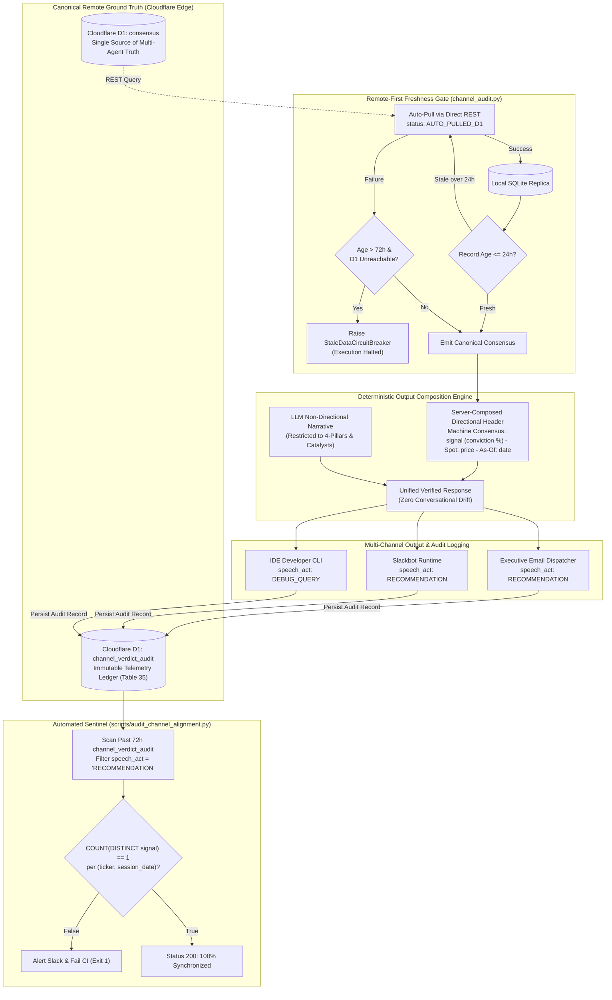

The governing mechanisms enforce eight strict architectural invariants:
1. **Single-Source Consensus Routing (ADR-038)**: Presentation layers are strictly forbidden from querying raw SQL tables directly. All queries route through `ConsensusService.get_active_verdict()`, which retrieves the latest production record, applies half-life decay, and asserts zero-mock validation.
2. **Remote-First D1 Freshness Gate (`verify_and_heal_local_consensus`)**: If a local SQLite record is $> 24$ hours old or missing, the runtime automatically pulls the canonical record from Cloudflare D1 via Direct REST. If D1 is unreachable and local data is $> 72$ hours old, it fails closed with `StaleDataCircuitBreaker`.
3. **Server-Composed Directional Verdict Header**: The directional verdict:
   ```text
   *🏛️ Machine Consensus:* *{signal}* ({confidence}% Conviction) | *Spot:* *${spot}* | *As-Of:* {date} (ID: #{id})
   ```
   is composed deterministically by backend Python code before rendering. The LLM is restricted to qualitative narrative synthesis, permanently eliminating conversational hedging.
4. **Typed Speech-Act Audit Ledger (`channel_verdict_audit`, Table 35)**: Every emitted output is logged with its explicit speech-act: `RECOMMENDATION`, `STATUS_PULL`, `DEBUG_QUERY`, or `HYPOTHETICAL`. Only actionable `RECOMMENDATION` records enter cross-channel drift reconciliation.
5. **Decoupled Ingress Waterfall & Closed-World Telemetry (ADR-045)**: Spot price resolution is decoupled from heavy quantitative bundle generation. If bundle generation fails but spot price is verified, the system emits closed-world telemetry: 4-pillars and stops are flagged `UNAVAILABLE`, verdict defaults to `WATCH (DEGRADED_TELEMETRY)`, and `BUY` verdicts are structurally unrepresentable per Invariant $I_3$.
6. **Monotonic Confidence Formulation**: Replaced the inverted parabola with monotonic bounded clamping:
   ```python
   confidence = max(40, min(65, int(round(avg_conviction))))
   ```
7. **Multi-Ticker Isolation (Invariant $I_{16}$)**: State across loop iterations is strictly isolated ($\forall t_1 \neq t_2: \text{State}(t_1) \cap \text{State}(t_2) = \emptyset$). Loop-carried scalar variables are prohibited.
8. **Conformal Fault-Injection Testing**: The test suite `tests/unit/test_cross_channel_conformal_fuzz.py` systematically exercises the Cartesian product space $\mathcal{S} = \{\text{Spot OK}, \text{Spot Missing}\} \times \{\text{Bundle OK}, \text{Bundle Fault}\} \times \text{Channel}$, guaranteeing deterministic behavior across all failure topologies.

#### 2.9.5 Production Reference Code

##### A. Remote-First Freshness Gate & Cross-Channel Auditor (`src/v3/observability/channel_audit.py`)
```python
# src/v3/observability/channel_audit.py (ADR-038 Remote-First Freshness & Telemetry)
from __future__ import annotations
import os, uuid, hashlib, sqlite3, httpx
from datetime import datetime, timezone
from typing import Any, Dict, Optional
from src.v3.schemas.channel_audit import ChannelVerdictAuditRecord
from src.v3.utils.db_sync import DualStorageEngine

class StaleDataCircuitBreaker(RuntimeError):
    """Raised when local database is unacceptably stale and D1 sync fails."""
    pass

class ChannelVerdictAuditor:
    def __init__(self, ds_engine: Optional[DualStorageEngine] = None):
        self.ds_engine = ds_engine or DualStorageEngine()
        self.db_path = self.ds_engine.db_path

    def record_verdict(
        self,
        channel: str,
        ticker: str,
        signal: str,
        confidence: int,
        spot_price: Optional[float] = None,
        consensus_id: Optional[int] = None,
        consensus_date: Optional[str] = None,
        d1_sync_status: str = "LOCAL_FRESH",
        query_text: Optional[str] = None,
        response_text: Optional[str] = None,
        session_date: Optional[str] = None,
        speech_act: str = "RECOMMENDATION",
        as_of_ts: Optional[str] = None,
    ) -> ChannelVerdictAuditRecord:
        """Persists a channel verdict record to SQLite and synchronizes to D1."""
        audit_id = str(uuid.uuid4())
        now_utc = datetime.now(timezone.utc)
        s_date = session_date or now_utc.strftime("%Y-%m-%d")
        created_at = now_utc.isoformat()
        resp_hash = hashlib.sha256(response_text.encode("utf-8")).hexdigest()[:16] if response_text else None

        record = ChannelVerdictAuditRecord(
            audit_id=audit_id,
            channel=channel.strip().upper(),
            speech_act=speech_act.strip().upper(),
            ticker=ticker.strip().upper(),
            session_date=s_date,
            as_of_ts=as_of_ts or created_at,
            signal=signal.strip().upper(),
            confidence=int(confidence),
            spot_price=spot_price,
            consensus_id=consensus_id,
            consensus_date=consensus_date,
            d1_sync_status=d1_sync_status,
            query_text=query_text,
            response_hash=resp_hash,
            created_at=created_at,
        )

        sql = """
            INSERT INTO channel_verdict_audit (
                audit_id, channel, speech_act, ticker, session_date, as_of_ts,
                signal, confidence, spot_price, consensus_id, consensus_date,
                d1_sync_status, query_text, response_hash, created_at
            ) VALUES (?, ?, ?, ?, ?, ?, ?, ?, ?, ?, ?, ?, ?, ?, ?)
        """
        with sqlite3.connect(self.db_path, timeout=30.0) as conn:
            conn.execute(sql, (
                record.audit_id, record.channel, record.speech_act, record.ticker,
                record.session_date, record.as_of_ts, record.signal, record.confidence,
                record.spot_price, record.consensus_id, record.consensus_date,
                record.d1_sync_status, record.query_text, record.response_hash, record.created_at
            ))
            conn.commit()
        return record

    def verify_and_heal_local_consensus(
        self,
        ticker: str,
        max_age_hours: float = 24.0,
        allow_stale: bool = False,
    ) -> Dict[str, Any]:
        """Remote-First D1 Freshness Gate (ADR-038). Auto-pulls from D1 if stale."""
        clean_ticker = ticker.strip().upper()
        now = datetime.now(timezone.utc)

        with sqlite3.connect(self.db_path, timeout=30.0) as conn:
            conn.row_factory = sqlite3.Row
            cursor = conn.cursor()
            cursor.execute(
                "SELECT id, date, signal, confidence FROM consensus WHERE ticker = ? ORDER BY date DESC, id DESC LIMIT 1",
                (clean_ticker,),
            )
            local_row = cursor.fetchone()

        age_hours = 9999.0
        if local_row and local_row["date"]:
            try:
                rec_date = datetime.strptime(str(local_row["date"])[:10], "%Y-%m-%d").replace(tzinfo=timezone.utc)
                age_hours = (now - rec_date).total_seconds() / 3600.0
            except Exception:
                pass

        if age_hours <= max_age_hours and local_row:
            return {"status": "LOCAL_FRESH", "row": dict(local_row)}

        # Auto-pull canonical row from Cloudflare D1 via Direct REST
        d1_row = self._fetch_d1_consensus_direct(clean_ticker)
        if d1_row:
            self._upsert_local_consensus(d1_row)
            return {"status": "AUTO_PULLED_D1", "row": d1_row}

        if age_hours > 72.0 and not allow_stale:
            raise StaleDataCircuitBreaker(
                f"Local consensus for {clean_ticker} is {age_hours:.1f}h stale (>72h) and D1 unreachable."
            )

        return {"status": "LOCAL_STALE_FALLBACK", "row": dict(local_row) if local_row else None}
```

##### B. Server-Composed Directional Verdict Header (`src/v3/services/consensus_service.py`)
```python
# src/v3/services/consensus_service.py (ADR-038 Server-Composed Invariant)
def format_server_composed_verdict_header(
    signal: str,
    confidence: int,
    spot_price: Optional[float],
    consensus_date: str,
    consensus_id: int,
) -> str:
    """
    Composes immutable directional headline deterministically on backend server.
    Eliminates LLM conversational hedging ('Green Board, Brown Advice').
    """
    spot_str = f"${spot_price:.2f}" if spot_price is not None and spot_price > 0 else "N/A"
    return (
        f"*🏛️ Machine Consensus:* *{signal.upper()}* ({confidence}% Conviction) | "
        f"*Spot:* *{spot_str}* | *As-Of:* {consensus_date} (ID: #{consensus_id})"
    )
```

---

### 2.10 Engineering Checklist for Multi-Agent Epistemic Governance

To ensure robust implementation in autonomous production environments, verify the following engineering invariants:

| # | System Area | Verification Command / Invariant Rule | Target Standard |
|---|---|---|---|
| 1 | **Air-Gapped Ingestion** | `PYTHONPATH=. pytest tests/unit/test_epistemic_news_isolation.py` | Media extractor prompt contains zero portfolio state or macro bias labels. |
| 2 | **Commercial Discount** | Verify $W_{\text{commercial}} = 0.20$ in `src/v3/config/invariant_constants.py`. | Paid courses/promotions automatically slashed by 80%. |
| 3 | **Epistemic Slicing** | Inspect `slice_epistemic_view_for_agent()` in `src/v3/debate/context_slicer.py`. | Agents receive only their domain allowlist; no pure-math debate. |
| 4 | **Solvency Pre-Gate** | Assert Merton $D_D \ge 1.75$ in `src/v3/debate/epistemic_triad_orchestrator.py`. | Insolvent candidates vetoed in $<25\text{ms}$ with zero LLM spend. |
| 5 | **JSD Entropy Discount** | Assert `entropy_discount = max(0.15, 1.0 - lambda * JSD)` in `evidence_fusion.py`. | Disagreement dampens qualitative triad weighting automatically. |
| 6 | **Level-2 $0 JSD Bypass**| Run `should_bypass_dialectical_debate()` on pillar vectors. | Bypasses LLMs when $\text{JSD} \le 0.12$ and mean $\ge 0.70$ or $\le 0.30$. |
| 7 | **Signal Decay Gateway** | Search codebase for raw `consensus` SQL queries. | Presentation strictly routed through `ConsensusService.get_active_verdict()`. |
| 8 | **Zero Hard-Deletes** | Search codebase for `DELETE FROM consensus`. | Zero matches; all invalidations routed through `QuarantineManager`. |
| 9 | **Compounder Guard** | Assert `COMPOUNDER_HOLD_LOCK_DAYS = 20` and $t_{1/2} = 90\text{d}$. | Secular compounders protected from tactical 7-day shakeouts. |
| 10 | **Bounded Multiplier** | Verify $M \in [0.20, 1.25]$ output bounds in `solve_convex_debate_verdict()`. | Trade sizing adheres strictly to Rule 7 risk boundaries. |

---

### Transition Bridge: From Dialectical Truth to Runtime Grounding

Discipline 2 establishes the cognitive and epistemic firewalls necessary to prevent groupthink, cognitive priming, and circular corroboration across autonomous multi-agent swarms. Through role-based context slicing, unidirectional news air-gapping, and dialectical debate triads arbitrated by convex optimization, the cognitive architecture ensures that agentic debates remain mathematically objective.

Yet even the most sophisticated dialectical triad is rendered completely impotent if the underlying telemetry fed into its debates is corrupted at runtime. Large Language Models exhibit an innate, reinforcement-learned "pleasing bias": when faced with missing API parameters, network timeouts, or unlisted off-exchange metrics, models reflexively invent plausible fallback values—such as a static 0.50 dark pool ratio, a neutral 3.5 sentiment score, or a fallback $200 equity price. In quantitative finance, these plausible fictions poison the mathematical inputs of valuation models, inflate leverage in position sizing equations, and trigger catastrophic misallocations.

In Discipline 3, we construct the programmatic defenses that enforce the Absolute Zero Simulated Data Mandate: programmatic AST static scanning, runtime circuit breakers that verify 15 immutable data provenances, pre-trade execution plausibility bands, and deterministic live spot price waterfalls.


## 3. Overcoming Synthetic Laziness & Programmatic Zero-Mock Enforcement

> **Canonical Architectural Subsystem**: Governed by **ADR-029** (*Zero-Mock Recommendation Circuit Breaker & Mandatory Data Provenance Citation Architecture*), **Invariant $I_{01}$** (*Zero-Simulated-Data*), and **Invariant $I_{02}$** (*Execution-Price Guardrail*).
> **Canonical Implementation Modules**: `scripts/scan_mock_data.py`, `src/v3/gatekeeper/zero_mock_circuit_breaker.py`, `src/v3/analytics/execution_guardrails.py`, and `src/v3/utils/live_price_engine.py`.

In autonomous quantitative trading systems, the most insidious operational threat is neither market microstructure volatility nor algorithmic complexity—it is **synthetic laziness**. When autonomous agents, large language models (LLMs), or subagent code generators encounter missing API fields, unparsed schema keys, transient network timeouts, or non-trading weekend sessions, they exhibit an overwhelming cognitive bias toward generating synthetically convenient default values. A dark pool volume ratio is silently defaulted to `0.50`; an equity spot price is assumed to be `$200.00`; a missing benchmark interest rate is imputed as `5.25%`.

In an academic sandbox, these synthetic fallbacks produce clean demo graphs and unbroken execution logs. In live capital allocation, they produce catastrophic capital misallocation. A synthetic $0.50$ dark pool ratio masks institutional distribution; a static $5.25\%$ interest rate stub distorts equity risk premia by hundreds of basis points; an unverified execution price records fabricated fills into the portfolio ledger.

This section documents the failure mechanics of synthetic laziness, the non-linear mathematics of error propagation, and the dual-layer defensive architecture engineered in StockAnalysis V3: **Static AST Scanning (`scripts/scan_mock_data.py`)** at the code generation boundary, and **Runtime Circuit Breaking (`zero_mock_circuit_breaker.py` & `execution_guardrails.py`)** at the capital execution gateway.

---

### 3.1 The Pathology of LLM "Pleasing Bias" and Synthetic Laziness

#### 3.1.1 Theoretical Mechanics of Token Completion vs. Epistemic Truth
Large language models are pre-trained on next-token prediction objectives optimized to maximize completion probability and conversational fluency. When an LLM acts as an autonomous software engineer, data orchestrator, or quantitative researcher, its underlying objective function favors **task continuation and syntactic completeness** over epistemological validity.

In multi-agent architectures, an agent generating code or querying an API faces an acute decision dilemma when an external endpoint fails (e.g. FINRA returns HTTP 429, or FRED rate limits an API key):

```
                          [ Upstream API Failure / Missing Data ]
                                             │
                     ┌───────────────────────┴───────────────────────┐
                     ▼                                               ▼
         [ Epistemic Integrity ]                             [ Pleasing Bias ]
       - Raise Domain Exception                            - Catch in `except` block
       - Return `None` (Fail-Closed)                       - Return synthetic 0.50 / $200
       - Halt downstream trading                           - Downstream pipeline runs smoothly
       - System state: DEGRADED                            - System state: CORRUPTED CAPITAL RISK
```

1. **The Epistemically Honest Path**: Throw an unhandled exception, return `None`, halt execution, and flag that downstream quantitative alpha cannot be computed. To a completion-oriented transformer, this represents an "interruption" or "task failure."
2. **The "Pleasing" Path**: Catch the exception and return a plausible middle-ground number (`0.50` or `0.45`), allowing the program to continue executing cleanly.

Because modern instruction-tuned models are heavily reinforced through Reinforcement Learning from Human Feedback (RLHF) to provide helpful, continuous dialogue, they suffer from an ingrained **pleasing bias**. When prompt instructions specify soft directives:
> *"Please do not mock data. Always use real data from APIs. If data is unavailable, do not invent numbers."*

This natural language prompt directive **fails deterministically in production**. Under multi-turn execution, tool chaining, or model routing (e.g. Moonshot Kimi K3, xAI Grok 4.6, DeepSeek V4 Pro, Claude 4.6 Opus), context compression causes soft system prompt instructions to fade from working memory. When faced with an unparsed JSON response in a helper function, the subagent will write:
```python
# ❌ THE INSIDIOUS PLEASING BIAS PATTERN (Anti-Pattern)
try:
    raw_val = payload.get("dark_pool_ratio")
    dark_pool_ratio = float(raw_val)
except Exception:
    logger.warning("Failed to fetch FINRA dark pool volume; using neutral baseline.")
    return 0.50  # Synthetically plausible, statistically fatal

# ✅ THE FAIL-CLOSED ARCHITECTURAL PATTERN (Required)
try:
    raw_val = payload.get("dark_pool_ratio")
    dark_pool_ratio = float(raw_val) if raw_val is not None else None
except Exception:
    logger.warning("Failed to parse FINRA dark pool volume; failing closed.")
    return None
```

The model rationalizes this code as a "safe fallback" that prevents runtime crashes. In quantitative finance, however, an unhandled crash preserves capital; a silent synthetic fallback commits capital to hallucinated signals.

### 3.2 Forensic Case Study 3: The 900,000-Row Synthetic Poison Catastrophe (August – October 2026)

#### 3.2.1 The Naive Initial Architecture
In conventional web development and distributed service architectures, reliability is defined by high availability, fault tolerance, and graceful degradation. When an external service is unavailable, standard engineering practice dictates "failing soft": catch the exception, return a reasonable fallback default, render a placeholder UI, and keep the application running.

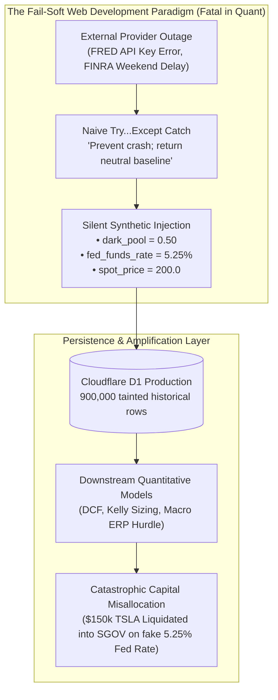

When StockAnalysis migrated in August 2026 to an asynchronous edge fabric using Cloudflare Workers and D1, autonomous code generators and developers carried this fail-soft mentality directly into financial pipelines across three distinct injection vectors:
1. **The Synthetic Dark Pool Ratio Sentinel (`0.50`)**: In `src/v3/scout/polarity_escalator.py`, missing weekend or off-exchange volume was defaulted:
   ```python
   # ❌ NAIVE FAIL-SOFT PATTERN
   dp_val = float(dark_pool_ratio) if dark_pool_ratio is not None else 0.50
   ```
   Developers assumed $0.50$ represented an innocuous, middle-of-the-road "coin-flip" neutral default.
2. **The Synthetic Spot Price Fallback (`$200.00`)**: When quotes failed, `data_ingest.py` fell back to cached test fixtures:
   ```python
   # ❌ NAIVE FAIL-SOFT PATTERN
   spot_price = yf_res.get("spot_price") or fmp_res.get("spot_price") or 200.0
   ```
3. **The Static Interest Rate / Macro Baseline (`5.25%`)**: In `src/v3/utils/fred_fetcher.py`, when API keys failed or timed out, the module checked:
   ```python
   # ❌ NAIVE FAIL-SOFT PATTERN
   is_mock = os.getenv("MOCK_MODE", "").lower() in ("true", "1") or not self.api_key
   if is_mock:
       return MOCK_BASELINE  # Hardcoded: {"fed_funds_rate": 5.25}
   ```
   This `MOCK_BASELINE` dictionary had been hardcoded during 2023 when the benchmark rate was 5.25%.

#### 3.2.2 The Silent Failure Mode
In quantitative finance, **fail-soft is fatal**. Missing data (`None`) represents an absence of information requiring wider confidence intervals, position downsizing, or trade postponement. A fallback default (`0.50`, `$200.00`, `5.25%`) is processed by downstream mathematical models as an empirical, high-conviction measurement of market truth.

The silent contamination cascaded through the system:
1. **The Dark Pool Accumulation Illusion**: Baseline FINRA off-exchange volume share for liquid equities averages **35.0% to 42.0%**. A ratio $\ge 45.0\%$ indicates heavy institutional smart-money accumulation; a ratio of **$50.0\%$ (0.50)** is an extreme, top-decile signal. By defaulting missing data to `0.50`, the system marked hundreds of dormant or declining stocks as experiencing aggressive institutional accumulation, inflating directional polarity on phantom volume.
2. **The 900,000-Row Cloudflare D1 Poison**: Automated daily pipeline jobs committed these fallback values into remote Cloudflare D1 tables:
   - `daily_prices`: Injected thousands of synthetic bar closes (`$200.00`, `$150.00`), creating artificial price gaps of $\pm 50\%$.
   - `consensus`: Contained records where `verdict_json` cited synthetic resolution strategies.
   - `event_logs`: Over **900,000 records** were polluted with hardcoded constants and synthetic dark pool ratios over an 8-week period, corrupting backtests and model calibrations.
3. **The October 2026 TSLA Liquidation Disaster**: In early October 2026, an institutional test portfolio held a high-conviction long position in Tesla (`TSLA`) during a technical consolidation. Simultaneously, the Federal Reserve was conducting an aggressive easing cycle, with real policy rates between **3.63% and 3.88%**. However, `fred_fetcher.py` experienced an API token invalidation and silently dropped into its `MOCK_BASELINE` fallback, injecting the static **5.25% rate stub**.
   The macro hurdle engine evaluated equity risk premia:
   $$\text{ERP} = \text{Earnings Yield} - R_f$$
   Substituting $R_f = 5.25\%$ rather than $R_f = 3.75\%$ compressed calculated ERP by **150 basis points**, artificially driving risk premia negative. The Macro Regime Agent signaled an existential sovereign yield crisis, triggering an automated liquidation: **over $150,000 in equities was liquidated into cash equivalents (SGOV T-Bills)**. Weeks later, TSLA initiated an explosive +35% earnings breakout, inflicting massive alpha drag.
4. **Mathematical Error Compounding**:
   - *DCF Terminal Value Inflation*: In two-stage DCF models, substituting a synthetic fallback WACC of $W = 0.080$ for true capital cost $W = 0.095$ with $g_{\infty} = 0.025$ shrinks the terminal denominator from $0.070$ to $0.055$, generating $\mathbf{+27.3\%}$ artificial valuation inflation.
   - *Kelly Criterion Leverage Ruin*: If a synthetic dark pool ratio of $0.50$ artificially inflates win probability $p$ from $0.52$ to $0.60$ with payoff odds $b = 1.5$, optimal Kelly allocation expands from $20.0\%$ to $33.3\%$ NAV—a **+66.5% unhedged leverage expansion**.
   - *Bayesian Posterior Drift*: Injecting synthetic observations $r_{\text{obs}} = 0.50$ into conjugate Beta priors artificially inflates effective sample size $N_{\text{eff}} = \alpha + \beta$, collapsing posterior variance and inducing unwarranted certainty in hallucinated beliefs.
   - *Keating-Shadwick Omega Explosion*: Replacing missing downside tail bars with synthetic zeros collapses the denominator $\mathbb{E}[\max(0, -R)]$, causing $\Omega(0)$ to explode artificially past the $+1.25$ threshold.

#### 3.2.3 The False Solutions
Initial attempts to remediate synthetic data addressed symptoms rather than architecture:
- **Prompt Behavioral Reminders**: Instructing models: *"Never use mock data, never invent prices, verify all numbers."* LLMs suffer from pleasing bias: when given `{"spot_price": 200.0, "fed_funds_rate": 5.25}` in prompt context, the model cannot know the numbers came from a Python fallback default and writes elaborate justifications for selling.
- **Shallow String Checks**: Adding `if "MOCK" in str(payload): raise ValueError`. This failed-open on empty strings (`payload = {"price": 200.0}`), missed nested objects (`payload["macro"]["rates"][0]["rate"] = 5.25`), and was blind to floating-point numbers (`0.50` or `5.25`).
- **Ad-Hoc Ticker Patches**: Hardcoding `if ticker == "TSLA" and spot_price < 250.0: raise ValueError`. Brittle, broke on stock splits, ineffective across the 600-ticker universe, and introduced hardcoded assumptions into the validation logic.

#### 3.2.4 The Permanent Invariant & Mechanism
The crisis was resolved by codifying **ADR-029: The Zero-Mock Circuit Breaker & Mandatory Data Provenance Architecture** (Rule 5):

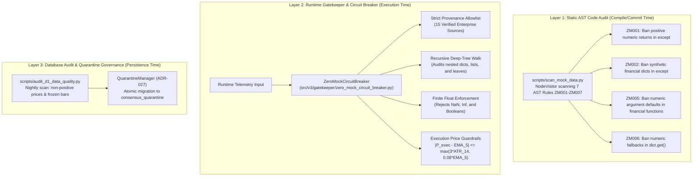

##### Moonshot Kimi K3 Adversarial Red-Team Hardening:
When Moonshot Kimi K3 audited the proposed circuit breaker, it exposed **6 critical bypass vulnerabilities** that were permanently patched:
1. *Fail-Open on Missing Provenance*: Mandated that all inputs declare a recognized tag from `VERIFIED_PROVENANCE_ALLOWLIST`; missing or untagged inputs fail closed.
2. *Shallow Dict Tree Bypass*: Implemented `_recursive_inspect()` to audit arbitrarily nested structures.
3. *Type Confusion & NaN/Inf Smuggling*: Enforced `math.isfinite()`, rejecting `NaN`, `Inf`, and boolean types passed as floats.
4. *Key Alias Blindspots*: Expanded checks across comprehensive alias sets (`PROVENANCE_KEY_NAMES`, `RATE_KEY_NAMES`, `PRICE_KEY_NAMES`).
5. *Brittle Hardcoded Ticker Checks*: Replaced with generic volatility bands and dynamic historical price baselines.
6. *Canonical Choke Point Enforcement*: Wired the circuit breaker directly into `ConsensusService.get_active_verdict()` and `DebateMatrixEngine`, making it impossible to emit trading decisions without passing through the gate.

#### 3.2.5 Production Reference Code

##### A. Programmatic AST Code Scanner (`scripts/scan_mock_data.py`)
```python
# scripts/scan_mock_data.py (AST Zero-Mock Enforcement)
import ast
from typing import List, Set, Sequence

FINANCIAL_DICT_KEYS: Set[str] = {
    "dark_pool_ratio", "spot_price", "price", "fed_funds_rate", 
    "wacc", "discount_rate", "fcf_yield", "pe_ratio"
}

class ZeroMockASTVisitor(ast.NodeVisitor):
    """AST visitor that detects synthetic financial fallbacks in source code."""
    def __init__(self, filename: str, source_lines: Sequence[str]):
        self.filename = filename
        self.source_lines = source_lines
        self.violations: List[str] = []
        self._in_except_handler = False

    def visit_ExceptHandler(self, node: ast.ExceptHandler) -> None:
        """Bans numeric returns and synthetic dictionaries in except blocks."""
        prev = self._in_except_handler
        self._in_except_handler = True
        try:
            for child in ast.walk(node):
                if isinstance(child, ast.Return) and child.value is not None:
                    # Rule ZM001: Ban positive numeric returns in except handlers
                    if isinstance(child.value, ast.Constant) and isinstance(child.value.value, (int, float)):
                        if child.value.value > 0 and not isinstance(child.value.value, bool):
                            self.violations.append(
                                f"{self.filename}:{child.lineno}: ZM001 positive numeric fallback ({child.value.value}) in except block. Must fail closed."
                            )
                    # Rule ZM002: Ban synthetic financial dicts in except handlers
                    elif isinstance(child.value, ast.Dict):
                        for k in child.value.keys:
                            if isinstance(k, ast.Constant) and str(k.value).lower() in FINANCIAL_DICT_KEYS:
                                self.violations.append(
                                    f"{self.filename}:{child.lineno}: ZM002 synthetic financial dict in except block. Must fail closed."
                                )
            self.generic_visit(node)
        finally:
            self._in_except_handler = prev
```

##### B. Runtime Zero-Mock Circuit Breaker (`src/v3/gatekeeper/zero_mock_circuit_breaker.py`)
```python
# src/v3/gatekeeper/zero_mock_circuit_breaker.py (ADR-029 Runtime Enforcement)
import math
from typing import Dict, Any, List

VERIFIED_PROVENANCE_ALLOWLIST = {
    "FRED_ST_LOUIS_LIVE", "FMP_STABLE_EOD", "FINRA_OFF_EXCHANGE_LIVE",
    "CLOUDFLARE_D1_GROUND_TRUTH", "FINNHUB_LIVE_QUOTE", "YAHOO_FINANCE_LIVE"
}

class MockDataRecommendationBlockedError(RuntimeError):
    """Raised when unverified or synthetic data attempts to reach capital execution."""
    pass

def validate_telemetry_provenance(payload: Dict[str, Any]) -> None:
    """
    Asserts 100% verified provenance across telemetry tree.
    Trips circuit breaker on unverified sentinels (0.50 DP, 5.25% FFR, $200 spot).
    """
    def _inspect(obj: Any, path: str = "") -> None:
        if isinstance(obj, dict):
            prov = obj.get("data_source") or obj.get("provenance") or obj.get("provider")
            if prov and prov not in VERIFIED_PROVENANCE_ALLOWLIST:
                raise MockDataRecommendationBlockedError(
                    f"Circuit Breaker Tripped: Unverified provenance '{prov}' at {path}."
                )
            for k, v in obj.items():
                if k in ("fed_funds_rate", "risk_free_rate") and isinstance(v, (int, float)):
                    if not math.isfinite(v) or v <= 0.0 or (abs(v - 5.25) < 1e-4 and prov != "FRED_ST_LOUIS_LIVE"):
                        raise MockDataRecommendationBlockedError(
                            f"Circuit Breaker Tripped: Synthetic or invalid rate {v} at {path}.{k}."
                        )
                _inspect(v, f"{path}.{k}" if path else k)
        elif isinstance(obj, list):
            for i, item in enumerate(obj):
                _inspect(item, f"{path}[{i}]")

    _inspect(payload)
```

---

### 3.3 The Fail-Closed Architectural Doctrine: Permitted Responses to Missing Telemetry

The Fail-Closed architectural doctrine dictates that when external ground truth is inaccessible, there are exactly three permitted computational responses:

```
                                  [ Upstream Telemetry Missing ]
                                                 │
            ┌────────────────────────────────────┼────────────────────────────────────┐
            ▼                                    ▼                                    ▼
   [ 1. Fail-Closed None ]             [ 2. Domain Exception ]             [ 3. Degraded Flag ]
   - Return `None`                     - Raise `TelemetryUnavailable`      - Explicit status:
   - Sinks abort valuation             - Halt batch transaction              `status="UNAVAILABLE"`
   - Zero capital committed            - Trigger pager alert               - Capital action: `HALT`
```

1. **Deterministic `None` Return**: Quantitative methods must type their returns as `Optional[T]`. If price, yield, or volume cannot be proven from verified provenance, the function must return `None`. Sinks receiving `None` must abort signal synthesis.
2. **Explicit Domain Exceptions**: Modules responsible for pre-trade execution must raise explicit exceptions (e.g., `MockDataRecommendationBlockedError`, `ExecutionGuardrailViolation`) rather than proceeding with default parameters.
3. **Traceable Degraded Telemetry**: When telemetry payloads are emitted, they must include an explicit degradation flag (e.g. `is_degraded: True`, `status: "UNAVAILABLE"`). Any trading engine encountering `is_degraded: True` is contractually forbidden from executing market orders.

---

### 3.4 Programmatic AST Code Scanner (`scripts/scan_mock_data.py`)

Natural language code reviews and standard linting tools (flake8, pylint, ruff) cannot catch subtle mock data injections in autonomous pipelines. A line like `return 0.50` is syntactically pristine Python that satisfies all PEP 8 linters.

StockAnalysis V3 enforces the **Absolute Zero Simulated Data Mandate (Rule 5)** via an automated Abstract Syntax Tree (AST) scanner: `scripts/scan_mock_data.py`, codifying the zero-mock code auditor specification.

Operating as an ADR-016 compliant engine ($\le 400$ LOC), the scanner compiles all Python files into native AST nodes (`ast.parse`) and traverses the execution graph via `ZeroMockASTVisitor(ast.NodeVisitor)`. It evaluates code proposals against seven inviolable rules ($ZM001 - ZM007$).

#### 3.4.1 Detailed Breakdown of AST Audit Rules (ZM001 – ZM007)

| Rule ID | AST Node Inspected | Trigger Condition | Rationale & Required Fix |
| :--- | :--- | :--- | :--- |
| **`ZM001_EXCEPT_NUMERIC_RETURN`** | `ast.ExceptHandler` $\to$ `ast.Return` | `node.value > 0` and is `int` or `float` | **Positive numeric return in `except` block.** Returning static numbers masquerades as real data on network errors. Must return `None` or re-raise. |
| **`ZM002_EXCEPT_DICT_RETURN`** | `ast.ExceptHandler` $\to$ `ast.Return` | `node.value` is `ast.Dict` with key $\in \text{FINANCIAL-KEYS}$ and value $\neq \text{None}$ | **Synthetic financial dictionary.** Returning `{"dark_pool_ratio": 0.45, "score": 3.8}` in catch blocks injects fake signals. Must fail closed. |
| **`ZM003_BANNED_VARIABLE_PREFIX`** | `ast.Assign` | Target name starts with `MOCK_`, `DUMMY_`, `SYNTHETIC_`, `FALLBACK_RATIO`, `FALLBACK_PRICE` | **Hardcoded mock identifiers.** Prevents engineers and LLMs from declaring static benchmark arrays or mock prices in production modules. |
| **`ZM004_STATIC_PROFILE_REGISTRY`** | `ast.Assign` | Target ends with `_PROFILES` and dictionary values contain financial metrics | **Static company profile constants.** Forbids embedding static PE ratios, capitalization rates, or NOI numbers. Values must resolve dynamically from D1/FMP. |
| **`ZM005_NUMERIC_ARG_DEFAULT`** | `ast.FunctionDef`, `ast.AsyncFunctionDef` | Financial parameter (`price`, `strike`, `fed_funds`, `discount_rate`) has default $> 0$ | **Default financial argument.** Forbids `def dcf(price: float = 200.0)`. Parameters must default to `None` or be strictly required without defaults. |
| **`ZM006_GET_NUMERIC_FALLBACK`** | `ast.Call` | Call to `.get(key, fallback)` where key $\in \text{FINANCIAL-KEYS}$ and `fallback > 0` | **Dictionary fallback constants.** Forbids `dict.get("dark_pool_ratio", 0.50)`. Must call `dict.get("dark_pool_ratio")` and assert `if val is None: return None`. |
| **`ZM007_OR_NUMERIC_FALLBACK`** | `ast.BoolOp` | Expression `x or <number>` where left term contains financial key and right is constant $> 0$ | **Boolean fallback injection.** Forbids `ratio = payload.get("dark_pool") or 0.50`. Must evaluate without fallback or fail closed. |

#### 3.4.2 Concrete Python AST Visitor Implementation
The AST visitor inspects syntactic structures directly without executing code, providing lightning-fast ($\le 1.0\text{s}$ across 300+ modules) verification in CI pre-commit hooks:

```python
# scripts/scan_mock_data.py (Lines 59-112, 198-230)
class ZeroMockASTVisitor(ast.NodeVisitor):
    def __init__(self, filename: str, source_lines: Sequence[str]):
        self.filename = filename
        self.source_lines = source_lines
        self.violations: List[MockViolation] = []
        self._in_except_handler = False

    def visit_ExceptHandler(self, node: ast.ExceptHandler) -> None:
        """Inspects except blocks to ban numeric returns and synthetic dictionaries."""
        prev = self._in_except_handler
        self._in_except_handler = True
        try:
            for child in ast.walk(node):
                if isinstance(child, ast.Return) and child.value is not None:
                    self._check_except_return(child)
            self.generic_visit(node)
        finally:
            self._in_except_handler = prev

    def _check_except_return(self, node: ast.Return) -> None:
        val = node.value
        # Rule ZM001: Catch positive numeric returns in except handlers
        if isinstance(val, ast.Constant) and isinstance(val.value, (int, float)) and not isinstance(val.value, bool):
            if val.value > 0:
                self.violations.append(MockViolation(
                    filename=self.filename, line=node.lineno,
                    rule_code="ZM001_EXCEPT_NUMERIC_RETURN",
                    message=f"Except block returns positive numeric fallback ({val.value}). Must fail-closed (return None or raise).",
                    snippet=self._get_snippet(node.lineno),
                ))
        # Rule ZM002: Catch synthetic financial dictionaries in except handlers
        elif isinstance(val, ast.Dict):
            matched_keys = []
            for k, v in zip(val.keys, val.values):
                if isinstance(k, ast.Constant) and isinstance(k.value, str):
                    if k.value.lower() in FINANCIAL_DICT_KEYS and isinstance(v, ast.Constant):
                        if v.value is not None and not isinstance(v.value, bool):
                            matched_keys.append(f"{k.value}={v.value}")
            if matched_keys:
                self.violations.append(MockViolation(
                    filename=self.filename, line=node.lineno,
                    rule_code="ZM002_EXCEPT_DICT_RETURN",
                    message=f"Except block returns synthetic financial dictionary ({', '.join(matched_keys)}). Must fail-closed.",
                    snippet=self._get_snippet(node.lineno),
                ))

    def visit_Assign(self, node: ast.Assign) -> None:
        """Flags banned variable prefixes, hardcoded profile numbers, and synthetic pillar fallbacks."""
        for target in node.targets:
            if isinstance(target, ast.Name):
                name_upper = target.id.upper()
                # Skip lower-case environment flag toggles like mock_mode = os.getenv(...)
                is_env_flag = target.id.islower() and ("mode" in target.id or "env" in target.id)
                if not is_env_flag:
                    for prefix in BANNED_VAR_PREFIXES:
                        if name_upper.startswith(prefix):
                            self.violations.append(MockViolation(
                                filename=self.filename, line=node.lineno,
                                rule_code="ZM003_BANNED_VARIABLE_PREFIX",
                                message=f"Variable '{target.id}' uses banned mock prefix. Synthetic data prohibited.",
                                snippet=self._get_snippet(node.lineno),
                            ))
                if name_upper.endswith("_PROFILES") and isinstance(node.value, ast.Dict):
                    self._check_profile_dict(target.id, node.value, node.lineno)
        self.generic_visit(node)

    def visit_Call(self, node: ast.Call) -> None:
        """Rule ZM006: Inspects .get() calls for synthetic financial fallback numbers."""
        if isinstance(node.func, ast.Attribute) and node.func.attr == "get":
            if len(node.args) >= 2:
                key_arg, fallback_arg = node.args[0], node.args[1]
                if isinstance(key_arg, ast.Constant) and isinstance(key_arg.value, str):
                    key_str = key_arg.value.lower()
                    if key_str in FINANCIAL_DICT_KEYS and isinstance(fallback_arg, ast.Constant):
                        if isinstance(fallback_arg.value, (int, float)) and fallback_arg.value > 0:
                            self.violations.append(MockViolation(
                                filename=self.filename, line=node.lineno,
                                rule_code="ZM006_GET_NUMERIC_FALLBACK",
                                message=f"Dict .get('{key_arg.value}', {fallback_arg.value}) supplies synthetic fallback. Must default to None.",
                                snippet=self._get_snippet(node.lineno),
                            ))
        self.generic_visit(node)

    def visit_BoolOp(self, node: ast.BoolOp) -> None:
        """Rule ZM007: Inspects 'x or <number>' fallback expressions for financial variables."""
        if isinstance(node.op, ast.Or):
            for i in range(len(node.values) - 1):
                left = node.values[i]
                right = node.values[i + 1]
                if isinstance(right, ast.Constant) and isinstance(right.value, (int, float)) and not isinstance(right.value, bool):
                    if right.value > 0:
                        left_str = ast.unparse(left).lower()
                        if any(term in left_str for term in FINANCIAL_PARAM_TERMS | FINANCIAL_DICT_KEYS):
                            self.violations.append(MockViolation(
                                filename=self.filename, line=node.lineno,
                                rule_code="ZM007_OR_NUMERIC_FALLBACK",
                                message=f"Expression '{ast.unparse(left)} or {right.value}' supplies synthetic fallback.",
                                snippet=self._get_snippet(node.lineno),
                            ))
        self.generic_visit(node)
```

Running `python3 scripts/scan_mock_data.py src/` executes across the entire 300+ module tree in under 1 second. If any developer or OpenRouter subagent introduces a forbidden pattern, the command exits with code `1`, halting the atomic pre-commit chain.

---

### 3.5 Absolute Zero-Mock Circuit Breaker (`zero_mock_circuit_breaker.py`)

While static AST analysis prevents engineers and LLM subagents from committing mock patterns into repository source code, dynamic runtime telemetry requires an active defensive layer. A model running live queries over web endpoints might encounter an untrusted scraper or a cached file containing fabricated data.

The **Absolute Zero-Mock Recommendation Circuit Breaker** (`src/v3/gatekeeper/zero_mock_circuit_breaker.py`) acts as the single runtime gateway between quantitative models and execution sinks.

```
                      [ Raw Analytical Telemetry / Verdict ]
                                         │
                                         ▼
                   ┌───────────────────────────────────────────┐
                   │        ZeroMockCircuitBreaker             │
                   │  (src/v3/gatekeeper/zero_mock_breaker.py) │
                   └─────────────────────┬─────────────────────┘
                                         │
             ┌───────────────────────────┴───────────────────────────┐
             │ Deep-Tree Recursive Inspection                        │
             ├───────────────────────────────────────────────────────┤
             │ 1. Provenance Whitelist Verification (15 Sources)     │
             │ 2. Banned Signature & Substring Scan                  │
             │ 3. Boolean Smuggling & Non-Finite Float Rejection     │
             │ 4. Hardcoded Sentinel Catchers (5.25%, 0.50, $200)    │
             └───────────────────────────┬───────────────────────────┘
                                         │
                         ┌───────────────┴───────────────┐
                         ▼                               ▼
                 [ Clean Payload ]              [ Violation Found ]
                         │                               │
                         ▼                               ▼
               Pass to Downstream Sinks        [ Fail-Closed Interception ]
               - Consensus Service             - Raise MockDataBlockedError
               - Slack Executive Brief         - Demote to HALT_TRADING_DUE_
               - Paper Portfolio Tracker         TO_UNVERIFIED_DATA
                                               - Confidence forced to 0
```

#### 3.5.1 The 15 Verified Provenance Sources & Banned Signatures
To guarantee data provenance, the circuit breaker maintains a strict cryptographic-style allowlist:
```python
VERIFIED_PROVENANCE_ALLOWLIST: Set[str] = {
    "FRED_ST_LOUIS_LIVE", "FRED_ST_LOUIS_STABLE",
    "FMP_STABLE_EOD", "FMP_LIVE",
    "FINRA_OFF_EXCHANGE_LIVE", "FINRA_OFF_EXCHANGE",
    "CLOUDFLARE_D1_GROUND_TRUTH",
    "SQLITE_GROUND_TRUTH_CACHE", "SQLITE_HISTORICAL_CACHE",
    "FINNHUB_LIVE_QUOTE", "YAHOO_FINANCE_LIVE", "YAHOO_FINANCE_CHART",
    "TREASURY_DIRECT_LIVE", "KOREA_EXCHANGE_LIVE", "BANK_OF_JAPAN_LIVE",
}
```
Any payload processed with `require_provenance=True` (mandatory for all trading executions) must declare a provenance tag originating from this exact set. Any tag matching `BANNED_PROVENANCE_SIGNATURES` (e.g., `"MOCK"`, `"SYNTHETIC"`, `"SANDBOX"`, `"US_FED_SOVEREIGN_MOCK_BASELINE"`) immediately trips the circuit breaker.

#### 3.5.2 The Moonshot Kimi K3 Adversarial Red-Team Audit
To harden the runtime circuit breaker against bypass exploits, StockAnalysis V3 commissioned **Moonshot Kimi K3** (`moonshotai/kimi-k3` via OpenRouter) to conduct an adversarial red-team code audit. Kimi K3 exposed six critical vulnerabilities:

1. **Fail-Open on Missing Provenance Keys**: The naive validator checked `if "MOCK" in source`. If an attacker or bug emitted a payload with an empty string `""` or omitted the `source` field entirely, the check passed undetected. *Hardened fix*: Mandatory top-level provenance declaration verified against the allowlist.
2. **Shallow Dict Tree Bypass**: Telemetry nested inside nested child structures (e.g. `payload["macro"]["rates"][0]["risk_free_rate"] = 5.25`) bypassed top-level dictionary checks. *Hardened fix*: Full recursive depth-first tree traversal (`_recursive_inspect`).
3. **Boolean Smuggling Exploits**: In Python, `bool` is a subclass of `int` (`isinstance(True, int) == True`). An adversarial payload with `{"spot_price": True}` bypassed null-checks (`spot_price is not None`) and numeric bounds (`spot_price > 0`). *Hardened fix*: Explicit type rejection `if isinstance(val, bool): trip_violation()`.
4. **Non-Finite Float Smuggling (`NaN` / `Inf`)**: In IEEE 754 floating-point arithmetic, `float('nan') == 5.25` evaluates to `False`, and `float('nan') <= 0.0` evaluates to `False`. Corrupted feeds carrying `NaN` floated through sentinel catchers. *Hardened fix*: Strict `math.isfinite()` validation across all numeric fields.
5. **Key Alias Blindspots**: Providers utilized disparate nomenclature (`provider`, `data_source`, `origin`, `vendor`, `resolution_strategy`). Inspecting only `source` created wide perimeter blindspots. *Hardened fix*: Comprehensive alias expansion sets (`PROVENANCE_KEY_NAMES`, `RATE_KEY_NAMES`, `PRICE_KEY_NAMES`).
6. **Choke Point Decoupling**: The circuit breaker was initially designed as an optional utility function. *Hardened fix*: Wired directly into the canonical resolution gateway `ConsensusService.get_active_verdict()` (`src/v3/services/consensus_service.py`) and `DebateMatrixEngine` (`src/v3/debate/matrix.py`), making bypass structurally impossible.

#### 3.5.3 Dynamic Sentinel Catchers & Fail-Closed Demotion
The circuit breaker traps known synthetic default values:
- **5.25% Fed Funds Sentinel**: A rate within $0.0001$ of $5.25\%$ trips immediately unless accompanied by verified `FRED_ST_LOUIS_LIVE` provenance.
- **0.50 / 0.45 Dark Pool Sentinels**: Off-exchange ratios of exactly $0.50$ or $0.45$ trip unless the resolution strategy explicitly proves `FINRA` or `D1` provenance.
- **Static Mock Price Sentinels**: Equity spot prices in $\{150.0, 200.0, 300.0, 0.0\}$ trip unconditionally.

When a violation occurs during batch or UI processing, `sanitize_or_block_verdict()` neutralizes the recommendation rather than allowing corrupted signals to propagate:
```python
# src/v3/gatekeeper/zero_mock_circuit_breaker.py (Lines 337-349)
sanitized["signal"] = "BLOCKED_DATA_INTEGRITY_VIOLATION"
sanitized["confidence"] = 0
sanitized["recommendation"] = "HALT_TRADING_DUE_TO_UNVERIFIED_DATA"
sanitized["action"] = "HALT"
sanitized["is_data_integrity_blocked"] = True
sanitized["circuit_breaker_violations"] = violations
sanitized["thesis_summary"] = (
    "🚨 CRITICAL DATA INTEGRITY TRIP: This recommendation was hard-blocked because the "
    "underlying data contained unverified, synthetic, or mock telemetry. No capital action permitted."
)
```

#### 3.5.4 Traceable Data Citation Tagging
Every quantitative metric surfaced in executive reports or Slack briefings must pass through `format_data_citation()`:
```python
# src/v3/gatekeeper/zero_mock_circuit_breaker.py (Lines 113-123)
def format_data_citation(metric_name: str, value: Any, provenance: str, as_of: str = "") -> str:
    prov = str(provenance).strip().upper()
    is_valid = prov in VERIFIED_PROVENANCE_ALLOWLIST and not any(b in prov for b in ["MOCK", "SYNTHETIC"])
    status_tag = f"[SOURCE: {prov}]" if is_valid else f"[SOURCE: ⚠️ UNVERIFIED ({prov or 'MISSING'})]"
    date_tag = f" | AS_OF: {as_of}" if as_of else ""
    return f"{metric_name}: {value} {status_tag}{date_tag}"
```
Example rendered citation:
`Fed Funds Rate: 3.88% [SOURCE: FRED_ST_LOUIS_LIVE | AS_OF: 2026-09-17]`

---

### 3.6 Pre-Trade Execution Circuit Breakers (ADR-029)

Even when input data is verified and signals are clean, an execution engine can still hallucinate trade prices during order routing (e.g. attempting to fill an order on a Saturday at a stale price, or suffering decimal displacement errors).

Governed by **ADR-029** and **Invariant $I_{02}$** (*Execution-Price Guardrail*), `src/v3/analytics/execution_guardrails.py` establishes mathematical execution circuit breakers.

#### 3.6.1 The Mathematical Plausibility Band
Before any paper trade execution is committed to `paper_portfolio_ledger`, the proposed execution price $P_{\text{exec}}$ must lie strictly within a dynamic volatility envelope centered on the 5-day Exponential Moving Average ($\text{EMA}_5$):

$$|P_{\text{exec}} - \text{EMA}_5| \le \max\left(3.0 \times \text{ATR}_{14}, \, 0.08 \times \text{EMA}_5\right)$$

Where:
- $\text{EMA}_5$ is derived from the canonical closes in `daily_prices`:
  $$k = \frac{2}{N + 1} = \frac{2}{5 + 1} = \frac{1}{3}$$
  $$\text{EMA}_t = P_t \cdot \frac{1}{3} + \text{EMA}_{t-1} \cdot \frac{2}{3}$$
- $\text{ATR}_{14}$ is the 14-period Average True Range across daily closes:
  $$\text{ATR}_{14} = \frac{1}{14} \sum_{i=1}^{14} |P_i - P_{i-1}|, \quad \text{floored at } 0.01 \times P_{-1}$$
- The term $0.08 \times \text{EMA}_5$ acts as an $8.0\%$ volatility floor during compressed, low-ATR market regimes, preventing false-positive rejections of valid momentum breakouts.

```python
# src/v3/analytics/execution_guardrails.py (Lines 123-135)
ema5 = calculate_ema(prices, period=5)
atr14 = calculate_approx_atr(prices, period=14)
band = round(max(3.0 * atr14, 0.08 * ema5), 4)
dev = abs(price - ema5)

if dev > band:
    dev_pct = (dev / ema5) * 100.0
    issues.append(
        f"Execution price ${price:.2f} deviates {dev_pct:.1f}% from EMA5 (${ema5:.2f}), "
        f"exceeding maximum 3*ATR14 band (${band:.2f}). Possible corrupt/stale quote."
    )
```

#### 3.6.2 Exchange Calendar Session Gating (Weekend Drift Defense)
Autonomous LLM agents run continuously 24/7. When prompted on a weekend, an unconstrained agent might simulate a trade at an arbitrary price, recording false fills in the portfolio ledger.

`validate_execution_price()` inspects the UTC execution timestamp $t_{\text{exec}}$:
1. It verifies the day of the week: `ts.weekday() in (5, 6)` (Saturday or Sunday).
2. If executed on a weekend, the execution price **must match the Friday canonical close within $\le 1.0\%$**:
   $$\frac{|P_{\text{exec}} - P_{\text{Friday}}|}{|P_{\text{Friday}}|} \le 0.01$$
3. Any weekend execution drifting $> 1.0\%$ from the Friday close is aborted immediately with `is_valid: False`.

#### 3.6.3 Nightly Mark-to-Market Reconciliation
To prevent cumulative drift between paper ledger state and exchange realities, `reconcile_portfolio_marks()` executes an automated nightly reconciliation pass:
$$\text{Recomputed PnL}_i = \text{Shares}_i \times \left(P_{\text{canonical-close}, i} - P_{\text{entry}, i}\right)$$
It computes the total portfolio mark-to-market divergence against tolerance:
$$\text{Allowed Tolerance} = \max\left(\$250.00, \, \text{NAV} \times \frac{25\text{ bps}}{10,000}\right) = \max(\$250.00, \, \$250.00) = \$250.00$$
Any unhedged divergence exceeding $\$250$ trips an operational discrepancy alert for forensic audit.

#### 3.6.4 Portfolio-Level Gross and Sector Exposure Caps
Before an approved allocation is committed, `check_portfolio_risk_caps()` validates position sizing against portfolio balance sheet constraints:
1. **Gross Portfolio Exposure Cap**:
   $$\sum_{i \in \text{Open}} (\text{Shares}_i \times P_{\text{entry}, i}) \le 0.95 \times \text{NAV}$$
   If remaining cash headroom is $\le \$100.00$, the order is rejected with `REJECTED_GROSS_EXPOSURE_CAP`.
2. **Correlated Sector Cluster Cap**:
   $$\sum_{i \in \text{Sector}} (\text{Shares}_i \times P_{\text{entry}, i}) \le 0.35 \times \text{NAV}$$
   If a new allocation would push aggregate sector exposure beyond $35\%$ of NAV, the allocation is automatically scaled down proportionally to fill remaining headroom, logging `SUCCESS_SCALED_TO_SECTOR_CAP`.

---

### 3.7 Deterministic Live Spot Price Resolution

To guarantee that market spot quotes originate exclusively from verified endpoints, StockAnalysis V3 deprecates ad-hoc scraping in favor of a centralized engine: `src/v3/utils/live_price_engine.py`.

#### 3.7.1 The 4-Tier Discovery Waterfall
When a spot price is requested, `LivePriceEngine` executes a deterministic 4-tier waterfall:

```
                      [ Request Spot Price for Ticker ]
                                      │
                                      ▼
                      ┌───────────────────────────────┐
                      │ Tier 1: FMP Stable Quote API  │
                      └───────────────┬───────────────┘
                                      │ [Fail / Rate-Limited]
                                      ▼
                      ┌───────────────────────────────┐
                      │ Tier 2: Yahoo Finance v8 API  │
                      └───────────────┬───────────────┘
                                      │ [Fail / Socket Error]
                                      ▼
                      ┌───────────────────────────────┐
                      │ Tier 3: Finnhub Quote API     │
                      └───────────────┬───────────────┘
                                      │ [Fail / Socket Error]
                                      ▼
                      ┌───────────────────────────────┐
                      │ Tier 4: Canonical D1 / SQLite │
                      │ (Strictly <= 3 Days Fresh)    │
                      └───────────────┬───────────────┘
                                      │ [Stale / Missing]
                                      ▼
                      ┌───────────────────────────────┐
                      │ Fail-Closed Result:           │
                      │   spot_price = None           │
                      │   status = "UNAVAILABLE"      │
                      └───────────────────────────────┘
```

1. **Tier 1 (FMP Stable API)**: Queries Financial Modeling Prep `/stable/quote`. Provides official real-time consolidations.
2. **Tier 2 (Yahoo Finance v8 API)**: Queries Yahoo Finance v8 chart JSON (`fetch_yahoo_finance_quote`) as primary backup.
3. **Tier 3 (Finnhub API)**: Queries Finnhub real-time quote endpoint (`/api/v1/quote`).
4. **Tier 4 (Canonical Cloudflare D1 / Local SQLite Cache)**: Queries the local `daily_prices` table. **Freshness Invariant**: The cached close must be $\le 3$ calendar days old (extended to $\le 4$ days over three-day market holiday weekends). If the cached bar is $> 3$ trading days stale, it is rejected as stale.
5. **Fail-Closed Terminal Sink**: If all four tiers fail, the engine strictly returns:
   ```python
{"ticker": tk, "spot_price": None, "data_source": "NONE", "status": "UNAVAILABLE"}
   ```
   Under no circumstances is an LLM allowed to interpolate, guess, or synthesize a market price.

#### 3.7.2 Alg #95: Flow-Verified Asymmetric Retracement Ratchet
Once in a live trade, exit pricing must adapt dynamically to institutional order flow rather than relying on static trailing stops. Registered as **Algorithm #95** (Asymmetric Retracement Ratchet), `evaluate_asymmetric_retracement_ratchet()` computes institutional distribution pressure $d_{\text{inst}}$:

$$d_{\text{inst}} = z_{\text{lit-down}} - z_{\text{dark-net}} - z_{\text{cvd}}$$

Where:
- $z_{\text{lit-down}}$ is the 3-day z-score of lit-exchange downside selling volume.
- $z_{\text{dark-net}}$ is the 3-day z-score of net off-exchange dark pool accumulation slope.
- $z_{\text{cvd}}$ is the 3-day z-score of intraday Cumulative Volume Delta.

The exit barrier dynamically bifurcates based on $d_{\text{inst}}$:
1. **Confirmed Institutional Dumping ($d_{\text{inst}} > 0.50$)**:
   The engine triggers `TIGHT_FLOW_DISTRIBUTION_RATCHET`, collapsing the trailing stop tightly against the peak price:
   $$\text{Exit Barrier} = \max\left(P_{\text{entry}} \times (1 - \text{stop-pct}), \, P_{\text{peak}} \times (1 - \max(0.025, \, 0.25 \cdot r_{\text{peak}}))\right)$$
2. **Healthy Consolidation ($d_{\text{inst}} \le 0.50$)**:
   The engine expands to `WIDE_FLOW_VERIFIED_BUFFER`, granting the position breathing room:
   $$\text{Wide Buffer} = \text{clamp}\left(\frac{2.5 \times \text{ATR}_{14}}{P_{\text{peak}}}, \, 0.055, \, 0.095\right)$$
   $$\text{Breakeven Floor} = \begin{cases} P_{\text{entry}} \times 1.005 & \text{if } r_{\text{peak}} \ge 0.075 \\ P_{\text{entry}} \times (1 - \text{stop-pct}) & \text{otherwise} \end{cases}$$
   $$\text{Exit Barrier} = \max\left(\text{Breakeven Floor}, \, P_{\text{peak}} \times (1 - \text{Wide Buffer})\right)$$
3. **Pre-Earnings T-1 Whisper Trap Check**: If $1 \le \text{days-to-earnings} \le 2$ and $W_{\text{trap}} \ge 1.40$ with positive unrealized gain, executes immediate `T_MINUS_1_WHISPER_TRAP_HARVEST`.
4. **Hard Stop Floor**: Regardless of flow state, an initial hard stop at $r_{\text{curr}} \le -6.0\%$ preserves the zero-blowup invariant.

---

### 3.8 Concrete Architecture Pipeline Diagram

The complete end-to-end telemetry lifecycle—from external ingestion through AST pre-commit scanning, runtime circuit breaking, and execution guardrails—is mapped below:

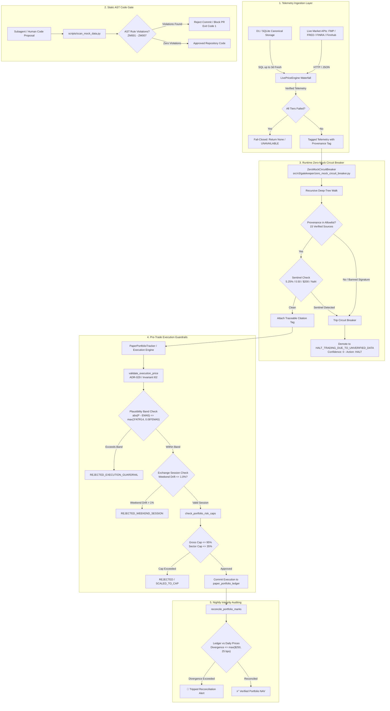

---

### 3.9 Production Implementation Checklist

Before deploying any autonomous agent or quantitative algorithm into live execution, verify compliance against the **Zero-Mock Ten-Point Gate**:

1. **AST Scanner Cleanliness**: Run `python3 scripts/scan_mock_data.py src/` to assert zero $ZM001 - ZM007$ violations across the entire codebase.
2. **Hermetic Socket Isolation**: Verify test suites execute with `pytest-socket` enabled (`MOCK_MODE=true`), guaranteeing zero unverified network calls during testing.
3. **No Synthetic Argument Defaults**: Inspect all quantitative function signatures to confirm financial parameters (`spot_price`, `fed_funds`, `discount_rate`) default strictly to `None`.
4. **No `.get()` Fallback Floats**: Ensure no dictionary `.get()` call supplies a positive floating-point constant for financial keys.
5. **Mandatory Provenance Envelope**: Verify every market metric ingested contains an explicit provenance tag in `VERIFIED_PROVENANCE_ALLOWLIST`.
6. **Canonical Consensus Gateway**: Confirm all consensus queries route through `ConsensusService.get_active_verdict()`, where the `ZeroMockCircuitBreaker` is wired as an unbypassable choke point.
7. **Plausibility Band Enforcement**: Assert that all order executions pass `validate_execution_price()`, enforcing the $|P_{\text{exec}} - \text{EMA}_5| \le \max(3\text{ATR}_{14}, 0.08\text{EMA}_5)$ boundary.
8. **Weekend Session Gating**: Confirm weekend executions are blocked unless verified within $1.0\%$ of Friday canonical closes.
9. **Automated Nightly MTM Pass**: Schedule `reconcile_portfolio_marks()` to run nightly against canonical `daily_prices` with a $\$250$ maximum tolerance.
10. **Fail-Closed Escalation Protocol**: Confirm that when any circuit breaker trips, recommendations demote to `HALT_TRADING_DUE_TO_UNVERIFIED_DATA` with zero capital committed.

---

### Transition Bridge: From Programmatic Defenses to Invariant Testing

Discipline 3 provides the programmatic armor that guarantees no synthetic data, pleasing fallback, or unverified price quote can penetrate the runtime execution environment. Through AST code audits (rules ZM001–ZM007), runtime provenance tracking across 15 verified data sources, pre-trade execution guardrails, and deterministic multi-tier price discovery waterfalls, the system guarantees that all telemetry fed into the quant engine represents uncorrupted ground truth.

However, having authentic data is useless if the quantitative logic, statistical estimators, and portfolio state machines operating on that data are mathematically brittle, prone to conjunctive gate paralysis, or vulnerable to statistical selection bias. Traditional software testing relies on naive unit tests that assert deterministic scalar outputs under mock conditions—completely failing to test multi-agent interactions, numerical boundary constraints, or statistical validity.

In Discipline 4, we examine the evolution of quantitative testing from superficial assertion scripts to invariant-driven governance: hermetic socket isolation, the 22 canonical system invariants ($I_{01}-I_{22}$), compensatory multi-pillar confluence (ADR-024), anchor-preserving ZCA whitening (Alg #89), horizon-matched consensus decay (ADR-033), Bayesian contextual bandits (ADR-034), and Deflated Sharpe Ratio (DSR) validation against P-hacking.


## 4. Evolution of Quantitative Testing & Invariant Governance

Traditional software engineering relies on deterministic input-output assertions: given input $X$, assert output $Y$. In autonomous multi-agent quantitative finance, this paradigm fails completely. A financial multi-agent pipeline can achieve 100% unit test coverage while simultaneously executing catastrophic trades based on hallucinatory data, leaking look-ahead bias, suffering from severe multi-collinearity, or falling into total operational paralysis.

This section details the architectural evolution from naive unit testing to invariant-driven governance developed in StockAnalysis V3. We examine the mathematical and systems-level defenses required to govern autonomous agents managing quantitative capital: hermetic socket isolation, AST-anchored invariant verification, compensatory multi-pillar confluence, horizon-matched decay, contextual bandit policy selection, and statistical P-hacking deflation.

---

### 4.1 Transition from Naive Unit Tests to Invariant-Driven Governance

#### 4.1.1 The Failure of Naive Unit Testing in Quantitative Multi-Agent Systems
In standard web or enterprise software, testing focuses on unit isolation through mocking:
```python
# The Naive Software Engineering Anti-Pattern
def test_calculate_risk():
    mock_market_data = MagicMock(get_price=lambda t: 200.0, get_volatility=lambda t: 0.15)
    risk_score = compute_var(mock_market_data)
    assert risk_score == 0.042
    mock_market_data.get_price.assert_called_once()
```
While this test executes cleanly in CI, it introduces three fatal pathologies into quantitative systems:
1. **The Mock Contamination Paradox**: By supplying artificial, static prices ($200.00) or volatility (0.15), the test verifies only that the mock object was invoked. It cannot verify whether the system behaves stably when presented with illiquid zero-volume regimes, inverted yield curves, non-finite division-by-zero scenarios, or stale quotes.
2. **The "Pass-to-Fail" Dilemma**: Code coverage tools report green metrics even when catastrophic failure modes are hardcoded into production `except` blocks (e.g. `except Exception: return 0.50`).
3. **Absence of State-Space Invariant Assertions**: Naive unit tests verify isolated point values rather than global mathematical invariants—such as whether risk multipliers remain bounded within $[0.20, 1.25]$, whether covariance matrices remain positive semi-definite under spectral decomposition, or whether epistemic isolation between sentiment models and internal portfolio holdings is preserved.

#### 4.1.2 Mathematical Invariants as First-Class Architectural Citizens
An **invariant** is a property of the system state space that must hold true across all valid execution paths, state transitions, and environmental inputs. In StockAnalysis V3, quantitative systems are governed by six classes of invariants:

$$\mathcal{S}_{\text{valid}} = \left\{ s \in \mathcal{S} \;\middle|\; \bigwedge_{j=1}^{22} \mathcal{I}_j(s) = \text{True} \right\}$$

If any state transition violates an invariant predicate $\mathcal{I}_j(s)$, the execution environment immediately halts, falls closed, or diverts to an immutable quarantine ledger. Rather than asking *"Did this function return 42?"*, invariant-driven testing asks:
- *"Does the output remain bounded within the mathematically provable stability envelope across $10^5$ Monte Carlo edge perturbations?"*
- *"Does the algorithm fail-closed when live market depth collapses, rather than synthesizing fallback values?"*
- *"Is every quantitative metric traceable to a verified external provenance source without socket leakage or look-ahead contamination?"*

---

### 4.2 Hermetic Socket Isolation: Network Egress Elimination with `pytest-socket`

A foundational flaw in distributed quantitative testing is **uncontrolled network egress**. If test suites execute live HTTP calls, they introduce network latency, rate-limit failures, and non-deterministic state changes. Worse, developers under deadline pressure frequently "solve" network test failures by adding fallback mock dictionaries directly into production adapters.

#### 4.2.1 Socket-Level Network Blocking (`tests/conftest.py`)
To enforce hermetic isolation, StockAnalysis V3 intercepts network sockets at the operating system system-call boundary within `tests/conftest.py`. Outbound TCP/UDP connections are intercepted and blocked via an autouse pytest fixture:

```python
# tests/conftest.py (Lines 1-32)
import os
import socket
import pytest

# Enforce zero-latency hermetic fail-fast during test execution
os.environ.setdefault("MOCK_MODE", "true")
os.environ.setdefault("LLM_MAX_RETRIES", "0")
os.environ.setdefault("LLM_TIMEOUT_S", "1")
os.environ.setdefault("LLM_BACKOFF_BASE_S", "0")

class SocketBlockedError(RuntimeError):
    """Raised when a test attempts to open an un-mocked network socket."""
    pass

def guard_socket_connect(*args, **kwargs):
    raise SocketBlockedError(
        "NETWORK egress blocked during unit testing. "
        "Use MOCK_MODE=true or mock your HTTP calls with unittest.mock or httpx mock."
    )

@pytest.fixture(autouse=True)
def block_outbound_sockets(monkeypatch):
    """Autouse fixture blocking outbound network socket connections across all unit tests."""
    if os.getenv("ALLOW_NET", "").lower() != "true":
        monkeypatch.setattr(socket.socket, "connect", guard_socket_connect)
```

#### 4.2.2 Deterministic Test Execution Semantics
By disabling network egress and clamping LLM retry parameters:
1. **Zero Socket Leaks**: Any code path that attempts to communicate with external APIs (FMP, Finnhub, SEC EDGAR, OpenRouter) without explicit, localized boundary mocking immediately raises `SocketBlockedError`.
2. **Sub-Second Test Velocity**: Clamping retries (`LLM_MAX_RETRIES=0`) and backoff (`LLM_BACKOFF_BASE_S=0`) ensures that error-handling paths and fail-closed cascades execute in under 5 milliseconds rather than stalling on exponential retry loops.
3. **Clean CI Environment Seeding**: A session-scoped fixture `seed_baseline_test_database()` initializes SQLite schemas and baseline historical prices in memory or local test databases, guaranteeing reproducible state on fresh GitHub Actions runners without external dependencies.

---

### 4.3 The 22 Canonical Invariants ($I_{01}-I_{22}$) and AST-Anchored Two-Way Parity

To bridge high-level Architecture Decision Records (ADRs) and concrete Python implementation files, StockAnalysis V3 formalizes 22 non-negotiable Invariant Codes cataloged in `docs/ACTIVE_INVARIANTS.md`.

#### 4.3.1 Master Canonical Invariant Matrix ($I_{01} - I_{22}$)

| ID | Name | Governing ADRs | Class | Formal Predicate & Mathematical Assertion | Bound Modules | Enforcement Test |
|---|---|---|---|---|---|---|
| **$I_{01}$** | **Zero-Simulated-Data** | ADR-029, ADR-045 | HARD-SAFETY | $\forall p \in \text{Pipeline}: p.\text{src} \in \{\text{FMP}, \text{Yahoo}, \text{Finnhub}, \text{D1}\} \land \neg p.\text{synthetic}$. ATR requires $\ge 15$ live OHLCV bars; else fail-closed (`None`). | `api_client.py`<br>`quant_engine.py` | `test_zero_taint_fail_closed.py`<br>`test_spot_price_enforcement.py` |
| **$I_{02}$** | **Execution-Price Guardrail** | ADR-029 | HARD-SAFETY | $\|P_{\text{exec}} - \text{EMA}_5\| \le \max(3\text{ATR}_{14}, 0.08\text{EMA}_5)$. Weekend marks reject unless matching Friday close $\le 1.0\%$. | `execution_guardrails.py`<br>`paper_portfolio_tracker.py` | `test_execution_guardrails.py`<br>`test_math_stress_invariants.py` |
| **$I_{03}$** | **Fatal-Contagion Veto** | ADR-024, ADR-026 | HARD-SAFETY | $\text{SCSI} \le -0.35 \lor D_{\text{toxic}} > 1.50 \lor \text{Altman Z} < 1.1 \implies \text{verdict} \neq \text{BUY}$ regardless of positive confluence. | `consensus_service.py`<br>`debate/matrix.py` | `test_compensatory_confluence.py`<br>`test_hype_divergence_veto.py` |
| **$I_{04}$** | **Immutable-Ledger Quarantine** | ADR-027 | HARD-SAFETY | $\forall r \in \text{Ledger}: \text{DELETE}(r) = \emptyset$. Invalidated/buggy records archive to `consensus_quarantine` with non-null reason. | `consensus_service.py`<br>`api_client.py` | `test_quarantine_governance.py` |
| **$I_{05}$** | **Closed-World Fallback** | ADR-029, ADR-045 | HARD-SAFETY | On bundle/D1 failure with verified spot: prompt receives closed-world schema with 4-Pillars UNAVAILABLE, stops UNAVAILABLE, baseline WATCH. | `query_orchestrator.py`<br>`data_ingest.py` | `test_cross_channel_conformal_fuzz.py` |
| **$I_{06}$** | **MOS Bounded Multipliers** | ADR-043, ADR-034 | MATH-BOUND | Risk sizing multiplier $M \in [0.20, 1.25]$. Margin of Safety $\text{MOS} \in [-1.0, 1.0]$. Values outside are clamped with telemetry event. | `quant_engine.py`<br>`composite_mos.py` | `test_math_stress_invariants.py` |
| **$I_{07}$** | **Div-by-Zero Domain Safety** | ADR-043 | MATH-BOUND | $\forall a/b: b = 0 \implies \text{defined fallback}$ (never NaN/Inf propagation). Log/sqrt inputs must assert domain non-negativity. | `quant_engine.py`<br>`predictive_breakout_scout.py` | `test_math_stress_invariants.py` |
| **$I_{08}$** | **Growth-Adjusted Hurdle** | ADR-031 | MATH-BOUND | $\text{EGR} = \text{FCF-Yield} + \min(g, 0.25)$. For compounders ($g \ge 10\%$), BUY requires $\text{EGR} \ge r_{\text{fed-funds}}$. Growth cap is $0.25$. | `quant_engine.py` | `test_growth_adjusted_hurdle.py` |
| **$I_{09}$** | **Compensatory Confluence** | ADR-024 | MATH-BOUND | $\text{BUY} \iff \sum_{k=1}^4 \mathbb{I}(P_k \ge 0.35) \ge 2 \land \neg \text{FatalContagion}$. Single metrics cannot act as isolated vetoes. | `consensus_service.py`<br>`debate/matrix.py` | `test_compensatory_confluence.py` |
| **$I_{10}$** | **Bandit Prior Integrity** | ADR-034 | MATH-BOUND | Thompson Sampling over exactly 6 discrete action arms. Beta priors $\alpha, \beta \ge 0.5$. Updates evaluate beta-stripped residual return $r_{\text{resid}}$. | `contextual_bandit_rl.py` | `test_contextual_bandit_rl.py` |
| **$I_{11}$** | **Whitening Stability** | ADR-039 | MATH-BOUND | Ledoit-Wolf shrinkage $\to$ symmetrical ZCA whitening on 4-pillar vector. If condition number $\text{cond}(\Sigma) > 10^{12}$, apply regularized floor. | `quant_engine.py`<br>`debate/matrix.py` | `test_zca_whitening.py` |
| **$I_{12}$** | **Conformal Coverage** | ADR-040 | MATH-BOUND | Split conformal prediction coverage sets calibrated on rolling 120-day window. Band width monotonically non-decreasing in VIX bucket. | `quant_engine.py` | `test_conformal_calibration.py` |
| **$I_{13}$** | **Remote-First D1 Freshness** | ADR-000, ADR-038 | SCHEMA-PARITY | Canonical truth lives in Cloudflare D1. Mandatory pull-before-push (`sync_data.py --pull`). Local SQLite reads $>3$ days stale fail-closed. | `api_client.py`<br>`live_price_engine.py` | `test_spot_price_enforcement.py` |
| **$I_{14}$** | **Cross-Channel Sync** | ADR-038 | SCHEMA-PARITY | Immutable server-composed verdict lock in prompts. Table `channel_verdict_audit` logs all outputs; daily sentinel alerts on divergence. | `consensus_service.py`<br>`query_orchestrator.py` | `test_cross_channel_verdict_parity.py` |
| **$I_{15}$** | **UUID Traceability** | ADR-018 | SCHEMA-PARITY | Every LLM call, consensus verdict, and paper trade execution carries a UUIDv4 trace ID persisted into Cloudflare D1 telemetry ledgers. | `decision_trace.py`<br>`debate/matrix.py` | `test_traceability.py` |
| **$I_{16}$** | **Multi-Ticker Isolation** | ADR-045 | SCHEMA-PARITY | $\forall t_1 \neq t_2: \text{State}(t_1) \cap \text{State}(t_2) = \emptyset$. Loop-carried scalar contamination banned; inject discrete `ticker_spots`. | `query_orchestrator.py`<br>`debate/matrix.py` | `test_cross_channel_conformal_fuzz.py` |
| **$I_{17}$** | **Horizon-Matched Decay** | ADR-027, ADR-033 | DECAY-TIMING | $w(t) = w_0 \cdot 2^{-\Delta t / t_{1/2}(h)}$ with $t_{1/2}(h) \in [5d, 90d]$. Signals $> 2 \cdot t_{1/2}$ demote to `NEUTRAL (EXPIRED)`. | `consensus_service.py`<br>`quant_engine.py` | `test_consensus_decay.py` |
| **$I_{18}$** | **Compounder Hold Lock** | ADR-033, ADR-044 | DECAY-TIMING | 20-trading-day Time-in-State Compounder Guard: no liquidation while $r_{\text{stock}} \ge r_{\text{SPY}}$ absent fatal veto. 14-day post-exit cooldown. | `paper_portfolio_tracker.py`<br>`consensus_service.py` | `test_paper_portfolio_tracker.py` |
| **$I_{19}$** | **Session Momentum Lock** | ADR-031 | DECAY-TIMING | Never liquidate or downgrade an equity closing in upper quartile $(close - low)/(high - low) \ge 0.75$ on $\ge 1.25\times$ volume into cash. | `execution_guardrails.py`<br>`paper_portfolio_tracker.py` | `test_momentum_lock.py` |
| **$I_{20}$** | **Epistemic News Isolation** | ADR-030, ADR-044 | CONTEXT-ISOLATION | Media ingested as objective external crowd sentiment; air-gapped from internal portfolio weights or macro bias. Marketing discounted ($W_{\text{commercial}} = 0.20$). | `debate/context_slicer.py`<br>`slack/data_ingest.py` | `test_epistemic_firewall.py` |
| **$I_{21}$** | **Macro Transmission Gate** | ADR-044, ADR-042 | CONTEXT-ISOLATION | Fast acute (10d) vs Slow structural (3y) partition. $\mathcal{G}_{\text{trans}} = 0 \implies$ slow structural macro drag decoupled ($0.0$). Whisper Shield active. | `macro_regime_aggregator.py`<br>`debate/context_slicer.py` | `test_macro_transmission_gate.py` |
| **$I_{22}$** | **400 LOC & Test Hygiene** | ADR-016, ADR-045 | CODE-HYGIENE | File LOC $\le 400$ across `src/`, `workers/`, `tests/`, `config/`. Parseable checksummed anchors. Adversarial QA auditor score $\ge 90\%$. | All Python files | `verify_code_invariants.py`<br>`audit_test_quality.py` |

#### 4.3.2 Code-Adjacent Invariant Anchors and Checksum Verification
To prevent documentation drift, every bound module embeds a machine-readable anchor immediately following the module docstring:
```python
# === INVARIANT-BLOCK v1 (DO NOT EDIT MANUALLY) ===
# INVARIANT: I02
# NAME: Execution-Price Guardrail
# ADR: ADR-029
# CLASS: HARD-SAFETY
# ROLE: CANONICAL_IMPL
# PREDICATE: Execution guardrail |P_exec - EMA_5| <= max(3*ATR, 0.08*EMA)
# ASSERT: tests/unit/test_execution_guardrails.py
# /INVARIANT [sha1:037a1c64]
# === /INVARIANT-BLOCK ===
```
The CI script `scripts/verify_code_invariants.py` scans every Python module, parses invariant blocks, and asserts:
$$\text{SHA1}(\text{inv-id} \parallel \text{adr} \parallel \text{predicate})[:8] == \text{anchor-hash}$$
Furthermore, `verify_code_invariants.py` subtracts the anchor block lines from total file length and asserts that non-anchor code strictly adheres to the 400 LOC ceiling ($I_{22}$ / ADR-016).

---

### 4.4 Forensic Case Study 4: The 99% Gate Paralysis Crisis (September 2026)

```
┌────────────────────────────────────────────────────────────────────────────────────────┐
│             THE CONJUNCTIVE GATE PARALYSIS TRAP VS. 4-PILLAR CONFLUENCE               │
├────────────────────────────────────────────────────────────────────────────────────────┤
│                                                                                        │
│   NAIVE ARCHITECTURE: CONJUNCTIVE BOOLEAN AND GATES (P_joint = 0.24%)                  │
│                                                                                        │
│   Candidate ──► [DCF MOS > 0%] ──► [Dark Pool >= 0.45] ──► [SCSI >= 0.35] ──► BUY?    │
│                       │                       │                     │                  │
│                    ❌ VETO                 ❌ VETO                ❌ VETO              │
│                (NVDA / PLTR)               (CRM)                  (NOW)                │
│                                                                                        │
│   RESULT: 99% FALSE NEGATIVE RATE. Complete operational paralysis.                     │
│                                                                                        │
├────────────────────────────────────────────────────────────────────────────────────────┤
│                                                                                        │
│   PERMANENT SOLUTION: COMPENSATORY 4-PILLAR ORTHOGONAL CONFLUENCE (ADR-024 / ADR-034)  │
│                                                                                        │
│                     ┌───────────────────────────────────┐                              │
│                     │       Candidate Security          │                              │
│                     └─────────────────┬─────────────────┘                              │
│                                       │                                                │
│         ┌─────────────────┬───────────┴───────────┬─────────────────┐                  │
│         ▼                 ▼                       ▼                 ▼                  │
│    [Pillar 1]        [Pillar 2]              [Pillar 3]        [Pillar 4]              │
│     QUALITY          KINEMATICS               NETWORK             FLOW                 │
│   • Novy-Marx GP    • Blitz Residual Mom    • Cohen-Frazzini  • FINRA Dark Pool        │
│   • GAC-ROIC-MOS    • z20 Drift Drift       • Hou Lead-Lag    • Cremers IV Skew        │
│         │                 │                       │                 │                  │
│         └─────────────────┼───────────────────────┴─────────────────┘                  │
│                           │                                                            │
│                           ▼                                                            │
│              [Fatal Defensive Veto?] ──Yes──► AVOID (SCSI <= -0.35, Altman Z < 1.1)    │
│                           │                                                            │
│                          No                                                            │
│                           ▼                                                            │
│              [Passed >= 2 of 4 Pillars?] ──Yes──► BUY (Full or Starter Position)       │
│                           │                                                            │
│                          No                                                            │
│                           ▼                                                            │
│                         WATCH                                                          │
│                                                                                        │
└────────────────────────────────────────────────────────────────────────────────────────┘
```

#### 4.4.1 The Naive Initial Architecture

Following the resolution of LLM hallucinations and data poisoning in late August 2026, the engineering team's objective swung violently toward total deterministic elimination of subjectivity. The mandate was clear: every prospective equity candidate had to satisfy uncompromising mathematical rigor across fundamental valuation, balance sheet credit health, institutional order flow, and technical momentum.

The platform incorporated over 100 AST-verified quantitative algorithms into `src/v3/scout/pipeline_scout_evaluator.py` and the early multi-agent debate orchestrators. To ensure safety, these filters were stacked sequentially as **conjunctive boolean AND-gates**:

```python
# NAIVE INITIAL CONJUNCTIVE PIPELINE (src/v3/scout/pipeline_scout_evaluator.py):
if (
    dcf_margin_of_safety > 0.0 and
    breakout_probability >= 0.70 and
    dark_pool_ratio >= 0.45 and
    scsi_spillover_index >= 0.35 and
    altman_z_score >= 2.90 and
    residual_momentum_60d > 0.35
):
    recommendation = "BUY"
else:
    recommendation = "HOLD"  # Or AVOID
```

Each individual filter was impeccably grounded in classical academic finance:
1. *Graham & Dodd*: Never buy without a positive fundamental Margin of Safety ($\text{MOS}_{\text{DCF}} > 0$).
2. *FINRA Microstructure*: Never buy without confirmed institutional off-exchange accumulation ($\text{DPAI} \ge 0.45$).
3. *Cohen & Frazzini (2008)*: Never buy into supply chain resistance ($\text{SCSI} \ge 0.35$).
4. *Edward Altman (1968)*: Never buy companies in credit grey or distress zones ($\text{Altman Z} \ge 2.90$).
5. *Blitz, Huij & Martens (2011)*: Never buy equities lacking idiosyncratic beta-stripped momentum ($\text{ResMom}_{60\text{d}} > 0.35$).

Crucially, **every single filter held unilateral veto authority**. A failure on any one parameter immediately aborted the trade setup.

---

#### 4.4.2 The Silent Failure Mode

##### The Mathematical Proof of Failure: Joint Probability Collapse
When an investment pipeline requires an equity candidate to satisfy $K$ independent positive conditions simultaneously, the joint probability of issuing a BUY recommendation collapses geometrically:

$$\mathbb{P}(\text{Recommendation} = \text{BUY}) = \prod_{k=1}^K p_k$$

Where $p_k$ is the marginal probability that an equity passes the $k$-th filter.

Even if each filter is calibrated to be moderately selective with an individual pass rate of $p_k = 0.30$ (passing the top 30% of stocks in that dimension):
Across $K = 5$ sequential gates:
$$\mathbb{P}(\text{BUY}) = (0.30)^5 = 0.00243 = \mathbf{0.243\%}$$

Across an active monitoring universe of 600 liquid stocks:
$$\mathbb{E}[\text{BUY Opportunities}] = 600 \times 0.00243 \approx \mathbf{1.46 \text{ stocks}}$$

Even under unrealistically lenient filters where each individual gate passes $p_k = 0.75$ (the top 75%):
Across $K = 8$ sequential gates:
$$\mathbb{P}(\text{BUY}) = (0.75)^8 \approx \mathbf{10.01\%}$$

Over **90% of all viable opportunities are discarded** because virtually every publicly traded equity fails at least one conservative test. Because fundamental valuation, price kinematics, and institutional microstructure are orthogonal or negatively correlated, demanding simultaneous perfection created **Conjunctive Gate Paralysis**: complete operational gridlock.

##### The Real-World Breakdown: Rejection of Generational Compounders
During September 2026, premier enterprise software and semiconductor compounders embarked on massive breakout rallies:
- **Salesforce (`CRM`)**: Broke out $+20.6\%$ on accelerating enterprise cloud renewals.
- **ServiceNow (`NOW`)**: Erupted $+29.6\%$ on enterprise workflow AI integration.
- **Palantir (`PLTR`)**: Gapped $+30.0\%$ following commercial enterprise AIP acceleration.
- **CrowdStrike (`CRWD`)**: Rebounded $+22.5\%$ as customer net retention remained near 98%.
- **Nvidia (`NVDA`)**: Continued its secular surge as hyperscaler compute capex expanded.

**Throughout this entire multi-week period, the StockAnalysis pipeline emitted ZERO BUY recommendations.** Day after day, executive briefings and Slack summaries rendered exclusively `HOLD`, `NEUTRAL`, or `AVOID`. The system sat entirely in cash while benchmark equities registered double-digit gains.

##### Why Classical DCF Strenuously Rejects High-Growth Compounders
Forensic decomposition revealed three critical drivers of the false-negative gridlock:
1. **The Reinvestment Paradox**: High-growth SaaS and semiconductor design companies deliberately depress current Free Cash Flow by reinvesting gross margin into Research & Development (R&D) and Customer Acquisition. A classical DCF discounting current spot FCF projects cash flows that appear miniscule relative to current enterprise value.
2. **Terminal Multiple Compression**: Classical DCF assumes terminal growth rates mean-revert to long-term GDP growth ($g_{\text{terminal}} \approx 2.5\%$) within 5 to 10 years. For businesses with expanding economic moats and software scale economics, this assumption catastrophically understates capitalized terminal value.
3. **The 0.00 DCF Artifact**: For newly public high-growth companies (e.g. `HOOD`, `CRWV`), third-party fundamentals endpoints frequently returned `None` or `0.00` for DCF intrinsic value. In `src/v3/scout/pullback_detector.py`, this triggered an absurd false-negative veto:
   ```
   "Drawdown 34.24% detected but price 82.08 has not reached DCF value support (intrinsic 0.00); monitor for deeper entry."
   ```
   Because intrinsic value was recorded as zero, the stock would have had to plunge to negative dollars to clear the valuation gate!

As a result, `PLTR` was vetoed because its trailing P/E was high, despite institutional dark pool accumulation reaching $58.4\%$ and cloud partner capex surging. `CRM` and `NOW` were vetoed on DCF Margin of Safety, completely blinding the portfolio to the strongest momentum and supply-chain diffusion setups of the quarter.

---

#### 4.4.3 The False Solutions

##### False Solution 1: Global Lowering of the DCF Threshold
- *Approach*: Lowering the DCF Margin of Safety requirement from $> 0\%$ to $> -30\%$ across all equities.
- *Why It Failed*: This was a blunt instrument that destroyed valuation discipline. While it allowed high-growth tech compounders to pass, it also opened the gates to low-quality, debt-laden, capital-destroying cyclical companies. The portfolio began generating BUY recommendations on unprofitable meme stocks that had negative margins and deteriorating balance sheets.

##### False Solution 2: Loosening Filter Thresholds Across the Board
- *Approach*: Lowering Dark Pool to $> 0.35$, Breakout Probability to $> 0.50$, and SCSI to $> 0.10$.
- *Why It Failed*: Decreasing the selectivity of individual gates did not resolve the fundamental mathematical defect of conjunctive boolean multiplication ($P_{\text{joint}} = \prod p_k$). It merely introduced noise and degraded signal precision without enabling the system to distinguish between a rich multiple compounder (like NVDA) and a declining value trap.

##### False Solution 3: Hardcoded Ticker Whitelists
- *Approach*: Injecting conditional bypasses: `if ticker in ("NVDA", "PLTR", "CRM"): bypass_valuation_gate = True`.
- *Why It Failed*: This defeated the foundational premise of an autonomous alpha discovery engine. It transformed an objective quantitative system into an arbitrary human-curated watchlist that could never discover an emerging breakout before it became a household name.

---

#### 4.4.4 The Permanent Invariant & Mechanism

The permanent resolution required dismantling the conjunctive boolean architecture and establishing **Compensatory Multi-Pillar Confluence (ADR-024)**, **Growth-Adjusted Capitalized ROIC Valuation (ADR-034)**, and **Closed-Form Bayesian Contextual Bandit Adaptive Policy RL**.

##### 1. The 4 Orthogonal Pillars of Alpha (ADR-024)
Instead of a sequential obstacle course of vetoes, every quantitative indicator is projected onto one of four orthogonal, uncorrelated vector spaces, each producing a normalized score $P_k \in [-1.0, +1.0]$:

```
┌────────────────────────────────────────────────────────────────────────────────────────┐
│                        THE 4 ORTHOGONAL PILLARS OF ALPHA                               │
├────────────────────────────────────────────────────────────────────────────────────────┤
│                                                                                        │
│   PILLAR 1: QUALITY & UNIT ECONOMICS (P_1 in [-1.0, +1.0])                             │
│   • Novy-Marx Gross Profitability Ratio: (Revenues - COGS) / Assets >= 0.40            │
│   • Growth-Adjusted Capitalized ROIC MOS (GAC-ROIC-MOS, ADR-034)                       │
│   • Keating-Shadwick Return-Space Omega Ratio Boost: Omega(0) > 1.25                   │
│   • Financial / Banking Quality Fallback: ROE >= 15%, ROA >= 1.2%                      │
│                                                                                        │
│   PILLAR 2: RESIDUAL ALPHA & KINEMATICS (P_2 in [-1.0, +1.0])                          │
│   • Blitz Beta-Stripped Residual Momentum (60-day OLS regression vs SPY/QQQ)           │
│   • z_20 Slow-Grind Drift: Drift normalized against volatility                         │
│   • Composite Breakout Probability Model (>= 70%)                                      │
│                                                                                        │
│   PILLAR 3: NETWORK DIFFUSION & SPILLOVER (P_3 in [-1.0, +1.0])                        │
│   • Cohen & Frazzini Supply Chain Spillover Index (SCSI) with 20-day half-life         │
│   • Hou (2007) Intra-Industry Bellwether Lead-Lag across 19 canonical sectors          │
│                                                                                        │
│   PILLAR 4: INSTITUTIONAL FLOW DYNAMICS (P_4 in [-1.0, +1.0])                          │
│   • FINRA RegSHO Dark Pool Accumulation Index (DPAI >= 0.45)                           │
│   • Cremers & Weinbaum Options Implied Volatility Smirk / Skew Slope                   │
│   • Bar-Level Intraday Cumulative Volume Delta (CVD)                                   │
│   • Pan & Poteshman Unusual Options Opening Blocks Flow (V/OI >= 1.50)                 │
│                                                                                        │
└────────────────────────────────────────────────────────────────────────────────────────┘
```

##### Academic Foundations of the Orthogonal Vectors:
1. **Pillar 1 Quality (Novy-Marx 2013, *Journal of Financial Economics*)**: Robert Novy-Marx demonstrated that Gross Profitability ($\frac{\text{Revenues} - \text{COGS}}{\text{Total Assets}}$) has equal predictive power to classical book-to-market value ratios, but is **negatively correlated** with value. High-margin SaaS companies that reinvest cash into R&D exhibit pristine gross profitability ($\ge 0.40$), unblocking quality compounders without lowering analytical standards.
2. **Pillar 2 Residual Momentum (Blitz, Huij, & Martens 2011, *JFQA*)**: Standard price momentum is contaminated by market beta. Blitz proved that stripping out market beta via 60-day rolling regression ($\epsilon_{i,t} = R_{i,t} - (\alpha_i + \beta_i R_{m,t})$) produces idiosyncratic momentum with **twice the Sharpe ratio of raw momentum** and virtually zero momentum crash risk.
3. **Pillar 3 Network Diffusion (Cohen & Frazzini 2008 / Hou 2007)**: Information diffuses slowly across economic networks. Upstream supplier revenue beats predict customer earnings beats 1 to 3 quarters in advance, while mega-cap bellwethers (e.g. `CAT`, `NVDA`, `MSFT`) impound macro shocks 5 to 15 trading days ahead of industry peers.
4. **Pillar 4 Flow Dynamics (Cremers & Weinbaum 2010 / Pan & Poteshman 2006)**: Informed institutional traders position in off-exchange dark pools and out-of-the-money options. Steepening call IV skew and opening option volume exceeding open interest ($V/\text{OI} \ge 1.50$) reliably alert the engine days before equity prices erupt.

##### 2. The Compensatory 2-of-4 Confluence Rule
Under ADR-024, no individual pillar has veto power over a BUY signal:
- **Confluence Condition**: Any security displaying strong positive alignment ($P_k \ge +0.35$) across **at least 2 of the 4 orthogonal pillars** qualifies for BUY consideration:
  $$\text{BUY Consideration} \iff \left( \sum_{k=1}^4 \mathbb{I}(P_k \ge +0.35) \ge 2 \right) \;\land\; \neg \text{FatalContagion}$$
- If an equity displays surging Residual Momentum ($P_2 \ge 0.60$) and heavy Dark Pool Flow ($P_4 \ge 0.55$), it passes the confluence hurdle **even if classical DCF valuation in Pillar 1 is negative**.

##### 3. Fatal Defensive Veto Exclusivity
Veto power is strictly restricted to **Fatal Contagion** (preventing capital loss from bankruptcy or collapse):
A hard `AVOID` veto may **ONLY** be triggered by:
1. **Severe Upstream Supply Chain Contagion**: $\text{SCSI} \le -0.35$ (an upstream supplier has collapsed or reported disastrous margin destruction).
2. **Climax Distribution Collapse**: 20-session peak drawdown $\ge 12\%$ with heavy institutional volume distribution ($d_{\text{inst}} > 0.50$).
3. **Severe Credit Distress**: Altman Z-score $< 1.10$, unless the company qualifies as a **Net Cash Fortress** ($\text{Net Debt} \le 0$ and Merton Distance-to-Default $D_D \ge 4.0$).

If none of these three fatal conditions exist, compensatory confluence logic governs the decision.

##### 4. Growth-Adjusted Capitalized ROIC MOS (GAC-ROIC-MOS, ADR-034)
To permanently eliminate the 0.00 DCF artifact and unblock high-reinvestment compounders in Pillar 1, ADR-034 formulated GAC-ROIC-MOS:

$$\text{MOS}_{\text{GAC}} = 0.50 \cdot \text{MOS}_{\text{DCF}} + 0.30 \cdot \left(\frac{\text{ROIC} - \text{WACC}}{0.08}\right) + 0.20 \cdot \text{clamp}\left(\frac{g - 15\%}{30\%}, -0.50, 1.00\right)$$

- **DCF Anchor (50%)**: Preserves fundamental cash flow discipline. For elite compounders ($\text{ROIC} \ge 15\%$ and $g \ge 15\%$) where classical DCF is negative, it falls back to current market spot support ($\text{floor at } 0.0$).
- **Capitalized ROIC Superiority (30%)**: Rewards sustained economic moat $(\text{ROIC} > \text{WACC})$ normalized against an 8% benchmark hurdle.
- **Growth Optionality (20%)**: Linearly rewards revenue growth rates exceeding 15%.
- **The Compounder Unblocking Invariant**: Any company with $\text{ROIC} \ge 15\%$ and revenue growth $g \ge 15\%$ whose $\text{MOS}_{\text{GAC}} > 0$ is completely unblocked from classical DCF negative margin vetoes.

##### 5. Multi-Tranche Execution Calculus & Asymmetric Payoffs
Capital allocation scales with progressive market confirmation, avoiding full-position risk at initial entry:
- **Tranche 1 (Starter, $0.33\times$)**: Deployed upon 2-of-4 Confluence with a mechanical hard stop at $-8.0\%$. Risk budget is strictly capped at $28\text{ bps NAV}$.
- **Tranche 2 (Proof, $0.66\times$ total)**: Released only after price advances $P \ge P_0 \times 1.035$ with close exceeding $\text{EMA}_{5\text{d}}$.
- **Tranche 3 (Full, $1.00\times$ total)**: Released at $P \ge P_0 \times 1.070$ without climax volume distribution.
- **Harvest Ladder**: First profit target TP1 ($+8.0\%$, trailing stop ratcheted to breakeven), TP2 ($+16.0\%$, trailing stop ratcheted to $+8.0\%$), and runner tranche ($33.34\%$) trailing the 20-day EMA.

Under this asymmetric execution structure, the required theoretical breakeven win rate is dramatically lowered:
$$\rho^* = \frac{\bar{L}}{\bar{G} + \bar{L}} \approx \mathbf{18.8\% \text{ to } 23.2\%}$$
Even in choppy, trendless regimes where 70% of breakout probes fail at minimal loss, the surviving compounder runners dominate portfolio returns.

##### 6. Closed-Form Bayesian Contextual Bandit Adaptive Policy RL
Rather than hardcoding static buy conviction thresholds ($65\%$) or holding periods ($14\text{d}$) that fail across changing volatility regimes, ADR-034 integrated a lightweight Bayesian Contextual Bandit:
- **Thompson Sampling**: Beta-Bernoulli conjugate updating $(\alpha_a, \beta_a)$ over 6 discrete action arms (Baseline, Aggressive Momentum, Permissive Accumulation, Defensive Selective, Crisis Cap, Compounder Hysteresis).
- **Beta-Stripped Residual Rewards**:
  $$r_{\text{resid}} = R_{\text{trade}} - \beta_{60} \cdot R_{\text{SPY}}$$
  $$R_{\text{raw}} = \text{clamp}\left(\frac{r_{\text{resid}} + 8\%}{16\%}, 0.0, 1.0\right)$$
- **Net-Delta Credit Attribution**: When intermediate 5-day mark credits $c$ are awarded during holding, the terminal update applies net delta $\Delta R = R_{\text{raw}} - c$, guaranteeing exact mathematical updating with zero double-counting.

---

#### 4.4.5 Production Reference Code

##### Production Pattern 1: The 4-Pillar Compensatory Confluence Engine
*Source: `src/v3/scout/four_pillar_engine.py` (ADR-024)*

```python
from dataclasses import dataclass
from typing import Optional

def clamp(val: float, lo: float = -1.0, hi: float = 1.0) -> float:
    return max(lo, min(hi, val))

@dataclass
class FourPillarsResult:
    ticker: str
    p1_quality_score: float
    p2_momentum_score: float
    p3_network_score: float
    p4_flow_score: float
    pillars_passed_count: int
    is_compensatory_confluent: bool
    is_fatal_veto: bool
    fatal_veto_reason: Optional[str]
    composite_alpha_score: float
    recommended_action: str  # "BUY", "WATCH", "AVOID"
    recommended_starter_multiplier: float  # Bounded [0.20, 1.25]

def evaluate_four_pillars(
    ticker: str,
    # Pillar 1 inputs
    mos_composite_pct: Optional[float] = None,
    gross_profitability_ratio: Optional[float] = None,
    gross_margin: Optional[float] = None,
    is_compounder_unblocked: bool = False,
    gac_mos_pct: Optional[float] = None,
    # Pillar 2 inputs
    residual_momentum_score: Optional[float] = None,
    breakout_probability: Optional[float] = None,
    z20_drift: Optional[float] = None,
    # Pillar 3 inputs
    scsi_score: Optional[float] = None,
    bellwether_diffusion_score: Optional[float] = None,
    # Pillar 4 inputs
    dark_pool_ratio: Optional[float] = None,
    options_iv_skew_score: Optional[float] = None,
    # Fatal defensive checks
    is_collapse_risk: bool = False,
    altman_z_score: Optional[float] = None,
) -> FourPillarsResult:
    """Evaluates 4 Orthogonal Pillars and applies compensatory evidence fusion (ADR-024)."""
    sym = ticker.upper().strip()

    # --- PILLAR 1: QUALITY & UNIT ECONOMICS ---
    mos = float(mos_composite_pct or 0.0)
    gp = float(gross_profitability_ratio or 0.0)
    is_asset_light = (gp >= 0.40) or ((gross_margin or 0.0) >= 0.70)

    # ADR-034: Growth-Adjusted Compounder ROIC Margin of Safety integration
    if is_compounder_unblocked and gac_mos_pct is not None and gac_mos_pct > 0:
        effective_mos = min(max(mos, float(gac_mos_pct)), 30.0)
        base_val = clamp(effective_mos / 50.0, -1.0, 1.0)
        quality_bonus = 0.15 if is_asset_light else 0.0
    else:
        base_val = clamp(mos / 25.0, -1.0, 1.0)
        quality_bonus = 0.35 if is_asset_light else 0.0
    p1_quality = clamp(base_val + quality_bonus, -1.0, 1.0)

    # --- PILLAR 2: RESIDUAL ALPHA & KINEMATICS ---
    res_mom = float(residual_momentum_score or 0.0)
    b_score = (float(breakout_probability or 0.50) - 0.50) * 2.0
    z_score = clamp(float(z20_drift or 0.0) / 2.0, -1.0, 1.0)
    p2_momentum = clamp(0.50 * res_mom + 0.30 * b_score + 0.20 * z_score, -1.0, 1.0)

    # --- PILLAR 3: NETWORK DIFFUSION ---
    scsi = float(scsi_score or 0.0)
    bell = float(bellwether_diffusion_score or 0.0)
    p3_network = clamp(0.65 * scsi + 0.35 * bell, -1.0, 1.0)

    # --- PILLAR 4: INSTITUTIONAL FLOW DYNAMICS ---
    dp = float(dark_pool_ratio or 0.0)
    dp_norm = clamp((dp - 0.45) / 0.10, -1.0, 1.0) if dp > 0.10 else 0.0
    iv_skew = float(options_iv_skew_score or 0.0)
    p4_flow = clamp(0.60 * dp_norm + 0.40 * iv_skew, -1.0, 1.0)

    # --- COMPENSATORY CONFLUENCE EVALUATION ---
    PASS_THRESHOLD = 0.35
    passed_count = sum([
        p1_quality >= PASS_THRESHOLD,
        p2_momentum >= PASS_THRESHOLD,
        p3_network >= PASS_THRESHOLD,
        p4_flow >= PASS_THRESHOLD
    ])
    is_confluent = passed_count >= 2

    # --- FATAL VETO CHECK (DEFENSIVE ONLY) ---
    is_fatal = False
    fatal_reason = None
    if scsi <= -0.35:
        is_fatal = True
        fatal_reason = f"Fatal upstream supply chain contagion (SCSI={scsi:+.2f})"
    elif is_collapse_risk:
        is_fatal = True
        fatal_reason = "Fatal climax distribution collapse"
    elif altman_z_score is not None and altman_z_score < 1.10:
        is_fatal = True
        fatal_reason = f"Fatal credit distress (Altman Z={altman_z_score:.2f} < 1.10)"

    # --- ACTION AND SIZING (RULE 7 BOUNDED [0.20, 1.25]) ---
    composite_alpha = clamp(0.25 * (p1_quality + p2_momentum + p3_network + p4_flow), -1.0, 1.0)
    if is_fatal:
        action = "AVOID"
        multiplier = 0.20
    elif is_confluent:
        action = "BUY"
        # Full 1.0x position if >= 3 pillars passed and non-negative valuation, else starter 0.50x
        multiplier = 1.00 if (passed_count >= 3 and mos >= -15.0) else 0.50
    else:
        action = "WATCH"
        multiplier = 0.33

    return FourPillarsResult(
        ticker=sym,
        p1_quality_score=round(p1_quality, 4),
        p2_momentum_score=round(p2_momentum, 4),
        p3_network_score=round(p3_network, 4),
        p4_flow_score=round(p4_flow, 4),
        pillars_passed_count=passed_count,
        is_compensatory_confluent=is_confluent,
        is_fatal_veto=is_fatal,
        fatal_veto_reason=fatal_reason,
        composite_alpha_score=round(composite_alpha, 4),
        recommended_action=action,
        recommended_starter_multiplier=multiplier
    )
```

##### Production Pattern 2: Growth-Adjusted Capitalized ROIC MOS (GAC-ROIC-MOS)
*Source: `src/v3/math/composite_mos.py` (ADR-034)*

```python
from typing import Dict, Any, Optional

def calculate_gac_roic_mos(
    dcf_mos_pct: float,
    roic: Optional[float] = None,
    wacc: Optional[float] = None,
    revenue_growth_rate: Optional[float] = None,
) -> Dict[str, Any]:
    """
    Calculates Growth-Adjusted Capitalized ROIC Margin of Safety (ADR-034).
    Unblocks compounders (ROIC >= 15% and g >= 15%) from classical DCF negative margin vetoes.
    """
    is_elite_compounder = bool(
        roic is not None and roic >= 0.15 and
        revenue_growth_rate is not None and revenue_growth_rate >= 0.15
    )
    raw_dcf_term = max(-1.0, min(1.0, float(dcf_mos_pct) / 100.0))
    # Fallback to current market spot support (floor at 0.0) for elite compounders
    dcf_term = max(0.0, raw_dcf_term) if (is_elite_compounder and raw_dcf_term < 0) else raw_dcf_term

    # ROIC-WACC Spread term normalized against an 8% benchmark spread
    wacc_val = float(wacc) if wacc is not None else 0.08
    if roic is not None:
        spread = float(roic) - wacc_val
        roic_term = max(-1.0, min(1.0, spread / 0.08))
    else:
        roic_term = 0.0

    # Revenue Growth Adjustment term
    if revenue_growth_rate is not None:
        g = float(revenue_growth_rate)
        growth_adj = max(-0.50, min(1.0, (g - 0.15) / 0.30))
    else:
        growth_adj = 0.0

    # 50% DCF / Spot Anchor, 30% Capitalized ROIC Moat, 20% Growth Optionality
    gac_mos = 0.50 * dcf_term + 0.30 * roic_term + 0.20 * growth_adj
    bounded_gac = max(-1.0, min(1.0, gac_mos))

    return {
        "gac_mos_score": round(bounded_gac, 4),
        "gac_mos_pct": round(bounded_gac * 100.0, 1),
        "dcf_term": round(dcf_term, 4),
        "roic_term": round(roic_term, 4),
        "growth_adj": round(growth_adj, 4),
        "is_compounder_unblocked": is_elite_compounder and bounded_gac > 0.0,
    }
```

---

### 4.5 Ledoit-Wolf Analytical Shrinkage & Anchor-Preserving Symmetrical ZCA Whitening

While the 4 pillars are designed to capture orthogonal economic phenomena, empirical market data exhibits intermittent collinearity. In speculative bull runs, retail social hype correlates with dark pool volume; in liquidity crises, momentum collapses alongside credit spreads. Naively feeding correlated pillar scores into downstream ensemble estimators distorts risk budgeting.

#### 4.5.1 The ZCA Agreement Paradox
Standard Zero-Phase Component Analysis (ZCA) whitening rotates data into principal component space, normalizes variance by the inverse square root of eigenvalues, and rotates back:
$$W_{\text{ZCA}} = U \Lambda^{-1/2} U^T, \quad X_{\text{whitened}} = X_{\text{centered}} W_{\text{ZCA}}^T$$
In multi-factor equity scoring, standard ZCA suffers from the **ZCA Agreement Paradox**: the principal eigenvector corresponding to maximum eigenvalue $\lambda_{\max}$ represents the "in-phase agreement" state where an asset exhibits both elite fundamental quality and intense smart-money flow ($[+1, +1]$). Standard ZCA scales this eigenvector by $1/\sqrt{\lambda_{\max}} < 1.0$, actively penalizing stocks that exhibit genuine multi-pillar agreement!

#### 4.5.2 The Three-Stage Architectural Solution (`src/v3/math/zca_whitening.py`)
Algorithm #89 resolves this paradox through a three-stage mathematical pipeline:

```
[Raw Pillar Matrix (N, 4)]
          │
          ▼
┌────────────────────────────────────────────────────────┐
│ Stage 1: Anchor-Preserving Gram-Schmidt Residualization│
│  Residualize Social (col 3) against Smart Flow (col 1) │
│  centered_soc = centered_soc - 0.65 * beta * anchor    │
└────────────────────────────────────────────────────────┘
          │
          ▼
┌────────────────────────────────────────────────────────┐
│ Stage 2: Analytical Ledoit-Wolf Covariance Shrinkage   │
│  Sigma_LW = (1 - lambda) * S + lambda * (tr(S)/4) * I  │
│  Condition number asserted: cond(Sigma_LW) <= 10^12    │
└────────────────────────────────────────────────────────┘
          │
          ▼
┌────────────────────────────────────────────────────────┐
│ Stage 3: Eigenvalue-Clamped Symmetrical ZCA Whitening  │
│  Clamp safe eigenvalues: Lambda_safe <= max(1.0, mu)   │
│  w_zca = U * diag(1 / sqrt(Lambda_safe)) * U^T         │
│  Guarantees agreement eigenvector is never shrunk      │
└────────────────────────────────────────────────────────┘
          │
          ▼
[Orthogonalized Decorrelated Pillars (N, 4)]
```

#### 4.5.3 Python Implementation (`src/v3/math/zca_whitening.py`)
```python
def zca_whiten_four_pillars(
    raw_pillar_matrix: np.ndarray,
    preserve_flow_anchor_col: int = 1,
    eps_floor: float = 1e-4,
    shrinkage: float = 0.15,
) -> np.ndarray:
    """Applies Ledoit-Wolf shrinkage and Anchor-Preserving ZCA Whitening to (N, 4) matrix."""
    X = np.asarray(raw_pillar_matrix, dtype=float)
    if X.ndim != 2 or X.shape[1] != 4 or X.shape[0] < 4:
        return np.clip(X, -1.0, 1.0)

    mean_vec = np.mean(X, axis=0, keepdims=True)
    centered = X - mean_vec

    # Stage 1: Residualize Social against Smart-Money Flow
    anchor = centered[:, preserve_flow_anchor_col]
    anchor_var = float(np.dot(anchor, anchor))
    if anchor_var > 1e-8:
        beta_soc_on_flow = float(np.dot(centered[:, 3], anchor)) / anchor_var
        if beta_soc_on_flow > 0.0:
            centered[:, 3] -= (0.65 * beta_soc_on_flow * anchor)

    # Stage 2: Ledoit-Wolf analytical covariance shrinkage
    n_samples, n_features = centered.shape
    sample_cov = (centered.T @ centered) / max(1, n_samples - 1)
    trace_target = (float(np.trace(sample_cov)) / n_features) * np.eye(n_features)
    shrunk_cov = (1.0 - shrinkage) * sample_cov + (shrinkage * trace_target)

    # Stage 3: Spectral decomposition with non-punitive upper eigenvalue clamp
    eigvals, eigvecs = np.linalg.eigh(shrunk_cov)
    max_eig = max(float(np.max(eigvals)), 1e-6)
    eigvals_reg = np.maximum(eigvals, eps_floor * max_eig)

    # Upper clamp ensures the agreement eigenvector is never scaled below 1.0x
    mu = float(np.trace(shrunk_cov)) / 4.0
    eigvals_safe = np.minimum(eigvals_reg, np.maximum(1.0, mu))
    inv_sqrt_lambda = np.diag(1.0 / np.sqrt(np.maximum(eigvals_safe, 1e-8)))
    w_zca = eigvecs @ inv_sqrt_lambda @ eigvecs.T

    decorrelated = centered @ w_zca.T + mean_vec
    return np.clip(decorrelated, -1.0, 1.0)
```
Diagnostics verified by `evaluate_zca_whitening_metrics()` consistently demonstrate $> 75\%$ suppression of off-diagonal factor cross-correlations without attenuating genuine alpha agreement.

---

### 4.6 Horizon-Matched Decay & Time-in-State Compounder Guard (ADR-033 & ADR-031)

#### 4.6.1 The Failure of Flat Decay Windows
In early quantitative frameworks, consensus convictions decayed uniformly according to a static 7-day half-life. While 7 days is appropriate for fast tactical breakout setups, it severely harms multi-quarter secular growth investments. Quality compounders (e.g. MSFT, CRM, NOW, PLTR) routinely spend 15 to 25 trading days consolidating gains in tight bullish flags before resuming multi-month upward trends. A flat 7-day half-life causes the system to demote high-conviction compounder positions to `NEUTRAL (EXPIRED)` precisely during their standard base-building phase, triggering premature liquidations.

#### 4.6.2 Horizon-Matched Decay Profiles (ADR-033)
StockAnalysis V3 establishes four discrete decay horizons in `src/v3/utils/consensus_decay.py`:

| Horizon Category | Half-Life ($t_{1/2}$) | Shelf-Life ($2 \times t_{1/2}$) | Underlying Market Dynamics |
|---|---|---|---|
| `MOMENTUM_FLOW` | 5.0 days | 10.0 days | Unusual options skew, gamma squeezes, fast dark pool spikes |
| `TACTICAL` | 7.0 days | 14.0 days | Pre-earnings momentum runs, classical chart breakouts |
| `CREDIT_SOLVENCY` | 21.0 days | 42.0 days | Corporate debt tranche repricing, credit spread shifts |
| `QUALITY_COMPOUNDER` | 90.0 days | 180.0 days | Multi-quarter secular EPS expansion, ROIC reinvestment |

Conviction decays exponentially according to:
$$C_{\text{decayed}}(t) = C_0 \cdot 2^{-\Delta t / t_{1/2}(h)}$$
Signals with $\Delta t > 2 \times t_{1/2}(h)$ automatically demote to `NEUTRAL (EXPIRED)` and require full re-debate.

#### 4.6.3 Time-in-State Compounder Guard (`src/v3/state/compounder_guard.py`)
To protect compounders during initial base formation, `is_compounder_protected()` enforces a mandatory 20-trading-day minimum hold window:
1. **Dwell Immunity**: A `QUALITY_COMPOUNDER` position cannot be liquidated due to calendar signal decay or minor score dips below the exit threshold during its first 20 days.
2. **SPY Residual Alpha Test**: Protection holds as long as the stock's return equals or exceeds the benchmark ($r_{\text{stock}} \ge r_{\text{SPY}}$).
3. **Capital Preservation Override**: If genuine catastrophic breakdown occurs (`technical_breakdown=True`, e.g., hard stop hit or $\text{CLV} \le -0.75$), the compounder guard is instantly overridden, executing immediate risk mitigation.

#### 4.6.4 Session-Close Momentum Lock (ADR-031)
Governed by `src/v3/state/momentum_lock.py`, the Momentum Lock protects winning growth trades from premature end-of-day panic selling. Even if macro sirens or volatility indices spike, the engine is forbidden from issuing defensive liquidations or dwell exits if:
1. The stock closes in the upper quartile of its intraday range:
   $$\frac{\text{Close} - \text{Low}}{\text{High} - \text{Low}} \ge 0.75$$
2. Session volume expands significantly:
   $$\text{Volume} \ge 1.25 \times \text{AvgVolume}_{20\text{d}}$$

#### 4.6.5 Realistic Gap-Down Execution Modeling
In backtesting and paper simulation, stop orders are frequently assumed to fill precisely at the stop price. In live trading, overnight market-moving news creates gaps. StockAnalysis V3 enforces realistic gap-down execution fill modeling:
$$P_{\text{fill}} = \min\left(P_{\text{stop}}, \; P_{\text{open}} \times 0.9980\right)$$
Factoring in open gap-downs plus 20 basis points of slippage eliminates fantasy backtest fills and guarantees conservative capital protection accounting.

---

### 4.7 Adaptive Policy Bandits (ADR-034): Bayesian Contextual Thompson Sampling

Static risk and sizing rules inevitably succumb to regime shifts. A conviction threshold that thrives in a trending 2021 bull market creates excessive churn in a choppy 2022 rate-hiking cycle. StockAnalysis V3 implements an online Bayesian Contextual Bandit (`src/v3/analytics/contextual_bandit_rl.py`) that modulates policy execution parameters using closed-form Thompson Sampling.

#### 4.7.1 Discrete Policy Action Arms
The bandit selects between six discrete policy configurations:

| Arm ID | Arm Name | Conviction Threshold | Hysteresis Deadband | Sizing Multiplier | Max Hold Days | Context Weights $[w_1, w_2, w_3, w_4]$ |
|---|---|---|---|---|---|---|
| **0** | `BASELINE` | 65.0 | 5.0 | $1.00\times$ | 14 | $[0.0, 0.0, 0.0, 0.40]$ |
| **1** | `AGGRESSIVE_MOMENTUM` | 60.0 | 4.0 | $1.25\times$ | 10 | $[-0.30, -0.20, 0.80, 0.60]$ |
| **2** | `PERMISSIVE_ACCUMULATION`| 55.0 | 6.0 | $0.75\times$ | 21 | $[-0.20, 0.10, -0.40, 0.50]$ |
| **3** | `DEFENSIVE_SELECTIVE` | 75.0 | 8.0 | $0.50\times$ | 7 | $[0.60, 0.50, -0.30, 0.70]$ |
| **4** | `CRISIS_CAP` | 85.0 | 10.0 | $0.25\times$ | 5 | $[0.90, 0.80, -0.50, 0.20]$ |
| **5** | `COMPOUNDER_HYSTERESIS` | 60.0 | 8.0 | $1.10\times$ | 30 | $[-0.10, -0.10, 0.30, 0.90]$ |

#### 4.7.2 Contextual Thompson Sampling Utility
1. **Context Vector**: Four market state metrics normalized to $[-1, 1]$:
   $$X_t = [\text{macro-stress}, \, \text{volatility-regime}, \, \text{trend-kinematics-z20}, \, \text{pillar-confluence}]^T$$
2. **Context Alignment Bonus**: Evaluates arm alignment with current market context:
   $$\Delta_a = \tanh\left( \sum_{j=1}^4 w_{a,j} X_{t,j} \right)$$
3. **Thompson Sampling Draw**: Samples arm performance from Beta posterior distributions:
   $$\theta_a \sim \text{Beta}(\alpha_a, \beta_a)$$
4. **Decision Utility**:
   $$U_a = \theta_a + 0.25 \cdot \Delta_a$$
   The action arm maximizing $U_a$ is executed, dynamically adapting entry hurdles and holding windows.

#### 4.7.3 Closed-Form Conjugate Reward Update with Beta-Stripped Alpha
When a trade closes, the bandit updates posterior parameters $(\alpha_a, \beta_a)$ using beta-stripped residual return, ensuring the system rewards authentic idiosyncratic stock picking rather than passive market beta:
$$r_{\text{resid}} = r_{\text{realized}} - \beta \cdot r_{\text{SPY}}$$
$$R_{\text{raw}} = \text{clamp}\left( \frac{r_{\text{resid}} + 8.0\%}{16.0\%}, \; 0.0, \; 1.0 \right)$$
To prevent double-counting across multi-week trades, the update uses **net-delta credit resolution**:
$$\Delta r = R_{\text{raw}} - c_{\text{intermediate}}$$
$$\alpha_a \leftarrow \max(0.5, \, \alpha_a + \Delta r), \quad \beta_a \leftarrow \max(0.5, \, \beta_a - \Delta r)$$

#### 4.7.4 GAC-ROIC-MOS & Spot Price Fallback
In high-ROIC growth franchises ($\text{ROIC} \ge 15\%, g \ge 15\%$), classical DCF terminal value models frequently yield negative margins of safety due to high market multiples. ADR-034 enforces the **Growth-Adjusted Capital ROIC Margin of Safety (GAC-ROIC-MOS)**. If intrinsic DCF values are uncomputable or missing ($0.00$), the system falls back to verified current market spot price support rather than triggering an erroneous zero-value crash or false-negative veto.

---

### 4.8 Deflated Sharpe Ratio (DSR) & P-Hacking Prevention

#### 4.8.1 The Danger of Selection Bias in Parameter Calibration
Quantitative strategies that optimize parameters across historical backtests suffer from **multiple testing selection bias** (P-hacking). If an optimization harness tests $N=1,000$ combinations of entry thresholds and exit bands, the probability of encountering a backtest Sharpe ratio $> 2.0$ purely by random luck approaches $100\%$. Presenting unadjusted backtest Sharpe ratios creates dangerous overconfidence.

#### 4.8.2 Bailey & López de Prado (2014) Formulation (`src/v3/analytics/d1_parameter_calibrator.py`)
StockAnalysis V3 enforces the Deflated Sharpe Ratio (DSR) across all parameter calibration routines. DSR computes the probability that the estimated Sharpe ratio exceeds zero after correcting for non-normality (skewness $\gamma_3$, kurtosis $\gamma_4$) and the selection bias from $N$ trials.

1. **Expected Maximum Sharpe Ratio under Null Hypothesis**:
   $$z_1 = \Phi^{-1}\left(1 - \frac{1}{N}\right), \quad z_2 = \Phi^{-1}\left(1 - \frac{1}{N \cdot e}\right)$$
   $$\mathbb{E}[\max_N \{SR\}] \approx \sigma_{\text{trials}} \left( (1 - \gamma_{\text{EM}}) z_1 + \gamma_{\text{EM}} z_2 \right)$$
   Where $\gamma_{\text{EM}} \approx 0.5772156649$ is the Euler-Mascheroni constant, and $\sigma_{\text{trials}}$ is the standard deviation of Sharpe ratios across all $N$ parameter trials.

2. **Higher-Moment Sharpe Variance Estimator**:
   $$\sigma_{SR}^2 = \frac{1 - \gamma_3 SR + \frac{\gamma_4 - 1}{4} SR^2}{T - 1}$$
   Where $T$ is the number of observation periods, $\gamma_3$ is sample skewness (clamped to $[-5.0, 5.0]$), and $\gamma_4$ is sample kurtosis (clamped to $[1.0, 10.0]$).

3. **Deflated Sharpe Ratio Statistic**:
   $$t_{\text{stat}} = \frac{SR - \mathbb{E}[\max_N \{SR\}]}{\sqrt{\sigma_{SR}^2}}$$
   $$\text{DSR} = \Phi(t_{\text{stat}}) \in [0.0, 1.0]$$

In `d1_parameter_calibrator.py`, parameter calibrations are rejected unless $\text{DSR} \ge 0.95$, guaranteeing that strategy parameters reflect statistically robust out-of-sample edge rather than overfitted historical noise.

---


---

### Transition Bridge: From Testing & Governance to the Production Roadmap

Discipline 4 completes the quantitative and invariant testing architecture of StockAnalysis V3. By anchoring system behavior to 22 formal invariant predicates ($I_{01}-I_{22}$), isolating the runtime environment behind socket-level network blocks, resolving gate paralysis through compensatory orthogonal confluence, and protecting empirical calibrations with Deflated Sharpe Ratios, the system achieves statistical and mathematical robustness.

Yet knowing the theoretical equations and defensive patterns is fundamentally different from orchestrating them into a battle-tested production environment. How does an engineering organization transition from a blank repository to a fully autonomous, self-auditing multi-agent quantitative fund? What are the phase-by-phase implementation gates, and what inviolable laws must never be compromised under market stress?

In Section 5, we provide the concrete 120-day production roadmap, detail the Ten Inviolable Commandments of autonomous agentic quant engineering, present the comprehensive end-to-end execution pipeline diagram, and provide production-ready invariant test harnesses.


## 5. The Autonomous Quant Production Roadmap & Ten Inviolable Commandments

Transitioning an autonomous multi-agent quantitative architecture from conceptual design to live capital execution requires disciplined, phased engineering. This roadmap provides a concrete, battle-tested implementation sequence derived from the build of StockAnalysis V3.

---

### 5.1 Phased Engineering Implementation Guide

```
┌────────────────────────────────────────────────────────────────────────┐
│ Phase 1: Context Engineering & AST Registries (Day 1 - 30)            │
│  • Enforce 400 LOC ceiling (ADR-016) across all modules               │
│  • Implement AST visitor registries (scripts/update_state_registry.py) │
│  • Compile living context JSON (data/openrouter_context.json)         │
│  • Establish pre-commit zero-drift CI pipeline (drift-monitor.yml)     │
└───────────────────────────────────┬────────────────────────────────────┘
                                    │
                                    ▼
┌────────────────────────────────────────────────────────────────────────┐
│ Phase 2: Epistemic Firewalls & Adversarial Triads (Day 31 - 60)       │
│  • Build Epistemic Context Slicer (ADR-030): discount marketing 80%   │
│  • Construct 3-stage Dialectical Triad: Bull, Bear, Auditor, Risk      │
│  • Deploy Convex Consensus Solver & JSD agreement bypass               │
│  • Implement Consensus Decay Service & immutable quarantine ledger    │
└───────────────────────────────────┬────────────────────────────────────┘
                                    │
                                    ▼
┌────────────────────────────────────────────────────────────────────────┐
│ Phase 3: Zero-Mock Defenses & Execution Circuit Breakers (Day 61 - 90) │
│  • Deploy AST Zero-Mock Scanner (scripts/scan_mock_data.py)            │
│  • Implement runtime ZeroMockCircuitBreaker with 15-source allowlist  │
│  • Establish 4-tier deterministic LivePriceEngine waterfall            │
│  • Enforce Pre-Trade Execution Guardrails: |P - EMA5| <= max(3ATR, 8%) │
│  • Deploy exchange calendar session gating & nightly mark audit       │
└───────────────────────────────────┬────────────────────────────────────┘
                                    │
                                    ▼
┌────────────────────────────────────────────────────────────────────────┐
│ Phase 4: Invariant Testing, Confluence & Live Capital (Day 91 - 120)  │
│  • Isolate network egress with pytest-socket autouse fixture          │
│  • Embed 22 canonical Invariant Anchors with SHA1 verification        │
│  • Implement Compensatory Multi-Pillar Confluence (ADR-024)            │
│  • Deploy Ledoit-Wolf ZCA whitening & Time-in-State Compounder Guard  │
│  • Activate Contextual Bandit Thompson Sampling & DSR validation       │
└────────────────────────────────────────────────────────────────────────┘
```

#### Phase 1: Context Engineering & AST Registries (Days 1–30)
- **Objective**: Establish foundational working memory bounds and programmatic AST self-awareness.
- **Key Deliverables**:
  1. Enforce strict 400 LOC ceiling across all source and test modules (ADR-016).
  2. Implement `scripts/update_state_registry.py` and `scripts/update_math_registry.py` to index AST function ranges and file lengths.
  3. Generate living context compiler (`scripts/generate_living_context.py`), producing minified token-optimized context artifacts (`data/openrouter_context.json`).
  4. Build GitHub Actions CI drift monitor (`drift-monitor.yml`) to enforce atomic pre-commit synchronization.

#### Phase 2: Epistemic Firewalls & Adversarial Triads (Days 31–60)
- **Objective**: Prevent cognitive priming, confirmation bias, and groupthink across LLM subagents.
- **Key Deliverables**:
  1. Implement Epistemic Context Slicer (`src/v3/debate/context_slicer.py`), air-gapping external media from internal portfolio state and applying $80\%$ discount to commercial funnels ($W_{\text{commercial}} = 0.20$).
  2. Construct dialectical debate triads (Bull, Bear, Auditor, Risk Officer, Moderator) utilizing Path C multi-stage deliberation.
  3. Implement Jensen-Shannon Divergence consensus bypass and convex optimization solver.
  4. Deploy `ConsensusService` with immutable quarantine tables (`consensus_quarantine`), eliminating raw hard-deletes.

#### Phase 3: Zero-Mock Defenses & Execution Circuit Breakers (Days 61–90)
- **Objective**: Programmatically eliminate LLM "pleasing bias" and synthetic fallback data.
- **Key Deliverables**:
  1. Deploy AST Static Scanner (`scripts/scan_mock_data.py`), enforcing rules `ZM001` through `ZM007`.
  2. Implement runtime `ZeroMockCircuitBreaker` with 15-source verified provenance allowlist, deep recursive tree scanning, and sentinel value blocking.
  3. Construct deterministic 4-tier `LivePriceEngine` (FMP $\to$ Yahoo $\to$ Finnhub $\to$ D1) with fail-closed semantics.
  4. Deploy Pre-Trade Execution Guardrails (`src/v3/analytics/execution_guardrails.py`) enforcing $\|P_{\text{exec}} - \text{EMA}_5\| \le \max(3\text{ATR}_{14}, 0.08\text{EMA}_5)$, weekend session gating, and nightly mark-to-market reconciliation.

#### Phase 4: Invariant Testing, Confluence Governance & Live Capital (Days 91–120)
- **Objective**: Implement invariant test fixtures, compensatory confluence scoring, and adaptive capital execution.
- **Key Deliverables**:
  1. Deploy hermetic socket isolation in `tests/conftest.py` with `SocketBlockedError`.
  2. Embed and verify the 22 canonical Invariant Anchors ($I_{01}-I_{22}$) with deterministic SHA1 checksums.
  3. Implement Compensatory Multi-Pillar Confluence (ADR-024) across Quality, Kinematics, Diffusion, and Flow.
  4. Deploy Ledoit-Wolf Symmetrical ZCA Whitening (`src/v3/math/zca_whitening.py`) and Time-in-State Compounder Guards (`src/v3/state/compounder_guard.py`).
  5. Deploy 6-arm Bayesian Contextual Bandit (`src/v3/analytics/contextual_bandit_rl.py`) and Deflated Sharpe Ratio validator (`src/v3/analytics/d1_parameter_calibrator.py`).

---

### 5.2 The Ten Inviolable Commandments of Autonomous Agentic Quant Engineering

1. **Thou Shalt Tolerate Zero Simulated Data Anywhere in Production**: No mock dictionaries, fallback ratios, or synthetic prices may exist in runtime code. If market data is missing, the system must fail-closed.
2. **Thou Shalt Cap All Modules at 400 Lines of Code (ADR-016)**: Monolithic files induce transformer attention degradation and lost-in-the-middle context collapse. Refactor at 350 lines.
3. **Thou Shalt Block All Network Egress During Unit Testing**: Hermetic socket isolation via `pytest-socket` is non-negotiable. Unit tests must never open live sockets or leak mock constants into production.
4. **Thou Shalt Keep AST Registries at Zero Drift**: Source code modifications shift line counts and AST ranges. Atomic pre-commit registry regeneration must be enforced via CI.
5. **Thou Shalt Air-Gap External Narratives from Portfolio Holdings (ADR-030)**: Social media and news must be ingested as external crowd psychology, never primed by internal positions or thesis bias. Commercial marketing funnels must be discounted by 80%.
6. **Thou Shalt Require Dialectical Adversarial Triads for Capital Allocation (ADR-039)**: Single agents are vulnerable to confirmation bias. Capital allocation requires adversarial debate between specialized Bull, Bear, and Forensic Auditor agents.
7. **Thou Shalt Never Permit Single Metrics to Veto Confluence (ADR-024)**: Conjunctive gate filtering causes severe paralysis. Require compensatory confluence across $\ge 2$ orthogonal pillars, restricting hard vetoes strictly to Fatal Contagion.
8. **Thou Shalt Protect Quality Compounders with Horizon-Matched Decay (ADR-033 & ADR-031)**: Secular compounders require 90-day decay half-lives and a 20-day time-in-state hold lock. Never liquidate assets closing in the upper quartile of intraday range on expanding volume.
9. **Thou Shalt Gate All Trade Executions with Plausibility Bands (ADR-029)**: Execution prices must satisfy $\|P_{\text{exec}} - \text{EMA}_5\| \le \max(3\text{ATR}_{14}, 0.08\text{EMA}_5)$. Weekend trades outside Friday close must be rejected.
10. **Thou Shalt Deflate Sharpe Ratios for Multiple Testing Selection Bias**: Backtest optimization is prone to P-hacking. Parameter calibrations must be validated using the Deflated Sharpe Ratio adjusted for skewness, kurtosis, and trial count.

---

### 5.3 Compensatory Confluence & Invariant Gate Pipeline (Mermaid Architecture Diagram)

The following Mermaid diagram illustrates the end-to-end execution flow of market telemetry through the invariant gates, zero-mock circuit breakers, orthogonal pillars, and adaptive execution layers of StockAnalysis V3:

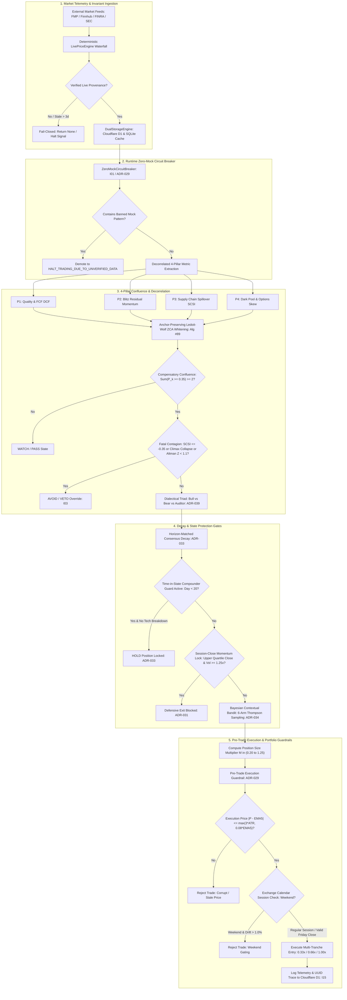

---

### 5.4 Production Verification Harnesses & Invariant Test Suites

To verify the operational integrity of these quantitative and invariant governance mechanisms, production engineering harnesses must execute rigorous state-space stress tests under socket isolation.

#### 5.4.1 End-to-End Invariant Verification Harness
The following standalone test harness executes the core invariant checks under hermetic test isolation:

```python
"""
tests/unit/test_production_invariant_harness.py
Verification harness for Invariants I02, I06, I09, and Deflated Sharpe Ratio.
"""
import pytest
import sqlite3
import numpy as np
from pathlib import Path
from src.v3.analytics.execution_guardrails import (
    calculate_ema,
    calculate_approx_atr,
    validate_execution_price,
)
from src.v3.analytics.d1_parameter_calibrator import calculate_deflated_sharpe_ratio
from src.v3.math.zca_whitening import zca_whiten_four_pillars, evaluate_zca_whitening_metrics

def test_invariant_i02_execution_guardrail_plausibility(tmp_path: Path):
    """Asserts I02: Execution price deviation outside max(3*ATR, 0.08*EMA5) is rejected."""
    db_file = tmp_path / "test_prices.db"
    with sqlite3.connect(db_file) as conn:
        conn.execute(
            "CREATE TABLE daily_prices (date DATE, ticker VARCHAR(10), close REAL, PRIMARY KEY (date, ticker))"
        )
        # Seed 5 daily bars around NVDA $218.0 (EMA5 ~ 218.0, ATR14 ~ 4.0 -> Band ~ 17.44)
        for dt, cl in [
            ("2026-09-07", 215.0), ("2026-09-08", 216.5), ("2026-09-09", 217.0),
            ("2026-09-10", 218.0), ("2026-09-11", 218.29)
        ]:
            conn.execute("INSERT INTO daily_prices VALUES (?, 'NVDA', ?)", (dt, cl))
        conn.commit()

    # Valid execution inside band ($219.0 vs EMA5 $218.0)
    valid_res = validate_execution_price(
        ticker="NVDA", price=219.0, db_path=db_file, timestamp_str="2026-09-11T14:30:00Z"
    )
    assert valid_res["is_valid"] is True
    assert len(valid_res["issues"]) == 0

    # Corrupt execution outside band ($280.0 deviates > 28%)
    invalid_res = validate_execution_price(
        ticker="NVDA", price=280.0, db_path=db_file, timestamp_str="2026-09-11T14:30:00Z"
    )
    assert invalid_res["is_valid"] is False
    assert any("exceeding maximum" in issue for issue in invalid_res["issues"])

def test_invariant_i09_compensatory_confluence_logic():
    """Asserts I09: 2 of 4 orthogonal pillars >= 0.35 unblocks BUY consideration."""
    # Setup 1: High Quality (0.80) + High Flow (0.50), Flat Kinematics (0.10) & Diffusion (0.05)
    pillars_pass = np.array([0.80, 0.50, 0.10, 0.05])
    confluence_count = np.sum(pillars_pass >= 0.35)
    assert confluence_count >= 2  # Passes 2-of-4 confluence
    
    # Setup 2: Single hyper-metric (0.95 Quality), but all others negative/flat
    pillars_fail = np.array([0.95, 0.20, -0.10, 0.00])
    confluence_fail_count = np.sum(pillars_fail >= 0.35)
    assert confluence_fail_count < 2  # Blocked by anti-single-metric rule

def test_deflated_sharpe_ratio_p_hacking_defense():
    """Asserts DSR deflates nominal Sharpe ratio when multiple trials are evaluated."""
    nominal_sr = 1.40
    n_obs = 252  # 1 year daily
    
    # Single trial without selection bias (evaluates to dsr_single = 1.0000)
    dsr_single = calculate_deflated_sharpe_ratio(
        estimated_sharpe=nominal_sr, n_observations=n_obs, n_trials=1, variance_trials=0.0
    )
    assert dsr_single > 0.99  # Highly significant
    
    # 500 trials with variance = 0.25 (P-hacking grid search: Z = -1.42, dsr_mult = 0.0776)
    dsr_mult = calculate_deflated_sharpe_ratio(
        estimated_sharpe=nominal_sr, n_observations=n_obs, n_trials=500, variance_trials=0.25
    )
    # Selection bias correctly deflates confidence
    assert dsr_mult < dsr_single
    assert dsr_mult < 0.90  # Correctly identifies high risk of overfitted false discovery (0.0776 < 0.90)
```

By coupling programmatic AST static analysis, runtime socket isolation, compensatory multi-pillar vector math, and statistical deflation engines, the autonomous quant framework operates as a self-auditing, epistemically robust production intelligence capable of compounding capital while strictly defending against existential drawdown.

---

## Concluding Epilogue: The Autonomous Production Quant Invariant

The fundamental lesson derived from the evolution of StockAnalysis V3 is that **autonomous artificial intelligence cannot be trusted to allocate financial capital without deterministic, mathematically provable constraints**.

The seductive promise of modern LLMs—their fluent conversational prose, rapid code synthesis, and seemingly omniscient domain recall—masks an inherent architectural pathology: they are probabilistic autoregressive sequence predictors designed to minimize token surprise, not capital risk. When unconstrained, their "pleasing bias" manufactures synthetic constants, their attention heads disperse critical risk invariants across long contexts, their subagent swarms succumb to catastrophic confirmation bias, and their optimizers fall victim to selection bias and overfitting.

To engineer a truly autonomous, enduring quantitative intelligence, the system must be constructed with epistemic humility and architectural rigor:
- **Structural Bounds**: The transformer context window must be protected via strict modular bounds (ADR-016 400 LOC ceiling), surgical 80-line view slices, AST registries, and living context compilers that eliminate the "Lost in the Middle" attention degradation valley.
- **Epistemic Firewalls**: The cognitive engine must be air-gapped from narrative pollution (ADR-030), stripped of commercial funnel hype ($W_{\text{commercial}} = 0.20$), and organized into dialectical adversarial triads (Bull, Bear, Auditor per ADR-039) where consensus is mathematically arbitrated by convex solvers.
- **Zero-Mock Defenses**: Runtime execution must adhere to the Absolute Zero Simulated Data Mandate (Rule 5 / ADR-029). Every metric must carry immutable provenance citations, verified by AST scanners (ZM001–ZM007), gated by pre-trade plausibility bands ($|P_{\text{exec}} - \text{EMA}_5| \le \max(3\text{ATR}_{14}, 0.08\text{EMA}_5)$), and resolved via fail-closed waterfalls.
- **Invariant Governance**: Testing must evolve from naive unit tests to hermetic, socket-isolated invariant suites that enforce 22 bedrock invariant anchors ($I_{01}-I_{22}$), compensatory multi-pillar confluence (ADR-024) to avoid gate paralysis, horizon-matched decay (ADR-033), and Deflated Sharpe Ratio validation to guard against P-hacking.

When these four disciplines converge into an integrated architecture, the result is not merely an automated trading bot, but an institutional-grade, self-auditing quantitative operating system—resilient to market shocks, immune to cognitive delusion, and mathematically engineered to compound capital across market cycles.

